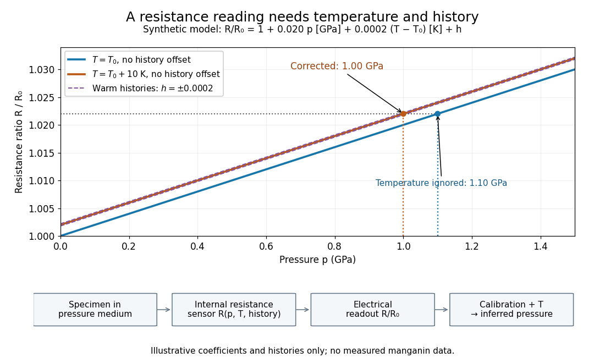

# Resistance pressure gauge

↑ **Parent:** [Pressure calibration](pressure-calibration.md)

A [resistance pressure gauge](resistance-pressure-gauge.md) is a [pressure sensor](pressure-sensor.md) whose [electrical resistance](electrical-resistance.md) is calibrated against [pressure](pressure-split.md). Even a simple local response needs both [pressure](pressure-split.md) and [temperature](temperature-split.md). For an original illustrative model define

$$
y=\frac{R}{R_0}-1=\alpha p+\beta(T-T_0)+h,\qquad
p=\frac{y-\beta(T-T_0)-h}{\alpha},
$$

where $R_0$ is the reference [electrical resistance](electrical-resistance.md) at $p=0$, $T=T_0$, and zero history offset. The [derivatives](derivative.md) $\alpha$ and $\beta$ are local sensitivities with units $\mathrm{Pa^{-1}}$ and $\mathrm{K^{-1}}$, respectively; $h$ is a dimensionless history offset. Constant sensitivities are an approximation over a chosen range, not material constants valid at every [pressure](pressure-split.md).

Choose synthetic coefficients $\alpha=0.020\,\mathrm{GPa^{-1}}$ and $\beta=2.0\times10^{-4}\,\mathrm{K^{-1}}$, with $T-T_0=10\,\mathrm K$ and $h=0$. A measured ratio $R/R_0=1.022$ then gives $p=(0.022-0.002)/0.020=1.00\,\mathrm{GPa}$. Ignoring the [temperature](temperature-split.md) change gives $1.10\,\mathrm{GPa}$, a $0.10\,\mathrm{GPa}$ error. This model is deliberately stipulated; these numbers are not measured [manganin](manganin.md) coefficients or Bridgman's data.

**[Figure 8](#image-pressure-calibration-a-synthetic-electrical-resistance-response-with-temperature-and-hysteresis-offsets). Pressure calibration: a synthetic electrical resistance response with temperature and hysteresis offsets**. Original calculated example. The blue reference line has $T=T_0$, $h=0$; the orange line has $T-T_0=10\,\mathrm K$, $h=0$. Dashed lines illustrate two histories with $h=\pm0.0002$, not observed data. A ratio 1.022 maps to 1.00 GPa after correcting [temperature](temperature-split.md), or 1.10 GPa if read against the blue line. The lower chain distinguishes the specimen, the internal sensor, the electrical readout and the calibrated [pressure](pressure-split.md).

If two histories differ by $\Delta h=0.0004$, their outputs at the same [pressure](pressure-split.md) differ by $0.0004R_0$; interpreting both with a single history-free curve gives an apparent [pressure](pressure-split.md) separation $\Delta h/\alpha=0.020\,\mathrm{GPa}$. The half separation is $0.010\,\mathrm{GPa}$. Reversing the drive can additionally cause mechanical [friction](friction.md) [hysteresis](hysteresis.md), independently of this sensor model. Record both the electrical calibration history and the loading direction.

For independent small standard [measurement uncertainties](measurement-uncertainty.md) $u_y,u_T,u_h$ and exact stipulated $\alpha,\beta$, first-order propagation gives

$$
u_p^2=\frac{u_y^2+\beta^2u_T^2+u_h^2}{\alpha^2}.
$$

For $u_y=10^{-4}$, $u_T=0.5\,\mathrm K$, and $u_h=10^{-4}$, this is $u_p=0.00866\,\mathrm{GPa}$. Real calibration also includes coefficient [measurement uncertainties](measurement-uncertainty.md), correlations, reference-point [measurement uncertainty](measurement-uncertainty.md), and any unresolved nonhydrostatic loading. A sensor calibrates its local environment; it cannot by itself certify the absence of [deviatoric stress](deviatoric-stress.md) throughout the sample.

## ↑ Ancestors (9)

1. [Pressure calibration](pressure-calibration.md)
2. [High-pressure experimental metrology](high-pressure-experimental-metrology.md)
3. [Pressure measurement](pressure-measurement.md)
4. [Pressure](pressure-split.md)
5. [Thermodynamics](thermodynamics-split.md)
6. [Statistical physics](statistical-physics-split.md)
7. [Branches of physics](branches-of-physics.md)
8. [Physics](physics-split.md)
9. [Codex Wiki](split.md)

## ← Incoming links (2)

- [Piston-cylinder pressure apparatus](piston-cylinder-pressure-apparatus.md)
- [Resistance pressure gauge](resistance-pressure-gauge.md)
