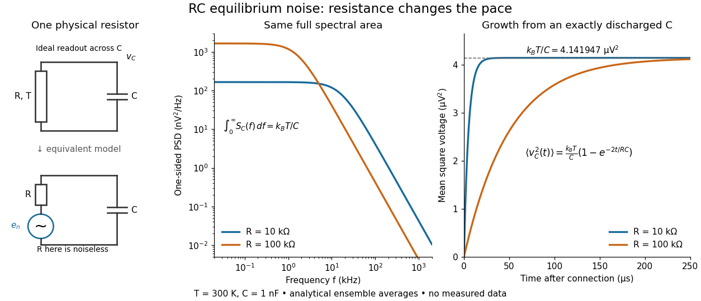

# Resistor-capacitor equilibrium noise

↑ **Parent:** [Thermal electrical noise](thermal-electrical-noise.md)

Connect one physical [resistor](resistor.md) $R$ across an ideal lossless [capacitor](capacitor.md) $C$, with no applied source and an ideal readout that draws no [electric current](electric-current.md). Represent the [resistor](resistor.md) by its noisy [Thévenin equivalent](thevenin-equivalent.md). The resulting [RC low-pass frequency response](rc-low-pass-frequency-response.md) gives the stationary [capacitor](capacitor.md) voltage [power spectral density](power-spectral-density.md)

$$
S_C^{(1)}(f)=\frac{4k_{\rm B}TR}{1+(2\pi fRC)^2}.
$$

Its mean square follows by the [effective noise bandwidth](effective-noise-bandwidth.md) calculation:

$$
\langle v_C^2\rangle=4k_{\rm B}TR\int_0^\infty\frac{df}{1+(2\pi fRC)^2}
=4k_{\rm B}TR\frac1{4RC}=\frac{k_{\rm B}T}{C}.
$$

This is also the [equipartition theorem](equipartition-theorem.md): the mean [capacitor energy](capacitor-energy.md) is $\tfrac12 C\langle v_C^2\rangle=\tfrac12 k_{\rm B}T$. Raising $R$ makes the low-[frequency](frequency.md) spectrum taller and its width narrower in exactly compensating proportions. It changes the equilibration time $RC$, not the final [variance](variance-split.md).

The integral to infinity belongs to the ideal classical model. For a physical [electrical circuit](electrical-circuit-split.md), assume [thermal equilibrium](thermal-equilibrium-split.md), linear components with negligible extra dissipation, and a corner far below the [frequencies](frequency.md) where parasitic effects, frequency-dependent [electrical resistance](electrical-resistance.md), or $hf\sim k_{\rm B}T$ invalidate the model; the omitted high-[frequency](frequency.md) tail must be negligible. A finite-bandwidth instrument measures only part of this [variance](variance-split.md). Its input [capacitance](capacitance.md) contributes to the total $C$, and its finite input [electrical resistance](electrical-resistance.md) introduces both loading and its own [thermal electrical noise](thermal-electrical-noise.md).

For $T=300\,\mathrm K$ and $C=1\,\mathrm{nF}$, the predicted equilibrium [variance](variance-split.md) is $4.141947\times10^{-12}\,\mathrm{V^2}$ and the [root mean square](root-mean-square.md) voltage is $2.0352\,\mu\mathrm V$. At $R=10\,\mathrm{k}\Omega$, $RC=10\,\mu\mathrm s$ and $B_{\rm n}=25\,\mathrm{kHz}$. At $R=100\,\mathrm{k}\Omega$, $RC=100\,\mu\mathrm s$ and $B_{\rm n}=2.5\,\mathrm{kHz}$; the equilibrium [root mean square](root-mean-square.md) voltage is identical.

**[Figure 19](#image-changing-electrical-resistance-changes-noise-timescales-but-preserves-k-rm-b-t-c). Changing electrical resistance changes noise timescales but preserves $k_{\rm B}T/C$**. Original calculated comparison at $T=300\,\mathrm K$ and $C=1\,\mathrm{nF}$. Left: the physical parallel [resistor](resistor.md) and [capacitor](capacitor.md) and their noisy [Thévenin equivalent](thevenin-equivalent.md). Middle: equilibrium one-sided voltage spectra for $10$ and $100\,\mathrm{k}\Omega$ have the same full integral. Right: mean square voltage grows toward the same equilibrium value from an exactly discharged initial [capacitor](capacitor.md). Curves describe ensemble [expected values](expected-value-split.md), not measured or simulated voltage traces.

To obtain the growth curve, prepare $v_C(0)=0$ exactly and connect the [resistor](resistor.md) at $t=0$ while maintaining its [temperature](temperature-split.md). The [RC low-pass filter](rc-low-pass-filter.md)'s causal [impulse response](impulse-response.md) is $h(t)=e^{-t/(RC)}/(RC)$ for $t\geq0$. Classical ideal [white noise](white-noise.md) with two-sided [power spectral density](power-spectral-density.md) $2k_{\rm B}TR$ gives

$$
\langle v_C(t)^2\rangle=2k_{\rm B}TR\int_0^t h(u)^2\,du
=\frac{k_{\rm B}T}{C}\left(1-e^{-2t/(RC)}\right).
$$

The factor $2k_{\rm B}TR$ here is the two-sided time-domain noise intensity; the equilibrium spectral integral above used the one-sided $4k_{\rm B}TR$. They give the same long-time limit. The [variance](variance-split.md) approaches equilibrium with [time constant](time-constant.md) $RC/2$, although a deterministic initial voltage decays with [time constant](time-constant.md) $RC$. If the [capacitor](capacitor.md) already starts in [thermal equilibrium](thermal-equilibrium-split.md), its initial [variance](variance-split.md) supplies the missing exponentially decaying term and the total [variance](variance-split.md) stays constant.

## ↑ Ancestors (6)

1. [Thermal electrical noise](thermal-electrical-noise.md)
2. [Noise (signal processing)](noise-signal-processing.md)
3. [Signal](signal.md)
4. [Signal processing](signal-processing.md)
5. [Electrical engineering](electrical-engineering-split.md)
6. [Codex Wiki](split.md)
