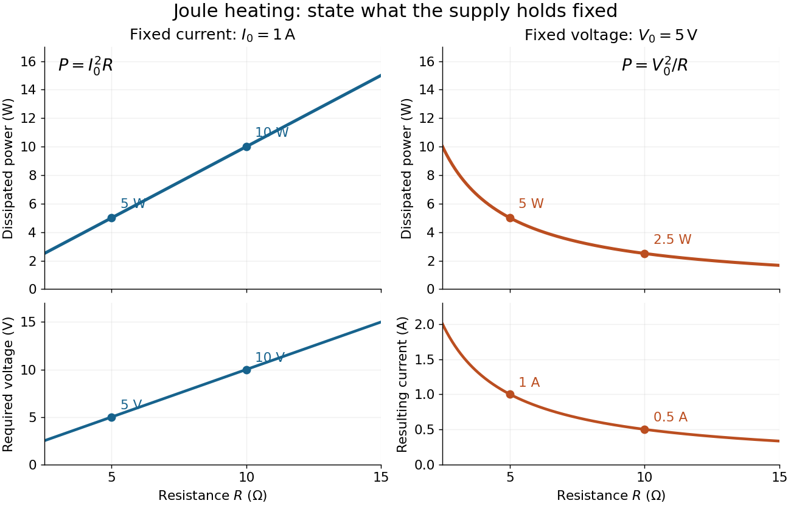

# Resistor power under fixed drive

↑ **Parent:** [Joule heating](joule-heating.md)

Whether increasing [electrical resistance](electrical-resistance.md) increases [Joule heating](joule-heating.md) depends on what the supply holds fixed. Consider separate ideal [resistor](resistor.md) experiments with $R=5\,\Omega$ and $R=10\,\Omega$, each maintained at its specified [temperature](temperature-split.md). At fixed [electric current](electric-current.md) $I_0=1\,\mathrm A$, doubling $R$ changes the required [electric potential difference](electric-potential-difference.md) from $5$ to $10\,\mathrm V$ and doubles [power](power.md) from $5$ to $10\,\mathrm W$. At fixed [electric potential difference](electric-potential-difference.md) $V_0=5\,\mathrm V$, doubling $R$ halves [electric current](electric-current.md) from $1$ to $0.5\,\mathrm A$ and halves [power](power.md) from $5$ to $2.5\,\mathrm W$. These are stipulated model values, not measured data.

**[Figure 16](#joule-heating-fixed-current-fixed-voltage). Increasing electrical resistance has opposite effects on Joule heating under fixed electric current and fixed electric potential difference**. Original calculated comparisons, with $I_0=1\,\mathrm A$ on the left and $V_0=5\,\mathrm V$ on the right. The marked $5$ and $10\,\Omega$ cases are separate ideal experiments. Each lower panel shows the companion quantity that changes when the supply holds the other quantity fixed.

The comparison also predicts feedback when a particular [resistor](resistor.md)'s [electrical resistance](electrical-resistance.md) rises with [temperature](temperature-split.md): a supply maintaining [electric current](electric-current.md) increases its heating [power](power.md), whereas one maintaining terminal [electric potential difference](electric-potential-difference.md) reduces it. Predicting the actual [temperature](temperature-split.md) still needs the material response $R(T)$ and its [heat transfer](heat-transfer.md) to the surroundings; a nominal supply setting does not establish which drive is actually constant at the [resistor](resistor.md).

## ↑ Ancestors (10)

1. [Joule heating](joule-heating.md)
2. [Ohm's law](ohm-s-law.md)
3. [Electrical resistance](electrical-resistance.md)
4. [Electrical resistance and conductance](electrical-resistance-and-conductance.md)
5. [Electric current](electric-current.md)
6. [Electric charge](electric-charge-split.md)
7. [Electromagnetism](electromagnetism-split.md)
8. [Branches of physics](branches-of-physics.md)
9. [Physics](physics-split.md)
10. [Codex Wiki](split.md)
