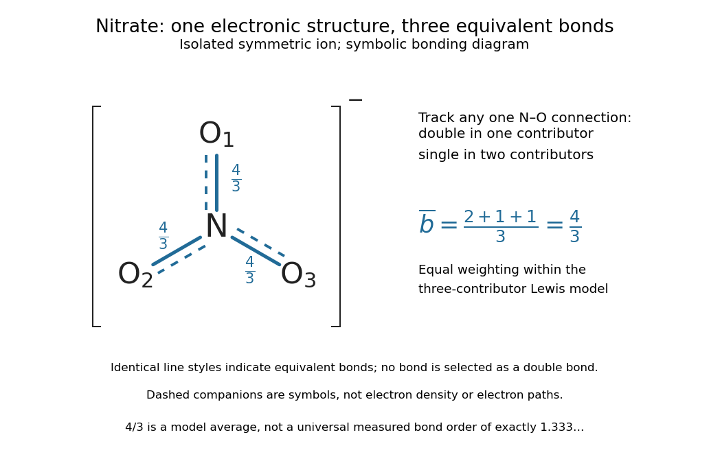

# Resonance (chemistry)

↑ **Parent:** [Lewis structure](lewis-structure.md)  
ⓦ [Wiki](https://en.wikipedia.org/wiki/Resonance_(chemistry))

A single [nitrate](nitrate.md) [Lewis structure](lewis-structure.md) singles out one N=O connection, yet the three N–O [chemical bonds](chemical-bond-split.md) of the isolated symmetric [ion](ion.md) are equivalent. [Chemical resonance](resonance-chemistry.md) reconciles that symmetry with the integer [electron pair](electron-pair.md) allocations of a [Lewis structure](lewis-structure.md). The equal [chemical bond](chemical-bond-split.md) lengths in [nitrate](nitrate.md) are discussed in [The Open University, Discovering chemistry: resonance structures](https://www.open.edu/openlearn/mod/oucontent/view.php?id=87848&section=_unit5.2).

[Chemical resonance](resonance-chemistry.md) uses several [Lewis structures](lewis-structure.md) with the same [chemical atom](atom-physics.md) connections and total [electric charge](electric-charge-split.md) to describe electronic structure that one allocation cannot fully express. The [chemical atoms](atom-physics.md) stay in place; the positions of [bond pairs](bond-pair.md), [lone pairs](lone-pair.md), and [formal charges](formal-charge.md) differ between drawings. A two-headed arrow $\leftrightarrow$ connects the drawings and is distinct from a [chemical equilibrium](chemical-equilibrium.md) arrow $\rightleftharpoons$. See the [IUPAC Gold Book, resonance form](https://goldbook.iupac.org/terms/view/08205).

In each [nitrate](nitrate.md) [resonance structure](resonance-structure.md), use the existing [formal charge](formal-charge.md) convention $\mathrm{FC}=v-n-b/2$:

$$
\begin{aligned}
\mathrm{FC}(\mathrm N)&=5-0-8/2=+1,\\
\mathrm{FC}(\text{singly connected O})&=6-6-2/2=-1,\\
\mathrm{FC}(\text{doubly connected O})&=6-4-4/2=0.
\end{aligned}
$$

Here $v$ counts neutral-[chemical atom](atom-physics.md) [valence electrons](valence-electron.md), $n$ counts nonbonding [electrons](electron.md), and $b$ counts incident bonding [electrons](electron.md). The sum is $+1-1-1+0=-1$, agreeing with the [nitrate ion](nitrate.md)'s net [electric charge](electric-charge-split.md). The [formal charge](formal-charge.md) rules and their distinction from actual atomic [electric charge](electric-charge-split.md) are given in [Flowers et al., Chemistry 2e, 7.4: formal charges and resonance](https://openstax.org/books/chemistry-2e/pages/7-4-formal-charges-and-resonance).

Keep one labelled [oxygen](oxygen.md) fixed while reading the three [nitrate](nitrate.md) [resonance structures](resonance-structure.md). Its connection is double in one drawing and single in two. Equal weighting within this three-contributor [Lewis structure](lewis-structure.md) model gives the average [bond order](bond-order.md)

$$
\overline b_{\mathrm{N-O}}=\frac{2+1+1}{3}=\frac43.
$$

The same calculation applies to all three N–O connections. Averaging the drawn [formal charges](formal-charge.md) similarly gives $-2/3$ per [oxygen](oxygen.md), while [nitrogen](nitrogen.md) retains $+1$; $+1+3(-2/3)=-1$. These fractions summarize the chosen contributors. They are not a measurement of [partial atomic charge](partial-atomic-charge.md), a literal fraction of an [electron](electron.md) sitting on an [oxygen](oxygen.md), or time spent in one drawing.

**[Figure 9](#image-equivalent-n-o-chemical-bonds-in-symmetric-nitrate-the-equal-contributor-bond-order-count-is-4-3). Equivalent N–O chemical bonds in symmetric nitrate: the equal-contributor bond order count is $4/3$**. All three connections have the same graphical treatment. A solid line with a dashed companion is a schematic indication of shared multiple-[chemical bond](chemical-bond-split.md) character, not a plot of [electron density](electron-density.md) or a physical fractional line. The labels $4/3$ record an average within three octet [Lewis structures](lewis-structure.md); no universal, directly measured [bond order](bond-order.md) of exactly $1.333\ldots$ is asserted.

The [resonance hybrid](resonance-hybrid.md) has one spatially continuous [electron density](electron-density.md) extending over the [ion](ion.md). None of its N–O [chemical bonds](chemical-bond-split.md) is permanently selected as the double connection of one contributor. The dashed marks above are symbols; [electrons](electron.md) do not travel along them or make the marks float between [chemical atoms](atom-physics.md). For isolated symmetric [nitrate](nitrate.md), symmetry makes the three N–O [chemical bonds](chemical-bond-split.md) equivalent; an environment that distinguishes the [oxygen](oxygen.md) sites can remove that equivalence. The fraction $4/3$ alone predicts neither a [chemical bond](chemical-bond-split.md) length nor a dissociation [energy](energy-split.md). The general relation between multiple [chemical bonds](chemical-bond-split.md), lengths, and strengths is discussed in [7.5 Strengths of Ionic and Covalent Bonds](chemistry-2e-by-paul-flowers-and-others/7-5-strengths-of-ionic-and-covalent-bonds.md); its tabulated averages are not a nitrate-specific calibration of $4/3$.

[Ozone](ozone.md) provides a useful two-contributor comparison. Its $3\times6=18$ [valence electrons](valence-electron.md) give three [bond pairs](bond-pair.md) and six [lone pairs](lone-pair.md). One [resonance structure](resonance-structure.md) has a double O–O connection on the left and a single one on the right; the other reverses these allocations while retaining the same [chemical atom](atom-physics.md) positions and connections. The central [oxygen](oxygen.md) has one [lone pair](lone-pair.md) and [formal charge](formal-charge.md) $+1$; the singly connected terminal [oxygen](oxygen.md) has three [lone pairs](lone-pair.md) and [formal charge](formal-charge.md) $-1$; the doubly connected terminal [oxygen](oxygen.md) has two [lone pairs](lone-pair.md) and [formal charge](formal-charge.md) zero. Thus $6+12=18$ [electrons](electron.md) and zero net [electric charge](electric-charge-split.md) are conserved. The equal-contributor [bond order](bond-order.md) count is $(2+1)/2=3/2$ for either connection. See [MIT 5.111, lecture 10, pp. 4–5: ozone resonance structures](https://ocw.mit.edu/courses/5-111sc-principles-of-chemical-science-fall-2014/3549685d450773a066a716832634203f_MIT5_111F14_Lec10.pdf).

For [carbon dioxide](carbon-dioxide.md), $\mathrm{O=C=O}$ and $\mathrm{O^-{-}C\equiv O^+}$ share sixteen [valence electrons](valence-electron.md) and the same O–C–O connections. The mirror drawing $\mathrm{O^+\equiv C{-}O^-}$ is also possible. The two charge-separated drawings are equivalent to one another for an isolated symmetric [carbon dioxide](carbon-dioxide.md) [molecule](molecule-split.md), but neither is equally dominant with $\mathrm{O=C=O}$ in the elementary [formal charge](formal-charge.md) comparison.

[Chemical resonance](resonance-chemistry.md) does not mean that a [molecule](molecule-split.md) rapidly flips between drawings, nor that separate [molecules](molecule-split.md) at [chemical equilibrium](chemical-equilibrium.md) carry the individual drawings. The actual [electron density](electron-density.md) belongs to one combined electronic description. In a [quantum mechanics](quantum-mechanics-split.md) treatment, contributors enter a [linear combination](linear-combination.md) of many-[electron](electron.md) [wavefunctions](wave-function-split.md); a [molecular orbital](molecular-orbital.md) treatment can describe the extended electronic arrangement through [molecular orbitals](molecular-orbital.md). The drawings alone provide neither a measured density nor numerical weights. Their usefulness is to expose the limitations of one localized allocation without pretending that every algebraically allowed [Lewis structure](lewis-structure.md) contributes equally.

**Table of contents**

- [Resonance donation](resonance-donation.md)
- [Resonance structure](resonance-structure.md)
- [Resonance hybrid](resonance-hybrid.md)

## ↑ Ancestors (5)

1. [Lewis structure](lewis-structure.md)
2. [Covalent bond](covalent-bond-split.md)
3. [Chemical bond](chemical-bond-split.md)
4. [Chemistry](chemistry-split.md)
5. [Codex Wiki](split.md)

## ← Incoming links (2)

- [Hückel's rule](huckel-s-rule.md)
- [Structure of xanthone by Shigeki Onuma and others](structure-of-xanthone-by-shigeki-onuma-and-others.md)
