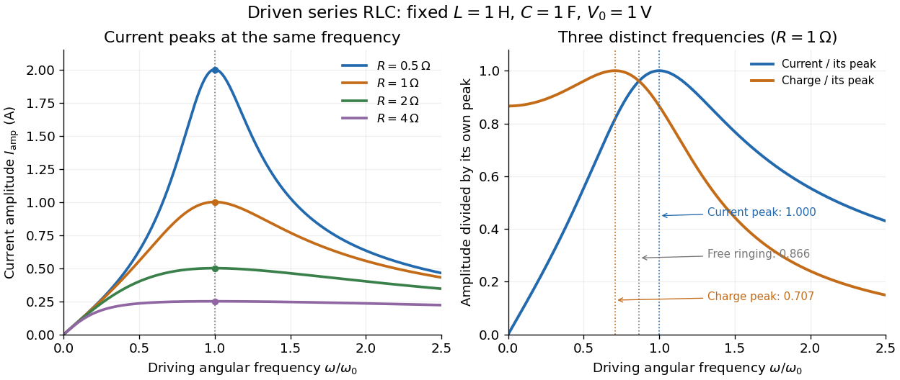

# Resonant series RLC response

↑ **Parent:** [Series RLC circuit](series-rlc-circuit.md)

Drive a [series RLC circuit](series-rlc-circuit.md) with [electric potential difference](electric-potential-difference.md) $V(t)=V_0\cos(\omega t)$, where $V_0>0$ and $\omega>0$. After the free transient decays, the [electric current](electric-current.md) has the same [angular frequency](angular-frequency.md) as the source:

$$
i_{\mathrm{ss}}(t)=I_{\mathrm{amp}}\cos(\omega t-\phi),\qquad
I_{\mathrm{amp}}(\omega)=\frac{V_0}{\sqrt{R^2+(\omega L-1/(\omega C))^2}},\qquad
\tan\phi=\frac{\omega L-1/(\omega C)}{R},\quad -\frac\pi2<\phi<\frac\pi2.
$$

For fixed positive $R,L,C,V_0$, the [electric current](electric-current.md) [amplitude](wave-amplitude.md) is largest exactly at $\omega=\omega_0=1/\sqrt{LC}$. The two [electrical reactance](electrical-reactance.md) contributions cancel there, leaving only the drop from [electrical resistance](electrical-resistance.md). In particular,

$$
i_{\mathrm{ss}}(t)=\frac{V_0}{R}\cos(\omega_0t),\qquad
q_{\mathrm{ss}}(t)=\frac{V_0}{R\omega_0}\sin(\omega_0t).
$$

Every solution approaches this periodic response because its difference from the displayed solution is a decaying free response. The peak remains at $\omega_0$ even for an [overdamped RLC response](overdamped-rlc-response.md); free ringing is not required for a maximum of driven [electric current](electric-current.md). [OpenStax University Physics 2, §15.3: current amplitude, phase, and resonance](https://openstax.org/books/university-physics-volume-2/pages/15-3-rlc-series-circuits-with-ac).

For example, stipulate $L=10\,\mathrm{mH}$, $C=1\,\mu\mathrm F$, $R=20\,\Omega$, and $V_0=1\,\mathrm V$. Then $\omega_0=10^4\,\mathrm{s}^{-1}$, $f_0=\omega_0/(2\pi)\approx1591.55\,\mathrm{Hz}$, and the peak [electric current](electric-current.md) [amplitude](wave-amplitude.md) is $50\,\mathrm{mA}$. Holding the source [amplitude](wave-amplitude.md) fixed is essential when comparing responses at different [frequencies](frequency.md).

**[Figure 7](#image-driven-electric-current-resonance-and-the-distinct-electric-charge-peak). Driven electric current resonance and the distinct electric charge peak**. Left: fixed $L=1\,\mathrm H$, $C=1\,\mathrm F$, $V_0=1\,\mathrm V$, with positive $R=0.5,1,2,4\,\Omega$. Right: at $R=1\,\Omega$, the charge-amplitude peak, free ringing frequency, and current-amplitude peak occur at $\omega/\omega_0\approx0.707,0.866,1$, respectively. Both driven curves are divided by their own peak amplitude.

Three [frequencies](frequency.md) must be distinguished. The free [underdamped RLC response](underdamped-rlc-response.md) rings at $\omega_d=\sqrt{\omega_0^2-\alpha^2}$. Driven [electric current](electric-current.md) peaks at $\omega_0$. Driven [electric charge](electric-charge.md) has [amplitude](wave-amplitude.md)

$$
q_{\mathrm{amp}}(\omega)=\frac{I_{\mathrm{amp}}(\omega)}{\omega}
=\frac{V_0/L}{\sqrt{(\omega_0^2-\omega^2)^2+4\alpha^2\omega^2}},
$$

whose peak occurs at $\sqrt{\omega_0^2-2\alpha^2}$ only if $\alpha<\omega_0/\sqrt2$. Otherwise it decreases from its zero-frequency limit $CV_0$, with no positive-frequency peak. The different peak locations follow because [electric current](electric-current.md) is the time [derivative](derivative.md) of [electric charge](electric-charge.md), multiplying a sinusoidal [amplitude](wave-amplitude.md) by $\omega$. The limiting responses are $I_{\mathrm{amp}}\sim V_0C\omega$ as $\omega\to0^+$ and $I_{\mathrm{amp}}\sim V_0/(L\omega)$ as $\omega\to\infty$.

The [Q factor](q-factor.md) measures selectivity:

$$
Q=\frac{L\omega_0}{R}=\frac{\omega_0}{2\alpha}.
$$

The average [Joule heating](joule-heating.md) [power](power.md) is $RI_{\mathrm{amp}}^2/2$. Its half-maximum [angular frequencies](angular-frequency.md) and their separation are exactly

$$
\omega_\pm=\sqrt{\omega_0^2+\alpha^2}\pm\alpha,\qquad
\Delta\omega=\omega_+-\omega_-=2\alpha=\frac RL=\frac{\omega_0}{Q}.
$$

These follow by setting $|\omega L-1/(\omega C)|=R$. In the numerical example, $Q=5$ and $\Delta\omega=2000\,\mathrm{s}^{-1}$. Reducing $R$ makes a taller, narrower [electric current](electric-current.md) peak; varying $C$ tunes the selected [frequency](frequency.md). Measuring the drop $v_R=Ri$ gives a [band-pass filter](band-pass-filter.md) that suppresses very low and very high [frequencies](frequency.md) while passing a range near [resonance](resonance.md). This is useful for selecting a radio signal, though the range must be broad enough to pass its modulation. [Feynman lectures, II.22.7: resonant filters and radio sidebands](https://www.feynmanlectures.caltech.edu/II_22.html#Ch22-S7).

## ↑ Ancestors (7)

1. [Series RLC circuit](series-rlc-circuit.md)
2. [RLC circuit](rlc-circuit.md)
3. [Electrical circuit](electrical-circuit.md)
4. [Electromagnetism](electromagnetism-split.md)
5. [Branches of physics](branches-of-physics.md)
6. [Physics](physics-split.md)
7. [Codex Wiki](split.md)

## ← Incoming links (6)

- [Band-pass filter](band-pass-filter.md)
- [Electrical impedance](electrical-impedance.md)
- [Electrical reactance](electrical-reactance.md)
- [Solution](past-exam-of-the-mathematics-course-of-the-university-of-cambridge/2017/ia/paper-2/5c/c/i/solution.md)
- [Solution](past-exam-of-the-mathematics-course-of-the-university-of-cambridge/2017/ia/paper-2/5c/c/ii/solution.md)
- [RLC circuit](rlc-circuit.md)
