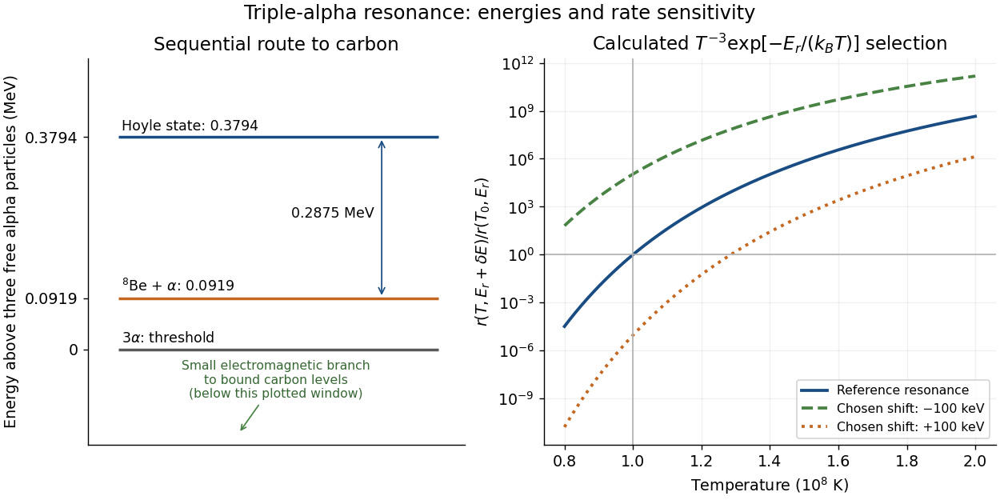

# Resonant triple-alpha temperature sensitivity

↑ **Parent:** [Fowler nuclear astrophysics](fowler-nuclear-astrophysics.md)

In a dilute thermal [helium](helium.md) gas with rapid formation–decay balance of [beryllium-8](beryllium-8.md), write its small equilibrium abundance schematically as $n_8\propto n_\alpha^2T^{-3/2}\exp[-\Delta_8/(k_BT)]$. A narrow isolated [Hoyle state](hoyle-state.md) gives a second-step coefficient proportional to $T^{-3/2}\exp[-\Delta_C/(k_BT)]$. Multiplication yields

$$
r_{3\alpha}\propto n_\alpha^3T^{-3}\exp\left[-\frac{E_r}{k_BT}\right],\qquad E_r=\Delta_8+\Delta_C,
$$

with the stabilizing decay strength absorbed into the coefficient. Here $k_B$ is the [Boltzmann constant](boltzmann-constant.md). The two positive offsets count [energy](energy-split.md) relative to their respective entrance thresholds, not relative to the [carbon-12](carbon-12.md) [ground state](ground-state.md). A resonance enhances capture at the relevant [energy](energy-split.md); the [Boltzmann factor](boltzmann-factor.md) still selects how many encounters reach it. This is a sequential narrow-level approximation with fixed nuclear widths, excluding [plasma screening](plasma-screening.md) and changes of composition or [mass density](density.md).

[William Alfred Fowler](william-alfred-fowler.md) lists the [Hoyle state](hoyle-state.md) $7.654\,\mathrm{MeV}$ above the [carbon-12](carbon-12.md) [ground state](ground-state.md), $0.2875\,\mathrm{MeV}$ above [beryllium-8](beryllium-8.md) plus an [alpha particle](alpha-particle.md), and $0.3794\,\mathrm{MeV}$ above three [alpha particles](alpha-particle.md).[II, p. 179](experimental-and-theoretical-nuclear-astrophysics-the-quest-for-the-origin-of-the-elements-by-william-alfred-fowler.md) Subtraction gives $\Delta_8=0.0919\,\mathrm{MeV}$ for the diagram.

Normalize the calculated rate at $T_0=10^8\,\mathrm K$ and $E_r=0.3794\,\mathrm{MeV}$. Holding [alpha particle](alpha-particle.md) [number density](number-density.md) and the decay strength fixed gives the original sensitivity calculation

$$
\frac{r(T,E_r+\delta E)}{r(T_0,E_r)}
=\left(\frac{T}{T_0}\right)^{-3}
\exp\left[-\frac{E_r+\delta E}{k_BT}+\frac{E_r}{k_BT_0}\right].
$$

At $T_0$, a deliberately chosen shift $\delta E=+100\,\mathrm{keV}$ multiplies the rate by $9.12\times10^{-6}$; $-100\,\mathrm{keV}$ gives $1.10\times10^5$. These offsets are hypothetical perturbations, not alternative measured nuclear levels. The reference curve has [local temperature exponent of a thermonuclear reaction](local-temperature-exponent-of-a-thermonuclear-reaction.md) $-3+E_r/(k_BT_0)=41.03$: raising [temperature](temperature-split.md) by $10\%$ gives a factor $41.12$ in this fixed-environment calculation. A real [star](star.md) changes its [stellar structure](stellar-structure-split.md) and composition as it burns, so these factors do not directly predict final [carbon](carbon.md) abundance or a constraint on life.

**[Figure 3](#image-triple-alpha-energy-thresholds-and-calculated-resonance-sensitivity). Triple-alpha energy thresholds and calculated resonance sensitivity**. Original energy bookkeeping using Fowler's rounded offsets (1983 lecture, p. 179). The normalized narrow-resonance rate calculation holds alpha density and decay strength fixed. The plus/minus 100 keV shifts are deliberately chosen sensitivity tests. No plotted curve is laboratory data. Bound carbon levels lie below the diagram's energy window; the downward arrow indicates stabilization rather than a measured lifetime or branching fraction.

## ↑ Ancestors (7)

1. [Fowler nuclear astrophysics](fowler-nuclear-astrophysics.md)
2. [Stellar nuclear fusion](stellar-nuclear-fusion.md)
3. [Stellar astrophysics](stellar-astrophysics-split.md)
4. [Astrophysics](astrophysics-split.md)
5. [Branches of physics](branches-of-physics.md)
6. [Physics](physics-split.md)
7. [Codex Wiki](split.md)

## ← Incoming links (1)

- [Triple-alpha process](triple-alpha-process.md)
