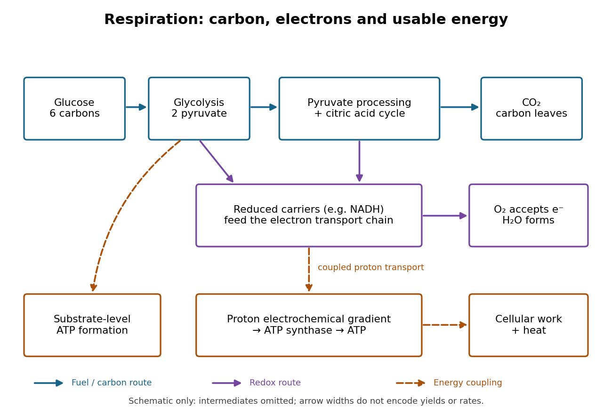

# Respiration and ATP coupling

↑ **Parent:** [Aerobic respiration](aerobic-respiration.md)

[Glycolysis](glycolysis.md) converts [glucose](glucose.md) into two [pyruvate](pyruvate.md) [molecules](molecule-split.md), with a net two [ATP](adenosine-triphosphate.md) and reduced [NADH](nadh.md); it does not directly consume [molecular oxygen](molecular-oxygen.md). [Pyruvate](pyruvate.md) processing and the [citric acid cycle](citric-acid-cycle.md), also called the [TCA cycle](citric-acid-cycle.md), release [carbon dioxide](carbon-dioxide.md) and supply reduced carriers. Thus releasing [carbon dioxide](carbon-dioxide.md) and consuming [molecular oxygen](molecular-oxygen.md) occur at different stages.[Biology 2e, §7.2, Outcomes of Glycolysis; §7.3, Breakdown of Pyruvate and Citric Acid Cycle](biology-2e-by-mary-ann-clark-and-others.md)

**[Figure 34](#image-cellular-respiration-separate-carbon-electron-and-energy-accounts). Cellular respiration: separate carbon, electron and energy accounts**. Original pathway schematic. Blue arrows trace the fuel pathway and [carbon dioxide](carbon-dioxide.md) release; purple arrows indicate reduced-carrier delivery and terminal [molecular oxygen](molecular-oxygen.md) [reduction](reduction-chemistry.md); orange dashed arrows denote [energy coupling](energy-coupling.md). Carrier chemistry and intermediate steps are abbreviated. Arrow widths encode no rates or yields.

An [electron transport chain](electron-transport-chain.md) reoxidizes carriers such as [NADH](nadh.md). Coupling some of its [redox](redox.md) steps to [proton](proton.md) transport establishes an [electrochemical gradient](electrochemical-gradient.md); [ATP synthase](atp-synthase.md) can use that gradient to form [ATP](adenosine-triphosphate.md) from [adenosine diphosphate](adenosine-diphosphate.md) and [inorganic phosphate](inorganic-phosphate.md). This is [oxidative phosphorylation](oxidative-phosphorylation.md). A separate route, [substrate-level phosphorylation](substrate-level-phosphorylation.md), transfers a [phosphate](phosphate.md) group from a reacting [substrate](substrate-biochemistry.md) to [adenosine diphosphate](adenosine-diphosphate.md). In typical [eukaryotic](eukaryote.md) [biological cells](biological-cell-split.md), the respiratory chain occupies the inner membrane of a [mitochondrion](mitochondria.md).[Biology 2e, §7.1, Substrate Phosphorylation; §7.4, Electron Transport Chain and Chemiosmosis, Figures 7.12–7.14](biology-2e-by-mary-ann-clark-and-others.md)

The useful achievement is controlled transfer: fuel [oxidation](oxidation.md) can replenish an [ATP](adenosine-triphosphate.md) supply that supports [active transport](active-transport.md) and synthesis. [ATP](adenosine-triphosphate.md) is a reusable chemical carrier, not newly created [energy](energy-split.md); [ATP](adenosine-triphosphate.md) [hydrolysis](hydrolysis.md) and the coupled cellular process have their own net [free energy](thermodynamic-free-energy.md) balance. Some fuel [energy](energy-split.md) is dissipated as [heat](heat-split.md).[Biology 2e, §7.1, ATP in Living Systems and Energy from ATP; §7.4, ATP Yield](biology-2e-by-mary-ann-clark-and-others.md)

There is no universal yield of $36$ or $38$ [ATP](adenosine-triphosphate.md) per [glucose](glucose.md). Actual [ATP](adenosine-triphosphate.md) recovery depends on carrier transfer routes, coupling and diversion of intermediates to other [metabolism](metabolism.md). In particular, an [oxygen](oxygen.md) uptake rate cannot be converted into an [ATP](adenosine-triphosphate.md) production rate by assuming one fixed multiplier.[Biology 2e, §7.4, ATP Yield: shuttle differences and use of intermediates](biology-2e-by-mary-ann-clark-and-others.md)

## ↑ Ancestors (5)

1. [Aerobic respiration](aerobic-respiration.md)
2. [Cellular respiration](cellular-respiration.md)
3. [Metabolism](metabolism.md)
4. [Biology](biology-split.md)
5. [Codex Wiki](split.md)
