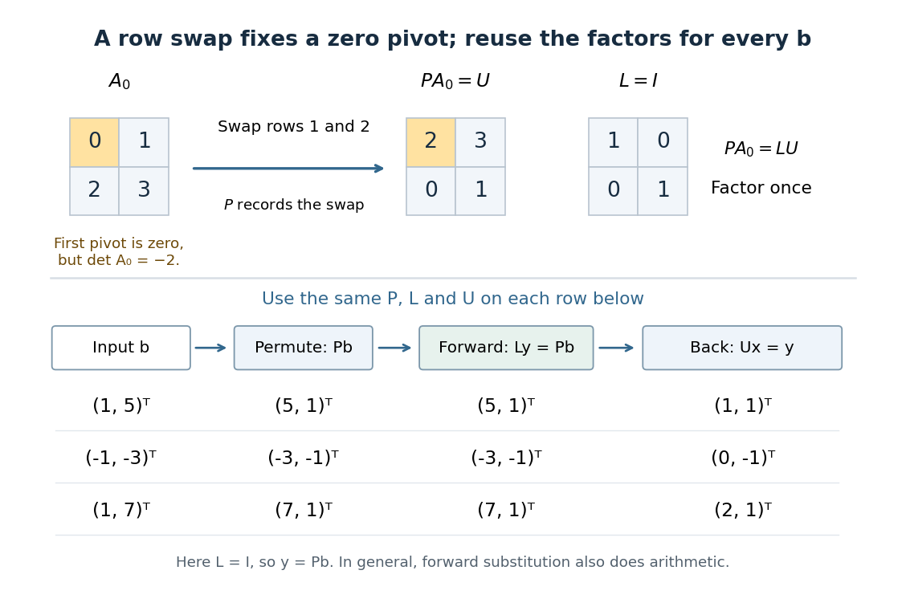

# Reusing LU factors for multiple right-hand sides

↑ **Parent:** [LU decomposition](lu-decomposition.md)

When a fixed [matrix](matrix.md) $A$ is used with several forcing or measurement [vectors](vector.md), compute its [Pivoted LU decomposition](pivoted-lu-decomposition.md) once. Collect $r$ right-hand sides into the columns of $B=(b^{(1)}\ \cdots\ b^{(r)})$, and the corresponding solutions into $X$. Then

$$
AX=B,\qquad LY=PB,\qquad UX=Y.
$$

Each column undergoes the same row permutation, [forward substitution](forward-substitution.md) and [back substitution](back-substitution.md). Neither $L$, $U$ nor $P$ depends on $B$. This is the useful separation between preparing a [linear system](system-of-linear-equations.md) and applying its solution procedure repeatedly. LAPACK implements it by taking previously computed factors, permuting all right-hand sides, and performing the two triangular solves.[LAPACK DGETRS, version 3.3.1, April 2011, Purpose, NRHS and B arguments, and nontransposed branch: DLASWP followed by lower-unit and upper-nonunit DTRSM calls](dgetrs-lapack-3-3-1-by-lapack-project.md)

For the unpivoted factors in [Computed three-by-three LU decomposition](computed-three-by-three-lu-decomposition.md), take

$$
B=\begin{pmatrix}7&0&4\\23&2&6\\26&4&-8\end{pmatrix},\qquad Y=\begin{pmatrix}7&0&4\\9&2&-2\\6&-2&2\end{pmatrix},\qquad X=\begin{pmatrix}1&0&2\\2&1&-1\\3&-1&1\end{pmatrix}.
$$

Direct [matrix multiplication](matrix-multiplication.md) checks all three identities $LY=B$, $UX=Y$ and $AX=B$. The first column reproduces the previous solve; the other two use exactly the same factors. New right-hand sides can also arrive one at a time. If $A$ changes, these stored factors generally need to be recomputed.

**[Figure 43](#image-one-row-permutation-fixes-a-zero-pivot-element-each-new-right-hand-side-reuses-the-same-lu-decomposition-and-two-triangular-solves). One row permutation fixes a zero pivot element; each new right-hand side reuses the same LU decomposition and two triangular solves**.

## ↑ Ancestors (7)

1. [LU decomposition](lu-decomposition.md)
2. [Numerical linear algebra](numerical-linear-algebra.md)
3. [Numerical analysis](numerical-analysis-split.md)
4. [Analysis](analysis-split.md)
5. [Area of mathematics](area-of-mathematics.md)
6. [Mathematics](mathematics-split.md)
7. [Codex Wiki](split.md)

## ← Incoming links (3)

- [LU decomposition](lu-decomposition.md)
- [LU factorization and solve costs](lu-factorization-and-solve-costs.md)
- [Tridiagonal solve costs](tridiagonal-solve-costs.md)
