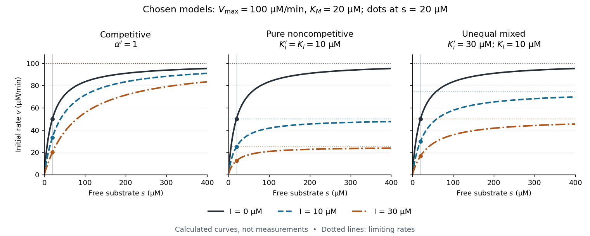

# Reversible enzyme inhibition

↑ **Parent:** [Enzyme inhibitor](enzyme-inhibitor.md)

Construct a minimal model with one [substrate](substrate-biochemistry.md) and no appreciable accumulated [reaction product](product-chemistry.md). Only the [enzyme-substrate complex](enzyme-substrate-complex.md) $ES$ produces product, with catalytic [rate constant](rate-constant.md) $k_{\rm cat}$; $EI$ and $ESI$ are inactive. Write $s=[S]$ and $I=[\mathrm I]$ for free [molar concentrations](molar-concentration.md), and $E_T$ for total [enzyme](enzyme-split.md) [molar concentration](molar-concentration.md). Assume a suitable [quasi-steady-state approximation](quasi-steady-state-approximation.md), rapid inhibitor binding and release relative to turnover, and negligible depletion of free inhibitor. In this construction the population relations are

$$
[ES]=[E]\frac{s}{K_M},\qquad
[EI]=[E]\frac{I}{K_i},\qquad
[ESI]=[ES]\frac{I}{K_i'},\qquad
\alpha=1+\frac{I}{K_i},\quad \alpha'=1+\frac{I}{K_i'}.
$$

Here $K_M$ is the uninhibited [Michaelis constant](michaelis-constant.md), and $K_i,K_i'$ are the [inhibition constants](inhibition-constant.md) for the two indicated binding branches. The symbol $I$ denotes a free [concentration](concentration.md), not an amount added to the tube. Define $V_{\max}=k_{\rm cat}E_T$. Conservation of [enzyme](enzyme-split.md) gives an original short derivation:

$$
\begin{aligned}
E_T&=[E]+[EI]+[ES]+[ESI]
=[E]\left(\alpha+\alpha'\frac{s}{K_M}\right),\\
v&=k_{\rm cat}[ES]
=\frac{V_{\max}s}{\alpha K_M+\alpha's}
=\frac{(V_{\max}/\alpha')s}{(\alpha/\alpha')K_M+s}.
\end{aligned}
$$

Thus fitting a [Michaelis-Menten equation](michaelis-menten-equation.md) at a fixed $I$ would return the apparent parameters

$$
V_{\max,\rm app}=\frac{V_{\max}}{\alpha'},\qquad
K_{M,\rm app}=\frac{\alpha}{\alpha'}K_M.
$$

“Apparent” means conditional on that inhibitor [concentration](concentration.md). The uninhibited [Michaelis constant](michaelis-constant.md) has not been redefined. [Dimensional analysis](dimensional-analysis.md) checks the denominator: both $\alpha K_M$ and $\alpha's$ have units of [molar concentration](molar-concentration.md); the resulting $v$ has units of [reaction rate](reaction-rate.md).

**[Figure 12](#image-chosen-competitive-inhibition-pure-noncompetitive-inhibition-and-mixed-inhibition-curves). Chosen competitive inhibition, pure noncompetitive inhibition and mixed inhibition curves**. Original calculations, not measured rates or fits to [trypsin](trypsin.md). Every panel uses $V_{\max}=100\,\mathrm{\mu M\,min^{-1}}$, $K_M=20\,\mathrm{\mu M}$ and $K_i=10\,\mathrm{\mu M}$, with free $I=0,10,30\,\mathrm{\mu M}$. [Competitive inhibition](competitive-inhibition.md) uses $\alpha'=1$; [pure noncompetitive inhibition](pure-noncompetitive-inhibition.md) uses $K_i'=10\,\mathrm{\mu M}$; the unequal-constant [mixed inhibition](mixed-inhibition.md) example uses $K_i'=30\,\mathrm{\mu M}$. Dots mark $s=20\,\mathrm{\mu M}$. Dotted horizontal lines are limiting rates, approached rather than reached at finite $s$.

The shared numerical choices make the mechanisms comparable. At $I=0$ and $s=20\,\mathrm{\mu M}$, all three models give $v=50\,\mathrm{\mu M\,min^{-1}}$. At $I=10\,\mathrm{\mu M}$, the respective [reaction rates](reaction-rate.md) are $100/3$, $25$, and $30\,\mathrm{\mu M\,min^{-1}}$; at $I=30\,\mathrm{\mu M}$ they are $20$, $12.5$, and $50/3\,\mathrm{\mu M\,min^{-1}}$. These are independently chosen teaching models, not measured [inhibition constants](inhibition-constant.md) for a named [enzyme](enzyme-split.md).

**Table of contents**

- [Inhibition constant](inhibition-constant.md)
- [Competitive inhibition](competitive-inhibition.md)
- [Mixed inhibition](mixed-inhibition.md)
  - [Pure noncompetitive inhibition](pure-noncompetitive-inhibition.md)
- [Uncompetitive inhibition](uncompetitive-inhibition.md)

## ↑ Ancestors (4)

1. [Enzyme inhibitor](enzyme-inhibitor.md)
2. [Enzyme](enzyme-split.md)
3. [Biology](biology-split.md)
4. [Codex Wiki](split.md)

## ← Incoming links (4)

- [Competitive inhibition](competitive-inhibition.md)
- [Enzyme inhibitor](enzyme-inhibitor.md)
- [Inhibition constant](inhibition-constant.md)
- [Pure noncompetitive inhibition](pure-noncompetitive-inhibition.md)
