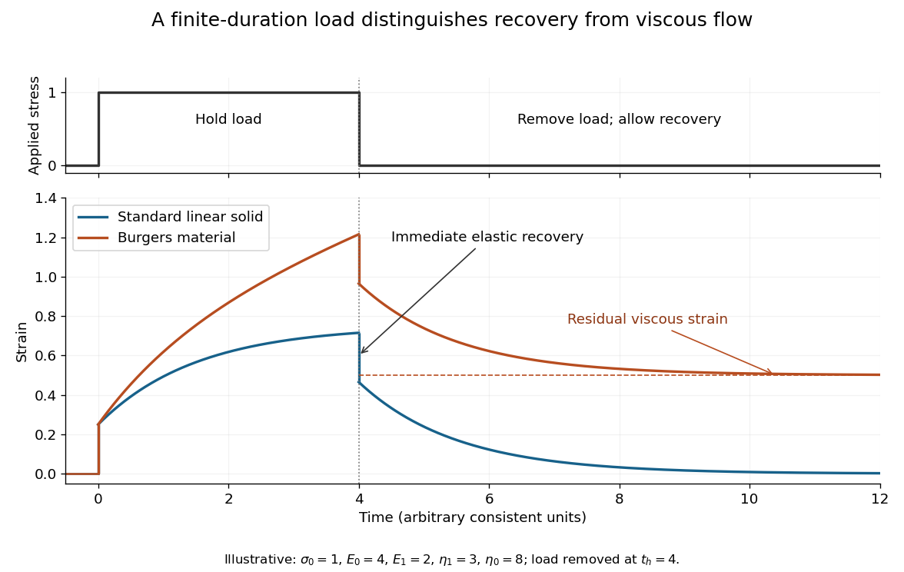

# Rheology

↑ **Parent:** [Fluid mechanics](fluid-mechanics.md)  
ⓦ [Wiki](https://en.wikipedia.org/wiki/Rheology)

Rheology studies how matter deforms and flows in response to applied stress.

**Table of contents**

- [Rheometry](#rheometry)
- [Yield stress](#yield-stress)
- [Microrheology](#microrheology)
  - [Passive microrheology](#passive-microrheology)
    - [Microrheology of a Maxwell fluid](#microrheology-of-a-maxwell-fluid)
- [Extensional flow](#extensional-flow)
  - [Extensional strain rate](#extensional-strain-rate)
- [Viscous dissipation potential](#viscous-dissipation-potential)
  - [Convex viscous potential minimum principle](#convex-viscous-potential-minimum-principle)
- [Rheometer](#rheometer)
  - [Couette rheometer](#couette-rheometer)
  - [Cone-and-plate rheometer](#cone-and-plate-rheometer)
  - [Parallel-plate rheometer](#parallel-plate-rheometer)
  - [Small-amplitude oscillatory shear](#small-amplitude-oscillatory-shear)
    - [Oscillatory-shear frequency sweep](#oscillatory-shear-frequency-sweep)
    - [Oscillatory-shear amplitude sweep](#oscillatory-shear-amplitude-sweep)
    - [Dynamic modulus](#dynamic-modulus)
      - [Maxwell fluid dynamic modulus](#maxwell-fluid-dynamic-modulus)
      - [Torsional measurement of a complex shear modulus](#torsional-measurement-of-a-complex-shear-modulus)
      - [Rubbery plateau](#rubbery-plateau)
    - [Storage modulus](#storage-modulus)
    - [Loss modulus](#loss-modulus)
      - [Dissipated energy per oscillatory shear cycle](#dissipated-energy-per-oscillatory-shear-cycle)
    - [Loss tangent](#loss-tangent)
    - [Viscoelastic relaxation time](#viscoelastic-relaxation-time)
- [Non-Newtonian fluid](#non-newtonian-fluid)
  - [Simple fluid](#simple-fluid)
    - [Viscometric flow](#viscometric-flow)
  - [Shear banding](#shear-banding)
  - [Generalized Newtonian fluid](#generalized-newtonian-fluid)
    - [Differential shear viscosity](#differential-shear-viscosity)
      - [Weak-pressure Couette-Poiseuille expansion](#weak-pressure-couette-poiseuille-expansion)
    - [Weissenberg–Rabinowitsch equation](#weissenberg-rabinowitsch-equation)
  - [Thixotropy](#thixotropy)
  - [Yield-stress fluid](#yield-stress-fluid)
    - [Bingham plastic](#bingham-plastic)
      - [Plane Poiseuille flow of a Bingham fluid](#plane-poiseuille-flow-of-a-bingham-fluid)
      - [Yield surface](#yield-surface)
      - [Pressure-driven annular Bingham flow with a free surface](#pressure-driven-annular-bingham-flow-with-a-free-surface)
      - [Bingham sliding law](#bingham-sliding-law)
    - [Herschel–Bulkley fluid](#herschel-bulkley-fluid)
    - [Plug flow of a yield-stress fluid](#plug-flow-of-a-yield-stress-fluid)
    - [Slump test for yield stress](#slump-test-for-yield-stress)
  - [Power-law fluid](#power-law-fluid)
    - [Power-law coating on a rotating cylinder](#power-law-coating-on-a-rotating-cylinder)
    - [Power-law Couette-Poiseuille flow](#power-law-couette-poiseuille-flow)
    - [Shear thinning](#shear-thinning)
  - [Viscoelasticity](#viscoelasticity)
    - [Linear viscoelasticity](#linear-viscoelasticity)
      - [Retardation time (viscoelasticity)](#retardation-time-viscoelasticity)
      - [Burgers material](#burgers-material)
    - [Anelasticity](#anelasticity)
      - [Snoek effect](#snoek-effect)
    - [Standard linear solid model](#standard-linear-solid-model)
      - [Series spring and Voigt-branch creep](#series-spring-and-voigt-branch-creep)
        - [Recovery after a finite-duration stress load](#recovery-after-a-finite-duration-stress-load)
      - [Peak frequencies in a standard linear solid](#peak-frequencies-in-a-standard-linear-solid)
    - [Passivity in linear viscoelasticity](#passivity-in-linear-viscoelasticity)
    - [Phan-Thien-Tanner fluid](#phan-thien-tanner-fluid)
      - [Uniaxial extension of an affine linear PTT fluid](#uniaxial-extension-of-an-affine-linear-ptt-fluid)
      - [Shear and pipe flow of an affine linear PTT fluid](#shear-and-pipe-flow-of-an-affine-linear-ptt-fluid)
    - [Weissenberg number](#weissenberg-number)
    - [Deborah number](#deborah-number)
    - [Differential pom-pom model](#differential-pom-pom-model)
      - [Steady uniaxial extension of the differential pom-pom model](#steady-uniaxial-extension-of-the-differential-pom-pom-model)
      - [Linear and second-order response of the differential pom-pom model](#linear-and-second-order-response-of-the-differential-pom-pom-model)
    - [Dashpot](#dashpot)
    - [Kelvin-Voigt model](#kelvin-voigt-model)
      - [Kelvin-Voigt harmonic compliance](#kelvin-voigt-harmonic-compliance)
      - [Kelvin-Voigt step-stress creep](#kelvin-voigt-step-stress-creep)
      - [Kelvin-Voigt rod Green function](#kelvin-voigt-rod-green-function)
      - [Kelvin-Voigt cantilever creep](#kelvin-voigt-cantilever-creep)
    - [Stress relaxation](#stress-relaxation)
    - [Linear viscoelastic fluid](#linear-viscoelastic-fluid)
      - [Anti-Zener model](#anti-zener-model)
      - [Boltzmann superposition](#boltzmann-superposition)
      - [Creep compliance](#creep-compliance)
      - [Complex viscosity](#complex-viscosity)
      - [Relaxation modulus](#relaxation-modulus)
        - [Instantaneous solvent term in a relaxation modulus](#instantaneous-solvent-term-in-a-relaxation-modulus)
    - [Viscometric functions](#viscometric-functions)
    - [Corotational Jeffreys fluid](#corotational-jeffreys-fluid)
    - [Linear Maxwell fluid](#linear-maxwell-fluid)
      - [Maxwell dissipation under controlled stress and strain](#maxwell-dissipation-under-controlled-stress-and-strain)
      - [Oscillatory channel flux of a linear Maxwell fluid](#oscillatory-channel-flux-of-a-linear-maxwell-fluid)
      - [Maxwell start-up shear layer](#maxwell-start-up-shear-layer)
      - [Maxwell cantilever creep](#maxwell-cantilever-creep)
      - [Maxwell-filtered local drag](#maxwell-filtered-local-drag)
    - [Conformation tensor](#conformation-tensor)
      - [Objective time derivative](#objective-time-derivative)
        - [Rivlin-Ericksen tensor](#rivlin-ericksen-tensor)
        - [Corotational derivative of a polar vector](#corotational-derivative-of-a-polar-vector)
        - [Upper-convected derivative](#upper-convected-derivative)
          - [Rotating-frame reduction of circular viscoelastic shear](#rotating-frame-reduction-of-circular-viscoelastic-shear)
          - [Upper-convected rate as a stress push-forward](#upper-convected-rate-as-a-stress-push-forward)
          - [Upper-convected Maxwell model](#upper-convected-maxwell-model)
            - [Giesekus model](#giesekus-model)
        - [Lower-convected derivative](#lower-convected-derivative)
          - [Lower-convected stress pull-back](#lower-convected-stress-pull-back)
        - [Jaumann derivative](#jaumann-derivative)
          - [Corotating-frame representation of a Jaumann derivative](#corotating-frame-representation-of-a-jaumann-derivative)
          - [Corotational Maxwell fluid](#corotational-maxwell-fluid)
            - [Steady shear of a corotational Maxwell fluid](#steady-shear-of-a-corotational-maxwell-fluid)
          - [Covariance of the Jaumann derivative](#covariance-of-the-jaumann-derivative)
    - [Oldroyd-B model](#oldroyd-b-model)
      - [Torque reversal of a linear Oldroyd fluid](#torque-reversal-of-a-linear-oldroyd-fluid)
      - [Inertialess Oldroyd-B circular Couette pressure](#inertialess-oldroyd-b-circular-couette-pressure)
      - [FENE-P model](#fene-p-model)
    - [Oldroyd-A model](#oldroyd-a-model)
      - [Steady simple shear of an Oldroyd-A fluid](#steady-simple-shear-of-an-oldroyd-a-fluid)
      - [Fading-memory representation of the Oldroyd-A model](#fading-memory-representation-of-the-oldroyd-a-model)
    - [Second-order fluid](#second-order-fluid)
      - [Elastic secondary circulation around a rotating sphere](#elastic-secondary-circulation-around-a-rotating-sphere)
      - [Newtonian velocity preservation in a second-order fluid](#newtonian-velocity-preservation-in-a-second-order-fluid)
    - [Johnson--Segalman--Oldroyd model](#johnson-segalman-oldroyd-model)
      - [Johnson-Segalman extensional response](#johnson-segalman-extensional-response)
      - [Johnson-Segalman steady viscometric functions](#johnson-segalman-steady-viscometric-functions)
        - [Johnson-Segalman negative-slope shear threshold](#johnson-segalman-negative-slope-shear-threshold)
      - [Gordon--Schowalter derivative](#gordon-schowalter-derivative)
      - [Retardation time of an Oldroyd fluid](#retardation-time-of-an-oldroyd-fluid)
      - [Linear oscillatory response of a Johnson--Segalman--Oldroyd fluid](#linear-oscillatory-response-of-a-johnson-segalman-oldroyd-fluid)
      - [Steady shear viscosity of a Johnson--Segalman--Oldroyd fluid](#steady-shear-viscosity-of-a-johnson-segalman-oldroyd-fluid)
    - [Normal-stress difference](#normal-stress-difference)
      - [Die swell](#die-swell)
      - [Weissenberg effect](#weissenberg-effect)
    - [Extensional viscosity](#extensional-viscosity)
      - [Uniaxial extensional flow](#uniaxial-extensional-flow)
        - [Extensional equations for a slender Newtonian column](#extensional-equations-for-a-slender-newtonian-column)
          - [Annular return flow around a slumping column](#annular-return-flow-around-a-slumping-column)
            - [Extensional screening length of a slumping column](#extensional-screening-length-of-a-slumping-column)
              - [Initial velocity profile of an annularly confined column](#initial-velocity-profile-of-an-annularly-confined-column)
          - [Plug-flow criterion for a column in a low-viscosity annulus](#plug-flow-criterion-for-a-column-in-a-low-viscosity-annulus)
        - [Axial strain rate](#axial-strain-rate)
      - [Trouton ratio](#trouton-ratio)
  - [Suspension rheology](#suspension-rheology)
    - [Dilute rod suspension](#dilute-rod-suspension)
    - [Jamming (physics)](#jamming-physics)
    - [Viscous number](#viscous-number)
    - [Shear-induced dilation](#shear-induced-dilation)

## Rheometry

↑ **Parent:** [Rheology](rheology.md)

Measurement of [stress](continuum-mechanics.md#stress)–deformation response using a calibrated [rheometer](#rheometer). Geometry, [temperature](temperature.md), sample history and possible [wall slip](fluid-mechanics.md#wall-slip) must be controlled before interpreting a measured [force](force.md) or torque as a bulk constitutive response.

## Yield stress

↑ **Parent:** [Rheology](rheology.md)

The [yield stress](#yield-stress) is the stress threshold beyond which a material sustains irreversible flow under the specified loading conditions. Time-dependent materials require an operational measurement protocol; a single elastic modulus does not determine their [yield stress](#yield-stress).

## Microrheology

↑ **Parent:** [Rheology](rheology.md)  
ⓦ [Wiki](https://en.wikipedia.org/wiki/Microrheology)

Microrheology infers local mechanical response from microscopic probes embedded in a material. Active methods apply a calibrated force and measure displacement; [passive microrheology](#passive-microrheology) uses thermal fluctuations. Probe size, boundary conditions at the probe, temporal resolution and material heterogeneity determine which continuum response can be inferred.

### Passive microrheology

↑ **Parent:** [Microrheology](#microrheology)

For a dilute spherical no-slip probe of radius $a$ in an isotropic incompressible linear medium at equilibrium, the bead's displacement per unit step force is $J_b(t)=J(t)/(6\pi a)$, where $J$ is the bulk shear [creep compliance](#creep-compliance). The [fluctuation-dissipation theorem](quantum-field-theory.md#fluctuation-dissipation-theorem) gives one-coordinate displacement variance $2k_BTJ_b(t)$. Adding the three equal Cartesian contributions proves the displayed relation. In a [Newtonian fluid](viscous-fluid-flow.md#newtonian-fluid), $J=t/\eta$, so it becomes $\langle\Delta r^2\rangle=6Dt$ with the [Stokes–Einstein relation](stokes-flow.md#stokes-einstein-relation) $D=k_BT/(6\pi\eta a)$.

The particle must sample a continuum response on its scale and remain in thermal equilibrium. A two-dimensional image records only two of the three displacement components; isotropy then gives $\langle\Delta r^2\rangle_{3d}=(3/2)\langle\Delta r^2\rangle_{2d}$. Localization noise, confinement and unresolved fast relaxation can otherwise be mistaken for elastic response.

#### Microrheology of a Maxwell fluid

↑ **Parent:** [Passive microrheology](#passive-microrheology)

A [Maxwell fluid](#linear-maxwell-fluid) has a spring and dashpot in series, so its step-stress [creep compliance](#creep-compliance) is $J(t)=1/G_0+t/\eta$. The [passive microrheology](#passive-microrheology) relation then gives the displayed three-dimensional [mean squared displacement](brownian-motion.md#mean-squared-displacement). The plateau scale $k_BT/(\pi aG_0)$ measures elasticity, while the long-time slope $k_BT/(\pi a\eta)$ measures viscosity. An entropic network with mesh size $\xi$ has the estimate $G_0\sim k_BT/\xi^3$, giving plateau scale $\xi^3/(\pi a)$.

The nonzero zero-lag extrapolation belongs to the idealized massless spring-dashpot response. Actual displacement variance starts at zero; fast solvent dynamics or inertia regularize the short-time behavior. Consequently the plateau formula applies after those transients and before the Maxwell relaxation time, if those scales are well separated. A sampling interval comparable with $\tau$ gives little access to a genuine plateau, even when spatial localization is sufficiently precise.

## Extensional flow

↑ **Parent:** [Rheology](rheology.md)

An [extensional flow](#extensional-flow) stretches material along one or more directions while contracting it along others. A local ideal model of planar extension has [velocity](classical-mechanics.md#velocity) $\mathbf u=(\dot\epsilon x,-\dot\epsilon y,0)$: its [rate-of-strain tensor](viscous-fluid-flow.md#strain-rate-tensor) is $\operatorname{diag}(\dot\epsilon,-\dot\epsilon,0)$ and it is an [incompressible flow](fluid-mechanics.md#incompressible-flow). [Uniaxial extensional flow](#uniaxial-extensional-flow) instead contracts both transverse directions. These geometries probe [extensional viscosity](#extensional-viscosity) and can stretch [polymers](polymer.md).

### Extensional strain rate

↑ **Parent:** [Extensional flow](#extensional-flow)

The [extensional strain rate](#extensional-strain-rate) is the rate of relative stretching along a specified material direction. If a short material line of [length](physics.md#length) $\ell$ follows a principal stretching direction, $\dot\epsilon=d\log\ell/dt$ is the corresponding [eigenvalue](linear-operator-theory.md#eigenvalue) of the [rate-of-strain tensor](viscous-fluid-flow.md#strain-rate-tensor). For the planar model in [extensional flow](#extensional-flow), $\dot\epsilon=\partial u_x/\partial x$; the two transverse rates are $-\dot\epsilon$ and zero. For [uniaxial extensional flow](#uniaxial-extensional-flow), each transverse rate is $-\dot\epsilon/2$.

## Viscous dissipation potential

↑ **Parent:** [Rheology](rheology.md)

A convex scalar function $\Omega(D)$ on symmetric [rate-of-strain tensors](viscous-fluid-flow.md#strain-rate-tensor) generates [stress](continuum-mechanics.md#stress) by $S=\partial\Omega/\partial D$. For [incompressible flow](fluid-mechanics.md#incompressible-flow), its argument is trace free and a [pressure](pressure.md) reaction must be added to the [stress](continuum-mechanics.md#stress). At nondifferentiable points the law is $S\in\partial\Omega(D)$, where the [subdifferential](convex-optimization.md#subdifferential) is defined by $\Omega(E)-\Omega(D)\geq S:(E-D)$ for every admissible $E$. This is a strain-rate potential, in contrast with potentials parameterized by thermodynamic forces.

### Convex viscous potential minimum principle

↑ **Parent:** [Viscous dissipation potential](#viscous-dissipation-potential)

An inertialess [fluid flow](fluid-mechanics.md#fluid-flow) with symmetric [stress](continuum-mechanics.md#stress) generated by a convex [viscous dissipation potential](#viscous-dissipation-potential) minimizes $\int\Omega(D)\,dx-\int b\cdot v\,dx-\int_{S_t}t\cdot v\,dS$ among fields satisfying the prescribed [velocities](classical-mechanics.md#velocity), and any [incompressibility](fluid-mechanics.md#incompressible-flow) constraint. The supporting-hyperplane inequality bounds the difference of two functional values below by $\int S:\nabla w-\int b\cdot w-\int_{S_t}t\cdot w$. [Integration by parts](calculus.md#integration-by-parts), equilibrium $\operatorname{div}S+b=0$ and $w=0$ on the [velocity](classical-mechanics.md#velocity) boundary make this lower bound zero. A [pressure](pressure.md) reaction has zero contraction with divergence-free variations. Convexity proves global minimality without asserting uniqueness.

## Rheometer

↑ **Parent:** [Rheology](rheology.md)  
ⓦ [Wiki](https://en.wikipedia.org/wiki/Rheometer)

A rheometer imposes a controlled deformation or stress and measures the material response to determine a [constitutive equation](continuum-mechanics.md#constitutive-equation).

### Couette rheometer

↑ **Parent:** [Rheometer](#rheometer)

Concentric cylinders impose shear while [torque](momentum.md#torque) and rotation measure a material's response. The displayed calibration holds for Newtonian laminar flow, inner-cylinder rotation and a stationary outer cylinder. In a narrow gap, the rate is approximately $\Omega R_i/(R_o-R_i)$ and inner-wall stress is $\mathcal T/(2\pi LR_i^2)$. End effects, [wall slip](fluid-mechanics.md#wall-slip) and inertial secondary flow require control.

### Cone-and-plate rheometer

↑ **Parent:** [Rheometer](#rheometer)

A small-angle cone rotating above a stationary plate imposes approximately uniform [shear rate](viscous-fluid-flow.md#shear-rate), since local gap and wall speed both scale with radius. Integrating the uniform shear stress with moment arm r over the plate gives the displayed torque. The leading approximation neglects edge effects and inertia.

### Parallel-plate rheometer

↑ **Parent:** [Rheometer](#rheometer)

A parallel-plate rheometer shears a sample in a thin gap between coaxial disks. Rotation at angular speed $\Omega$ gives local [shear rate](viscous-fluid-flow.md#shear-rate) $\dot\gamma(r)=\Omega r/h$, so differentiating the measured torque with respect to rim shear rate can recover a generalized-Newtonian viscosity.

### Small-amplitude oscillatory shear

↑ **Parent:** [Rheometer](#rheometer)

Small-amplitude oscillatory shear probes linear viscoelastic response by imposing $\gamma=\gamma_0\sin\omega t$ and resolving the stress into components in phase with strain and strain rate.

#### Oscillatory-shear frequency sweep

↑ **Parent:** [Small-amplitude oscillatory shear](#small-amplitude-oscillatory-shear)

Measurements at different [frequencies](wave.md#frequency) while retaining an amplitude in the linear regime. They compare observation time with material [relaxation times](markov-chain.md#relaxation-time).

#### Oscillatory-shear amplitude sweep

↑ **Parent:** [Small-amplitude oscillatory shear](#small-amplitude-oscillatory-shear)

Measurements at fixed [frequency](wave.md#frequency) and varying oscillation amplitude. Amplitude-independent moduli identify a possible linear regime; dependence on amplitude signals nonlinear response or an experimental artifact.

#### Dynamic modulus

↑ **Parent:** [Small-amplitude oscillatory shear](#small-amplitude-oscillatory-shear)  
ⓦ [Wiki](https://en.wikipedia.org/wiki/Dynamic_modulus)

The [dynamic modulus](#dynamic-modulus) is the complex [stress](continuum-mechanics.md#stress)-amplitude to [strain](continuum-mechanics.md#strain)-amplitude ratio in steady oscillatory response. With the convention $e^{i\omega t}$, the real part is the [storage modulus](#storage-modulus) and the imaginary part is the [loss modulus](#loss-modulus). For $\epsilon=\epsilon_0\cos\omega t$, $\sigma=\epsilon_0(G'\cos\omega t-G''\sin\omega t)$. The average supplied power is $\omega\epsilon_0^2G''/2$, fixing the loss-sign convention. The elastic coefficient is a shear or extension modulus according to the deformation measured; it is unrelated to the [complex modulus](complex-analysis.md#complex-modulus) meaning absolute value of a complex number.

##### Maxwell fluid dynamic modulus

↑ **Parent:** [Dynamic modulus](#dynamic-modulus)

A series [spring](elasticity-physics.md#spring) of modulus $G$ and [dashpot](#dashpot) of [viscosity](dynamic-viscosity.md) $\eta$ have $\tau=\eta/G$ and $\dot\gamma=\dot\sigma/G+\sigma/\eta$. With $e^{i\omega t}$ amplitudes, $G'=G(\omega\tau)^2/[1+(\omega\tau)^2]$ and $G''=G\omega\tau/[1+(\omega\tau)^2]$. Low [frequencies](wave.md#frequency) are fluid-like; high [frequencies](wave.md#frequency) retain an elastic plateau. The loss peaks at $\omega\tau=1$.

##### Torsional measurement of a complex shear modulus

↑ **Parent:** [Dynamic modulus](#dynamic-modulus)

A thin uniform circular rod of radius $r$ and length $\ell$ undergoing a small end twist of complex amplitude $\Theta$ has shear-strain amplitude $\gamma(\rho)=\rho\Theta/\ell$. A [complex viscoelastic modulus](#dynamic-modulus) $G^*(\omega)$ gives shear-stress amplitude $G^*\rho\Theta/\ell$. Integrating the restoring [torque](momentum.md#torque) gives

$$
\mathcal T=-\frac{G^*\Theta}{\ell}\int_A\rho^2\,dA=-\frac{\pi r^4G^*}{2\ell}\Theta.
$$

The area integral is the polar second moment of the cross-section, not a mass [moment of inertia](rigid-body-dynamics.md#moment-of-inertia). For a disc of moment of inertia $I$ and negligible rod inertia, harmonic angular motion satisfies $[-I\omega^2+K^*(\omega)]\Theta=0$ in a free-mode calculation, or equals the external torque amplitude in a driven measurement. The complex stiffness is a frequency-domain constitutive representation; a general real-time response has memory and cannot be described by putting an arbitrary frequency-dependent complex number into an instantaneous real equation.

##### Rubbery plateau

↑ **Parent:** [Dynamic modulus](#dynamic-modulus)

The rubbery plateau is a frequency or time range in which a flexible polymer network has an approximately constant elastic [storage modulus](#storage-modulus) dominated by chain entropy. A permanently crosslinked [elastomer](polymer.md#elastomer) retains a nonzero long-time modulus. An entangled uncrosslinked [polymer melt](polymer.md#polymer-melt) can have a transient plateau but ultimately reaches terminal fluid flow at sufficiently low frequency. The plateau therefore must be interpreted with the network lifetime and observation window specified.

#### Storage modulus

↑ **Parent:** [Small-amplitude oscillatory shear](#small-amplitude-oscillatory-shear)  
ⓦ [Wiki](https://en.wikipedia.org/wiki/Storage_modulus)

The storage modulus is the in-phase coefficient $G'$ in $\tau=\gamma_0(G'\sin\omega t+G''\cos\omega t)$. It measures elastic energy storage.

#### Loss modulus

↑ **Parent:** [Small-amplitude oscillatory shear](#small-amplitude-oscillatory-shear)  
ⓦ [Wiki](https://en.wikipedia.org/wiki/Loss_modulus)

The loss modulus is the quadrature coefficient $G''$ in oscillatory shear. It measures viscous energy dissipation.

##### Dissipated energy per oscillatory shear cycle

↑ **Parent:** [Loss modulus](#loss-modulus)

For [strain](continuum-mechanics.md#strain) $\gamma=\gamma_0\cos\omega t$ and [stress](continuum-mechanics.md#stress) $\sigma=\gamma_0(G'\cos\omega t-G''\sin\omega t)$, integrating supplied [power](energy.md#power) $\sigma\dot\gamma$ over one period gives the displayed dissipated [energy](energy.md) per unit [volume](geometry-and-topology.md#volume). The storage term integrates to zero; passivity requires nonnegative [loss modulus](#loss-modulus) for positive [frequency](wave.md#frequency) in this convention.

#### Loss tangent

↑ **Parent:** [Small-amplitude oscillatory shear](#small-amplitude-oscillatory-shear)  
ⓦ [Wiki](https://en.wikipedia.org/wiki/Loss_tangent)

The loss tangent $\tan\delta=G''/G'$ compares dissipative and elastic response. Its crossover through one often identifies a dominant viscoelastic relaxation time.

#### Viscoelastic relaxation time

↑ **Parent:** [Small-amplitude oscillatory shear](#small-amplitude-oscillatory-shear)

A viscoelastic relaxation time is the characteristic time over which stored stress decays after deformation. A single-mode material commonly crosses from viscous to elastic response around $\omega\lambda=1$.

## Non-Newtonian fluid

↑ **Parent:** [Rheology](rheology.md)  
ⓦ [Wiki](https://en.wikipedia.org/wiki/Non-Newtonian_fluid)

A non-Newtonian fluid has a stress--strain-rate relation with nonlinear, time-dependent, history-dependent, or microstructure-dependent behavior.

### Simple fluid

↑ **Parent:** [Non-Newtonian fluid](#non-newtonian-fluid)

A simple fluid has local [stress](continuum-mechanics.md#stress) determined by the history of deformation of a material element, rather than by spatial derivatives of that history. An isotropic incompressible simple fluid has an arbitrary isotropic [pressure](pressure.md) and an objective constitutive functional of the relative [deformation gradients](continuum-mechanics.md#deformation-gradient). Internal-variable equations can represent such a functional when the initial material state is fixed by the past history.

#### Viscometric flow

↑ **Parent:** [Simple fluid](#simple-fluid)

A viscometric flow has the local relative deformation history of steady [simple shear flow](viscous-fluid-flow.md#simple-shear-flow), up to rigid changes of frame. For an isotropic [simple fluid](#simple-fluid), symmetry leaves one shear stress and two independent [normal-stress differences](#normal-stress-difference). The corresponding [viscometric functions](#viscometric-functions) depend on the magnitude of the [shear rate](viscous-fluid-flow.md#shear-rate), while [pressure](pressure.md) supplies the isotropic part.

### Shear banding

↑ **Parent:** [Non-Newtonian fluid](#non-newtonian-fluid)

Shear banding is spatial separation into regions with different local [shear rates](viscous-fluid-flow.md#shear-rate). In simple inertialess planar shear, equal shear stress can coexist with different rates when the homogeneous constitutive curve is nonmonotonic. Gradient terms and boundary conditions can determine the interface and selected stress; a local multivalued flow curve alone does not provide that selection. Shear banding need not be confused with the ordinary smooth shear-rate variation in a pressure-driven channel.

### Generalized Newtonian fluid

↑ **Parent:** [Non-Newtonian fluid](#non-newtonian-fluid)  
ⓦ [Wiki](https://en.wikipedia.org/wiki/Generalized_Newtonian_fluid)

A generalized Newtonian fluid has instantaneous scalar constitutive law $\tau=\eta(\dot\gamma)\dot\gamma$, with viscosity depending on the current [shear rate](viscous-fluid-flow.md#shear-rate) but carrying no memory.

#### Differential shear viscosity

↑ **Parent:** [Generalized Newtonian fluid](#generalized-newtonian-fluid)

Differential shear viscosity measures the incremental shear-stress response around a given positive base [shear rate](viscous-fluid-flow.md#shear-rate). It differs from the secant [shear viscosity](dynamic-viscosity.md) mu. A regular locally stable stress-to-rate inversion needs positive differential viscosity. Zero differential viscosity makes a first-order stress perturbation singular, and negative differential viscosity identifies a decreasing constitutive branch.

##### Weak-pressure Couette-Poiseuille expansion

↑ **Parent:** [Differential shear viscosity](#differential-shear-viscosity)

Perturb the [Couette flow](viscous-fluid-flow.md#couette-flow) between walls moving at +-U by a small pressure gradient -G. The mean shear rate remains U/h, and the stress variation across the gap is -Gy. Linearizing the monotone [generalized Newtonian fluid](#generalized-newtonian-fluid) law divides this variation by differential viscosity, giving the displayed velocity and flux per unit width. Require $Gh\ll(U/h)\eta_d(U/h)$ and a smooth constitutive law on the perturbed rates. For a [power-law fluid](#power-law-fluid), the denominator is $nk(U/h)^{n-1}$.

<h4 id="weissenberg-rabinowitsch-equation">Weissenberg–Rabinowitsch equation</h4>

↑ **Parent:** [Generalized Newtonian fluid](#generalized-newtonian-fluid)

The Weissenberg--Rabinowitsch equation recovers the wall shear rate of a generalized Newtonian fluid from a measured pressure-drop--flow-rate curve. For a circular pipe,

$$
\dot\gamma_R=\frac{3Q+\tau_R,dQ/d\tau_R}{\pi R^3}.
$$

### Thixotropy

↑ **Parent:** [Non-Newtonian fluid](#non-newtonian-fluid)  
ⓦ [Wiki](https://en.wikipedia.org/wiki/Thixotropy)

Thixotropy is a reversible decrease of viscosity caused by sustained deformation, followed by recovery while the material rests. It requires an evolving microstructural state and therefore depends on shear history.

### Yield-stress fluid

↑ **Parent:** [Non-Newtonian fluid](#non-newtonian-fluid)  
ⓦ [Wiki](https://en.wikipedia.org/wiki/Yield-stress_fluid)

A yield-stress fluid behaves as a rigid material below a critical shear stress and flows once that stress is exceeded.

#### Bingham plastic

↑ **Parent:** [Yield-stress fluid](#yield-stress-fluid)  
ⓦ [Wiki](https://en.wikipedia.org/wiki/Bingham_plastic)

A Bingham plastic has $\dot\gamma=0$ for $|\tau|<\tau_c$ and $\tau=\tau_c\operatorname{sgn}\dot\gamma+\mu\dot\gamma$ after yield.

##### Plane Poiseuille flow of a Bingham fluid

↑ **Parent:** [Bingham plastic](#bingham-plastic)

For fixed plates $y=\pm h$, no slip, viscosity $\mu_0>0$, yield [stress](continuum-mechanics.md#stress) $\tau_0\geq0$ and $G=-p_{,x}>0$, [force balance](force.md#force-balance) gives shear [stress](continuum-mechanics.md#stress) $-Gy$. The central [plug flow of a yield-stress fluid](#plug-flow-of-a-yield-stress-fluid) has half-width $y_0=\tau_0/G$. If $y_0<h$, the [velocity](classical-mechanics.md#velocity) is

$$
u(y)=\frac{G}{2\mu_0}\left[(h-y_0)^2-(|y|-y_0)_+^2\right].
$$

It is even in $y$; its derivative is $( -Gy+\tau_0\operatorname{sign}y)/\mu_0$ in the yielded layers and zero in the plug. If $Gh\leq\tau_0$, there is no flow. Odd [velocity](classical-mechanics.md#velocity) is incompatible with this pressure-driven no-slip solution at nonzero flow.

##### Yield surface

↑ **Parent:** [Bingham plastic](#bingham-plastic)

A yield surface separates yielded material, where stress exceeds the yield criterion and deformation occurs, from an unyielded plug where the deformation rate vanishes.

##### Pressure-driven annular Bingham flow with a free surface

↑ **Parent:** [Bingham plastic](#bingham-plastic)

For a Bingham layer on a stationary cylinder of radius $a$ with a shear-free cylindrical surface at $b$, an axial pressure gradient $-G$ produces $\tau_{rz}=G(b^2/r-r)/2$. Flow starts when $G(b^2-a^2)/(2a)$ exceeds the yield stress.

##### Bingham sliding law

↑ **Parent:** [Bingham plastic](#bingham-plastic)

A thin Bingham layer of thickness $h$ between a stationary wall and a moving body gives $u_b=(h/\mu)(|\tau_b|-\tau_c)_+\operatorname{sgn}\tau_b$.

<h4 id="herschel-bulkley-fluid">Herschel–Bulkley fluid</h4>

↑ **Parent:** [Yield-stress fluid](#yield-stress-fluid)  
ⓦ [Wiki](https://en.wikipedia.org/wiki/Herschel–Bulkley_fluid)

A Herschel–Bulkley fluid is unyielded for $|\tau|\leq\tau_y$ and obeys $\tau=\operatorname{sgn}(\dot\gamma)(\tau_y+K|\dot\gamma|^n)$ after yield. The parameters $K$ and $n$ are its consistency and power-law index.

#### Plug flow of a yield-stress fluid

↑ **Parent:** [Yield-stress fluid](#yield-stress-fluid)

Where the stress in a yield-stress fluid remains below the yield stress, the shear rate vanishes and the material moves as an undeformed plug bounded by yielded layers.

#### Slump test for yield stress

↑ **Parent:** [Yield-stress fluid](#yield-stress-fluid)

A slump test releases a known volume of material and infers its yield stress from the dimensions of the final gravity-supported deposit.

### Power-law fluid

↑ **Parent:** [Non-Newtonian fluid](#non-newtonian-fluid)  
ⓦ [Wiki](https://en.wikipedia.org/wiki/Power-law_fluid)

A power-law fluid has shear stress $\tau=K|\dot\gamma|^{n-1}\dot\gamma$. It is shear thinning for $n<1$, Newtonian for $n=1$, and shear thickening for $n>1$.

#### Power-law coating on a rotating cylinder

↑ **Parent:** [Power-law fluid](#power-law-fluid)

For a thin, shear-free coating on a horizontal cylinder, [lubrication theory](viscous-fluid-flow.md#lubrication-theory) balances tangential gravity against the transverse [shear stress](viscous-fluid-flow.md#shear-stress) gradient. With angle measured counterclockwise from the rightward horizontal and wall speed $U=\Omega a>0$, the flux is $Uh-\operatorname{sgn}(\cos\theta)\frac{n}{2n+1}(\rho g|\cos\theta|/k)^{1/n}h^{(2n+1)/n}$. On the uphill side this function has a finite maximum. The tightest restriction is at $\cos\theta=1$, where differentiation gives $h_*=[kU^n/(\rho g)]^{1/(n+1)}$ and the displayed global steady-flux bound. This is the leading gravity-driven model without higher-order pressure-gradient or capillary corrections.

#### Power-law Couette-Poiseuille flow

↑ **Parent:** [Power-law fluid](#power-law-fluid)

For plates at y=+-h moving at velocities +-U and pressure gradient -G, [force balance](force.md#force-balance) fixes the displayed stress. The [power-law fluid](#power-law-fluid) law gives $u_y=(Gh/k)^{1/n}\operatorname{sgn}(\alpha-y/h)|\alpha-y/h|^{1/n}$. Integrating from the lower no-slip wall yields $u=-U+hn(Gh/k)^{1/n}[|\alpha+1|^{1+1/n}-|\alpha-y/h|^{1+1/n}]/(n+1)$. The upper wall fixes alpha uniquely for k,n,G,U\>0. Absolute values are essential when the shear reverses inside the gap.

#### Shear thinning

↑ **Parent:** [Power-law fluid](#power-law-fluid)  
ⓦ [Wiki](https://en.wikipedia.org/wiki/Shear_thinning)

Shear thinning is the decrease of effective viscosity with increasing shear rate.

### Viscoelasticity

↑ **Parent:** [Non-Newtonian fluid](#non-newtonian-fluid)  
ⓦ [Wiki](https://en.wikipedia.org/wiki/Viscoelasticity)

Viscoelasticity combines viscous dissipation with elastic storage and relaxation of deformation.

#### Linear viscoelasticity

↑ **Parent:** [Viscoelasticity](#viscoelasticity)

[stress](continuum-mechanics.md#stress) is a linear causal functional of deformation history: in simple shear, $\sigma(t)=\int_{-\infty}^tG(t-t')\dot\gamma(t')dt'$. Superposition holds and [complex viscoelastic modulus](#dynamic-modulus) is amplitude-independent within the small-deformation regime.

##### Retardation time (viscoelasticity)

↑ **Parent:** [Linear viscoelasticity](#linear-viscoelasticity)

The characteristic time for a delayed [strain](continuum-mechanics.md#strain) response to approach equilibrium under a step in [stress](continuum-mechanics.md#stress). For a [Kelvin-Voigt model](#kelvin-voigt-model) with elastic modulus $E$ and viscosity $\eta$, the equation $\eta\dot\varepsilon+E\varepsilon=\sigma_0$ gives $\varepsilon=(\sigma_0/E)(1-e^{-t/\tau_r})$, where $\tau_r=\eta/E$. A [relaxation time](markov-chain.md#relaxation-time) instead describes decay of [stress](continuum-mechanics.md#stress) after an imposed strain; the two times need not coincide in a [standard linear solid model](#standard-linear-solid-model).

##### Burgers material

↑ **Parent:** [Linear viscoelasticity](#linear-viscoelasticity)  
ⓦ [Wiki](https://en.wikipedia.org/wiki/Burgers_material)

A four-element [linear viscoelasticity](#linear-viscoelasticity) model with a [spring](elasticity-physics.md#spring) $E_0$, a [Kelvin-Voigt model](#kelvin-voigt-model) branch $E_1,\eta_1$, and a free [dashpot](#dashpot) $\eta_0$ in series. Adding their [strains](continuum-mechanics.md#strain) under common [stress](continuum-mechanics.md#stress) gives the displayed [creep compliance](#creep-compliance), with $\tau=\eta_1/E_1$. There is an instantaneous elastic response, a delayed recoverable response and steady viscous flow.[Burgers Model, PFC 6.0 documentation, Figure 1 and equations (1)–(2), (5): Kelvin and Maxwell units in series](https://docs.itascasoftware.com/pfc600/common/models/burgers/doc/modelburgers.html) Named after [Johannes Martinus Burgers](physicist.md#johannes-martinus-burgers), it extends a [Maxwell model](#linear-maxwell-fluid) with a delayed elastic branch, or a [standard linear solid model](#standard-linear-solid-model) with a free dashpot.

For a load $\sigma_0$ maintained for time $t_h$, the two recoverable contributions behave as in [recovery after a finite-duration stress load](#recovery-after-a-finite-duration-stress-load), while the free [dashpot](#dashpot) retains $\sigma_0t_h/\eta_0$. Hence

$$
\varepsilon(t)=\frac{\sigma_0}{E_1}(1-e^{-t_h/\tau})e^{-(t-t_h)/\tau}
+\frac{\sigma_0t_h}{\eta_0},\qquad t>t_h,
\qquad\boxed{\varepsilon(\infty)=\frac{\sigma_0t_h}{\eta_0}}.
$$

This residual response models viscous flow; it does not by itself establish a plastic yield threshold or a damage mechanism in a real specimen.

**[Figure 1](#image-immediate-recovery-delayed-recovery-and-residual-viscous-strain). Immediate recovery, delayed recovery and residual viscous strain**. Original predictions for a standard linear solid and a Burgers material under the same finite-duration load. Dimensionless illustrative parameters; no experimental rubber or wood data are fitted.

#### Anelasticity

↑ **Parent:** [Viscoelasticity](#viscoelasticity)

Anelasticity is a delayed but recoverable strain response caused by relaxation of internal degrees of freedom. After a small imposed [stress](continuum-mechanics.md#stress) is removed, the strain can return to its original value over a finite time rather than instantaneously. Under oscillatory loading, this delay causes a phase lag and dissipation, measured by a [loss modulus](#loss-modulus) or [loss tangent](#loss-tangent). Stress-induced redistribution of interstitial impurities in a metal gives the [Snoek effect](#snoek-effect). This solid-state response is distinct from an approximation to fluid mass conservation carrying a similar name.

##### Snoek effect

↑ **Parent:** [Anelasticity](#anelasticity)

The Snoek effect is [anelasticity](#anelasticity) caused by stress-induced redistribution of mobile [interstitial defects](physical-chemistry.md#interstitial-defect) among differently oriented sites in a crystal. An applied [stress](continuum-mechanics.md#stress) favors orientations whose local distortion best accommodates it. At low frequency the atoms can track that bias and provide additional relaxed compliance; at high frequency their populations are nearly frozen. Dissipation is largest between these regimes. For a weak single relaxation, the [loss tangent](#loss-tangent) has the approximate shape $\Delta\omega\tau/[1+(\omega\tau)^2]$, with $\tau=\tau_0e^{E_a/(k_BT)}$ for thermally activated hopping. The peak is near $\omega\tau=1$. This describes a standard mechanism for interstitial impurities in body-centred cubic metals, not every damping mechanism in every alloy. [ISIJ International 37 (1997), 610: stress-induced interstitial diffusion, Eq. (2) for the Debye-shaped damping peak and its activated relaxation time](https://www.jstage.jst.go.jp/article/isijinternational1989/37/6/37_6_610/_pdf)

#### Standard linear solid model

↑ **Parent:** [Viscoelasticity](#viscoelasticity)  
ⓦ [Wiki](https://en.wikipedia.org/wiki/Standard_linear_solid_model)

A [standard linear solid model](#standard-linear-solid-model) has a finite instantaneous stiffness, a nonzero long-time stiffness and one exponential stress-relaxation mode. A [Kelvin-Voigt model](#kelvin-voigt-model) with spring $G_0$ and viscosity $\eta$ in series with spring $G_1$ gives

$$
\eta\dot\sigma+(G_0+G_1)\sigma=G_1\eta\dot\epsilon+G_0G_1\epsilon,
\qquad G_L=\frac{G_0G_1}{G_0+G_1},\quad G_H=G_1,\quad\tau=\frac\eta{G_0+G_1}.
$$

These expressions follow by adding series strains under common [stress](continuum-mechanics.md#stress). Its [storage modulus](#storage-modulus) is $G_L+(G_H-G_L)x^2/(1+x^2)$ and its [loss modulus](#loss-modulus) is $(G_H-G_L)x/(1+x^2)$ for $x=\omega\tau$. Its [relaxation modulus](#relaxation-modulus) is $G(t)=G_L+(G_H-G_L)e^{-t/\tau}$, while its [creep compliance](#creep-compliance) is $J(t)=G_1^{-1}+G_0^{-1}(1-e^{-G_0t/\eta})$. Thus creep retardation and stress-relaxation times differ. This solid has bounded creep and cannot represent terminal fluid flow.

##### Series spring and Voigt-branch creep

↑ **Parent:** [Standard linear solid model](#standard-linear-solid-model)

A [spring](elasticity-physics.md#spring) $E_0$ in series with a parallel spring-dashpot branch $E_1,\eta$ has creep compliance $J(t)=1/E_0+(1/E_1)(1-e^{-E_1t/\eta})$. It includes immediate and delayed recoverable [strain](continuum-mechanics.md#strain), but no unbounded viscous flow. Large [strain](continuum-mechanics.md#strain), damage or [anisotropy](continuum-mechanics.md#anisotropy) require additional constitutive structure.

###### Recovery after a finite-duration stress load

↑ **Parent:** [Series spring and Voigt-branch creep](#series-spring-and-voigt-branch-creep)

Apply constant [stress](continuum-mechanics.md#stress) $\sigma_0$ at $t=0$ and remove it at $t=t_h$. For [series spring and Voigt-branch creep](#series-spring-and-voigt-branch-creep), the series [spring](elasticity-physics.md#spring) recovers its [strain](continuum-mechanics.md#strain) $\sigma_0/E_0$ immediately on unloading. The [Kelvin-Voigt model](#kelvin-voigt-model) branch has [retardation time](#retardation-time-viscoelasticity) $\tau=\eta/E_1$ and must keep continuous [strain](continuum-mechanics.md#strain) because an instantaneous dashpot displacement would require an impulse. Its post-unloading equation is $\eta\dot\varepsilon+E_1\varepsilon=0$. Solving with the branch's strain at $t_h$ gives the title formula. Thus all remaining [strain](continuum-mechanics.md#strain) eventually recovers: this [standard linear solid model](#standard-linear-solid-model) has no permanent set.

##### Peak frequencies in a standard linear solid

↑ **Parent:** [Standard linear solid model](#standard-linear-solid-model)

For a [standard linear solid model](#standard-linear-solid-model) with $0<G_R<G_U$, put $x=\omega\tau$. Its [storage modulus](#storage-modulus) is $G'=G_R+(G_U-G_R)x^2/(1+x^2)$ and its [loss modulus](#loss-modulus) is $G''=(G_U-G_R)x/(1+x^2)$. The latter peaks at $x=1$, whereas its [loss tangent](#loss-tangent) is

$$
\tan\delta=\frac{(G_U-G_R)x}{G_R+G_Ux^2}.
$$

Differentiation puts the loss-tangent peak at $x=\sqrt{G_R/G_U}$, with height $(G_U-G_R)/(2\sqrt{G_RG_U})$. A loss-modulus peak and a loss-tangent peak therefore need not occur at the same frequency. For weak relaxation, $G_U/G_R$ is close to one and their frequencies are approximately equal.

#### Passivity in linear viscoelasticity

↑ **Parent:** [Viscoelasticity](#viscoelasticity)

A passive [viscoelasticity](#viscoelasticity) law cannot deliver net [work](energy.md#work) in a periodic steady deformation without an external source of energy. With [strain](continuum-mechanics.md#strain) $\epsilon=\epsilon_0\cos\omega t$ and [stress](continuum-mechanics.md#stress) $\sigma=\epsilon_0(G'\cos\omega t-G''\sin\omega t)$, the cycle-averaged supplied power is $\langle\sigma\dot\epsilon\rangle=\omega\epsilon_0^2G''/2$. Thus a necessary passivity condition, using the convention $e^{i\omega t}$, is a nonnegative [loss modulus](#loss-modulus) at every positive frequency. Equivalently the [work](energy.md#work) per cycle is $\pi\epsilon_0^2G''$. A stable differential equation for stress does not by itself ensure this energetic condition.

#### Phan-Thien-Tanner fluid

↑ **Parent:** [Viscoelasticity](#viscoelasticity)

The affine linear PTT fluid considered here uses a symmetric dimensionless tensor $A$ with $\overset\nabla A+(1+\alpha\operatorname{tr}A)A/\tau=2E$ and polymer [stress](continuum-mechanics.md#stress) $G_0A$. Here $\overset\nabla A$ is the [upper-convected derivative](#upper-convected-derivative), $G_0,\tau>0$ and the nonlinear relaxation parameter $\alpha$ is usually positive. Linearizing about rest gives the [Maxwell fluid](#linear-maxwell-fluid) [relaxation modulus](#relaxation-modulus) $G(s)=G_0e^{-s/\tau}$. The PTT family also admits other relaxation functions and nonaffine derivatives; their nonlinear predictions need not equal those of this specified version.

##### Uniaxial extension of an affine linear PTT fluid

↑ **Parent:** [Phan-Thien-Tanner fluid](#phan-thien-tanner-fluid)

For [uniaxial extensional flow](#uniaxial-extensional-flow) put $q=\tau\dot\gamma>0$, $f=1+\alpha\operatorname{tr}A$ and $T=f-2q$. The diagonal components are $a_{11}=2q/T$, $a_{22}=a_{33}=-q/(T+3q)$. The identity $f-1=\alpha\operatorname{tr}A$ gives the cubic equation in the title. For $\alpha>0$ its physical root has $T>\max(0,1-2q)$ and connects to $T=1$ at rest. Its [extensional viscosity](#extensional-viscosity) is $\eta_E=G_0\tau[2/T+1/(T+3q)]$, tending to $3G_0\tau$ at small $q$ and $2G_0\tau/\alpha$ at large $q$. At $\alpha=0$ the stable steady Maxwell extension instead ends at $q=1/2$; the finite high-rate limit must not be extended to that degenerate case.

##### Shear and pipe flow of an affine linear PTT fluid

↑ **Parent:** [Phan-Thien-Tanner fluid](#phan-thien-tanner-fluid)

In steady [simple shear flow](viscous-fluid-flow.md#simple-shear-flow), the tensor equation gives $a_{22}=a_{33}=0$, $a_{11}=2a_{12}^2$ and the equation in the title. A circular pipe with axial [pressure gradient](fluid-mechanics.md#pressure-gradient) $\Delta p$ has $G_0a_{rz}=\Delta p r/2$. Thus $w'=\Delta p r/(2G_0\tau)+\alpha\Delta p^3r^3/(4G_0^3\tau)$, and [no-slip boundary conditions](viscous-fluid-flow.md#no-slip-boundary-condition) give

$$
w(r)=-\frac{\Delta p}{4G_0\tau}(R^2-r^2)-\frac{\alpha\Delta p^3}{16G_0^3\tau}(R^4-r^4).
$$

Positive $\alpha$ produces [shear thinning](#shear-thinning); the sign of the pressure gradient determines the direction of the flow.

#### Weissenberg number

↑ **Parent:** [Viscoelasticity](#viscoelasticity)  
ⓦ [Wiki](https://en.wikipedia.org/wiki/Weissenberg_number)

The Weissenberg number measures deformation accumulated over a [viscoelastic relaxation time](#viscoelastic-relaxation-time), often as the product of that time and a [shear rate](viscous-fluid-flow.md#shear-rate) or an extension rate. Its precise rate convention should be stated. Unlike a [Deborah number](#deborah-number) based on externally imposed temporal variation, it can remain nonzero in a steady flow. A weak-flow constitutive expansion generally requires both slow temporal change and small deformation over the memory time.

#### Deborah number

↑ **Parent:** [Viscoelasticity](#viscoelasticity)  
ⓦ [Wiki](https://en.wikipedia.org/wiki/Deborah_number)

The Deborah number compares a material's [viscoelastic relaxation time](#viscoelastic-relaxation-time) with the time scale of an imposed process. A small value allows substantial [stress relaxation](#stress-relaxation) during that process; a large value can reveal stored [elasticity](elasticity-physics.md). In [small-amplitude oscillatory shear](#small-amplitude-oscillatory-shear), one commonly uses $\mathrm{De}=\omega\tau$. Large frequency does not by itself invalidate a [linear viscoelastic fluid](#linear-viscoelastic-fluid) approximation if the deformation amplitude remains sufficiently small.

#### Differential pom-pom model

↑ **Parent:** [Viscoelasticity](#viscoelasticity)

This differential model separates normalized molecular orientation $B=A/\operatorname{tr}A$ from scalar stretch $\lambda$. With component-first [velocity gradient](continuum-mechanics.md#velocity-gradient) $K$, it evolves by $D_tA=KA+AK^T-(A-I)/\tau_1$ and $D_t\lambda=\lambda B:K-(\lambda-1)/\tau_2$. Its relaxed state is $A=I$, $B=I/3$, $\lambda=1$. The displayed constant-relaxation stretch law is an idealization; variants can add saturation or nonlinear relaxation.

##### Steady uniaxial extension of the differential pom-pom model

↑ **Parent:** [Differential pom-pom model](#differential-pom-pom-model)

For extension rate $s>0$ and $x=s\tau_1<1/2$, the steady [conformation tensor](#conformation-tensor) is $\operatorname{diag}((1-2x)^{-1},(1+x)^{-1},(1+x)^{-1})$. Its normalized orientation has axial component $(1+x)/[3(1-x)]$ and transverse components $(1-2x)/[3(1-x)]$. Stretch is finite only if $s^2\tau_1\tau_2<1-x$, when $\lambda_\infty=(1-x)/(1-x-s^2\tau_1\tau_2)$ and the displayed [extensional viscosity](#extensional-viscosity) follows. Above $x=1/2$, the unnormalized axial tensor grows exponentially but $B\to\operatorname{diag}(1,0,0)$; then stretch remains bounded only if $s\tau_2<1$. Orientation normalization and stretch relaxation therefore impose different thresholds.

##### Linear and second-order response of the differential pom-pom model

↑ **Parent:** [Differential pom-pom model](#differential-pom-pom-model)

Linearizing the [differential pom-pom model](#differential-pom-pom-model) about its relaxed state leaves no first-order stretch perturbation in [incompressible flow](fluid-mechanics.md#incompressible-flow). Its anisotropic orientation obeys $\dot a+a/\tau_1=A_1$, producing the displayed [relaxation modulus](#relaxation-modulus). In a slow-flow expansion, $A=I+\tau_1A_1+\tau_1^2(2A_1^2-A_2)+O(3)$. Trace normalization and the first stretch correction affect only isotropic [stress](continuum-mechanics.md#stress) at this order, giving the displayed [second-order fluid](#second-order-fluid) coefficients. Linear small-amplitude response allows arbitrary frequency, whereas this local second-order expansion also requires slow time dependence.

#### Dashpot

↑ **Parent:** [Viscoelasticity](#viscoelasticity)

An ideal [dashpot](#dashpot) resists relative motion with force proportional to velocity. Maintaining a displacement rate $\dot x$ requires force $\mu\dot x$ and dissipates power $\mu\dot x^2$ for $\mu>0$. Connecting it in parallel or series with a [spring](elasticity-physics.md#spring) gives different constitutive laws.

#### Kelvin-Voigt model

↑ **Parent:** [Viscoelasticity](#viscoelasticity)

The [Kelvin-Voigt model](#kelvin-voigt-model) puts a spring and dashpot in parallel. Their common displacement makes their forces add. With the convention $e^{i\omega t}$, the complex stiffness is $k+i\omega\mu$, giving storage stiffness $k$ and loss stiffness $\omega\mu$. Under a force step, $x=(F_0/k)(1-e^{-t/\tau})$ with $\tau=\mu/k$. The series spring–dashpot is a [Maxwell fluid](#linear-maxwell-fluid) analogue and has different relaxation and creep behavior.

##### Kelvin-Voigt harmonic compliance

↑ **Parent:** [Kelvin-Voigt model](#kelvin-voigt-model)

Under harmonic [stress](continuum-mechanics.md#stress), [strain](continuum-mechanics.md#strain) amplitude is $\sigma_0/\sqrt{E^2+\omega^2\eta^2}$ and its lag is $\arctan(\omega\eta/E)$. Low frequencies are nearly elastic; high-frequency stress-controlled deformation is small and nearly a quarter cycle behind [stress](continuum-mechanics.md#stress).

##### Kelvin-Voigt step-stress creep

↑ **Parent:** [Kelvin-Voigt model](#kelvin-voigt-model)

For $E\varepsilon+\eta\dot\varepsilon=\sigma_0\Theta(t)$ with initially zero [strain](continuum-mechanics.md#strain), $\varepsilon=(\sigma_0/E)(1-e^{-t/\tau})$ and $\tau=\eta/E$. [Strain](continuum-mechanics.md#strain) is continuous at load application, approaches a bounded value and recovers exponentially after unloading.

##### Kelvin-Voigt rod Green function

↑ **Parent:** [Kelvin-Voigt model](#kelvin-voigt-model)

For a rod with unit mass density and elastic modulus, the [Kelvin-Voigt model](#kelvin-voigt-model) gives $\phi_{tt}-\phi_{xx}-\gamma\phi_{txx}=0$, $\gamma>0$. For the operator with the opposite overall sign, $-\partial_t^2+\partial_x^2+\gamma\partial_t\partial_x^2$, the inverse under the $e^{-i\omega t}$ [Fourier transform](fourier-transform.md) convention is the displayed expression. Its poles are $\omega_\pm=-i\gamma k^2/2\pm\sqrt{k^2-\gamma^2k^4/4}$. With $\Omega_k=\sqrt{k^2-\gamma^2k^4/4}$ real, the [retarded fundamental solution](distribution-theory.md#retarded-fundamental-solution) in spatial Fourier variables is $\widetilde G_R(k,t)=-\Theta(t)e^{-\gamma k^2t/2}\sin(\Omega_kt)/\Omega_k$. Its initial derivative is $-1$, fixed by the leading coefficient $-\partial_t^2$. At a repeated root take the continuous limit; for imaginary $\Omega_k$ the sine becomes a hyperbolic sine.

##### Kelvin-Voigt cantilever creep

↑ **Parent:** [Kelvin-Voigt model](#kelvin-voigt-model)

For a quasistatic cantilever of Kelvin-Voigt material, the bending moment is $M=EIy_{xx}+\eta_sIy_{xxt}$. A tip load gives $M=F(t)(\ell-x)$, so the free-tip displacement obeys the displayed equation with $\tau=\eta_s/E$. A step load gives a finite asymptotic deflection. If inertia is retained, the interior equation is $\rho Ay_{tt}+EIy_{xxxx}+\eta_sIy_{xxxxt}=0$, with the corresponding moment and shear conditions at the tip.

#### Stress relaxation

↑ **Parent:** [Viscoelasticity](#viscoelasticity)  
ⓦ [Wiki](https://en.wikipedia.org/wiki/Stress_relaxation)

Stress relaxation is decay of stored stress after a deformation is imposed and then held fixed. It probes a material's memory through its [relaxation modulus](#relaxation-modulus). An instantaneous [generalized Newtonian fluid](#generalized-newtonian-fluid) has no stored shear stress once the shear rate is zero and cannot describe a nontrivial relaxation tail.

#### Linear viscoelastic fluid

↑ **Parent:** [Viscoelasticity](#viscoelasticity)

A linear viscoelastic fluid has causal stress response linear in the deformation history, often expressed as $\sigma^d(t)=2\int_0^\infty G(s)E(t-s)\,ds$. The approximation requires small deformation and rotation over the relevant memory times. High frequency is allowed at sufficiently small amplitude. An integrable decaying [relaxation modulus](#relaxation-modulus) gives a finite [zero-shear viscosity](dynamic-viscosity.md#zero-shear-viscosity); an instantaneous solvent term may be written separately.

##### Anti-Zener model

↑ **Parent:** [Linear viscoelastic fluid](#linear-viscoelastic-fluid)

A [Maxwell fluid](#linear-maxwell-fluid) branch connected in parallel with a Newtonian [dashpot](#dashpot). Branches share strain and their stresses add. With $\tau=\eta_M/G$, the displayed modulus uses the $e^{i\omega t}$ convention. Its low-frequency viscosity is $\eta_M+\eta_s$ and static shear modulus zero, so the material ultimately flows.

##### Boltzmann superposition

↑ **Parent:** [Linear viscoelastic fluid](#linear-viscoelastic-fluid)

In time-translation-invariant [linear response](statistical-physics.md#linear-response-theory), each infinitesimal past strain step contributes its amplitude times the elapsed-time [relaxation modulus](#relaxation-modulus). Adding those causal contributions gives the displayed stress-history integral for shear. An equivalent formulation convolves the [creep compliance](#creep-compliance) with stress increments. This constitutive law assumes sufficiently small strains about a specified equilibrium or relaxed state; nonlinear deformation, aging and evolving material structure can invalidate that simple superposition.

##### Creep compliance

↑ **Parent:** [Linear viscoelastic fluid](#linear-viscoelastic-fluid)

A small step of [shear stress](viscous-fluid-flow.md#shear-stress) $s_0H(t)$ produces shear strain $\gamma(t)=s_0J(t)$ from a relaxed state. This time-dependent deformation under held stress is creep. The causal constitutive convolution gives $\widehat s=p\widehat G\widehat\gamma$, proving the displayed [Laplace transform](integral-transform.md#laplace-transform) relation. For a [Maxwell fluid](#linear-maxwell-fluid), $J(t)=1/G_0+t/(G_0\tau)$: an elastic jump followed by viscous flow.

##### Complex viscosity

↑ **Parent:** [Linear viscoelastic fluid](#linear-viscoelastic-fluid)

For the convention $e^{i\omega t}$, complex viscosity is the ratio of oscillatory [shear stress](viscous-fluid-flow.md#shear-stress) amplitude to [shear rate](viscous-fluid-flow.md#shear-rate) amplitude. A causal [relaxation modulus](#relaxation-modulus) gives the displayed transform. Its associated complex shear modulus is $G^*=i\omega\eta^*=G'+iG''$, where $G'$ is the [storage modulus](#storage-modulus) and $G''$ the [loss modulus](#loss-modulus).

##### Relaxation modulus

↑ **Parent:** [Linear viscoelastic fluid](#linear-viscoelastic-fluid)

The relaxation modulus is the shear-stress response at lag s to a unit small step of shear strain. By linear superposition it is the causal memory kernel multiplying [shear rate](viscous-fluid-flow.md#shear-rate). Its decaying part represents stored stress that relaxes after deformation ceases.

###### Instantaneous solvent term in a relaxation modulus

↑ **Parent:** [Relaxation modulus](#relaxation-modulus)

For a [linear viscoelastic fluid](#linear-viscoelastic-fluid), write the solvent stress explicitly as $2\mu_0E(t)$, or use the displayed kernel with a causal endpoint delta satisfying $\int_0^\infty\delta_+(s)f(s)\,ds=f(0)$. If a symmetric delta is integrated with half its weight at the endpoint, its coefficient must instead be $2\mu_0$. Mixing those conventions loses a factor of two. The [Oldroyd-B model](#oldroyd-b-model) has the displayed exponentially decaying polymer part after linearization.

#### Viscometric functions

↑ **Parent:** [Viscoelasticity](#viscoelasticity)

The three viscometric functions describe steady homogeneous [simple shear flow](viscous-fluid-flow.md#simple-shear-flow): its [shear viscosity](dynamic-viscosity.md) and the first and second [normal-stress differences](#normal-stress-difference) per squared shear rate. Take x as the flow direction, y as the gradient direction and z as the vorticity direction, so $N_1=\sigma_{xx}-\sigma_{yy}$ and $N_2=\sigma_{yy}-\sigma_{zz}$. Isotropic pressure drops out of these differences.

#### Corotational Jeffreys fluid

↑ **Parent:** [Viscoelasticity](#viscoelasticity)

A [corotational Jeffreys fluid](#corotational-jeffreys-fluid) obeys $\overset\circ S+S/\tau=2\mu_0\overset\circ D+2\mu_1D/\tau$, with [deviatoric stress](continuum-mechanics.md#deviatoric-stress) $S$, [rate-of-strain tensor](viscous-fluid-flow.md#strain-rate-tensor) $D$, [Jaumann derivative](#jaumann-derivative) and relaxation time $\tau>0$. Put $A=S-2\mu_0D$. In the [corotating-frame representation of a Jaumann derivative](#corotating-frame-representation-of-a-jaumann-derivative), $\widetilde A'+\widetilde A/\tau=2(\mu_1-\mu_0)\widetilde D/\tau$. An [integrating factor](linear-ordinary-differential-equation.md#integrating-factor) gives an exponentially weighted history transported between the rotating frames. The infinite-past formula selects histories with $e^{t/\tau}\widetilde A(t)\to0$ as $t\to-\infty$; finite initial data also contribute an exponentially decaying homogeneous term.

#### Linear Maxwell fluid

↑ **Parent:** [Viscoelasticity](#viscoelasticity)

A linear Maxwell fluid has [constitutive equation](continuum-mechanics.md#constitutive-equation) $\boldsymbol\sigma+\lambda\partial_t\boldsymbol\sigma=\mu\dot{\boldsymbol\gamma}$, with $\dot{\boldsymbol\gamma}$ twice the [rate-of-strain tensor](viscous-fluid-flow.md#strain-rate-tensor). Here $\mu$ is the zero-frequency [shear viscosity](dynamic-viscosity.md) and $\lambda>0$ is the [viscoelastic relaxation time](#viscoelastic-relaxation-time). Stress at fixed strain decays as $e^{-t/\lambda}$; the corresponding series spring and dashpot have shear modulus $G=\mu/\lambda$. In small-amplitude simple shear from an isotropic relaxed state, the first-order forcing is off-diagonal, so both [normal-stress differences](#normal-stress-difference) vanish at linear order. This is not a statement about the nonlinear objective model at second order in shear rate.

##### Maxwell dissipation under controlled stress and strain

↑ **Parent:** [Linear Maxwell fluid](#linear-maxwell-fluid)

For a series [Maxwell model](#linear-maxwell-fluid) with $\tau=\eta/k$, $E''=k\omega\tau/(1+\omega^2\tau^2)$. At fixed [strain](continuum-mechanics.md#strain) amplitude the energy dissipated per cycle is $\pi E''\varepsilon_0^2$ and peaks at $\omega\tau=1$. At fixed [stress](continuum-mechanics.md#stress) amplitude it is instead $\pi\sigma_0^2/(\eta\omega)$, which has no finite-frequency maximum. Specifying the imposed variable and whether loss means energy per cycle or [power](energy.md#power) is essential.

##### Oscillatory channel flux of a linear Maxwell fluid

↑ **Parent:** [Linear Maxwell fluid](#linear-maxwell-fluid)

For a no-slip channel with half-width $h$, a harmonic [pressure gradient](fluid-mechanics.md#pressure-gradient) $\Delta p e^{i\omega t}$ and [complex viscosity](#complex-viscosity) $\widehat\mu=G_0\tau/(1+i\omega\tau)$, put $z^2=i\omega\rho h^2/\widehat\mu$. Solving $\widehat\mu U''-i\omega\rho U=\Delta p$ gives $U=-\Delta p[1-\cosh(zy/h)/\cosh z]/(i\omega\rho)$; integration gives the displayed flux per unit width. At low frequency it approaches $-2\Delta p h^3/(3G_0\tau)$. At fixed positive $h,\tau,G_0,\rho$, the high-frequency leading flux is $-2\Delta p h/(i\omega\rho)$, although shear waves can persist in the local profile. If instead $\omega\tau\gg1$ while $\rho\omega^2h^2/G_0\ll1$, the negligible-inertia elastic limit is $Q\simeq-2i\omega\Delta p h^3/(3G_0)$. The last two limits impose different scale orderings.

##### Maxwell start-up shear layer

↑ **Parent:** [Linear Maxwell fluid](#linear-maxwell-fluid)

For a half-space initially at rest and a wall given a step velocity $U$, [momentum conservation](momentum.md#momentum-conservation) and the [Maxwell fluid](#linear-maxwell-fluid) stress law give $\tau u_{tt}+u_t=(G_0\tau/\rho)u_{yy}$. The displayed decaying [Laplace transform](integral-transform.md#laplace-transform) solution obeys the wall condition. Inverting on a right-half-plane [Bromwich contour](complex-analysis.md#bromwich-contour) yields a shear signal of speed $\sqrt{G_0/\rho}$. The limit $\tau\to0$ at fixed $G_0\tau=\eta$ gives viscous error-function penetration; $\tau\to\infty$ at fixed $G_0$ gives a sharp elastic front.

##### Maxwell cantilever creep

↑ **Parent:** [Linear Maxwell fluid](#linear-maxwell-fluid)

For a quasistatic beam made of a two-element series Maxwell material, $\dot M+M/\tau=EI\partial_t y_{xx}$. A force step therefore produces an instantaneous elastic deflection followed by unbounded linear creep, as displayed. It cannot have the finite long-time plateau of a [Kelvin-Voigt cantilever creep](#kelvin-voigt-cantilever-creep) response; a solid with finite relaxed modulus requires an additional elastic element.

##### Maxwell-filtered local drag

↑ **Parent:** [Linear Maxwell fluid](#linear-maxwell-fluid)

A prescribed local linear Maxwell [force](force.md) law filters a harmonic drag amplitude by $(1+i\omega\lambda)^{-1}$. For periodic states its time derivative has zero mean, so the mean [force](force.md) equals the mean driving [force](force.md). Leading harmonic power is reduced by $[1+(\omega\lambda)^2]^{-1}$, as elastic storage changes the in-phase dissipative response.

#### Conformation tensor

↑ **Parent:** [Viscoelasticity](#viscoelasticity)  
ⓦ [Wiki](https://en.wikipedia.org/wiki/Conformation_tensor)

The conformation tensor describes the average stretch and orientation of polymer molecules. Its equilibrium value is the identity tensor under a common normalization.

##### Objective time derivative

↑ **Parent:** [Conformation tensor](#conformation-tensor)  
ⓦ [Wiki](https://en.wikipedia.org/wiki/Objective_time_derivative)

An objective time derivative transforms covariantly under time-dependent rigid changes of observer, so constitutive predictions do not depend on the observer's rotation.

###### Rivlin-Ericksen tensor

↑ **Parent:** [Objective time derivative](#objective-time-derivative)

Using the component-first [velocity gradient](continuum-mechanics.md#velocity-gradient) $K_{ij}=\partial v_i/\partial x_j$, the Rivlin-Ericksen tensors are defined by the displayed recurrence. In particular $A_1$ is twice the [rate-of-strain tensor](viscous-fluid-flow.md#strain-rate-tensor). These tensors transform objectively under time-dependent rigid observer changes. With this convention the [upper-convected derivative](#upper-convected-derivative) of $A_1$ is $A_2-2A_1^2$, an identity useful in the slow-flow expansion of a [second-order fluid](#second-order-fluid).

###### Corotational derivative of a polar vector

↑ **Parent:** [Objective time derivative](#objective-time-derivative)

With [velocity gradient](continuum-mechanics.md#velocity-gradient) $A_{ij}=\partial_i v_j$, set $\Omega=(A-A^T)/2$. A vector rigidly rotating with the material has [material derivative](continuum-mechanics.md#material-derivative) $D_t\mathbf p=-\Omega\mathbf p$, so its corotational derivative vanishes. Its unit rotational coefficient is fixed by an [objective time derivative](#objective-time-derivative); adding $-\xi D\mathbf p$ describes the material's [flow alignment of a polar order parameter](critical-phenomenon.md#flow-alignment-of-a-polar-order-parameter).

###### Upper-convected derivative

↑ **Parent:** [Objective time derivative](#objective-time-derivative)  
ⓦ [Wiki](https://en.wikipedia.org/wiki/Upper-convected_derivative)

The upper-convected derivative of a contravariant tensor is $\overset{\triangledown}{\mathbf C}=D\mathbf C/Dt-(\nabla\mathbf u)\mathbf C-\mathbf C(\nabla\mathbf u)^T$.

###### Rotating-frame reduction of circular viscoelastic shear

↑ **Parent:** [Upper-convected derivative](#upper-convected-derivative)

For azimuthal velocity $v(r)e_\theta$, the [velocity gradient](continuum-mechanics.md#velocity-gradient) in the rotating polar basis is $\begin{pmatrix}0&-v/r\\v'&0\end{pmatrix}$. The basis rotates along a particle at angular speed $v/r$. Accounting for that rotation in the [material derivative](continuum-mechanics.md#material-derivative) replaces $L$ by $L-(v/r)\begin{pmatrix}0&-1\\1&0\end{pmatrix}$ in the [upper-convected derivative](#upper-convected-derivative). Its remaining shear rate is $v'-v/r$, so the local viscoelastic [normal-stress difference](#normal-stress-difference) follows the same constitutive algebra as [simple shear flow](viscous-fluid-flow.md#simple-shear-flow).

###### Upper-convected rate as a stress push-forward

↑ **Parent:** [Upper-convected derivative](#upper-convected-derivative)

Differentiate the [Kirchhoff stress tensor](continuum-mechanics.md#kirchhoff-stress-tensor) relation $\boldsymbol\tau=FSF^T$, using $\dot F=LF$ for the [velocity gradient](continuum-mechanics.md#velocity-gradient). Subtracting the two deformation terms gives the displayed [upper-convected derivative](#upper-convected-derivative). This removes the transport generated solely by deformation of a fixed material stress tensor.

###### Upper-convected Maxwell model

↑ **Parent:** [Upper-convected derivative](#upper-convected-derivative)  
ⓦ [Wiki](https://en.wikipedia.org/wiki/Upper-convected_Maxwell_model)

The upper-convected Maxwell model evolves viscoelastic stress according to

$$
\boldsymbol\tau+\lambda\overset{\triangledown}{\boldsymbol\tau}
=\eta\dot{\boldsymbol\gamma}.
$$

It has constant shear viscosity and predicts a divergent extensional viscosity at a finite extension rate.

###### Giesekus model

↑ **Parent:** [Upper-convected Maxwell model](#upper-convected-maxwell-model)  
ⓦ [Wiki](https://en.wikipedia.org/wiki/Giesekus_model)

The Giesekus model adds the nonlinear anisotropic-drag term $\alpha\lambda\boldsymbol\tau^2/\eta$ to the [Upper-convected Maxwell model](#upper-convected-maxwell-model). Positive dimensionless mobility factor $\alpha$ produces shear thinning and a nonzero second normal-stress difference.

###### Lower-convected derivative

↑ **Parent:** [Objective time derivative](#objective-time-derivative)  
ⓦ [Wiki](https://en.wikipedia.org/wiki/Lower-convected_derivative)

The lower-convected derivative of a covariant tensor is $\overset{\vartriangle}{\mathbf C}=D\mathbf C/Dt+(\nabla\mathbf u)^T\mathbf C+\mathbf C\nabla\mathbf u$.

###### Lower-convected stress pull-back

↑ **Parent:** [Lower-convected derivative](#lower-convected-derivative)

For $L=\dot FF^{-1}$, the product rule proves the displayed [lower-convected derivative](#lower-convected-derivative) identity. Under a superposed rotation $Q(t)$, $\tau^*=Q\tau Q^T$ and $L^*=QLQ^T+\dot QQ^T$. The two rotation terms in $\dot\tau^*$ cancel those in $(L^*)^T\tau^*+\tau^*L^*$, proving that the lower-convected rate is an [objective time derivative](#objective-time-derivative).

###### Jaumann derivative

↑ **Parent:** [Objective time derivative](#objective-time-derivative)  
ⓦ [Wiki](https://en.wikipedia.org/wiki/Jaumann_derivative)

The Jaumann derivative is the corotational objective derivative $\overset{\circ}{\mathbf C}=D\mathbf C/Dt-\boldsymbol\Omega\mathbf C+\mathbf C\boldsymbol\Omega$, where $\boldsymbol\Omega$ is the [spin tensor](viscous-fluid-flow.md#spin-tensor).

###### Corotating-frame representation of a Jaumann derivative

↑ **Parent:** [Jaumann derivative](#jaumann-derivative)

If an [orthogonal matrix](linear-algebra.md#orthogonal-matrix) $Q$ satisfies $\dot Q=WQ$ for the [spin tensor](viscous-fluid-flow.md#spin-tensor) $W^T=-W$, the [Jaumann derivative](#jaumann-derivative) becomes an ordinary derivative in that frame:

$$
\frac{d}{dt}(Q^TTQ)=Q^T(\dot T-WT+TW)Q.
$$

This follows by differentiating all three factors and using $\dot Q^T=-Q^TW$. It converts a [tensor](multilinear-algebra.md#tensor) relaxation law using the [Jaumann derivative](#jaumann-derivative) into a componentwise ordinary differential equation.

###### Corotational Maxwell fluid

↑ **Parent:** [Jaumann derivative](#jaumann-derivative)

The corotational Maxwell fluid replaces the ordinary derivative of the [linear Maxwell fluid](#linear-maxwell-fluid) by the [Jaumann derivative](#jaumann-derivative):

$$
\boldsymbol\sigma+\lambda\left[D_t\boldsymbol\sigma+\tfrac12(\omega\boldsymbol\sigma-\boldsymbol\sigma\omega)\right]=\mu\dot{\boldsymbol\gamma}.
$$

Here $\omega=G-G^T$ uses $G_{ij}=\partial_i u_j$, or equivalently the commutator is $-W\sigma+\sigma W$ with the standard [spin tensor](viscous-fluid-flow.md#spin-tensor). The stress has relaxation time $\lambda$ and small-rate viscosity $\mu$. The commutator makes the [constitutive equation](continuum-mechanics.md#constitutive-equation) nonlinear while maintaining an [objective time derivative](#objective-time-derivative).

###### Steady shear of a corotational Maxwell fluid

↑ **Parent:** [Corotational Maxwell fluid](#corotational-maxwell-fluid)

For [simple shear flow](viscous-fluid-flow.md#simple-shear-flow) $u=(\dot\gamma y,0,0)$, put $s=\dot\gamma$ and $\ell=\lambda s$. The steady [deviatoric stress](continuum-mechanics.md#deviatoric-stress) is

$$
\boldsymbol\sigma=\frac{\mu s}{1+\ell^2}\begin{pmatrix}\ell&1&0\\1&-\ell&0\\0&0&0\end{pmatrix}.
$$

This follows by setting $\omega_{xy}=-s$, $\omega_{yx}=s$ in the [corotational Maxwell fluid](#corotational-maxwell-fluid) equation: $\sigma_{xx}=\lambda s\sigma_{xy}$, $\sigma_{yy}=-\lambda s\sigma_{xy}$, and $\sigma_{xy}+\lambda s(\sigma_{xx}-\sigma_{yy})/2=\mu s$. Hence the [shear viscosity](dynamic-viscosity.md) is $\mu/(1+\lambda^2s^2)$, which exhibits [shear thinning](#shear-thinning), while $N_1=2\mu\lambda s^2/(1+\lambda^2s^2)$ and $N_2=-N_1/2$. These differences are independent of the isotropic pressure.

###### Covariance of the Jaumann derivative

↑ **Parent:** [Jaumann derivative](#jaumann-derivative)

Use the derivative-index-first [velocity gradient](continuum-mechanics.md#velocity-gradient) $G_{ij}=\partial_i u_j$ and $\omega=G-G^T$. For an [objective time derivative](#objective-time-derivative) the [tensor](multilinear-algebra.md#tensor) transformation $A^*=QAQ^T$ under $x^*=Q(t)x+c(t)$ must imply $\mathcal D A^*/\mathcal Dt=Q(\mathcal D A/\mathcal Dt)Q^T$. If $R=\dot Q Q^T$, then $G^*=QGQ^T-R$ and

$$
D_t A^*=Q(D_t A)Q^T+RA^*-A^*R,\qquad
\omega^*=Q\omega Q^T-2R.
$$

Consequently the extra terms cancel in $D_t A+\tfrac12(\omega A-A\omega)$, proving covariance. With the component-index-first gradient $L_{ij}=\partial_j u_i$, the same physical rate is $D_t A-WA+AW$, with [spin tensor](viscous-fluid-flow.md#spin-tensor) $W=(L-L^T)/2=-\omega/2$. Changing the gradient convention without changing the commutator sign destroys objectivity.

#### Oldroyd-B model

↑ **Parent:** [Viscoelasticity](#viscoelasticity)  
ⓦ [Wiki](https://en.wikipedia.org/wiki/Oldroyd-B_model)

The Oldroyd-B model combines a Newtonian solvent with infinitely extensible Hookean polymer dumbbells. It predicts constant shear viscosity, a positive first normal-stress difference, and an extensional catastrophe at a finite extension rate.

##### Torque reversal of a linear Oldroyd fluid

↑ **Parent:** [Oldroyd-B model](#oldroyd-b-model)

In an inertialess [cone-and-plate rheometer](#cone-and-plate-rheometer), reverse a steady torque from T to -T at time zero. The polymer shear stress remains continuous while the positive solvent viscosity allows the rate to jump. The linear stress equation gives $\lambda_2=\mu_0\tau/(\mu_0+G_0\tau)$ and the displayed velocity for t\>0, where $\Omega_+=3\alpha T/[2\pi a^3(\mu_0+G_0\tau)]$. The transient backward speed exceeds the final backward speed because stored polymer stress initially retains its former sign.

##### Inertialess Oldroyd-B circular Couette pressure

↑ **Parent:** [Oldroyd-B model](#oldroyd-b-model)

For circular [Couette flow](viscous-fluid-flow.md#couette-flow) with $v=Ar+B/r$, the [rotating-frame reduction of circular viscoelastic shear](#rotating-frame-reduction-of-circular-viscoelastic-shear) gives shear rate $g=-2B/r^2$. The total [shear stress](viscous-fluid-flow.md#shear-stress) is $\mu g$, and the azimuthal minus radial [normal-stress difference](#normal-stress-difference) is $2(\mu-\mu_r)\tau g^2$ in the stress convention where $\sigma_{rr}=-p$. Radial [force balance](force.md#force-balance) without inertia is $p'=-2(\mu-\mu_r)\tau g^2/r$, which integrates to the displayed pressure. The pressure constant is undetermined by these equations.

##### FENE-P model

↑ **Parent:** [Oldroyd-B model](#oldroyd-b-model)  
ⓦ [Wiki](https://en.wikipedia.org/wiki/FENE-P_model)

The FENE-P model replaces infinitely extensible Hookean polymers by finitely extensible nonlinear elastic springs with a mean-field closure. Finite extensibility regularizes the Oldroyd-B extensional catastrophe and produces shear thinning.

#### Oldroyd-A model

↑ **Parent:** [Viscoelasticity](#viscoelasticity)

The Oldroyd-A model is the lower-convected counterpart of the [Oldroyd-B model](#oldroyd-b-model): its polymeric stress evolves using a [lower-convected derivative](#lower-convected-derivative).

##### Steady simple shear of an Oldroyd-A fluid

↑ **Parent:** [Oldroyd-A model](#oldroyd-a-model)

For constant [simple shear flow](viscous-fluid-flow.md#simple-shear-flow) rate $s$, the nonpressure stress in the component-first gradient convention $L_{12}=s$ is

$$
\sigma^d=\begin{pmatrix}0&\mu s&0\\\mu s&-2(\mu-\mu_r)\tau s^2&0\\0&0&0\end{pmatrix}.
$$

Thus the first [normal-stress difference](#normal-stress-difference) is $N_1=2(\mu-\mu_r)\tau s^2$, while the second is $N_2=-N_1$. Adding the incompressibility [pressure](pressure.md) changes neither difference.

##### Fading-memory representation of the Oldroyd-A model

↑ **Parent:** [Oldroyd-A model](#oldroyd-a-model)

Put $S=\sigma^d-2\mu_rD$ in the [Oldroyd-A model](#oldroyd-a-model). It obeys $\mathcal D_lS+S/\tau=2(\mu-\mu_r)D/\tau$. Pulling back as $F^TSF$ converts this to an ordinary linear relaxation equation. With decayed remote-past initial memory, its solution is

$$
\sigma^d(t)=2\mu_rD(t)+\frac{2(\mu-\mu_r)}\tau\int_{-\infty}^t e^{-(t-s)/\tau}F(t)^{-T}F(s)^TD(s)F(s)F(t)^{-1}\,ds.
$$

At a finite initial time, include the homogeneous transported term $e^{-(t-t_0)/\tau}F(t)^{-T}F(t_0)^TS(t_0)F(t_0)F(t)^{-1}$. The integral-only law is not equivalent to all arbitrary initial-value solutions without a memory condition.

#### Second-order fluid

↑ **Parent:** [Viscoelasticity](#viscoelasticity)  
ⓦ [Wiki](https://en.wikipedia.org/wiki/Second-order_fluid)

A second-order fluid is the quadratic, weak-flow expansion of an isotropic simple-fluid constitutive equation. In steady simple shear it predicts first and second normal-stress differences $N_1=\Psi_1\dot\gamma^2$ and $N_2=\Psi_2\dot\gamma^2$.

##### Elastic secondary circulation around a rotating sphere

↑ **Parent:** [Second-order fluid](#second-order-fluid)

For a sphere of radius $a$ rotating with [angular velocity](rigid-body-dynamics.md#angular-velocity) $\Omega$, the primary [Stokes flow](stokes-flow.md) has $v_\phi=K\sin\theta/r^2$, $K=\Omega a^3$. In the weak, inertialess [second-order fluid](#second-order-fluid) correction, put $c=\psi_1+2\psi_2$. The [stream function](fluid-mechanics.md#stream-function) in the title has

$$
H(r)=\frac{cK^2}{4\mu a^3}\left[1-3(a/r)^2+2(a/r)^3\right],\quad
v_r=\frac{H}{r^2}(3\cos^2\theta-1),\quad v_\theta=-\frac{H'}r\sin\theta\cos\theta.
$$

Both meridional components vanish at $r=a$ and decay at infinity. Indeed, $E_{r\phi}=-3K\sin\theta/(2r^3)$ gives $[\nabla\times\nabla\cdot(2cE^2)]_\phi=72cK^2\sin\theta\cos\theta/r^8$, and the curl of the momentum equation reduces to $(d^2/dr^2-6/r^2)^2H=72cK^2/(\mu r^7)$. For $c>0$ the [secondary flow](fluid-mechanics.md#secondary-flow) enters towards the equator and leaves near the poles; $c<0$ reverses it and $c=0$ removes this correction. The meridional circulation is even in the sign of sphere rotation. Inertial secondary flow is excluded from this calculation.

##### Newtonian velocity preservation in a second-order fluid

↑ **Parent:** [Second-order fluid](#second-order-fluid)

Write the non-Newtonian extra [stress](continuum-mechanics.md#stress) as $S=2(\psi_1+2\psi_2)E^2-\psi_1\overset\circ E$, with the [Jaumann derivative](#jaumann-derivative). For a steady [Stokes flow](stokes-flow.md), $\nabla\times\nabla\cdot\overset\circ E=0$. If $\psi_1+2\psi_2=0$, the extra force is a [gradient](multivariable-calculus.md#gradient) and only alters [pressure](pressure.md). In a planar [incompressible flow](fluid-mechanics.md#incompressible-flow), $E^2=q\operatorname{diag}(1,1,0)$, so its [divergence](multivariable-calculus.md#divergence) is also a gradient; no coefficient restriction is needed. A Newtonian velocity with prescribed boundary velocities consequently solves the second-order model with an altered pressure. On the regular weak-flow branch, [Uniqueness of Stokes flow](stokes-flow.md#uniqueness-of-stokes-flow) makes each velocity correction vanish. This does not establish uniqueness of arbitrary large nonlinear branches or the absence of higher-order effects in a real material.

<h4 id="johnson-segalman-oldroyd-model">Johnson--Segalman--Oldroyd model</h4>

↑ **Parent:** [Viscoelasticity](#viscoelasticity)

The Johnson--Segalman--Oldroyd model is a linear relaxation-retardation equation made nonlinear through a Gordon--Schowalter objective derivative. Its slip parameter can produce a rate-dependent steady shear viscosity.

##### Johnson-Segalman extensional response

↑ **Parent:** [Johnson--Segalman--Oldroyd model](#johnson-segalman-oldroyd-model)

In [uniaxial extensional flow](#uniaxial-extensional-flow), the conformation equations give $A_{xx}=1/(1-2\alpha\tau\dot\epsilon)$ and $A_{yy}=A_{zz}=1/(1+\alpha\tau\dot\epsilon)$. Their stress difference gives the displayed [extensional viscosity](#extensional-viscosity). A stable positive steady conformation requires both denominators positive; a first pole marks loss of a bounded steady response. At zero extension rate the [Trouton ratio](#trouton-ratio) is three relative to the zero-shear viscosity.

##### Johnson-Segalman steady viscometric functions

↑ **Parent:** [Johnson--Segalman--Oldroyd model](#johnson-segalman-oldroyd-model)

For stress $-pI+\alpha G_0A+2\mu_0E$ and slip derivative $D_tA+\Omega A-A\Omega-\alpha(EA+AE)=-(A-I)/\tau$, the steady [viscometric functions](#viscometric-functions) are $\mu=\mu_0+\alpha^2G_0\tau/D$, $\psi_1=2\alpha^2G_0\tau^2/D$ and $\psi_2=-(1-\alpha)\psi_1/2$. Solving the three symmetric xy conformation equations gives $A_{xy}=\alpha\tau\dot\gamma/D$, $A_{xx}=1+(1+\alpha)\tau\dot\gamma A_{xy}$, $A_{yy}=1-(1-\alpha)\tau\dot\gamma A_{xy}$ and $A_{zz}=1$.

###### Johnson-Segalman negative-slope shear threshold

↑ **Parent:** [Johnson-Segalman steady viscometric functions](#johnson-segalman-steady-viscometric-functions)

For nonzero slip parameter with $|\alpha|<1$, scale shear rate as $x=\tau\sqrt{1-\alpha^2}\dot\gamma$ and stress as $S=x[b+1/(1+x^2)]$, where $b=\mu_0/(\alpha^2G_0\tau)$. The derivative is $b+(1-x^2)/(1+x^2)^2$ and its least value is $b-1/8$, attained at $x^2=3$. A decreasing homogeneous constitutive segment therefore exists exactly under the displayed condition. It permits different shear rates at the same stress and motivates [shear banding](#shear-banding); the local curve alone does not select a band-interface stress.

<h5 id="gordon-schowalter-derivative">Gordon--Schowalter derivative</h5>

↑ **Parent:** [Johnson--Segalman--Oldroyd model](#johnson-segalman-oldroyd-model)

For a tensor $\boldsymbol\sigma$, the Gordon--Schowalter derivative used here is

$$
\overset{\square}{\boldsymbol\sigma}
=\overset{\triangledown}{\boldsymbol\sigma}
+\frac a2(\dot{\boldsymbol\gamma}\boldsymbol\sigma
+\boldsymbol\sigma\dot{\boldsymbol\gamma}),
$$

which interpolates among objective convected derivatives as the dimensionless slip parameter $a$ changes.

##### Retardation time of an Oldroyd fluid

↑ **Parent:** [Johnson--Segalman--Oldroyd model](#johnson-segalman-oldroyd-model)

The retardation time controls the delayed strain-rate term in an Oldroyd constitutive equation. Together with the relaxation time it determines the solvent-like high-frequency or high-rate response.

<h5 id="linear-oscillatory-response-of-a-johnson-segalman-oldroyd-fluid">Linear oscillatory response of a Johnson--Segalman--Oldroyd fluid</h5>

↑ **Parent:** [Johnson--Segalman--Oldroyd model](#johnson-segalman-oldroyd-model)

In small-amplitude oscillatory shear,

$$
G'=\frac{\eta\omega^2(\lambda_1-\lambda_2)}{1+\omega^2\lambda_1^2},
\qquad
G''=\frac{\eta\omega(1+\omega^2\lambda_1\lambda_2)}{1+\omega^2\lambda_1^2}.
$$

<h5 id="steady-shear-viscosity-of-a-johnson-segalman-oldroyd-fluid">Steady shear viscosity of a Johnson--Segalman--Oldroyd fluid</h5>

↑ **Parent:** [Johnson--Segalman--Oldroyd model](#johnson-segalman-oldroyd-model)

For Gordon--Schowalter parameter $0<a<2$, the steady shear viscosity is

$$
\eta_{\rm sh}=\eta
\frac{1+a(2-a)\lambda_1\lambda_2\dot\gamma^2}
{1+a(2-a)\lambda_1^2\dot\gamma^2}.
$$

It is shear thinning when $\lambda_1>\lambda_2$.

#### Normal-stress difference

↑ **Parent:** [Viscoelasticity](#viscoelasticity)  
ⓦ [Wiki](https://en.wikipedia.org/wiki/Normal-stress_difference)

In simple shear, the first and second normal-stress differences are $N_1=\tau_{xx}-\tau_{yy}$ and $N_2=\tau_{yy}-\tau_{zz}$.

##### Die swell

↑ **Parent:** [Normal-stress difference](#normal-stress-difference)  
ⓦ [Wiki](https://en.wikipedia.org/wiki/Die_swell)

A polymeric extrudate can expand sideways after leaving a die as the [normal-stress differences](#normal-stress-difference) and stored deformation generated upstream relax. Axial elastic recovery contributes to transverse swelling in an [incompressible flow](fluid-mechanics.md#incompressible-flow). A Newtonian extrudate can also swell through rearrangement of its velocity profile, so observing swelling alone does not isolate the elastic contribution.

##### Weissenberg effect

↑ **Parent:** [Normal-stress difference](#normal-stress-difference)  
ⓦ [Wiki](https://en.wikipedia.org/wiki/Weissenberg_effect)

A rotating rod can draw a liquid with appreciable [viscoelasticity](#viscoelasticity) inward and raise its free surface around the rod. Tensile [normal stresses](continuum-mechanics.md#normal-stress) along curved flow lines produce an inward hoop force, competing with inertia and gravity. It is a manifestation of elastic [normal-stress differences](#normal-stress-difference), rather than merely a changed scalar [shear viscosity](dynamic-viscosity.md).

#### Extensional viscosity

↑ **Parent:** [Viscoelasticity](#viscoelasticity)  
ⓦ [Wiki](https://en.wikipedia.org/wiki/Extensional_viscosity)

The uniaxial extensional viscosity is the tensile normal-stress difference divided by the imposed extension rate.

##### Uniaxial extensional flow

↑ **Parent:** [Extensional viscosity](#extensional-viscosity)

An incompressible uniaxial extensional flow has velocity $\mathbf u=\dot\epsilon(-x/2,-y/2,z)$. Its principal deformation rates are $-\dot\epsilon/2,-\dot\epsilon/2,\dot\epsilon$.

###### Extensional equations for a slender Newtonian column

↑ **Parent:** [Uniaxial extensional flow](#uniaxial-extensional-flow)

A slender axisymmetric column of a [Newtonian fluid](viscous-fluid-flow.md#newtonian-fluid), with radius $a(z,t)$, axial [velocity](classical-mechanics.md#velocity) $w$, external [pressure](pressure.md) $p_e$ and axial body-force density $f$, obeys $(a^2)_t+(a^2w)_z=0$ and $3\mu(a^2w_z)_z/a^2=p_{e,z}-f$ when inertia, [surface tension](surface-tension.md) and leading external shear are negligible. The factor three is the [Trouton ratio](#trouton-ratio). Radial [mass conservation](continuum-mechanics.md#mass-conservation) gives $u_r=-rw_z/2$; the [Newtonian fluid stress tensor](viscous-fluid-flow.md#newtonian-fluid-stress-tensor) gives $p=p_e-\mu w_z$ and axial excess [stress](continuum-mechanics.md#stress) $3\mu w_z$. This reduces a three-dimensional [Stokes flow](stokes-flow.md) to one-dimensional evolving geometry.

###### Annular return flow around a slumping column

↑ **Parent:** [Extensional equations for a slender Newtonian column](#extensional-equations-for-a-slender-newtonian-column)

In a closed-base cylindrical container, [mass conservation](continuum-mechanics.md#mass-conservation) makes the annular [volume flux](fluid-mechanics.md#volumetric-flow-rate) opposite to the core flux. With $h=R-a\ll a$ and annular [viscosity](dynamic-viscosity.md) $\lambda\mu$, [Couette-Poiseuille flow in a thin gap](viscous-fluid-flow.md#couette-poiseuille-flow-in-a-thin-gap) gives $q_g=wh/2-h^3P_z/(12\lambda\mu)\simeq-aw/2$, where $P$ removes the annular [hydrostatic pressure](fluid-mechanics.md#hydrostatic-pressure). Hence $P_z=6\lambda\mu aw/h^3[1+O(h/a)]$. The resulting column equation is $(a^2w_z)_z/a^2=\Delta\rho g/(3\mu)+2\lambda aw/h^3$. Curvature and the Couette flux change only the neglected relative order $h/a$.

###### Extensional screening length of a slumping column

↑ **Parent:** [Annular return flow around a slumping column](#annular-return-flow-around-a-slumping-column)

For a uniform initial column, [annular return flow around a slumping column](#annular-return-flow-around-a-slumping-column) competes with axial extensional [stress](continuum-mechanics.md#stress) over $\widehat z=\sqrt{h_0^3/(2\lambda a_0)}$. With $G=\Delta\rho g/(3\mu)$, choose [velocity](classical-mechanics.md#velocity) $\widehat w=G\widehat z^2$ and time $\widehat t=\widehat z/\widehat w$. Equivalently $\widehat z=R/\sqrt{\lambda\alpha_0}$, where $\phi=a^2/R^2$ and $\alpha(\phi)=2\sqrt\phi/(1-\sqrt\phi)^3$ in the leading thin-annulus model. This length describes the vertical range of the basal constraint: a much taller column has a localized basal [boundary layer](continuum-mechanics.md#boundary-layer), while a much shorter column responds predominantly through extension.

###### Initial velocity profile of an annularly confined column

↑ **Parent:** [Extensional screening length of a slumping column](#extensional-screening-length-of-a-slumping-column)

Using the [extensional screening length of a slumping column](#extensional-screening-length-of-a-slumping-column), an initially uniform column of length $\Lambda$ obeys $W_{ZZ}=1+W$, $W(0)=0$ and $W_Z(\Lambda)=0$. Thus $W=\cosh(\Lambda-Z)/\cosh\Lambda-1$ and its initial area-fraction growth is $\phi_T=\phi_0\sinh(\Lambda-Z)/\cosh\Lambda$. For $\Lambda\gg1$, the [velocity](classical-mechanics.md#velocity) is $e^{-Z}-1$ outside exponentially small end corrections; for $\Lambda\ll1$, it is $Z^2/2-\Lambda Z$. The first limit balances excess weight with annular hydraulic drag, the second with extensional viscous [stress](continuum-mechanics.md#stress).

###### Plug-flow criterion for a column in a low-viscosity annulus

↑ **Parent:** [Extensional equations for a slender Newtonian column](#extensional-equations-for-a-slender-newtonian-column)

A column of [viscosity](dynamic-viscosity.md) $\mu$ in an annulus of [viscosity](dynamic-viscosity.md) $\lambda\mu$ and gap $h\ll a$ drives return flow of speed $O(a|w|/h)$ in a closed container. Annular shear scales as $\lambda\mu a|w|/h^2$, inducing relative core-velocity variation $O(\lambda a^2/h^2)$. Thus the [extensional equations for a slender Newtonian column](#extensional-equations-for-a-slender-newtonian-column) admit a leading plug-like axial [velocity](classical-mechanics.md#velocity) when $\lambda\ll h^2/a^2$. The small [viscosity](dynamic-viscosity.md) ratio alone is insufficient when the gap is very narrow.

###### Axial strain rate

↑ **Parent:** [Uniaxial extensional flow](#uniaxial-extensional-flow)

The axial strain rate is the axial component of the [rate-of-strain tensor](viscous-fluid-flow.md#strain-rate-tensor). For axial [velocity](classical-mechanics.md#velocity) $w(z)$ it is $E=\partial w/\partial z$. In a uniform [uniaxial extensional flow](#uniaxial-extensional-flow), $w=Ez$ and [incompressible flow](fluid-mechanics.md#incompressible-flow) requires $u_r=-Er/2$; positive $E$ stretches the axial direction and contracts the transverse directions.

##### Trouton ratio

↑ **Parent:** [Extensional viscosity](#extensional-viscosity)  
ⓦ [Wiki](https://en.wikipedia.org/wiki/Trouton_ratio)

The Trouton ratio is extensional viscosity divided by shear viscosity. It approaches three for an incompressible Newtonian fluid in uniaxial extension.

### Suspension rheology

↑ **Parent:** [Non-Newtonian fluid](#non-newtonian-fluid)  
ⓦ [Wiki](https://en.wikipedia.org/wiki/Suspension_rheology)

Suspension rheology relates particle concentration, particle pressure, shear stress, deformation rate, and fluid migration in a mixture of particles and a liquid.

#### Dilute rod suspension

↑ **Parent:** [Suspension rheology](#suspension-rheology)

In the non-interacting dilute limit, the particle contribution to bulk stress is number density times the orientation average of the [particle stresslet tensor](stokes-flow.md#particle-stresslet-tensor). Alignment, tumbling, rotational diffusion and interactions determine the orientational distribution and hence the excess [viscosity](dynamic-viscosity.md).

#### Jamming (physics)

↑ **Parent:** [Suspension rheology](#suspension-rheology)  
ⓦ [Wiki](https://en.wikipedia.org/wiki/Jamming_(physics))

Jamming is the loss of the ability of a dense disordered material to flow as its particle fraction or applied confinement reaches a critical state.

#### Viscous number

↑ **Parent:** [Suspension rheology](#suspension-rheology)

The viscous number $I_v=\eta|\dot\gamma|/p_s$ compares viscous shear stress with particle pressure in a dense suspension.

#### Shear-induced dilation

↑ **Parent:** [Suspension rheology](#suspension-rheology)  
ⓦ [Wiki](https://en.wikipedia.org/wiki/Shear-induced_dilation)

Shear-induced dilation is the tendency of a dense granular or suspended-particle packing to increase its volume under shear. In a saturated confined system it requires pore-fluid migration and can delay stress adjustment.

## ↑ Ancestors (4)

1. [Fluid mechanics](fluid-mechanics.md)
2. [Branches of physics](physics.md#branches-of-physics)
3. [Physics](physics.md)
4. [Codex Wiki](README.md)

## ← Incoming links (2)

- [Mantle viscosity from glacial isostatic adjustment](geophysics.md#mantle-viscosity-from-glacial-isostatic-adjustment)
- [Solution](past-exam-of-the-physics-of-the-earth-as-a-planet-course-of-the-university-of-cambridge/2016/paper-1.md#2/a/solution)
