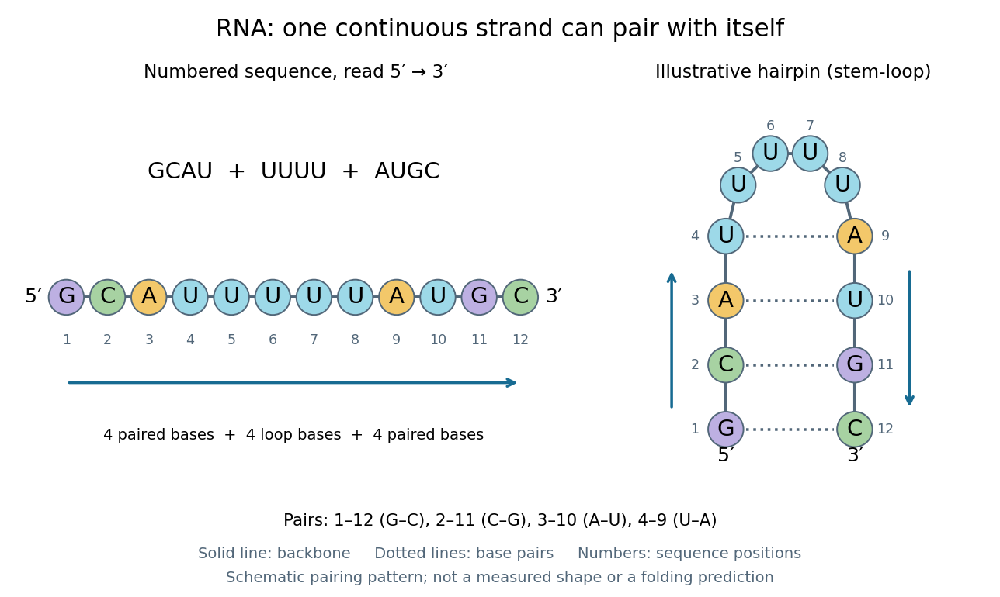

# Ribonucleic acid

↑ **Parent:** [Nucleic acid](nucleic-acid.md)

[Ribonucleic acid](ribonucleic-acid.md), or [RNA](ribonucleic-acid.md), is a [nucleotide](nucleotide.md) [polymer](polymer-split.md) whose [nucleotide sequence](nucleic-acid-sequence.md) can both carry information and organize a working molecular shape. Its backbone contains alternating [ribose](ribose.md) [sugars](sugar.md) and [phosphate](phosphate.md) groups connected through [covalent bonds](covalent-bond-split.md). Its usual [nucleobases](nucleotide-base.md) are [adenine](adenine.md) A, [uracil](uracil.md) U, [guanine](guanine.md) G, and [cytosine](cytosine.md) C. Thus [RNA](ribonucleic-acid.md) uses U where [DNA](deoxyribonucleic-acid.md) uses T; its [ribose](ribose.md) also differs chemically from [DNA](deoxyribonucleic-acid.md)'s [deoxyribose](deoxyribose.md). See [NHGRI: RNA](https://www.genome.gov/genetics-glossary/Ribonucleic-Acid-RNA).

In [transcription](transcription-biology.md), an [enzyme](enzyme-split.md) uses one [DNA](deoxyribonucleic-acid.md) strand as a template for [RNA](ribonucleic-acid.md). For example, the [DNA](deoxyribonucleic-acid.md) template $3'\text{-}\mathrm{TACGG}\text{-}5'$ specifies $5'\text{-}\mathrm{AUGCC}\text{-}3'$ in [RNA](ribonucleic-acid.md). The [base pairing](base-pairing.md) rules now include A–U rather than A–T, while G–C remains. This [RNA](ribonucleic-acid.md) matches the other [DNA](deoxyribonucleic-acid.md) strand's $5'$-to-$3'$ lettering after T is replaced by U. Identifying the template strand matters: replacing T by U in an arbitrarily chosen [DNA](deoxyribonucleic-acid.md) strand is not a general method for deriving the [RNA](ribonucleic-acid.md) product. See [Alberts et al., Molecular Biology of the Cell: from DNA to RNA](https://www.ncbi.nlm.nih.gov/books/NBK26887/).

[RNA](ribonucleic-acid.md) is often a single strand, but single-stranded does not mean straight or entirely unpaired. Complementary regions within one [RNA](ribonucleic-acid.md) [molecule](molecule-split.md) can undergo [base pairing](base-pairing.md), bringing distant positions together. Consider the illustrative twelve-[nucleotide](nucleotide.md) [nucleotide sequence](nucleic-acid-sequence.md) $5'\text{-}\mathrm{GCAUUUUUAUGC}\text{-}3'$. Pair positions 1 with 12, 2 with 11, 3 with 10, and 4 with 9. The resulting [stem-loop](stem-loop.md) has four [base pairs](base-pair.md): G–C, C–G, A–U, U–A. Positions 5–8 remain unpaired in the loop. Both arms belong to the same continuous backbone, and the paired arms have the directions of [antiparallel nucleic acid strands](antiparallel-nucleic-acid-strands.md).

**[Figure 12](#image-one-rna-nucleotide-sequence-two-drawings-numbered-letters-and-an-illustrative-stem-loop-with-four-base-pairs). One RNA nucleotide sequence, two drawings: numbered letters and an illustrative stem-loop with four base pairs**.

The diagram proposes a possible pairing pattern, not a prediction that this short [RNA](ribonucleic-acid.md) must adopt that shape under every condition. Actual [RNA](ribonucleic-acid.md) folding depends on additional interactions, [temperature](temperature-split.md), [ions](ion.md), and associated [proteins](protein-split.md); the full three-dimensional arrangement contains more information than the drawn [base pairs](base-pair.md). The example's purpose is to show how a linear [nucleotide sequence](nucleic-acid-sequence.md) can specify contacts within itself.

Different [RNA](ribonucleic-acid.md) roles make this flexibility useful. [Messenger RNA](messenger-rna.md) carries a message that a [ribosome](ribosome.md) reads during [translation](translation-biology.md) to build a [protein](protein-split.md). [Transfer RNA](transfer-rna.md) helps match that message to [amino acid](amino-acid.md) building blocks; see [NHGRI: transfer RNA](https://www.genome.gov/genetics-glossary/Transfer-RNA-tRNA). [Ribosomal RNA](ribosomal-rna.md) forms structural and catalytic parts of the [ribosome](ribosome.md). Other [RNA](ribonucleic-acid.md) participates in [gene regulatory networks](gene-regulatory-network.md), changing how strongly [genes](gene.md) are expressed. Many [RNA](ribonucleic-acid.md) [molecules](molecule-split.md) therefore function without being translated into [proteins](protein-split.md); for some [genes](gene.md), functional [RNA](ribonucleic-acid.md) is the product itself.

Most strikingly, some folded [RNA](ribonucleic-acid.md) acts as an [enzyme](enzyme-split.md): these catalytic [RNA](ribonucleic-acid.md) [molecules](molecule-split.md) are [ribozymes](ribozyme.md). The [ribosome](ribosome.md)'s bond-forming [active site](active-site.md) is built from [RNA](ribonucleic-acid.md), although the complete [ribosome](ribosome.md) also contains [proteins](protein-split.md). Structural evidence appears in [Nissen et al., The structural basis of ribosome activity in peptide bond synthesis, Science 289, 920–930 (2000)](https://pubmed.ncbi.nlm.nih.gov/10937990/). [RNA](ribonucleic-acid.md) therefore connects a readable record with physical recognition, regulation, and catalysis: the same kind of [polymer](polymer-split.md) can be a message, an adaptor, or part of molecular machinery.

**Table of contents**

- [Double-stranded RNA](double-stranded-rna.md)
- [Small nucleolar RNA](small-nucleolar-rna.md)
- [RNA localization](rna-localization.md)
- [RNA pseudoknot](rna-pseudoknot.md)
- [Small regulatory RNA](small-regulatory-rna.md)
  - [Piwi-interacting RNA](piwi-interacting-rna.md)
    - [21U RNA](21u-rna.md)
    - [piRNA ping-pong amplification](pirna-ping-pong-amplification.md)
    - [piRNA cluster](pirna-cluster.md)
- [MicroRNA](microrna.md)
  - [lin-4 microRNA](lin-4-microrna.md)
  - [MicroRNA-mediated deadenylation](microrna-mediated-deadenylation.md)
  - [miR2111](mir2111.md)
  - [MicroRNA-resistant target](microrna-resistant-target.md)
  - [MicroRNA mimic](microrna-mimic.md)
    - [MRX34](mrx34.md)
  - [MicroRNA seed region](microrna-seed-region.md)
  - [miR-34 family](mir-34-family.md)
  - [miR-16-1](mir-16-1.md)
  - [miR-15a](mir-15a.md)
  - [let-7](let-7.md)
- [RNA secondary structure](rna-secondary-structure.md)
  - [RNA looping](rna-looping.md)
  - [Iron-responsive element](iron-responsive-element.md)
  - [RNA modification switch](rna-modification-switch.md)
- [Messenger RNA](messenger-rna.md)
  - [caudal messenger RNA](caudal-messenger-rna.md)
  - [hunchback messenger RNA](hunchback-messenger-rna.md)
  - [bicoid messenger RNA](bicoid-messenger-rna.md)
  - [5′ untranslated region](5%E2%80%B2-untranslated-region.md)
  - [Polycistronic messenger RNA](polycistronic-messenger-rna.md)
  - [psbA messenger RNA](psba-messenger-rna.md)
  - [Beta-actin messenger RNA](beta-actin-messenger-rna.md)
  - [nanos messenger RNA](nanos-messenger-rna.md)
  - [3′ untranslated region](3%E2%80%B2-untranslated-region.md)
    - [Nanos response element](nanos-response-element.md)
  - [Decapping](decapping.md)
  - [Poly(A) tail](poly-a-tail.md)
    - [Deadenylation](deadenylation.md)
      - [CCR4-NOT complex](ccr4-not-complex.md)
  - [oskar messenger RNA](oskar-messenger-rna.md)
- [Transfer RNA](transfer-rna.md)
  - [Peptidyl-tRNA](peptidyl-trna.md)
  - [Anticodon](anticodon.md)
  - [Aminoacyl-tRNA](aminoacyl-trna.md)
  - [Methionyl-tRNA](methionyl-trna.md)
- [Ribosomal RNA](ribosomal-rna.md)
- [Polyuridylic acid](polyuridylic-acid.md)

## ↑ Ancestors (4)

1. [Nucleic acid](nucleic-acid.md)
2. [Polymer](polymer-split.md)
3. [Chemistry](chemistry-split.md)
4. [Codex Wiki](split.md)

## ← Incoming links (1)

- [Ribonucleic acid](ribonucleic-acid.md)
