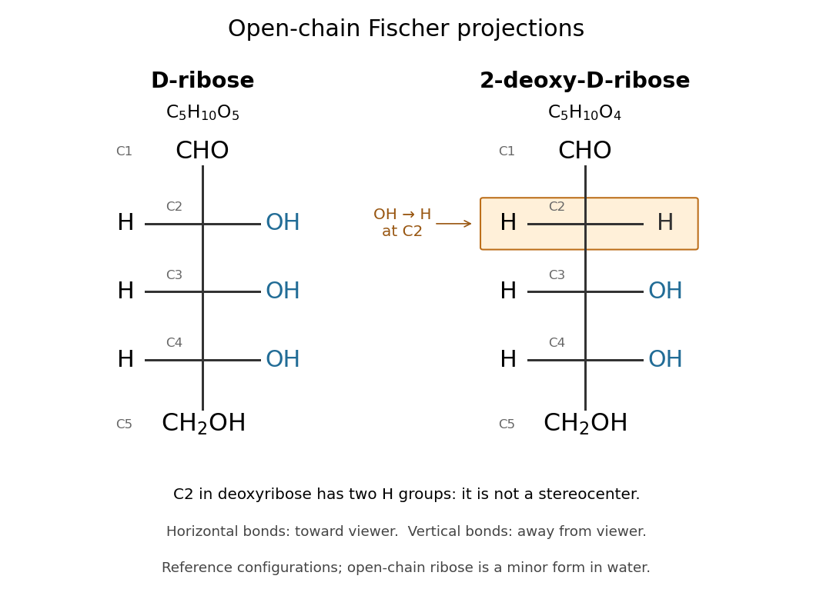

# Ribose

↑ **Parent:** [Sugar](sugar.md)  
ⓦ [Wiki](https://en.wikipedia.org/wiki/Ribose)

[Ribose](ribose.md) is a [monosaccharide](monosaccharide.md) with [molecular formula](molecular-formula.md) $\mathrm C_5\mathrm H_{10}\mathrm O_5$. Its biologically familiar form is D-ribose, an [aldopentose](aldopentose.md) whose open-chain [Fischer projection](fischer-projection.md) has $\mathrm{CHO}$ at the top, $\mathrm{CH}_2\mathrm{OH}$ at the bottom, and [hydroxy groups](hydroxy-group.md) on the right at C2, C3, and C4. The opposite horizontal substituents are [hydrogen](hydrogen.md). See [McMurry, Organic Chemistry, 25.3: D-ribose and D-glucose configurations](https://openstax.org/books/organic-chemistry/pages/25-3-d-l-sugars).

**[Figure 3](#image-open-chain-fischer-projections-of-d-ribose-and-2-deoxy-d-ribose). Open-chain Fischer projections of D-ribose and 2-deoxy-D-ribose**. At each cross, horizontal [chemical bonds](chemical-bond-split.md) point toward the viewer and vertical [chemical bonds](chemical-bond-split.md) point away. Both drawings number the free [sugar](sugar.md) from its [aldehyde](aldehyde.md) carbon, C1. In [deoxyribose](deoxyribose.md), C2 has two [hydrogen](hydrogen.md) substituents and is not a [stereocenter](stereocenter.md). These are open-chain reference structures, not a depiction of the predominant [chemical species](chemical-species.md) in [water](water.md).

Read the drawing by counting groups: $\mathrm{CHO}$ contributes $\mathrm C\mathrm H\mathrm O$, three $\mathrm{CHOH}$ groups contribute $\mathrm C_3\mathrm H_6\mathrm O_3$, and $\mathrm{CH}_2\mathrm{OH}$ contributes $\mathrm C\mathrm H_3\mathrm O$. Their sum is $\mathrm C_5\mathrm H_{10}\mathrm O_5$. The count checks composition; the right/right/right pattern additionally specifies the [stereochemistry](stereochemistry-split.md) of D-[ribose](ribose.md).

In [RNA](ribonucleic-acid.md), [ribose](ribose.md) occurs as a ring within each [nucleotide](nucleotide.md), joining a [nucleobase](nucleotide-base.md) to the [phosphate](phosphate.md)-linked backbone. Its C2 position retains a [hydroxy group](hydroxy-group.md), unlike [deoxyribose](deoxyribose.md) in [DNA](deoxyribonucleic-acid.md). In a [nucleotide](nucleotide.md), the [sugar](sugar.md) positions carry primes, so this is C2′. See [Alberts et al.: nucleotide sugars in RNA and DNA](https://www.ncbi.nlm.nih.gov/books/NBK26883/). Free [ribose](ribose.md) in [water](water.md) is also predominantly cyclic, with several ring forms in [chemical equilibrium](chemical-equilibrium.md) and very little open-chain form; the [Fischer projection](fischer-projection.md) is valuable for comparing configurations, not for estimating their abundances. See [Mason et al., The Conformation of a Ribose Derivative in Aqueous Solution: A Neutron Scattering and Molecular Dynamics Study (2013), introduction](https://pmc.ncbi.nlm.nih.gov/articles/PMC3819725/).

## ↑ Ancestors (5)

1. [Sugar](sugar.md)
2. [Carbohydrate](carbohydrate.md)
3. [Chemical substance](chemical-substance-split.md)
4. [Chemistry](chemistry-split.md)
5. [Codex Wiki](split.md)

## ← Incoming links (19)

- [Adenosine](adenosine.md)
- [Adenosine diphosphate](adenosine-diphosphate.md)
- [Adenosine monophosphate](adenosine-monophosphate.md)
- [Adenosine triphosphate](adenosine-triphosphate.md)
- [Aldopentose](aldopentose.md)
- [Carbohydrate](carbohydrate.md)
- [Deoxyribose](deoxyribose.md)
- [Fischer projection](fischer-projection.md)
- [Guanosine](guanosine.md)
- [Monosaccharide](monosaccharide.md)
- [Nucleic acid](nucleic-acid.md)
- [Nucleoside](nucleoside.md)
- [Nucleotide](nucleotide.md)
- [Solution](past-exam-of-the-chemistry-b-course-of-the-university-of-cambridge/2024/paper-2/b10/a/solution.md)
- [Ribonucleic acid](ribonucleic-acid.md)
- [Ribonucleotide](ribonucleotide.md)
- [Ribose](ribose.md)
- [Stereocenter](stereocenter.md)
- [Sugar](sugar.md)
