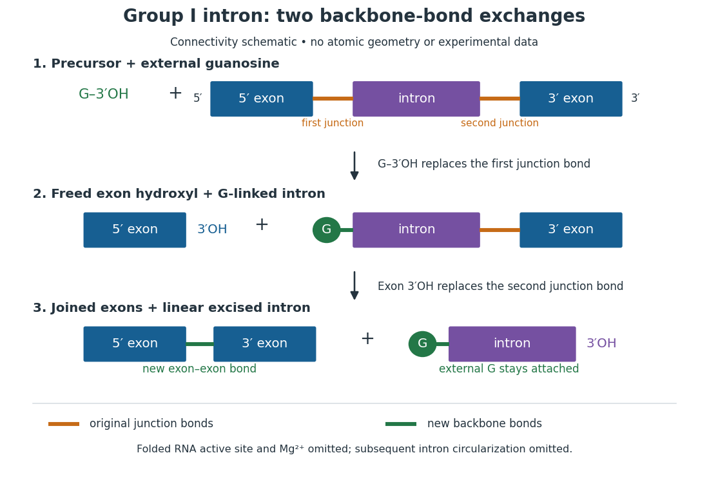
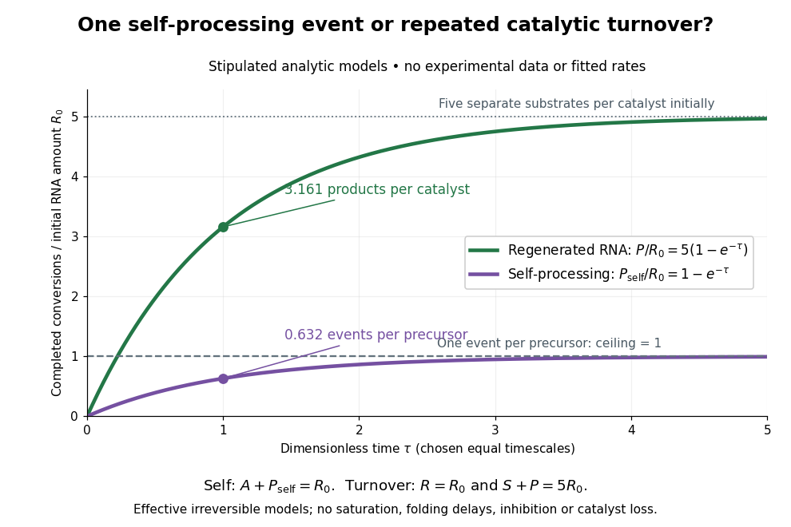

# Ribozyme

↑ **Parent:** [Enzyme](enzyme-split.md)  
ⓦ [Wiki](https://en.wikipedia.org/wiki/Ribozyme)

A [ribozyme](ribozyme.md) is an [RNA](ribonucleic-acid.md) [molecule](molecule-split.md) whose folded structure provides [catalysis](catalysis.md) of a [chemical reaction](chemical-reaction-split.md). A [protein](protein-split.md) [enzyme](enzyme-split.md) builds its [active site](active-site.md) from an [amino acid](amino-acid.md) chain; a [ribozyme](ribozyme.md) builds a working [active site](active-site.md) from [RNA](ribonucleic-acid.md), sometimes with metal [ions](ion.md) and associated [proteins](protein-split.md). [Base pairing](base-pairing.md) can help recognize a [substrate](substrate-biochemistry.md), but recognition alone does not establish [catalysis](catalysis.md): the [RNA](ribonucleic-acid.md) must promote chemical conversion. A passive [messenger RNA](messenger-rna.md) template being read by a [ribosome](ribosome.md) is not thereby a [ribozyme](ribozyme.md). See [Cech and Herschlag, Group I Ribozymes: Substrate Recognition, Catalytic Strategies, and Comparative Mechanistic Analysis, sections 1–3](https://herschlaglab.stanford.edu/s/39.pdf).

The surprise is that an information-bearing [polymer](polymer-split.md) can also perform chemistry. Examples include the self-splicing [group I intron](group-i-catalytic-intron.md) of Tetrahymena thermophila and the catalytic [RNA](ribonucleic-acid.md) component of bacterial [RNase P](ribonuclease-p.md), discussed below. The [ribosome](ribosome.md) supplies an everyday example: its [peptide bond](peptide-bond.md)-forming [active site](active-site.md) is made of [ribosomal RNA](ribosomal-rna.md), although the complete machine also contains [proteins](protein-split.md). Nissen and colleagues examined structures of a large [ribosome](ribosome.md) subunit with [substrate](substrate-biochemistry.md) analogues and found [RNA](ribonucleic-acid.md) contacting those analogues at the catalytic centre. This supports an [RNA](ribonucleic-acid.md) [active site](active-site.md), not a claim that isolated [ribosomal RNA](ribosomal-rna.md) can carry out all of [biological translation](translation-biology.md). See [Nissen, Hansen, Ban, Moore and Steitz, The structural basis of ribosome activity in peptide bond synthesis, Science 289 (2000), 920–930](https://pubmed.ncbi.nlm.nih.gov/10937990/).

For the Tetrahymena [group I intron](group-i-catalytic-intron.md), [RNA splicing](rna-splicing.md) removes the [intron](intron.md) and joins its flanking [exons](exon.md). The first chemical step uses the free $3'$ [hydroxyl group](hydroxy-group.md) of an external [guanosine](guanosine.md) to attack the [phosphodiester bond](phosphodiester-bond.md) at the $5'$ splice junction. This releases the upstream [exon](exon.md) with a free $3'$ [hydroxyl group](hydroxy-group.md) and attaches the [guanosine](guanosine.md) to the [intron](intron.md). That newly freed [hydroxyl group](hydroxy-group.md) then attacks the [phosphodiester bond](phosphodiester-bond.md) at the other splice junction, joining the [exons](exon.md) and releasing the linear [intron](intron.md). Each step exchanges one backbone connection for another; it is not simply separation of [base pairs](base-pair.md). See [Cech, Zaug and Grabowski, 1981: the phosphoester-transfer mechanism](https://pubmed.ncbi.nlm.nih.gov/6101203/).

**[Figure 3](#image-group-i-intron-self-splicing-an-external-guanosine-starts-two-exchanges-of-phosphodiester-bonds). Group I intron self-splicing: an external guanosine starts two exchanges of phosphodiester bonds**. Original chemical-connectivity schematic, not an atomic structure or measured reaction trace. Orange junctions are the two bonds replaced; green junctions are the new bonds. The folded [RNA](ribonucleic-acid.md) [active site](active-site.md) and [magnesium](magnesium.md) [ions](ion.md) are omitted. The linear excised [intron](intron.md) is shown before any subsequent circularization.

The motivating experiment began with an unexpected control. As Cech recounts, Zaug purified a [ribosomal RNA](ribosomal-rna.md) precursor from Tetrahymena using a detergent and phenol extraction, then compared test tubes with and without added [cell nucleus](cell-nucleus.md) extract. Incubation in salts and [nucleotides](nucleotide.md) released the same amount of small [intron](intron.md) [RNA](ribonucleic-acid.md) in both cases, detected by [gel electrophoresis](gel-electrophoresis.md). Repetition made a missing ingredient or accidental omission less plausible. Activity also survived treatments intended to destroy [proteins](protein-split.md). Nevertheless, absence of added extract did not by itself exclude a tightly attached, resistant [protein](protein-split.md), or prove that the small [RNA](ribonucleic-acid.md) had been newly excised rather than released from an already processed complex. See [Thomas R. Cech, 1989 Nobel lecture, pp. 655–659: the unexpected control and alternative explanations](https://www.nobelprize.org/uploads/2018/06/cech-lecture.pdf).

An independent chemical readout addressed the latter problem. Cech mixed precursor [RNA](ribonucleic-acid.md) with [phosphorus](phosphorus.md)-32-labelled [guanosine](guanosine.md) bearing three [phosphate](phosphate.md) groups (GTP), and used [gel electrophoresis](gel-electrophoresis.md) followed by exposure to X-ray film to locate the label. Label appeared in the excised [intron](intron.md) with [magnesium](magnesium.md) present; it was absent when [magnesium](magnesium.md) was omitted or labelled [ATP](adenosine-triphosphate.md) replaced the labelled [guanosine](guanosine.md) reagent. This experiment is described in [Cech, 1989 Nobel lecture, pp. 657–658: labelled-guanosine controls](https://www.nobelprize.org/uploads/2018/06/cech-lecture.pdf). The 1981 study established attachment through the [guanosine](guanosine.md) $3'$ [hydroxyl group](hydroxy-group.md) and showed that [guanosine](guanosine.md) without a triphosphate also supported excision: breaking down the added [nucleotide](nucleotide.md) to supply [energy](energy-split.md) was unnecessary. See [Cech, Zaug and Grabowski, In vitro splicing of the ribosomal RNA precursor of Tetrahymena, Cell 27 (1981), 487–496: primary abstract](https://pubmed.ncbi.nlm.nih.gov/6101203/). Separately, sequencing and terminal analysis found an extra $5'$ [guanosine](guanosine.md) absent from the corresponding [DNA](deoxyribonucleic-acid.md) sequence. See [Zaug and Cech, The intervening sequence excised from the ribosomal RNA precursor of Tetrahymena contains a 5-terminal guanosine residue not encoded by the DNA, Nucleic Acids Research 10 (1982), 2823–2838](https://pubmed.ncbi.nlm.nih.gov/7099968/). Together, incorporation and sequence evidence support a new [covalent bond](covalent-bond-split.md), beyond a change in how [RNA](ribonucleic-acid.md) associates.

Kruger, Grabowski, Zaug, Sands, Gottschling and Cech's 1982 test removed dependence on a precursor purified from Tetrahymena. They cloned the [intron](intron.md) and adjacent [exons](exon.md) into a [DNA](deoxyribonucleic-acid.md) template, made precursor [RNA](ribonucleic-acid.md) with purified bacterial [RNA polymerase](rna-polymerase.md) under conditions suppressing [RNA splicing](rna-splicing.md), and removed [proteins](protein-split.md) by detergent–phenol extraction. Denaturing [gel electrophoresis](gel-electrophoresis.md) separated precursor species. Purified precursor was then incubated with the [guanosine](guanosine.md) reagent, [magnesium](magnesium.md) and salt; matched samples without this incubation supplied a precursor baseline. Their standard assay used $10\,\mathrm{mM}$ magnesium chloride, $0.1\,\mathrm{mM}$ of that [guanosine](guanosine.md) reagent, $100\,\mathrm{mM}$ ammonium sulfate and a [buffer solution](buffer-solution.md) at [pH](ph.md) $7.5$, for $30$ minutes at [temperature](temperature-split.md) $37\,{}^{\circ}\mathrm C$, with specified variations in individual experiments. [Gel electrophoresis](gel-electrophoresis.md) and radioactive-film detection showed excised [intron](intron.md) [RNA](ribonucleic-acid.md); sequencing verified its $5'$ junction. See [Kruger et al., Self-Splicing RNA, Cell 31 (1982), 147–157, figures 3–4 and Experimental Procedures](https://dosequis.colorado.edu/courses/methodslogic/papers/Cech1982.pdf).

Excision alone could leave disconnected [exons](exon.md). To test joining, the authors paired labelled [RNA](ribonucleic-acid.md) with [DNA](deoxyribonucleic-acid.md) spanning the joined-[exon](exon.md) sequence, removed exposed [RNA](ribonucleic-acid.md) with [enzymes](enzyme-split.md), and separated the protected pieces by denaturing [gel electrophoresis](gel-electrophoresis.md). Spliced samples yielded protected [RNA](ribonucleic-acid.md) long enough to span the junction. See [Kruger et al., 1982, figure 6: independent evidence for exon ligation](https://dosequis.colorado.edu/courses/methodslogic/papers/Cech1982.pdf). The experimental logic matters: an [intron](intron.md)-sized band identifies a candidate product, while sequence and junction assays test its chemical identity.

These controls support sufficiency of the prepared [RNA](ribonucleic-acid.md) under the assay conditions. They do not show that every [RNA](ribonucleic-acid.md) self-splices, or that [proteins](protein-split.md) are dispensable inside a [biological cell](biological-cell-split.md). Many [group I introns](group-i-catalytic-intron.md) use [proteins](protein-split.md) to help attain an active fold. See [Cech and Herschlag, Group I Ribozymes, section 6: protein facilitation](https://herschlaglab.stanford.edu/s/39.pdf). Nor does a failed assay necessarily identify an inactive [nucleotide sequence](nucleic-acid-sequence.md): unsuitable [ions](ion.md), [pH](ph.md), or [temperature](temperature-split.md) can prevent a working [active site](active-site.md) from forming.

The distinction between self-processing and repeated use became especially clear with bacterial [RNase P](ribonuclease-p.md). In 1983 Guerrier-Takada, Gardiner, Marsh, Pace and Altman separated the [RNA](ribonucleic-acid.md) and [protein](protein-split.md) components of [RNase P](ribonuclease-p.md) from two [bacteria](bacteria.md). Purified [RNA](ribonucleic-acid.md) cleaved precursor [transfer RNA](transfer-rna.md) under conditions containing $60\,\mathrm{mM}$ [magnesium](magnesium.md) [ions](ion.md), or $10\,\mathrm{mM}$ [magnesium](magnesium.md) [ions](ion.md) plus $1\,\mathrm{mM}$ spermidine. The [protein](protein-split.md) components alone had no catalytic activity. At $5$–$10\,\mathrm{mM}$ [magnesium](magnesium.md) without spermidine, both components were needed. Thus the comparison demonstrated an [RNA](ribonucleic-acid.md) [catalyst](catalyst.md) while also explaining why [protein](protein-split.md) assistance could matter under other conditions. [RNase P](ribonuclease-p.md) produces the mature $5'$ end of [transfer RNA](transfer-rna.md) by removing its leader; it acts on a separate [substrate](substrate-biochemistry.md) and can be used again. See [Guerrier-Takada et al., The RNA moiety of ribonuclease P is the catalytic subunit of the enzyme, Cell 35 (1983), 849–857: primary abstract](https://pubmed.ncbi.nlm.nih.gov/6197186/).

Self-splicing demonstrates [RNA](ribonucleic-acid.md) chemistry, but one precursor completing one rearrangement is not yet evidence for catalytic turnover: repeated conversion of separate [substrates](substrate-biochemistry.md) by a regenerated [catalyst](catalyst.md). The self-splicing precursor changes its own connectivity and incorporates external [guanosine](guanosine.md). In 1986 Zaug and Cech showed that a shortened Tetrahymena [intron](intron.md) [RNA](ribonucleic-acid.md) could cleave and rejoin separate short [RNA](ribonucleic-acid.md) [substrates](substrate-biochemistry.md) in a sequence-dependent reaction. This demonstrated an [RNA](ribonucleic-acid.md) [enzyme](enzyme-split.md) acting beyond its own self-processing. See [Zaug and Cech, The intervening sequence RNA of Tetrahymena is an enzyme, Science 231 (1986), 470–475: primary abstract](https://pubmed.ncbi.nlm.nih.gov/3941911/).

**[Figure 4](#image-stipulated-chemical-kinetics-models-one-self-processing-event-versus-repeated-ribozyme-turnover). Stipulated chemical kinetics models: one self-processing event versus repeated ribozyme turnover**. Original analytical illustration, with dimensionless time and amounts normalized by the initial [RNA](ribonucleic-acid.md) amount. Curves are calculated from the equations below, not experimental data or fits to Tetrahymena or [RNase P](ribonuclease-p.md). Equal exponential timescales are a chosen teaching convention; the figure does not compare their biological speeds.

Read the second figure as a counting argument. In a stipulated model, $A$ denotes unprocessed precursor and $P_{\rm self}$ counts completed self-processing events. Set $A(0)=R_0$, $P_{\rm self}(0)=0$ and $dA/d\tau=-A$. The [exponential function](exponential-function.md) solution gives $P_{\rm self}/R_0=1-e^{-\tau}$, never exceeding one. Here [guanosine](guanosine.md) and other necessary reagents are taken to be available in excess; $P_{\rm self}$ counts events, not every separate [reaction product](product-chemistry.md) [molecule](molecule-split.md).

For a second stipulated model, let an unchanged [ribozyme](ribozyme.md) $R$ perform $R+S\longrightarrow R+P$ on a separate [substrate](substrate-biochemistry.md) $S$. Assume the effective [law of mass action](law-of-mass-action.md) $dS/dt=-kRS$, no reverse reaction, no [ribozyme](ribozyme.md) loss and no inhibited or long-lived bound states. Set $R=R_0$, $S(0)=5R_0$, $P(0)=0$ and $\tau=kR_0t$. Then $S/R_0=5e^{-\tau}$ and $P/R_0=5(1-e^{-\tau})$, with $S+P=5R_0$. At $\tau=1$, self-processing gives about $0.632$ completed events per initial [RNA](ribonucleic-acid.md), whereas the regenerated [ribozyme](ribozyme.md) gives about $3.161$ [reaction product](product-chemistry.md) [molecules](molecule-split.md) per initial [ribozyme](ribozyme.md). More than one [substrate](substrate-biochemistry.md) conversion per initial [ribozyme](ribozyme.md), with appropriate background and identity controls, is evidence for turnover. Product accumulation below that threshold alone cannot distinguish a reusable [catalyst](catalyst.md) from one-shot chemistry. These models illustrate that distinction; actual [enzyme kinetics](enzyme-kinetics.md) can include folding delays, binding, saturation and product release.

## ↑ Ancestors (3)

1. [Enzyme](enzyme-split.md)
2. [Biology](biology-split.md)
3. [Codex Wiki](split.md)

## ← Incoming links (9)

- [Active site](active-site.md)
- [Enzyme](enzyme-split.md)
- [Exon](exon.md)
- [Gel electrophoresis](gel-electrophoresis.md)
- [Group I catalytic intron](group-i-catalytic-intron.md)
- [Ribonuclease P](ribonuclease-p.md)
- [Ribonucleic acid](ribonucleic-acid.md)
- [Ribozyme](ribozyme.md)
- [RNA splicing](rna-splicing.md)
