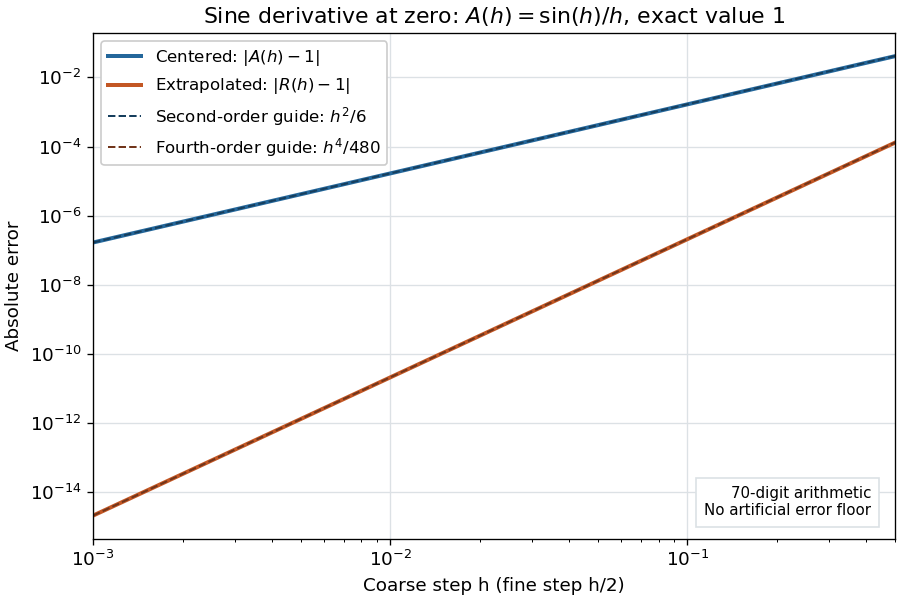
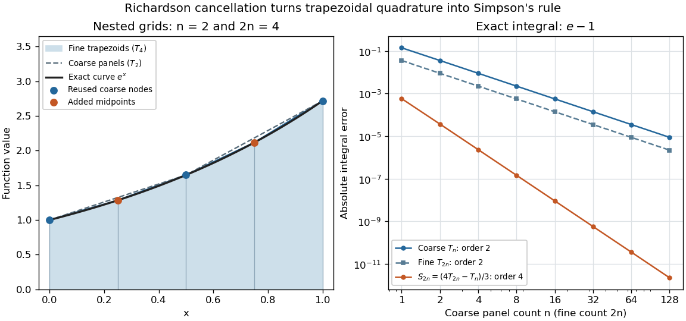

# Richardson extrapolation

↑ **Parent:** [Numerical analysis](numerical-analysis-split.md)  
ⓦ [Wiki](https://en.wikipedia.org/wiki/Richardson_extrapolation)

[Richardson extrapolation](richardson-extrapolation.md) improves an approximation by combining two resolutions so that their leading [truncation errors](truncation-error.md) cancel. The useful surprise is that the size of that leading error need not be known: its scaling under refinement is enough. This lets an existing [finite difference method](finite-difference-method.md) or [quadrature rule](quadrature-rule.md) produce a more accurate answer from two runs, without first deriving a new method from scratch.

Suppose $A(h)$ approximates a fixed [limit](limit-of-a-function.md) $L$ as the positive resolution parameter $h$ tends to zero, with an [asymptotic expansion](asymptotic-expansion-split.md)

$$
A(h)=L+c h^p+O(h^{p+q}),\qquad p>0,\quad q>0.
$$

Here $p$ is known, $c$ is independent of $h$, and $O$ denotes [Big O notation](big-o-notation.md). The same [asymptotic expansion](asymptotic-expansion-split.md), with the same $c$, must describe both $h$ and $h/2$. Nested grids make it natural to reuse samples, although nesting itself does not establish this error model. Define the [linear combination](linear-combination.md)

$$
R(h)=\frac{2^p A(h/2)-A(h)}{2^p-1}
=A(h/2)+\frac{A(h/2)-A(h)}{2^p-1}.
$$

The weights sum to one, preserving $L$, while $2^p c(h/2)^p-c h^p=0$. Thus [Richardson extrapolation](richardson-extrapolation.md) gives $R(h)=L+O(h^{p+q})$: the next available term in the [asymptotic expansion](asymptotic-expansion-split.md) determines the improved order. Justin Solomon's numerical analysis text develops this cancellation for [finite differences](finite-difference-split.md) and applies it to [numerical integration](numerical-integration-split.md).[Justin Solomon, Numerical Algorithms, §14.3.3 and Exercise 14.9](https://people.csail.mit.edu/jsolomon/share/book/numerical_book.pdf)

Geometrically, regard the approximation as a [function](function-split.md) of $t=h^p$. Its first two terms are a straight line $L+ct$. The two computed points lie at positive $t$; extending the line through them to $t=0$ gives $R(h)$. This is why the operation is extrapolation: it estimates a value outside the sampled parameter interval. The remaining curvature corresponds to the uncancelled terms of the [asymptotic expansion](asymptotic-expansion-split.md).

**Worked example: a centered derivative of sine**. For the [smooth function](smooth-function.md) $f(x)=\sin x$, the exact [derivative](derivative.md) at $x=0$ is $L=\cos0=1$. The centered [difference quotient](difference-quotient.md), a [central finite difference](central-finite-difference.md), is

$$
A(h)=\frac{f(h)-f(-h)}{2h}=\frac{\sin h}{h}.
$$

The [Taylor series](taylor-series.md) of [sine](sine.md) gives the signed [truncation error](truncation-error.md)

$$
A(h)-1=-\frac{h^2}{6}+\frac{h^4}{120}+O(h^6).
$$

Thus $p=2$, $q=2$ and $c=-1/6$. Halving $h$ divides the leading [truncation error](truncation-error.md) by four. Combining the two centered [difference quotients](difference-quotient.md) with [Richardson extrapolation](richardson-extrapolation.md) gives

$$
R(h)=\frac{4A(h/2)-A(h)}{3},\qquad
R(h)-1=-\frac{h^4}{480}+O(h^6).
$$

Indeed, the $h^4$ coefficient becomes $(4/16-1)/(3\cdot120)=-1/480$; the $h^2$ coefficient vanishes. This is the even-power case of [Richardson extrapolation](richardson-extrapolation.md) discussed in Persson's authored lecture notes.[Per-Olof Persson, Math 128A, Chapter 4, §§4.1–4.2](https://persson.berkeley.edu/math128a/lecture_notes/math128a_lecture_notes_chapter_4.html)

For $h=0.4$ and $h/2=0.2$, the actual computations are

$$
\begin{aligned}
A(0.4)&\approx0.973545855771626,\\
A(0.2)&\approx0.993346653975306,\\
R(0.4)&\approx0.999946920043199.
\end{aligned}
$$

The absolute error drops from about $2.6454\times10^{-2}$ for $A(0.4)$ to $5.3080\times10^{-5}$ for $R(0.4)$, an improvement by roughly a factor of 498. Refining again gives $R(0.2)\approx0.999996670632607$, whose absolute error is about $3.3294\times10^{-6}$. The refined [truncation errors](truncation-error.md) decrease by nearly four for $A$ and nearly sixteen for $R$, reflecting their second and fourth orders.

**[Figure 8](#image-centered-sine-derivative-errors-second-order-before-richardson-extrapolation-and-fourth-order-after-cancellation). Centered sine derivative errors: second order before Richardson extrapolation and fourth order after cancellation**. [Source](richardson-derivative-error-orders.py).

The [logarithmic scale](logarithmic-scale.md) on each axis turns power laws into straight lines. The dashed reference curves are $h^2/6$ and $h^4/480$, the magnitudes of the leading [truncation errors](truncation-error.md). The plotted errors are computed with 70-digit decimal arithmetic, rather than clipped to a display floor; this isolates the [asymptotic expansion](asymptotic-expansion-split.md) from [roundoff error](round-off-error.md).

**Worked example: integrating an exponential**. Approximate the [definite integral](definite-integral.md) of the [exponential function](exponential-function.md) on $[0,1]$:

$$
L=\int_0^1 e^x\,dx=e-1\approx1.718281828459045.
$$

For [numerical integration](numerical-integration-split.md), the composite [trapezoidal rule](trapezoidal-rule.md) adds the areas of trapezoids between successive samples; this is the quadrature use of the endpoint average that also occurs in the ODE [trapezoidal rule](trapezoidal-rule.md). On $n$ equal intervals, with $h=1/n$, define

$$
T_n=h\left[\frac{1+e}{2}+\sum_{j=1}^{n-1}e^{jh}\right].
$$

Summing the [geometric series](geometric-series.md) gives $T_n=(e-1)\frac h2\frac{e^h+1}{e^h-1}$. Expanding the [exponential function](exponential-function.md) near zero yields

$$
T_n-L=L\left(\frac{h^2}{12}-\frac{h^4}{720}+O(h^6)\right).
$$

The leading [truncation error](truncation-error.md) again has $p=2$, $q=2$. On the uniform nested grids with $n$ and $2n$ intervals, [Richardson extrapolation](richardson-extrapolation.md) therefore gives

$$
S_{2n}=\frac{4T_{2n}-T_n}{3},\qquad
S_{2n}-L=\frac{Lh^4}{2880}+O(h^6).
$$

This [linear combination](linear-combination.md) is exactly composite [Simpson's rule](simpson-s-rule.md) on the finer grid, whose spacing is $h/2$. On each coarse panel, an old endpoint receives weight $h/6$ and the new [midpoint](midpoint.md) weight $2h/3$; shared old endpoints receive weight $h/3$. These are the usual [Simpson's rule](simpson-s-rule.md) weights $1,4,2,\ldots,4,1$ multiplied by $h/6$. The equivalence is explained directly in LeMesurier's university notes.[Brenton LeMesurier, MATH 375, §19.1: The Basic Simpson's Rule by Richardson Extrapolation](https://lemesurierb.people.charleston.edu/elementary-numerical-analysis-python/notebooks/definite-integrals-3-simpson-richardson.html)

For two coarse panels and four fine panels,

$$
\begin{aligned}
T_2&\approx1.753931092464825,\\
T_4&\approx1.727221904557517,\\
S_4&\approx1.718318841921747.
\end{aligned}
$$

The absolute errors are about $0.0356493$, $0.00894008$ and $0.0000370135$, respectively. Reusing the fine-grid samples makes [Richardson extrapolation](richardson-extrapolation.md) especially attractive here: the resulting [Simpson's rule](simpson-s-rule.md) needs no samples beyond those already used by $T_{2n}$.

**[Figure 9](#image-exponential-quadrature-on-nested-grids-trapezoidal-areas-reused-sample-nodes-and-the-fourth-order-simpson-combination). Exponential quadrature on nested grids: trapezoidal areas, reused sample nodes, and the fourth-order Simpson combination**. [Source](richardson-trapezoid-extrapolation.py).

**When the improvement is justified**. [Richardson extrapolation](richardson-extrapolation.md) requires the stated [asymptotic expansion](asymptotic-expansion-split.md) and the correct positive $p$. If the actual leading exponent is $r\ne p$, its coefficient after combination is $c(2^{p-r}-1)/(2^p-1)$, so the leading [truncation error](truncation-error.md) generally remains. Merely knowing $A(h)-L=O(h^p)$ does not supply a common coefficient $c$ or a higher-order remainder. A [discontinuity of a function](discontinuity-of-a-function.md), a singular endpoint, or unrelated changes between grids can invalidate the assumed [asymptotic expansion](asymptotic-expansion-split.md); refinement alone does not guarantee improvement for every numerical problem.

[Roundoff error](round-off-error.md) and errors in the sampled values survive the cancellation of [truncation error](truncation-error.md). If the coarse and fine values have absolute perturbations bounded by $\varepsilon$, the perturbation in $R(h)$ is bounded by $(2^p+1)\varepsilon/(2^p-1)$; for $p=2$ this is $5\varepsilon/3$. In [floating-point arithmetic](floating-point-arithmetic-split.md), a centered [difference quotient](difference-quotient.md) can also amplify sample errors through division by $h$, so an indefinitely smaller $h$ need not be more accurate. Persson's notes describe this balance between [truncation error](truncation-error.md) and [roundoff error](round-off-error.md).[Per-Olof Persson, Math 128A, Chapter 4, §4.1: Roundoff Error Instability](https://persson.berkeley.edu/math128a/lecture_notes/math128a_lecture_notes_chapter_4.html)

The same cancellation idea appears in [step-doubling error estimation](step-doubling-error-estimation.md). For an order-$p$ one-step method for an [ordinary differential equation](ordinary-differential-equation.md), two half steps each contribute [local truncation error](local-truncation-error.md) of order $h^{p+1}$, so their accumulated leading local error has ratio $2^{-p}$ to one full step. This explains the denominator $2^p-1$ there; the appropriate exponent follows from that local error model, rather than automatically from a generic use of [Richardson extrapolation](richardson-extrapolation.md).

## ↑ Ancestors (5)

1. [Numerical analysis](numerical-analysis-split.md)
2. [Analysis](analysis-split.md)
3. [Area of mathematics](area-of-mathematics.md)
4. [Mathematics](mathematics-split.md)
5. [Codex Wiki](split.md)

## ← Incoming links (6)

- [Adaptive Euler step doubling for exponential decay](adaptive-euler-step-doubling-for-exponential-decay.md)
- [Composite Simpson's rule](composite-simpson-s-rule.md)
- [Solution](past-exam-of-the-mathematics-course-of-the-university-of-cambridge/2005/iii/paper-69/7/solution.md)
- [Solution](past-exam-of-the-mathematics-course-of-the-university-of-cambridge/2012/iii/paper-69/6/solution.md)
- [Richardson extrapolation](richardson-extrapolation.md)
- [Step-doubling error estimation](step-doubling-error-estimation.md)
