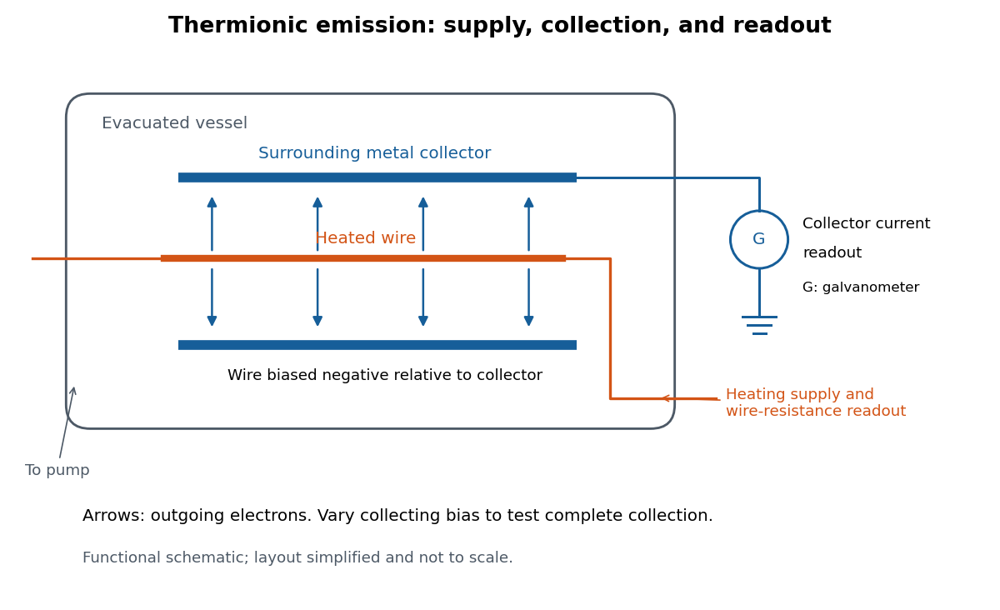

# Richardson hot-wire emission experiment

↑ **Parent:** [Thermionic emission](thermionic-emission-split.md)

In his Nobel lecture, delivered on 12 December 1929 for the 1928 prize, [Owen Willans Richardson](owen-willans-richardson.md) recalled heating wires for weeks while hand-pumping away gas released by the apparatus. With [platinum](platinum.md), he found a finite emission per unit area that rose rapidly with [temperature](temperature-split.md). His initial 1901 formula used $T^{1/2}$; he preferred the $T^2$ form in 1911.[Nobel Lectures, Physics 1922–1941; pp. 224–225 and 229, preparation and chronology](nobel-lectures-physics-1922-1941/thermionic-phenomena-and-the-laws-which-govern-them-by-owen-willans-richardson.md)

The early apparatus surrounded a heated [platinum](platinum.md) wire with a metal cylinder connected to earth through a [galvanometer](galvanometer.md). Wire [electrical resistance](electrical-resistance.md) supplied the [temperature](temperature-split.md) readout. After checking collection saturation, Richardson measured at a wire potential of $-120\,\mathrm V$, over roughly $1300$–$1600\,\mathrm K$; reversing polarity suppressed the negative discharge.[Histories of the Electron: The Birth of Microphysics edited by Jed Z. Buchwald and Andrew Warwick; pp. 229–231, resistance thermometry and Fig. 7.2, reproducing the 1903 apparatus](histories-of-the-electron-the-birth-of-microphysics-edited-by-jed-z-buchwald-and-andrew-warwick/o-w-richardson-and-the-electron-theory-of-matter-1901-1916-by-ole-knudsen.md)

**[Figure 2](#image-heated-wire-emission-and-separate-collection-and-temperature-measurements). Heated-wire emission and separate collection and temperature measurements**. Original functional schematic of the measurement principle, with a wire and surrounding collector shown in section. The layout is simplified; no dimensions or instrument performance are asserted.

The inference rests on several controls. A [temperature](temperature-split.md) sweep probes thermal escape; reversing the collecting [electric field](electric-field-split.md) tests the sign of the mobile [electric charge](electric-charge-split.md); varying collection voltage tests whether transport is limiting. Prolonged pumping and heating test whether a transient gas release is responsible. These controls address different alternatives, and none by itself establishes a clean, uniform surface.

For a modern repetition, stabilize each [temperature](temperature-split.md), measure the collector [electric current](electric-current.md) against collecting [electric potential difference](electric-potential-difference.md), and record the pressure and surface preparation. Repeat selected [temperatures](temperature-split.md) after cooling to reveal drift. Use the collection plateau and the actual emitting area to construct a [Richardson plot](richardson-plot.md). The resulting slope estimates the [work function](work-function.md) only within the stated surface and transport assumptions; it does not turn an uncontrolled wire into a reference material.

## ↑ Ancestors (5)

1. [Thermionic emission](thermionic-emission-split.md)
2. [Electron](electron.md)
3. [Subatomic particle](subatomic-particle.md)
4. [Physics](physics-split.md)
5. [Codex Wiki](split.md)
