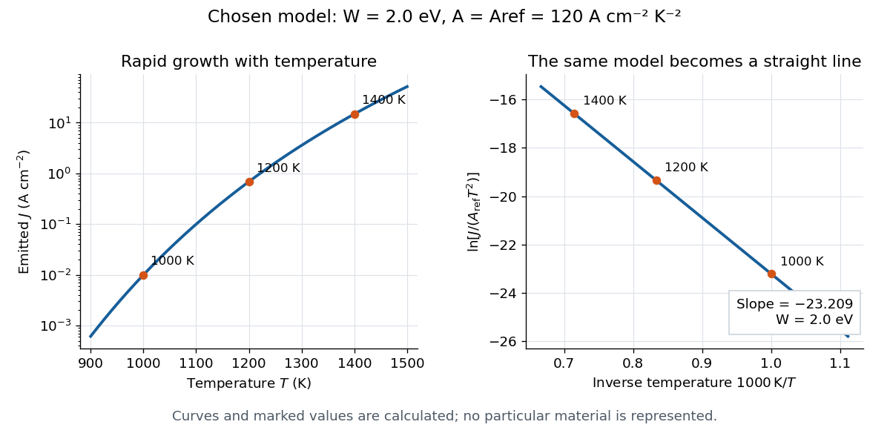

# Richardson plot

↑ **Parent:** [Richardson-Dushman law](richardson-dushman-law.md)

Choose a fixed positive reference $A_{\rm ref}$ with the same units as $A$. Taking the [natural logarithm](natural-logarithm.md) of a dimensionless ratio gives

$$
x=\frac1T,\qquad
y=\ln\!\left(\frac{J}{A_{\rm ref}T^2}\right)
=\ln\!\left(\frac{A}{A_{\rm ref}}\right)-\frac{W}{k_B}x.
$$

Thus the [Richardson plot](richardson-plot.md) is a [straight line](straight-line.md) when $A$ and $W$ are constant, with slope $-W/k_B$ and intercept $\ln(A/A_{\rm ref})$. The familiar notation $\ln(J/T^2)$ silently chooses units; the reference makes that choice explicit. Changing $A_{\rm ref}$ shifts the intercept and leaves the inferred [work function](work-function.md) unchanged. If the horizontal axis instead uses $1000\,\mathrm K/T$, its slope is $-W/(1000\,\mathrm K\,k_B)$.

For the chosen $2.0\,\mathrm{eV}$ example, choose $A_{\rm ref}=120\,\mathrm{A\,cm^{-2}\,K^{-2}}$. Then $y(1000\,\mathrm K)=-23.2090$ and $y(1200\,\mathrm K)=-19.3409$. Their slope is approximately $-23209\,\mathrm K$, giving $W=2.0\,\mathrm{eV}$. Two [temperatures](temperature-split.md) determine a line algebraically; several [temperatures](temperature-split.md) allow curvature and drift to be detected. These values are calculated, rather than experimental observations.

**[Figure 1](#image-one-chosen-emission-model-as-a-temperature-curve-and-a-dimensionless-richardson-plot). One chosen emission model as a temperature curve and a dimensionless Richardson plot**. The marked values are calculations with constant $W=2.0\,\mathrm{eV}$ and $A=A_{\rm ref}=120\,\mathrm{A\,cm^{-2}\,K^{-2}}$. They illustrate the [Richardson-Dushman law](richardson-dushman-law.md), rather than a particular material or a historical measurement.

A straight trace alone does not establish a unique surface [work function](work-function.md). [Adsorption](adsorption.md), changing [surface coverage](surface-coverage.md), or a mixture of regions with different barriers can change the inferred slope. For independent emitting patches with area fractions $f_i$, constant $A_i$ and barriers $W_i$,

$$
J=T^2\sum_i f_i A_i e^{-W_i/(k_BT)},\qquad \sum_i f_i=1.
$$

Lower barriers contribute disproportionately. Even with fixed patches, the slope of the [Richardson plot](richardson-plot.md) gives a [temperature](temperature-split.md)-dependent weighted mean of the $W_i$, rather than their simple area average. If $A$ or $W$ themselves vary with [temperature](temperature-split.md), the apparent slope-derived barrier becomes

$$
W_{\rm app}=-k_B\frac{dy}{d(1/T)}
=W-T\frac{dW}{dT}+k_BT^2\frac{d\ln A}{dT}.
$$

Check collection, [temperature](temperature-split.md) calibration, and surface stability before assigning curvature to a new emission mechanism.

## ↑ Ancestors (6)

1. [Richardson-Dushman law](richardson-dushman-law.md)
2. [Thermionic emission](thermionic-emission-split.md)
3. [Electron](electron.md)
4. [Subatomic particle](subatomic-particle.md)
5. [Physics](physics-split.md)
6. [Codex Wiki](split.md)

## ← Incoming links (3)

- [Richardson hot-wire emission experiment](richardson-hot-wire-emission-experiment.md)
- [Richardson plot](richardson-plot.md)
- [Thermionic emission](thermionic-emission-split.md)
