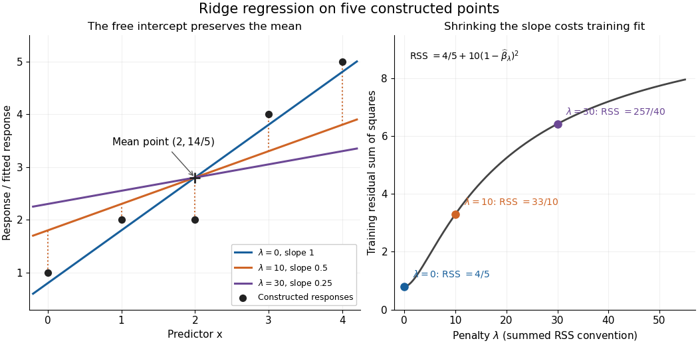
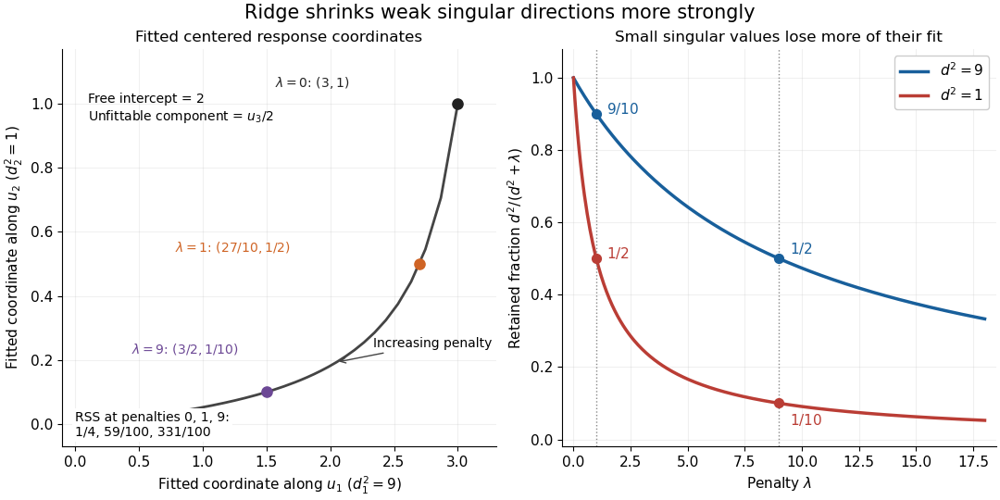

# Ridge regression

↑ **Parent:** [Linear regression](linear-regression-split.md)  
ⓦ [Wiki](https://en.wikipedia.org/wiki/Ridge_regression)

[Ridge regression](ridge-regression.md) fits a [linear regression](linear-regression-split.md) model while penalizing the size of its slope [regression coefficients](regression-coefficient.md). For a fixed $n\times p$ [design matrix](design-matrix.md) $X$ containing the slope predictors, observed responses $Y$, and an unpenalized [regression intercept](regression-intercept.md) $\alpha$, the objective is

$$
(\widehat\alpha_\lambda,\widehat\beta_\lambda)=\underset{\alpha\in\mathbb R,\,\beta\in\mathbb R^p}{\operatorname{argmin}}\left\{\|Y-\alpha\mathbf1-X\beta\|_2^2+\lambda\|\beta\|_2^2\right\},\qquad\lambda\geq0.
$$

Here $\mathbf1$ is the all-ones [vector](vector.md), and $\|\beta\|_2^2=\sum_j\beta_j^2$ is the [squared Euclidean norm](squared-euclidean-norm.md) of the slopes alone. The first term is the [residual sum of squares](residual-sum-of-squares.md); the second implements [regularization](regularization.md). No random-error assumption is needed to define this fit. The convention is a summed [squared-error loss](squared-error-loss.md): writing the objective as $n^{-1}\operatorname{RSS}+\lambda_{\mathrm{avg}}\|\beta\|_2^2$ gives the same fit when $\lambda=n\lambda_{\mathrm{avg}}$.[slides 5 and 7: summed squared-error objective and unpenalized intercept](data-mining-36-462-and-36-662/modern-regression-1-ridge-regression.md)

For an exact example, reuse the constructed pairs $(x_i,Y_i)=(0,1),(1,2),(2,2),(3,4),(4,5)$ from [linear regression](linear-regression-split.md). Their [sample means](sample-mean.md) are $\bar x=2$ and $\bar Y=14/5$, and the centered cross-products are $\sum_i(x_i-2)^2=10$ and $\sum_i(x_i-2)(Y_i-14/5)=10$. Thus

$$
\widehat\beta_\lambda=\frac{10}{10+\lambda},\qquad\widehat\alpha_\lambda=\frac{14}{5}-2\widehat\beta_\lambda,\qquad\widehat Y_i=\frac{14}{5}+\widehat\beta_\lambda(x_i-2).
$$

The [ordinary least squares](ordinary-least-squares.md) line has slope $1$ and [residual sum of squares](residual-sum-of-squares.md) $4/5$. At $\lambda=10$, [ridge regression](ridge-regression.md) has slope $1/2$, [regression intercept](regression-intercept.md) $9/5$, and [residual sum of squares](residual-sum-of-squares.md) $33/10$; at $\lambda=30$ these become $1/4$, $23/10$, and $257/40$. Every line passes through $(2,14/5)$: the penalty reduces the slope while retaining the response [sample mean](sample-mean.md).

**[Figure 3](#image-exact-synthetic-ridge-fits-flatten-around-the-sample-mean-as-training-rss-increases). Exact synthetic ridge fits flatten around the sample mean as training RSS increases**.

The computational benefit is visible after [predictor centering](predictor-centering.md). Write $X_c$ for the [design matrix](design-matrix.md) with each column's [sample mean](sample-mean.md) subtracted, and $Y_c=Y-\bar Y\mathbf1$. The [unpenalized intercept in ridge regression](unpenalized-intercept-in-ridge-regression.md) gives $\widehat\alpha_\lambda=\bar Y-\bar x^T\widehat\beta_\lambda$, and the [closed-form ridge regression estimator](closed-form-ridge-regression-estimator.md) solves

$$
(X_c^TX_c+\lambda I_p)\widehat\beta_\lambda=X_c^TY_c.
$$

For any nonzero [vector](vector.md) $v$ and $\lambda>0$, $v^T(X_c^TX_c+\lambda I_p)v=\|X_cv\|_2^2+\lambda\|v\|_2^2>0$. This [positive-definite matrix](positive-definite-matrix.md) is therefore invertible even when $X_c$ lacks [full column rank](full-column-rank.md), including repeated columns or $p\geq n$. The unique penalized slopes resolve the ambiguity of [rank-deficient ordinary least squares](rank-deficient-ordinary-least-squares.md); they do not supply evidence about slope directions absent from the data. This makes [ridge regression](ridge-regression.md) useful for [multicollinearity](multicollinearity.md).[p. 1, equations (1)–(2): uniqueness for positive penalty regardless of design rank](advanced-topics-in-statistical-learning-spring-2023/high-dimensional-regression-ridge.md)

[Predictor centering](predictor-centering.md) and scaling serve different purposes. Centering handles the free [regression intercept](regression-intercept.md). Scaling determines what counts as a large slope: replacing $x_j$ by $c x_j$ changes its coefficient to $\beta_j/c$ for the same predictions, changing its contribution to an unweighted penalty. A common convention forms [standard scores](standard-score.md) $z_{ij}=(x_{ij}-\bar x_j)/s_j$ using each nonconstant predictor's sample [standard deviation](standard-deviation.md) $s_j$, then penalizes slopes $\theta_j$ in those coordinates. Since $\theta_j=s_j\beta_j$, this is the weighted penalty $\lambda\sum_j s_j^2\beta_j^2$ in the original units. Constant columns have $s_j=0$ and must be removed before this scaling. Scaling is a modelling choice; equal penalties in original units and in standardized units define different fits.[slide 7: center predictors, leave the intercept free and scale predictors to sample variance one](data-mining-36-462-and-36-662/modern-regression-1-ridge-regression.md)

The [singular value decomposition](singular-value-decomposition.md) explains the shrinkage. If $X_c=UDV^T$ is the compact decomposition using the $r$ positive [singular values](singular-value.md) $d_j$, with columns $u_j$ of $U$, then

$$
\widehat Y_\lambda=\bar Y\mathbf1+\sum_{j=1}^r\frac{d_j^2}{d_j^2+\lambda}\,u_j u_j^TY_c.
$$

The [principal-component shrinkage by ridge regression](principal-component-shrinkage-by-ridge-regression.md) factors are between $0$ and $1$: directions with small [singular values](singular-value.md) are damped most. As $\lambda\to\infty$, the [fitted values](fitted-values.md) approach $\bar Y\mathbf1$; the [vanishing-penalty ridge limit](vanishing-penalty-ridge-limit.md) recovers the [ordinary least squares](ordinary-least-squares.md) fitted vector as $\lambda\downarrow0$, even if the slope estimates at zero penalty are nonunique. The [covariance and bias of a ridge regression estimator](covariance-and-bias-of-a-ridge-regression-estimator.md) describes the resulting [bias-variance tradeoff](bias-variance-tradeoff.md). A penalty can reduce [variance of an estimator](variance-of-an-estimator.md) while introducing [bias of an estimator](bias-of-an-estimator.md); the [unbounded directional risk of fixed ridge shrinkage](unbounded-directional-risk-of-fixed-ridge-shrinkage.md) rules out a uniform improvement for a fixed positive penalty over all possible signals.[pp. 1–2: shrinkage of fitted principal-component directions](advanced-topics-in-statistical-learning-spring-2023/high-dimensional-regression-ridge.md)

For a second exact construction, choose a centered [orthonormal set](orthonormal-set.md) of three [vectors](vector.md),

$$
u_1=\tfrac12(1,-1,1,-1)^T,\qquad u_2=\tfrac12(1,1,-1,-1)^T,\qquad u_3=\tfrac12(1,-1,-1,1)^T,
$$

and set $X=(3u_1,u_2)$ and $Y=2\mathbf1+3u_1+u_2+\tfrac12u_3$. The squared [singular values](singular-value.md) are $9$ and $1$. At $\lambda=1$, the fitted coordinates along $u_1,u_2$ are $(27/10,1/2)$, retaining $9/10$ and $1/2$ of their [ordinary least squares](ordinary-least-squares.md) values $(3,1)$. At $\lambda=9$ they become $(3/2,1/10)$, retaining $1/2$ and $1/10$. The unfittable $u_3/2$ component contributes $1/4$ to every [residual sum of squares](residual-sum-of-squares.md), giving total values $1/4$, $59/100$, and $331/100$ at penalties $0,1,9$. These are constructed fits, not measured prediction results.

**[Figure 4](#image-exact-synthetic-ridge-shrinkage-retains-the-strong-singular-direction-longer-than-the-weak-one). Exact synthetic ridge shrinkage retains the strong singular direction longer than the weak one**.

The penalty $\lambda$ is a [hyperparameter](hyperparameter.md), so fitting slopes at a fixed value and selecting that value are separate tasks. Use a [validation set](validation-set.md) or [K-fold cross-validation](k-fold-cross-validation.md) to compare candidate penalties by held-out [squared-error loss](squared-error-loss.md). In each split, compute predictor [sample means](sample-mean.md) and scales from that split's [training data](training-data.md), apply the same transformation to its [validation set](validation-set.md), and refit the slopes; using held-out information in preprocessing introduces [data leakage](data-leakage.md). Minimum training [residual sum of squares](residual-sum-of-squares.md) cannot select useful shrinkage: [ordinary least squares](ordinary-least-squares.md) already attains the smallest possible value.[slides 5–8 and 11–14: tuning for prediction, training error and refitting on each training fold](data-mining-36-462-and-36-662/model-selection-and-validation-1-cross-validation.md) After [model selection](model-selection.md), refit on all [training data](training-data.md) with the selected penalty. A separate [test set](test-set.md) or [nested cross-validation](nested-cross-validation.md) assesses the entire selection procedure; a low selected validation score alone is no performance guarantee.[pp. 2079–2080: selection as part of fitting and nested assessment](on-over-fitting-in-model-selection-and-subsequent-selection-bias-in-performance-evaluation-by-gavin-c-cawley-and-others.md)

**Table of contents**

- [Gaussian posterior representation of ridge regression](gaussian-posterior-representation-of-ridge-regression.md)
- [Unbounded directional risk of fixed ridge shrinkage](unbounded-directional-risk-of-fixed-ridge-shrinkage.md)
- [Uniform directional risk improvement by ridge regression](uniform-directional-risk-improvement-by-ridge-regression.md)
- [Unpenalized intercept in ridge regression](unpenalized-intercept-in-ridge-regression.md)
- [Covariance and bias of a ridge regression estimator](covariance-and-bias-of-a-ridge-regression-estimator.md)
- [Closed-form ridge regression estimator](closed-form-ridge-regression-estimator.md)
  - [Vanishing-penalty ridge limit](vanishing-penalty-ridge-limit.md)
  - [Primal-dual identity for ridge regression](primal-dual-identity-for-ridge-regression.md)
  - [Principal-component shrinkage by ridge regression](principal-component-shrinkage-by-ridge-regression.md)

## ↑ Ancestors (8)

1. [Linear regression](linear-regression-split.md)
2. [Normal linear model](normal-linear-model-split.md)
3. [Statistical modelling](statistical-modelling-split.md)
4. [Statistical model](statistical-model-split.md)
5. [Probability and statistics](probability-and-statistics-split.md)
6. [Area of mathematics](area-of-mathematics.md)
7. [Mathematics](mathematics-split.md)
8. [Codex Wiki](split.md)

## ← Incoming links (38)

- [Closed-form ridge regression estimator](closed-form-ridge-regression-estimator.md)
- [Covariance and bias of a ridge regression estimator](covariance-and-bias-of-a-ridge-regression-estimator.md)
- [Fitted values](fitted-values.md)
- [Gaussian posterior representation of ridge regression](gaussian-posterior-representation-of-ridge-regression.md)
- [Kernel ridge regression](kernel-ridge-regression.md)
- [Lava estimator](lava-estimator.md)
- [Solution](past-exam-of-the-chemistry-course-of-the-year-4-of-the-natural-sciences-course-of-the-university-of-cambridge/2022/paper-1/15/c/solution.md)
- [Solution](past-exam-of-the-mathematics-course-of-the-university-of-cambridge/2008/iii/paper-45/2/a/solution.md)
- [Solution](past-exam-of-the-mathematics-course-of-the-university-of-cambridge/2008/iii/paper-45/2/c/solution.md)
- [Solution](past-exam-of-the-mathematics-course-of-the-university-of-cambridge/2010/iii/paper-32/3/solution.md)
- [Solution](past-exam-of-the-mathematics-course-of-the-university-of-cambridge/2013/iii/paper-31/3/solution.md)
- [Solution](past-exam-of-the-mathematics-course-of-the-university-of-cambridge/2013/iii/paper-32/7/i/solution.md)
- [Solution](past-exam-of-the-mathematics-course-of-the-university-of-cambridge/2015/iii/paper-32/2/solution.md)
- [Solution](past-exam-of-the-mathematics-course-of-the-university-of-cambridge/2015/iii/paper-33/4/a/solution.md)
- [Solution](past-exam-of-the-mathematics-course-of-the-university-of-cambridge/2015/iii/paper-33/4/b/solution.md)
- [Solution](past-exam-of-the-mathematics-course-of-the-university-of-cambridge/2015/iii/paper-33/4/c/solution.md)
- [Solution](past-exam-of-the-mathematics-course-of-the-university-of-cambridge/2016/iii/paper-205/2/solution.md)
- [Solution](past-exam-of-the-mathematics-course-of-the-university-of-cambridge/2018/iii/paper-205/2/solution.md)
- [Solution](past-exam-of-the-mathematics-course-of-the-university-of-cambridge/2018/iii/paper-218/6/d/solution.md)
- [Solution](past-exam-of-the-mathematics-course-of-the-university-of-cambridge/2018/iii/paper-218/6/f/solution.md)
- [Solution](past-exam-of-the-mathematics-course-of-the-university-of-cambridge/2019/ii/paper-1/29j/b/solution.md)
- [Solution](past-exam-of-the-mathematics-course-of-the-university-of-cambridge/2021/iii/paper-218/1/a/solution.md)
- [Solution](past-exam-of-the-mathematics-course-of-the-university-of-cambridge/2022/iii/paper-218/6/c/solution.md)
- [Solution](past-exam-of-the-mathematics-course-of-the-university-of-cambridge/2023/iii/paper-205/5/a/solution.md)
- [Solution](past-exam-of-the-mathematics-course-of-the-university-of-cambridge/2023/iii/paper-218/5/a/solution.md)
- [Solution](past-exam-of-the-mathematics-course-of-the-university-of-cambridge/2023/iii/paper-218/5/d/solution.md)
- [Solution](past-exam-of-the-mathematics-course-of-the-university-of-cambridge/2024/iii/paper-218/2/a/solution.md)
- [Solution](past-exam-of-the-mathematics-course-of-the-university-of-cambridge/2025/iii/paper-205/5/a/solution.md)
- [Solution](past-exam-of-the-mathematics-course-of-the-university-of-cambridge/2025/iii/paper-218/2/a/solution.md)
- [Primal-dual identity for ridge regression](primal-dual-identity-for-ridge-regression.md)
- [Principal-component shrinkage by ridge regression](principal-component-shrinkage-by-ridge-regression.md)
- [Residual sum of squares](residual-sum-of-squares.md)
- [Ridge regression](ridge-regression.md)
- [Unbounded directional risk of fixed ridge shrinkage](unbounded-directional-risk-of-fixed-ridge-shrinkage.md)
- [Uniform directional risk improvement by ridge regression](uniform-directional-risk-improvement-by-ridge-regression.md)
- [Unpenalized intercept in ridge regression](unpenalized-intercept-in-ridge-regression.md)
- [Vanishing-penalty ridge limit](vanishing-penalty-ridge-limit.md)
- [Variable selection](variable-selection.md)
