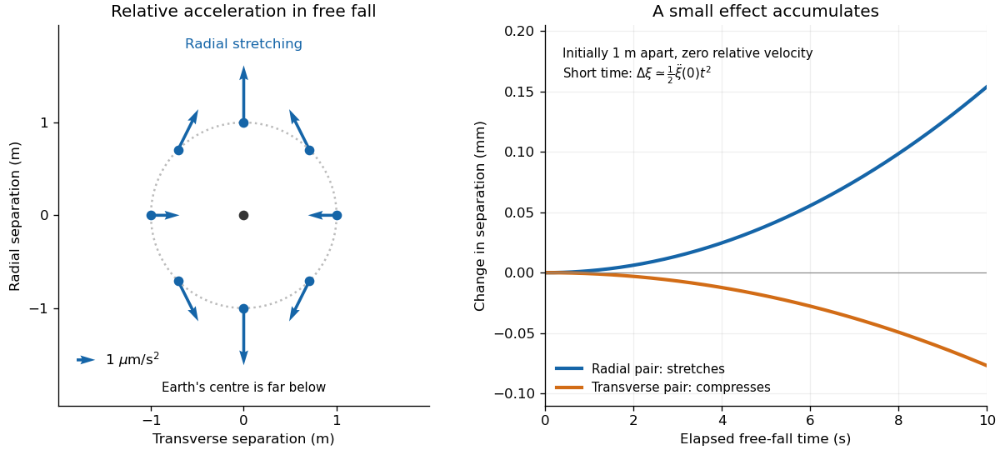

# Riemann curvature tensor

↑ **Parent:** [General relativity](general-relativity.md)  
ⓦ [Wiki](https://en.wikipedia.org/wiki/Riemann_curvature_tensor)

The Riemann tensor measures the failure of covariant derivatives to commute.

**Table of contents**

- [Curvature sign convention](#curvature-sign-convention)
- [Double divergence of a contravariant tensor](#double-divergence-of-a-contravariant-tensor)
- [Pair symmetry from the normal-coordinate curvature formula](#pair-symmetry-from-the-normal-coordinate-curvature-formula)
- [Bianchi identities from covariant derivative commutators](#bianchi-identities-from-covariant-derivative-commutators)
- [Curvature commutator is a tensor derivation](#curvature-commutator-is-a-tensor-derivation)
- [Three-dimensional curvature from the Ricci tensor](#three-dimensional-curvature-from-the-ricci-tensor)
- [Kretschmann scalar](#kretschmann-scalar)
- [Curvature commutator on a covariant tensor](#curvature-commutator-on-a-covariant-tensor)
- [Curvature commutator on a contravariant tensor](#curvature-commutator-on-a-contravariant-tensor)
- [Geodesic deviation](#geodesic-deviation)
  - [Local tidal acceleration scaling](#local-tidal-acceleration-scaling)
  - [Conserved deviation energy in constant curvature](#conserved-deviation-energy-in-constant-curvature)
    - [Exponential and oscillatory geodesic deviation](#exponential-and-oscillatory-geodesic-deviation)
  - [Orthogonality of proper-time deviation vectors](#orthogonality-of-proper-time-deviation-vectors)
  - [Jacobi field](#jacobi-field)
    - [Jacobi fields vanishing at their initial point](#jacobi-fields-vanishing-at-their-initial-point)
    - [Jacobi curvature operator](#jacobi-curvature-operator)
    - [Jacobi fields from conjugation at a central endpoint](#jacobi-fields-from-conjugation-at-a-central-endpoint)
    - [Endpoint-vanishing normal Jacobi fields have dimension at most n-1](#endpoint-vanishing-normal-jacobi-fields-have-dimension-at-most-n-1)
- [Symmetric Hessian of a scalar field](#symmetric-hessian-of-a-scalar-field)
  - [Third covariant derivatives of a scalar](#third-covariant-derivatives-of-a-scalar)
- [First Bianchi identity](#first-bianchi-identity)
- [Second Bianchi identity](#second-bianchi-identity)
- [Weyl tensor](#weyl-tensor)
  - [Magnetic part of the Weyl tensor](#magnetic-part-of-the-weyl-tensor)
  - [Electric part of the Weyl tensor](#electric-part-of-the-weyl-tensor)
  - [Trace-free property of the Weyl tensor](#trace-free-property-of-the-weyl-tensor)
  - [Weyl tensor of a conformally flat metric](#weyl-tensor-of-a-conformally-flat-metric)
- [First-pair antisymmetry of the Riemann tensor](#first-pair-antisymmetry-of-the-riemann-tensor)
- [Ricci tensor](#ricci-tensor)
  - [Schouten tensor](#schouten-tensor)
  - [Ricci tensor in two dimensions](#ricci-tensor-in-two-dimensions)
    - [Two-dimensional general relativity](#two-dimensional-general-relativity)
  - [Contracted Bianchi identity](#contracted-bianchi-identity)
    - [Double divergence of the Riemann tensor](#double-divergence-of-the-riemann-tensor)
    - [Einstein tensor](#einstein-tensor)
      - [Flat FLRW Einstein-tensor divergence](#flat-flrw-einstein-tensor-divergence)
        - [de Sitter scale factor in flat slicing](#de-sitter-scale-factor-in-flat-slicing)
          - [Vacuum-dominated doubling time](#vacuum-dominated-doubling-time)
  - [Constant sectional curvature](#constant-sectional-curvature)
    - [Schur theorem in pseudo-Riemannian geometry](#schur-theorem-in-pseudo-riemannian-geometry)
- [Penrose wave equation](#penrose-wave-equation)

## Curvature sign convention

↑ **Parent:** [Riemann curvature tensor](riemann-curvature-tensor.md)

Definitions of the [Riemann curvature tensor](riemann-curvature-tensor.md) can differ by an overall sign, independent of the [metric signature](topological-manifold.md#metric-signature). Reversing that definition reverses the [Ricci tensor](#ricci-tensor), [Ricci scalar](general-relativity.md#ricci-scalar) and [Einstein tensor](#einstein-tensor), as well as the [curvature](differential-geometry.md#curvature) side of the [geodesic deviation](#geodesic-deviation) identity and the [Palatini identity](einstein-field-equations.md#palatini-identity). A derivation must choose the contraction and [derivative](calculus.md#derivative) ordering explicitly before combining formulas from different conventions. Changing a [metric signature](topological-manifold.md#metric-signature) alone is a separate operation.

## Double divergence of a contravariant tensor

↑ **Parent:** [Riemann curvature tensor](riemann-curvature-tensor.md)

For a [Levi-Civita connection](general-relativity.md#levi-civita-connection), a contravariant rank-two [tensor](multilinear-algebra.md#tensor) satisfies $T^{ab}{}_{;ab}=T^{ab}{}_{;ba}$ without itself being symmetric. The [Ricci identity](#curvature-commutator-on-a-covariant-tensor) gives their difference as $R_{pb}(T^{pb}-T^{bp})$, which vanishes because the [Ricci tensor](#ricci-tensor) is symmetric. Zero torsion alone for a general affine connection does not ensure this symmetry.

## Pair symmetry from the normal-coordinate curvature formula

↑ **Parent:** [Riemann curvature tensor](riemann-curvature-tensor.md)

With convention $R(X,Y)=\nabla_{[X,Y]}-[\nabla_X,\nabla_Y]$, and $R_{ij,kl}=g(R(\partial_i,\partial_j)\partial_k,\partial_l)$, normal coordinates give

$$
R_{ij,kl}=\tfrac12(g_{jk,il}+g_{il,jk}-g_{jl,ik}-g_{ik,jl})
$$

at their center. Symmetry of the metric and commutation of second derivatives prove pair exchange. The opposite curvature convention changes the formula's overall sign but preserves all these algebraic symmetries.

## Bianchi identities from covariant derivative commutators

↑ **Parent:** [Riemann curvature tensor](riemann-curvature-tensor.md)

The [first Bianchi identity](#first-bianchi-identity) follows by applying cyclic curvature commutators to the gradient of an arbitrary [scalar field](classical-field-theory.md#scalar-field): its symmetric Hessian makes the third-derivative terms cancel, leaving $R_{abc}{}^d+R_{bca}{}^d+R_{cab}{}^d=0$. For the [second Bianchi identity](#second-bianchi-identity), write the vector-bundle derivative as $D_a=\partial_a+\Gamma_a$, so $[D_b,D_c]=\mathcal R_{bc}$. The operator [Jacobi identity](lie-algebra.md#jacobi-identity) gives the cyclic sum of $\partial_a\mathcal R_{bc}+[\Gamma_a,\mathcal R_{bc}]$ equal to zero. Restoring the connection terms on the two curvature-form indices gives precisely $\nabla_aR_{bcd}{}^e+\nabla_bR_{cad}{}^e+\nabla_cR_{abd}{}^e=0$: the additional terms cancel because the connection is torsion-free and curvature is antisymmetric in its first pair.

## Curvature commutator is a tensor derivation

↑ **Parent:** [Riemann curvature tensor](riemann-curvature-tensor.md)

For a torsion-free [linear connection on a manifold](vector-bundle.md#affine-connection), the commutator of two [covariant derivatives](general-relativity.md#covariant-derivative) obeys the tensor-product [Leibniz rule](calculus.md#leibniz-rule): mixed first-derivative terms cancel after antisymmetrizing. It vanishes on [scalar fields](classical-field-theory.md#scalar-field), so $\Delta_{ab}(fQ)=f\Delta_{ab}Q$; its action is therefore pointwise tensorial. Its vector action defines the [Riemann curvature tensor](riemann-curvature-tensor.md). Applying the commutator to a scalar contraction proves that every covariant tensor index contributes minus the corresponding curvature action, while every contravariant index contributes plus. Torsion-free does not by itself imply [metric compatibility](vector-bundle.md#metric-compatibility).

## Three-dimensional curvature from the Ricci tensor

↑ **Parent:** [Riemann curvature tensor](riemann-curvature-tensor.md)

In dimension three the [Riemann curvature tensor](riemann-curvature-tensor.md) is $R_{ijpq}=g_{ip}S_{jq}-g_{iq}S_{jp}-g_{jp}S_{iq}+g_{jq}S_{ip}$, where $S$ is the [Schouten tensor](#schouten-tensor). Consequently every three-dimensional [Ricci-flat Riemannian manifold](second-fundamental-form.md#ricci-flat-riemannian-manifold) is a [flat Riemannian manifold](second-fundamental-form.md#flat-manifold). The implication fails in higher dimensions.

## Kretschmann scalar

↑ **Parent:** [Riemann curvature tensor](riemann-curvature-tensor.md)

The Kretschmann scalar is the scalar [tensor contraction](multilinear-algebra.md#tensor-contraction) of two copies of the [Riemann curvature tensor](riemann-curvature-tensor.md). In [Schwarzschild spacetime](schwarzschild-spacetime.md), with metric coefficient $1-2M/r$ and $G=c=1$, it is $48M^2/r^6$. Divergence of this scalar along a curve approaching a proposed regular point proves that there is no twice continuously differentiable, nondegenerate metric extension through that point: such an extension would have continuous finite curvature components and hence a finite scalar contraction. This gives a coordinate-independent test of a [curvature singularity](general-relativity.md#curvature-singularity). Boundedness of this single scalar does not prove regularity.

## Curvature commutator on a covariant tensor

↑ **Parent:** [Riemann curvature tensor](riemann-curvature-tensor.md)

For a rank-two covariant tensor, the derivative commutator contributes one curvature action on each index:

$$
[\nabla_\alpha,\nabla_\beta]W_{\mu\nu}
=-R^\rho{}_{\mu\alpha\beta}W_{\rho\nu}
-R^\rho{}_{\nu\alpha\beta}W_{\mu\rho}.
$$

## Curvature commutator on a contravariant tensor

↑ **Parent:** [Riemann curvature tensor](riemann-curvature-tensor.md)

For a type-$(2,0)$ tensor, the [Ricci identity](#curvature-commutator-on-a-covariant-tensor) acts once on each contravariant index:

$$
[\nabla_\alpha,\nabla_\beta]T^{\mu\nu}
=R^\mu{}_{\rho\alpha\beta}T^{\rho\nu}
+R^\nu{}_{\rho\alpha\beta}T^{\mu\rho}.
$$

## Geodesic deviation

↑ **Parent:** [Riemann curvature tensor](riemann-curvature-tensor.md)  
ⓦ [Wiki](https://en.wikipedia.org/wiki/Geodesic_deviation)

For a family of affinely parametrized geodesics with tangent $U$ and connecting field $J$, the Jacobi equation in the convention used here is

$$
\nabla_U\nabla_UJ=R(U,J)U.
$$

It describes the relative acceleration produced by spacetime curvature.

Here $J$ describes an infinitesimal separation and the [covariant derivatives](general-relativity.md#covariant-derivative) compare it in a frame transported along the reference [geodesic](riemannian-geometry.md#geodesic). The [Riemann curvature tensor](riemann-curvature-tensor.md) thus becomes something measured with neighboring trajectories. The Newtonian version follows by differentiating [gravitational acceleration](newton-s-law-of-universal-gravitation.md#gravitational-acceleration) with respect to position. In the exterior of a spherical mass, let $\xi_r$ be radial separation and $\xi_\perp$ separation in either transverse direction. [Newton's law of universal gravitation](newton-s-law-of-universal-gravitation.md) gives

$$
\ddot\xi_r=\frac{2GM}{r^3}\xi_r,\qquad
\ddot\xi_\perp=-\frac{GM}{r^3}\xi_\perp.
$$

The upper particle falls less strongly than the lower one, stretching their radial separation; side-by-side particles accelerate toward converging radial directions, compressing their transverse separation. See [Oregon State's derivation of tidal acceleration](https://sites.science.oregonstate.edu/physics/coursewikis/GGR/book/ggr/tidal.html).

For a spherical [Earth](planetary-science.md#earth) model with $r=R_\oplus=6.371\times10^6\,\mathrm m$, $g=9.81\,\mathrm{m\,s^{-2}}$ and $GM=gR_\oplus^2$, a one-metre radial separation gives $\ddot\xi_r=2g/R_\oplus=3.07958\times10^{-6}\,\mathrm{m\,s^{-2}}$; a one-metre transverse separation gives $-1.53979\times10^{-6}\,\mathrm{m\,s^{-2}}$. Initially comoving particles therefore change separation after one second by approximately $\tfrac12\ddot\xi\,t^2$: $+1.54$ micrometres radially or $-0.770$ micrometres transversely. This short-time calculation holds the reference radius fixed to leading order. Its beauty is that common falling motion drops out, leaving a measurable stretching pattern that reveals curvature.

**[Figure 1](#image-radial-stretching-and-transverse-compression-in-a-small-freely-falling-laboratory-near-earth-s-surface). Radial stretching and transverse compression in a small freely falling laboratory near Earth's surface**.

### Local tidal acceleration scaling

↑ **Parent:** [Geodesic deviation](#geodesic-deviation)

The [geodesic deviation](#geodesic-deviation) equation makes the relative gravitational acceleration proportional to the separation $L$ and a typical [Riemann curvature tensor](riemann-curvature-tensor.md) component $\mathcal R$. Thus tidal acceleration vanishes as $L\to0$ at fixed bounded curvature. A uniform [electric field](electric-field.md) can give different accelerations $qE/m$ at the same point, independently of separation. Relative tidal changes accumulated over a fixed long time need not vanish as a fraction of the initial separation; a local spacetime experiment must control its duration as well as its spatial size.

### Conserved deviation energy in constant curvature

↑ **Parent:** [Geodesic deviation](#geodesic-deviation)

In [constant sectional curvature](#constant-sectional-curvature) $\kappa$, a [deviation vector](riemannian-geometry.md#deviation-vector) orthogonal to a unit [timelike geodesic](general-relativity.md#timelike-geodesic) obeys $D^2S=\kappa S$, where $D=\nabla_T$. Therefore $K=g(DS,DS)-\kappa g(S,S)$ is constant, since its derivative is $2g(DS,D^2S)-2\kappa g(S,DS)=0$. Its squared length $f=g(S,S)$ satisfies $\ddot f=2K+4\kappa f$. In four spacetime dimensions, $\kappa=R/12$.

#### Exponential and oscillatory geodesic deviation

↑ **Parent:** [Conserved deviation energy in constant curvature](#conserved-deviation-energy-in-constant-curvature)

In a [parallel-propagated orthonormal frame](general-relativity.md#parallel-propagated-orthonormal-frame), orthogonal [geodesic deviation](#geodesic-deviation) in [constant sectional curvature](#constant-sectional-curvature) reduces to three scalar equations $\ddot S^i=\kappa S^i$. For $\kappa>0$, $S=Ae^{\sqrt\kappa\tau}+Be^{-\sqrt\kappa\tau}$: generic initial data grow exponentially, but the pure decaying mode is a counterexample to universal growth. Initially comoving neighbors have $S=S(0)\cosh(\sqrt\kappa\tau)$. For $\kappa<0$, $S=A\cos(\sqrt{-\kappa}\tau)+B\sin(\sqrt{-\kappa}\tau)$, so the deviation is bounded and oscillatory. Simultaneous focusing requires compatible vector initial data and is not automatic for every oscillatory solution.

### Orthogonality of proper-time deviation vectors

↑ **Parent:** [Geodesic deviation](#geodesic-deviation)

For a [geodesic variation](riemannian-geometry.md#geodesic-variation) of unit [timelike geodesics](general-relativity.md#timelike-geodesic), [proper time](special-relativity.md#proper-time) normalization holds across the entire variation: $g(T,T)=-1$. [Metric compatibility](vector-bundle.md#metric-compatibility) and $\nabla_TS=\nabla_ST$ then give $d g(S,T)/d\tau=\tfrac12S(g(T,T))=0$. Consequently an initially orthogonal [deviation vector](riemannian-geometry.md#deviation-vector) stays orthogonal. The common normalization is essential: an arbitrary family of affinely parametrized curves with different tangent norms does not imply this conclusion.

### Jacobi field

↑ **Parent:** [Geodesic deviation](#geodesic-deviation)  
ⓦ [Wiki](https://en.wikipedia.org/wiki/Jacobi_field)

A Jacobi field is the infinitesimal connecting vector between neighboring members of a one-parameter family of geodesics. It satisfies the geodesic-deviation equation along the reference geodesic.

#### Jacobi fields vanishing at their initial point

↑ **Parent:** [Jacobi field](#jacobi-field)

For $\gamma(t)=\exp_p(tV)$, every [Jacobi field](#jacobi-field) with $J(0)=0$ is uniquely of the form

$$
J(t)=(d\exp_p)_{tV}(tB),\qquad B=D_tJ(0)\in T_pM.
$$

Differentiate the [geodesic variation](riemannian-geometry.md#geodesic-variation) $\exp_p(t(V+sB))$ in $s$ to obtain the formula. Uniqueness of the Jacobi equation with prescribed initial value and derivative shows that all such fields are obtained. A nontrivial field vanishing at $t=L>0$ therefore corresponds to a nonzero vector in the kernel of $(d\exp_p)_{LV}$, giving the [conjugate point](calculus-of-variations.md#conjugate-point) criterion.

#### Jacobi curvature operator

↑ **Parent:** [Jacobi field](#jacobi-field)

For the [Riemann curvature tensor](riemann-curvature-tensor.md) convention $R(X,Y)Z=\nabla_X\nabla_YZ-\nabla_Y\nabla_XZ-\nabla_{[X,Y]}Z$, define $\mathcal R_X(v)=R(v,X)X$. Curvature pair interchange makes this operator self-adjoint. If $v\perp X$, then $\langle\mathcal R_Xv,v\rangle=K(v,X)|v|^2|X|^2$. The [Jacobi field](#jacobi-field) equation is $D_t^2J+\mathcal R_{\dot\gamma}J=0$. The operator $v\mapsto R(X,v)X$ is $-\mathcal R_X$ and is likewise self-adjoint; this sign distinction matters when testing curvature inequalities.

#### Jacobi fields from conjugation at a central endpoint

↑ **Parent:** [Jacobi field](#jacobi-field)

For a [Lie group](lie-theory.md#lie-group) with a [bi-invariant Riemannian metric](lie-theory.md#bi-invariant-riemannian-metric), vary $\gamma(t)=e^{tA}$ by conjugation: $F(s,t)=e^{sX}e^{tA}e^{-sX}$. Its [Jacobi field](#jacobi-field) is $J_X(t)=Xe^{tA}-e^{tA}X$. If $e^A$ is central, all these fields vanish at both endpoints. Their space has dimension $\dim\mathfrak g-\dim\mathfrak z(A)$, since the kernel is the [centralizer of an element of a Lie algebra](lie-algebra.md#centralizer-of-an-element-of-a-lie-algebra).

#### Endpoint-vanishing normal Jacobi fields have dimension at most n-1

↑ **Parent:** [Jacobi field](#jacobi-field)

In dimension $n\ge2$, along a nonconstant [geodesic](riemannian-geometry.md#geodesic), such a [Jacobi field](#jacobi-field) is determined injectively by $D_tJ(0)$, which lies in the $(n-1)$-dimensional normal space. On the round unit sphere the geodesic from a point to its antipode, parametrized with speed $\pi$ on $[0,1]$, has fields $J(t)=\sin(\pi t)E(t)$ for all parallel normal fields $E$, attaining the bound. For a constant geodesic the endpoint-vanishing Jacobi field space is zero.

## Symmetric Hessian of a scalar field

↑ **Parent:** [Riemann curvature tensor](riemann-curvature-tensor.md)

For a torsion-free connection, $U_\mu=\partial_\mu\phi$ satisfies $\nabla_\alpha U_\beta=\nabla_\beta U_\alpha$.

### Third covariant derivatives of a scalar

↑ **Parent:** [Symmetric Hessian of a scalar field](#symmetric-hessian-of-a-scalar-field)

Use the sequential convention $\varphi_{;lmn}=\nabla_n\nabla_m\nabla_l\varphi$ and define $R$ by $X^a{}_{;mn}-X^a{}_{;nm}=R^a{}_{bmn}X^b$. The [symmetric Hessian of a scalar field](#symmetric-hessian-of-a-scalar-field) gives symmetry in $l,m$, but the [curvature commutator on a covariant tensor](#curvature-commutator-on-a-covariant-tensor) gives $\varphi_{;l[mn]}=-R^p{}_{lmn}\varphi_{;p}/2$. Averaging the three distinct permutations yields $\varphi_{;(lm)n}=\varphi_{;(lmn)}-(R^p{}_{lmn}+R^p{}_{mln})\varphi_{;p}/3$. Thus a scalar's third covariant derivative is not generally totally symmetric.

## First Bianchi identity

↑ **Parent:** [Riemann curvature tensor](riemann-curvature-tensor.md)

For a torsion-free connection, $R^\mu{}_{\alpha\beta\gamma}+R^\mu{}_{\beta\gamma\alpha}+R^\mu{}_{\gamma\alpha\beta}=0$.

## Second Bianchi identity

↑ **Parent:** [Riemann curvature tensor](riemann-curvature-tensor.md)

For the [Levi-Civita connection](general-relativity.md#levi-civita-connection), the cyclic covariant derivative of curvature vanishes: $\nabla_{[e}R^a{}_{|b|cd]}=0$. Contracting this identity gives the [contracted Bianchi identity](#contracted-bianchi-identity).

## Weyl tensor

↑ **Parent:** [Riemann curvature tensor](riemann-curvature-tensor.md)  
ⓦ [Wiki](https://en.wikipedia.org/wiki/Weyl_tensor)

The Weyl tensor is the completely trace-free part of the [Riemann curvature tensor](riemann-curvature-tensor.md). In four dimensions,

$$
\begin{aligned}
C_{\alpha\beta\gamma\delta}
={}&R_{\alpha\beta\gamma\delta}
-\frac12(
g_{\alpha\gamma}R_{\beta\delta}
+g_{\beta\delta}R_{\alpha\gamma}\\
&\qquad
-g_{\alpha\delta}R_{\beta\gamma}
-g_{\beta\gamma}R_{\alpha\delta})
+\frac R6(
g_{\alpha\gamma}g_{\beta\delta}
-g_{\alpha\delta}g_{\beta\gamma}).
\end{aligned}
$$

### Magnetic part of the Weyl tensor

↑ **Parent:** [Weyl tensor](#weyl-tensor)

In four spacetime dimensions, relative to a timelike [unit normal](differential-geometry.md#unit-normal) $n$, define $B_{ab}=\tfrac12\epsilon_{acde}C^{de}{}_{bf}n^cn^f$, with the chosen spacetime [metric volume tensor](differential-form.md#metric-volume-tensor). This is the dual tidal part of the [Weyl tensor](#weyl-tensor). Normal contractions vanish by curvature and volume-tensor antisymmetry. Its sign depends on the specified orientation and dualization convention.

### Electric part of the Weyl tensor

↑ **Parent:** [Weyl tensor](#weyl-tensor)

Relative to a timelike [unit normal](differential-geometry.md#unit-normal) $n$, the electric part is $E_{ab}=C_{acbd}n^cn^d$. It describes the tidal component of the [Weyl tensor](#weyl-tensor) measured by that observer. Antisymmetry in each curvature pair makes it spatial in both slots; pair symmetry and vanishing traces make it symmetric and trace-free.

### Trace-free property of the Weyl tensor

↑ **Parent:** [Weyl tensor](#weyl-tensor)

Every contraction of the Weyl tensor vanishes. Contracting its first and third indices directly cancels the Ricci and scalar-curvature terms; antisymmetry in each pair and symmetry under exchanging the two pairs reduce all other contractions to this one or make them vanish immediately.

### Weyl tensor of a conformally flat metric

↑ **Parent:** [Weyl tensor](#weyl-tensor)

Every [conformally flat metric](general-relativity.md#conformally-flat-metric) in dimension at least four has identically zero Weyl tensor. The Weyl tensor is the obstruction to local conformal flatness in dimensions at least four.

## First-pair antisymmetry of the Riemann tensor

↑ **Parent:** [Riemann curvature tensor](riemann-curvature-tensor.md)

Applying the curvature commutator to the parallel metric gives $R_{\mu\alpha\beta\gamma}=-R_{\alpha\mu\beta\gamma}$.

## Ricci tensor

↑ **Parent:** [Riemann curvature tensor](riemann-curvature-tensor.md)

The Ricci tensor is the contraction $R_{\alpha\beta}=R^\mu{}_{\alpha\mu\beta}$ and is symmetric for the Levi-Civita connection.

### Schouten tensor

↑ **Parent:** [Ricci tensor](#ricci-tensor)

For dimension $n\geq3$, the Schouten tensor packages the [Ricci tensor](#ricci-tensor) and [scalar curvature](second-fundamental-form.md#scalar-curvature) in the trace part of the [Riemann curvature tensor](riemann-curvature-tensor.md). In dimension three it is $S_{ij}=R_{ij}-Rg_{ij}/4$, and the full [Riemann curvature tensor](riemann-curvature-tensor.md) is reconstructed from it.

### Ricci tensor in two dimensions

↑ **Parent:** [Ricci tensor](#ricci-tensor)

The algebraic symmetries of the [Riemann curvature tensor](riemann-curvature-tensor.md) leave only one independent curvature component in two dimensions and force

$$
R_{\alpha\beta}=\frac12g_{\alpha\beta}R.
$$

Consequently the [Einstein tensor](#einstein-tensor) vanishes identically.

#### Two-dimensional general relativity

↑ **Parent:** [Ricci tensor in two dimensions](#ricci-tensor-in-two-dimensions)

With no cosmological term, the two-dimensional [Einstein field equations](einstein-field-equations.md) reduce identically on the geometric side to $G_{\alpha\beta}=0$. They impose $T_{\alpha\beta}=0$ and supply no local metric dynamics; the Einstein-Hilbert action is topological.

### Contracted Bianchi identity

↑ **Parent:** [Ricci tensor](#ricci-tensor)

The Ricci tensor and scalar satisfy $\nabla^\alpha R_{\alpha\beta}=\tfrac12\nabla_\beta R$.

#### Double divergence of the Riemann tensor

↑ **Parent:** [Contracted Bianchi identity](#contracted-bianchi-identity)

For the [Levi-Civita connection](general-relativity.md#levi-civita-connection), the [second Bianchi identity](#second-bianchi-identity) gives $\nabla_iR^{ik}{}_{mn}=\nabla_mR^k{}_n-\nabla_nR^k{}_m$. Applying another [covariant derivative](general-relativity.md#covariant-derivative) and the [contracted Bianchi identity](#contracted-bianchi-identity) reduces its divergence to a commuting scalar Hessian plus curvature commutators on the [Ricci tensor](#ricci-tensor). The latter are the difference of symmetric tensors: a square of the [Ricci tensor](#ricci-tensor) and $R^{ab}R_{anbm}$, which is symmetric in $m,n$ by curvature pair exchange and Ricci symmetry. Both differences vanish. This identity does not require vacuum field equations and is independent of the overall curvature sign convention.

#### Einstein tensor

↑ **Parent:** [Contracted Bianchi identity](#contracted-bianchi-identity)  
ⓦ [Wiki](https://en.wikipedia.org/wiki/Einstein_tensor)

The Einstein tensor is

$$
G_{\mu\nu}=R_{\mu\nu}-\frac12Rg_{\mu\nu}.
$$

The contracted Bianchi identity and metric compatibility give  
$\nabla^\nu G_{\mu\nu}=0$, ensuring compatibility of the Einstein equations with covariant stress-energy conservation.

##### Flat FLRW Einstein-tensor divergence

↑ **Parent:** [Einstein tensor](#einstein-tensor)

For $ds^2=-dt^2+a(t)^2d\mathbf x^2$, the nonzero connection coefficients are

$$
\Gamma^t_{ij}=a\dot a\,\delta_{ij},
\qquad
\Gamma^i_{tj}=\Gamma^i_{jt}=H\delta^i_j.
$$

With $G_t^t=-3H^2$ and  
$G_i^j=-(2\ddot a/a+H^2)\delta_i^j$, direct substitution into the mixed-tensor covariant derivative gives zero.

###### de Sitter scale factor in flat slicing

↑ **Parent:** [Flat FLRW Einstein-tensor divergence](#flat-flrw-einstein-tensor-divergence)

The vacuum equation with positive cosmological constant gives  
$H^2=\Lambda/3$. Its expanding flat-slicing solution is

$$
a(t)=a_0e^{\sqrt{\Lambda/3}\,t}.
$$

###### Vacuum-dominated doubling time

↑ **Parent:** [de Sitter scale factor in flat slicing](#de-sitter-scale-factor-in-flat-slicing)

In a spatially flat universe dominated by a positive constant [energy density](statistical-physics.md#energy-density) $\epsilon$, the [Friedmann equations](cosmology.md#friedmann-equations) give $H^2=8\pi G\epsilon/(3c^2)$. On the expanding branch $a(t)=a_i e^{H(t-t_i)}$, so the [scale factor](cosmology.md#scale-factor-cosmology) doubles after $(\log2)/H$. This concerns a linear length scale; the enclosed physical volume grows by a factor of eight over the same interval.

### Constant sectional curvature

↑ **Parent:** [Ricci tensor](#ricci-tensor)  
ⓦ [Wiki](https://en.wikipedia.org/wiki/Constant_sectional_curvature)

A pseudo-Riemannian manifold has constant sectional curvature $K$ when $R_{abcd}=K(g_{ac}g_{bd}-g_{ad}g_{bc})$. In dimension $n$, its Ricci tensor and scalar are $R_{ab}=(n-1)Kg_{ab}$ and $R=n(n-1)K$.

#### Schur theorem in pseudo-Riemannian geometry

↑ **Parent:** [Constant sectional curvature](#constant-sectional-curvature)

In dimension greater than two, if sectional curvature is pointwise independent of the two-plane, the contracted Bianchi identity forces that curvature to be constant on each connected component.

The positive-definite specialization is [Schur's lemma](riemannian-geometry.md#schur-s-lemma-riemannian-geometry).

## Penrose wave equation

↑ **Parent:** [Riemann curvature tensor](riemann-curvature-tensor.md)

In a Ricci-flat spacetime, the Penrose wave equation is a nonlinear covariant wave equation for the Riemann tensor. Its principal part is $\nabla^e\nabla_eR_{abcd}$ and its lower-order terms are quadratic contractions of curvature.

## ↑ Ancestors (4)

1. [General relativity](general-relativity.md)
2. [Branches of physics](physics.md#branches-of-physics)
3. [Physics](physics.md)
4. [Codex Wiki](README.md)

## ← Incoming links (133)

- [Absence of a local gravitational stress-energy tensor](general-relativity.md#absence-of-a-local-gravitational-stress-energy-tensor)
- [Cartan-Ambrose-Hicks theorem](riemannian-geometry.md#cartan-ambrose-hicks-theorem)
- [Chiral Riemann curvature spinor decomposition](connection-1-form.md#chiral-riemann-curvature-spinor-decomposition)
- [Comma-to-semicolon prescription](general-relativity.md#comma-to-semicolon-prescription)
- [Curvature commutator is a tensor derivation](#curvature-commutator-is-a-tensor-derivation)
- [Curvature of a conformally Euclidean metric](general-relativity.md#curvature-of-a-conformally-euclidean-metric)
- [Curvature sign convention](#curvature-sign-convention)
- [Curvature-sign convention in Killing derivative identities](killing-vector-field.md#curvature-sign-convention-in-killing-derivative-identities)
- [Curvature singularity](general-relativity.md#curvature-singularity)
- [Einstein-equation coupling under reversed curvature](einstein-field-equations.md#einstein-equation-coupling-under-reversed-curvature)
- [Einstein field equations](einstein-field-equations.md)
- [Equivalence principle](general-relativity.md#equivalence-principle)
- [Gauss–Codazzi equations for a non-null hypersurface](second-fundamental-form.md#gauss-codazzi-equations-for-a-non-null-hypersurface)
- [Gaussian curvature](second-fundamental-form.md#gaussian-curvature)
- [Geodesic deviation](#geodesic-deviation)
- [Harmonic reduction of the vacuum Einstein equations](numerical-relativity.md#harmonic-reduction-of-the-vacuum-einstein-equations)
- [Inertial coordinates inside a slowly rotating spherical shell](black-hole.md#inertial-coordinates-inside-a-slowly-rotating-spherical-shell)
- [Intrinsic flatness of a circular cylinder](differential-geometry.md#intrinsic-flatness-of-a-circular-cylinder)
- [Jacobi curvature operator](#jacobi-curvature-operator)
- [Kretschmann scalar](#kretschmann-scalar)
- [Local tidal acceleration scaling](#local-tidal-acceleration-scaling)
- [Locally symmetric Riemannian manifold](riemannian-geometry.md#locally-symmetric-riemannian-manifold)
- [Solution](past-exam-of-the-mathematics-course-of-the-university-of-cambridge/2001/iii/paper-12.md#1/solution)
- [Solution](past-exam-of-the-mathematics-course-of-the-university-of-cambridge/2001/iii/paper-12.md#3/solution)
- [Solution](past-exam-of-the-mathematics-course-of-the-university-of-cambridge/2001/iii/paper-68.md#2/solution)
- [Solution](past-exam-of-the-mathematics-course-of-the-university-of-cambridge/2001/iii/paper-68.md#3/c/solution)
- [Solution](past-exam-of-the-mathematics-course-of-the-university-of-cambridge/2002/iii/paper-14.md#5/solution)
- [Solution](past-exam-of-the-mathematics-course-of-the-university-of-cambridge/2002/iii/paper-72.md#2/solution)
- [Solution](past-exam-of-the-mathematics-course-of-the-university-of-cambridge/2002/iii/paper-73.md#3/solution)
- [Solution](past-exam-of-the-mathematics-course-of-the-university-of-cambridge/2003/iii/paper-14.md#6/solution)
- [Solution](past-exam-of-the-mathematics-course-of-the-university-of-cambridge/2003/iii/paper-16.md#1/a/solution)
- [Solution](past-exam-of-the-mathematics-course-of-the-university-of-cambridge/2003/iii/paper-16.md#1/b/solution)
- [Solution](past-exam-of-the-mathematics-course-of-the-university-of-cambridge/2004/iii/paper-14.md#5/solution)
- [Solution](past-exam-of-the-mathematics-course-of-the-university-of-cambridge/2004/iii/paper-18.md#2/solution)
- [Solution](past-exam-of-the-mathematics-course-of-the-university-of-cambridge/2004/iii/paper-19.md#1/a/solution)
- [Solution](past-exam-of-the-mathematics-course-of-the-university-of-cambridge/2004/iii/paper-19.md#3/c/solution)
- [Solution](past-exam-of-the-mathematics-course-of-the-university-of-cambridge/2004/iii/paper-55.md#1/solution)
- [Solution](past-exam-of-the-mathematics-course-of-the-university-of-cambridge/2004/iii/paper-55.md#2/solution)
- [Solution](past-exam-of-the-mathematics-course-of-the-university-of-cambridge/2004/iii/paper-57.md#2/solution)
- [Solution](past-exam-of-the-mathematics-course-of-the-university-of-cambridge/2004/iii/paper-58.md#1/solution)
- [Solution](past-exam-of-the-mathematics-course-of-the-university-of-cambridge/2004/iii/paper-58.md#6/solution)
- [Solution](past-exam-of-the-mathematics-course-of-the-university-of-cambridge/2005/iii/paper-15.md#4/solution)
- [Solution](past-exam-of-the-mathematics-course-of-the-university-of-cambridge/2005/iii/paper-19.md#5/solution)
- [Solution](past-exam-of-the-mathematics-course-of-the-university-of-cambridge/2005/iii/paper-60.md#1/solution)
- [Solution](past-exam-of-the-mathematics-course-of-the-university-of-cambridge/2005/iii/paper-60.md#2/solution)
- [Solution](past-exam-of-the-mathematics-course-of-the-university-of-cambridge/2006/iii/paper-15.md#1/solution)
- [Solution](past-exam-of-the-mathematics-course-of-the-university-of-cambridge/2006/iii/paper-15.md#2/solution)
- [Solution](past-exam-of-the-mathematics-course-of-the-university-of-cambridge/2006/iii/paper-23.md#1/solution)
- [Solution](past-exam-of-the-mathematics-course-of-the-university-of-cambridge/2006/iii/paper-61.md#3/solution)
- [Solution](past-exam-of-the-mathematics-course-of-the-university-of-cambridge/2006/iii/paper-64.md#1/solution)
- [Solution](past-exam-of-the-mathematics-course-of-the-university-of-cambridge/2007/iii/paper-61.md#2/solution)
- [Solution](past-exam-of-the-mathematics-course-of-the-university-of-cambridge/2007/iii/paper-63.md#1/solution)
- [Solution](past-exam-of-the-mathematics-course-of-the-university-of-cambridge/2008/iii/paper-19.md#5/solution)
- [Solution](past-exam-of-the-mathematics-course-of-the-university-of-cambridge/2008/iii/paper-63.md#2/solution)
- [Solution](past-exam-of-the-mathematics-course-of-the-university-of-cambridge/2008/iii/paper-66.md#2/b/i/solution)
- [Solution](past-exam-of-the-mathematics-course-of-the-university-of-cambridge/2009/ii/paper-1.md#36d/solution)
- [Solution](past-exam-of-the-mathematics-course-of-the-university-of-cambridge/2009/ii/paper-4.md#24h/c/solution)
- [Solution](past-exam-of-the-mathematics-course-of-the-university-of-cambridge/2009/iii/paper-17.md#4/b/solution)
- [Solution](past-exam-of-the-mathematics-course-of-the-university-of-cambridge/2009/iii/paper-58.md#1/solution)
- [Solution](past-exam-of-the-mathematics-course-of-the-university-of-cambridge/2009/iii/paper-58.md#4/solution)
- [Solution](past-exam-of-the-mathematics-course-of-the-university-of-cambridge/2009/iii/paper-59.md#1/a/solution)
- [Solution](past-exam-of-the-mathematics-course-of-the-university-of-cambridge/2009/iii/paper-59.md#1/d/solution)
- [Solution](past-exam-of-the-mathematics-course-of-the-university-of-cambridge/2009/iii/paper-59.md#1/e/solution)
- [Solution](past-exam-of-the-mathematics-course-of-the-university-of-cambridge/2010/iii/paper-52.md#2/solution)
- [Solution](past-exam-of-the-mathematics-course-of-the-university-of-cambridge/2010/iii/paper-54.md#1/a/i/solution)
- [Solution](past-exam-of-the-mathematics-course-of-the-university-of-cambridge/2010/iii/paper-54.md#3/c/solution)
- [Solution](past-exam-of-the-mathematics-course-of-the-university-of-cambridge/2010/iii/paper-56.md#2/solution)
- [Solution](past-exam-of-the-mathematics-course-of-the-university-of-cambridge/2010/iii/paper-56.md#3/solution)
- [Solution](past-exam-of-the-mathematics-course-of-the-university-of-cambridge/2010/iii/paper-56.md#4/solution)
- [Solution](past-exam-of-the-mathematics-course-of-the-university-of-cambridge/2010/iii/paper-7.md#1/solution)
- [Solution](past-exam-of-the-mathematics-course-of-the-university-of-cambridge/2012/iii/paper-14.md#1/solution)
- [Solution](past-exam-of-the-mathematics-course-of-the-university-of-cambridge/2012/iii/paper-51.md#4/solution)
- [Solution](past-exam-of-the-mathematics-course-of-the-university-of-cambridge/2012/iii/paper-56.md#2/b/solution)
- [Solution](past-exam-of-the-mathematics-course-of-the-university-of-cambridge/2012/iii/paper-56.md#2/d/solution)
- [Solution](past-exam-of-the-mathematics-course-of-the-university-of-cambridge/2012/iii/paper-56.md#3/a/solution)
- [Solution](past-exam-of-the-mathematics-course-of-the-university-of-cambridge/2012/iii/paper-56.md#3/c/i/solution)
- [Solution](past-exam-of-the-mathematics-course-of-the-university-of-cambridge/2012/iii/paper-56.md#4/c/solution)
- [Solution](past-exam-of-the-mathematics-course-of-the-university-of-cambridge/2013/iii/paper-15.md#4/solution)
- [Solution](past-exam-of-the-mathematics-course-of-the-university-of-cambridge/2013/iii/paper-49.md#3/a/ii/solution)
- [Solution](past-exam-of-the-mathematics-course-of-the-university-of-cambridge/2014/iii/paper-50.md#1/c/i/solution)
- [Solution](past-exam-of-the-mathematics-course-of-the-university-of-cambridge/2015/ii/paper-3.md#35d/b/solution)
- [Solution](past-exam-of-the-mathematics-course-of-the-university-of-cambridge/2015/iii/paper-52.md#3/iii/solution)
- [Solution](past-exam-of-the-mathematics-course-of-the-university-of-cambridge/2016/iii/paper-116.md#3/solution)
- [Solution](past-exam-of-the-mathematics-course-of-the-university-of-cambridge/2016/iii/paper-309.md#1/iii/1/solution)
- [Solution](past-exam-of-the-mathematics-course-of-the-university-of-cambridge/2016/iii/paper-309.md#1/iii/2/solution)
- [Solution](past-exam-of-the-mathematics-course-of-the-university-of-cambridge/2016/iii/paper-309.md#4/i/solution)
- [Solution](past-exam-of-the-mathematics-course-of-the-university-of-cambridge/2016/iii/paper-309.md#4/ii/solution)
- [Solution](past-exam-of-the-mathematics-course-of-the-university-of-cambridge/2016/iii/paper-309.md#4/iii/solution)
- [Solution](past-exam-of-the-mathematics-course-of-the-university-of-cambridge/2016/iii/paper-311.md#3/a/iii/solution)
- [Solution](past-exam-of-the-mathematics-course-of-the-university-of-cambridge/2017/iii/paper-115.md#4/a/solution)
- [Solution](past-exam-of-the-mathematics-course-of-the-university-of-cambridge/2017/iii/paper-115.md#4/d/solution)
- [Solution](past-exam-of-the-mathematics-course-of-the-university-of-cambridge/2017/iii/paper-309.md#2/c/solution)
- [Solution](past-exam-of-the-mathematics-course-of-the-university-of-cambridge/2017/iii/paper-309.md#4/d/solution)
- [Solution](past-exam-of-the-mathematics-course-of-the-university-of-cambridge/2018/ii/paper-3.md#25i/a/solution)
- [Solution](past-exam-of-the-mathematics-course-of-the-university-of-cambridge/2018/iii/paper-309.md#2/i/solution)
- [Solution](past-exam-of-the-mathematics-course-of-the-university-of-cambridge/2018/iii/paper-309.md#2/ii/solution)
- [Solution](past-exam-of-the-mathematics-course-of-the-university-of-cambridge/2018/iii/paper-309.md#2/iii/solution)
- [Solution](past-exam-of-the-mathematics-course-of-the-university-of-cambridge/2018/iii/paper-309.md#4/a/solution)
- [Solution](past-exam-of-the-mathematics-course-of-the-university-of-cambridge/2019/ii/paper-1.md#37d/b/solution)
- [Solution](past-exam-of-the-mathematics-course-of-the-university-of-cambridge/2019/iii/paper-311.md#2/ii/solution)
- [Solution](past-exam-of-the-mathematics-course-of-the-university-of-cambridge/2019/iii/paper-311.md#2/iii/solution)
- [Solution](past-exam-of-the-mathematics-course-of-the-university-of-cambridge/2020/ii/paper-1.md#38d/ii/solution)
- [Solution](past-exam-of-the-mathematics-course-of-the-university-of-cambridge/2020/ii/paper-1.md#38d/v/solution)
- [Solution](past-exam-of-the-mathematics-course-of-the-university-of-cambridge/2021/ii/paper-1.md#38c/a/solution)
- [Solution](past-exam-of-the-mathematics-course-of-the-university-of-cambridge/2021/ii/paper-1.md#38c/c/ii/solution)
- [Solution](past-exam-of-the-mathematics-course-of-the-university-of-cambridge/2021/iii/paper-309.md#3/d/solution)
- [Solution](past-exam-of-the-mathematics-course-of-the-university-of-cambridge/2022/ii/paper-2.md#38d/c/solution)
- [Solution](past-exam-of-the-mathematics-course-of-the-university-of-cambridge/2022/iii/paper-309.md#4/c/solution)
- [Solution](past-exam-of-the-mathematics-course-of-the-university-of-cambridge/2023/ii/paper-2.md#38b/c/solution)
- [Solution](past-exam-of-the-mathematics-course-of-the-university-of-cambridge/2023/ii/paper-2.md#38b/d/solution)
- [Solution](past-exam-of-the-mathematics-course-of-the-university-of-cambridge/2023/iii/paper-309.md#1/a/i/solution)
- [Solution](past-exam-of-the-mathematics-course-of-the-university-of-cambridge/2024/iii/paper-357.md#3/b/solution)
- [Solution](past-exam-of-the-mathematics-course-of-the-university-of-cambridge/2024/iii/paper-357.md#3/d/solution)
- [Solution](past-exam-of-the-mathematics-course-of-the-university-of-cambridge/2025/iii/paper-309.md#2/a/i/solution)
- [Solution](past-exam-of-the-mathematics-course-of-the-university-of-cambridge/2025/iii/paper-357.md#1/b/solution)
- [Solution](past-exam-of-the-mathematics-course-of-the-university-of-cambridge/2026/iii/paper-131.md#2/a/solution)
- [Solution](past-exam-of-the-mathematics-course-of-the-university-of-cambridge/2026/iii/paper-309.md#3/b/solution)
- [Solution](past-exam-of-the-relativity-course-of-the-university-of-cambridge/2012/paper-1.md#2/b/solution)
- [Solution](past-exam-of-the-relativity-course-of-the-university-of-cambridge/2012/paper-1.md#3/solution)
- [Solution](past-exam-of-the-relativity-course-of-the-university-of-cambridge/2015/paper-1.md#2/a/solution)
- [Solution](past-exam-of-the-relativity-course-of-the-university-of-cambridge/2016/paper-1.md#2/a/solution)
- [Solution](past-exam-of-the-relativity-course-of-the-university-of-cambridge/2017.md#2/b/solution)
- [Solution](past-exam-of-the-relativity-course-of-the-university-of-cambridge/2018.md#section-b/b4/solution)
- [Solution](past-exam-of-the-relativity-course-of-the-university-of-cambridge/2022.md#section-a/2/solution)
- [Ricci-flat manifold](differential-geometry.md#ricci-flat-manifold)
- [Ricci tensor in two dimensions](#ricci-tensor-in-two-dimensions)
- [Riemannian metric](riemannian-metric.md)
- [Schouten tensor](#schouten-tensor)
- [Strong equivalence principle](general-relativity.md#strong-equivalence-principle)
- [Theorema Egregium](differential-geometry.md#theorema-egregium)
- [Three-dimensional curvature from the Ricci tensor](#three-dimensional-curvature-from-the-ricci-tensor)
- [Vacuum spacetime](einstein-field-equations.md#vacuum-spacetime)
- [Weyl tensor](#weyl-tensor)
