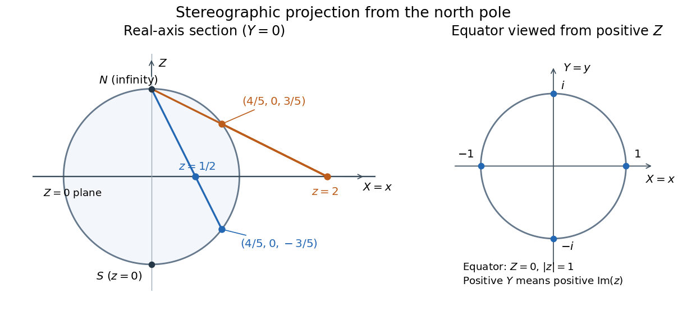
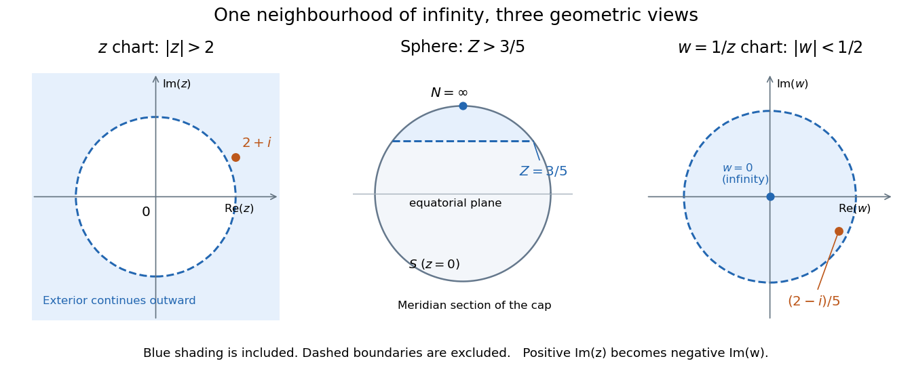

# Riemann surfaces

↑ **Parent:** [Complex analysis](complex-analysis.md)

**Table of contents**

- [Meromorphic differential on a Riemann surface](#meromorphic-differential-on-a-riemann-surface)
- [Hyperbolic Riemann surface in potential theory](#hyperbolic-riemann-surface-in-potential-theory)
- [Compact Riemann surface](#compact-riemann-surface)
- [Abel-Jacobi map of a compact Riemann surface](#abel-jacobi-map-of-a-compact-riemann-surface)
  - [Abel theorem for divisors](#abel-theorem-for-divisors)
- [Differential of the third kind](#differential-of-the-third-kind)
- [Riemann bilinear relations for a compact surface](#riemann-bilinear-relations-for-a-compact-surface)
- [Three-branch-point regular surface cover](#three-branch-point-regular-surface-cover)
  - [Orientation-reversing equivalence of branched-cover monodromy](#orientation-reversing-equivalence-of-branched-cover-monodromy)
- [Quasiconformal mapping](#quasiconformal-mapping)
  - [Maximal dilatation](#maximal-dilatation)
  - [Beltrami coefficient](#beltrami-coefficient)
    - [Beltrami equation](#beltrami-equation)
- [Conformal metric](#conformal-metric)
- [Translation surface](#translation-surface)
  - [Slit connected sum of translation tori](#slit-connected-sum-of-translation-tori)
- [Teichmüller theory](#teichmuller-theory)
  - [Teichmüller map](#teichmuller-map)
    - [Teichmüller's uniqueness theorem](#teichmuller-s-uniqueness-theorem)
    - [Reich–Strebel inequality](#reich-strebel-inequality)
  - [Extremal length](#extremal-length)
    - [Extremal length lower bound from a closed one-form](#extremal-length-lower-bound-from-a-closed-one-form)
    - [Conformal modulus of an annulus](#conformal-modulus-of-an-annulus)
      - [Conformal cylinder](#conformal-cylinder)
  - [SL2R action on differentials](#sl2r-action-on-differentials)
  - [Teichmüller space](#teichmuller-space)
- [Local coordinate](#local-coordinate)
- [Holomorphic map](#holomorphic-map)
  - [Biholomorphism](#biholomorphism)
- [Germ of a holomorphic function](#germ-of-a-holomorphic-function)
  - [Function element](#function-element)
  - [Space of germs of holomorphic functions](#space-of-germs-of-holomorphic-functions)
    - [Analytic germ projection](#analytic-germ-projection)
      - [Surjective inverse-polynomial germ projection without even covering](#surjective-inverse-polynomial-germ-projection-without-even-covering)
    - [Evaluation map on a space of germs](#evaluation-map-on-a-space-of-germs)
    - [Germ surface of the square root of z to the eighth minus one](#germ-surface-of-the-square-root-of-z-to-the-eighth-minus-one)
- [Complex structure lifted through a covering map](#complex-structure-lifted-through-a-covering-map)
- [Uniformization theorem](#uniformization-theorem)
  - [Thrice-punctured sphere as a modular quotient](#thrice-punctured-sphere-as-a-modular-quotient)
  - [Green-function exhaustion proof of disk uniformization](#green-function-exhaustion-proof-of-disk-uniformization)
  - [Riemann mapping theorem](#riemann-mapping-theorem)
    - [Square-root improvement of a normalized conformal map](#square-root-improvement-of-a-normalized-conformal-map)
    - [Caratheodory boundary extension theorem](#caratheodory-boundary-extension-theorem)
    - [Koebe distortion theorem](#koebe-distortion-theorem)
      - [Koebe quarter theorem](#koebe-quarter-theorem)
        - [Boundary-distance derivative bound for a conformal bijection](#boundary-distance-derivative-bound-for-a-conformal-bijection)
  - [Automorphisms of simply connected Riemann surfaces](#automorphisms-of-simply-connected-riemann-surfaces)
  - [Riemann surfaces uniformized by the complex plane](#riemann-surfaces-uniformized-by-the-complex-plane)
  - [Plane domain with two omitted points is hyperbolic](#plane-domain-with-two-omitted-points-is-hyperbolic)
  - [Uniformization of a punctured compact Riemann surface](#uniformization-of-a-punctured-compact-riemann-surface)
  - [Compact Riemann surface containing an embedded punctured plane](#compact-riemann-surface-containing-an-embedded-punctured-plane)
- [Identity theorem on a Riemann surface](#identity-theorem-on-a-riemann-surface)
- [Harmonic function on a Riemann surface](#harmonic-function-on-a-riemann-surface)
  - [Conformal invariance of harmonicity](#conformal-invariance-of-harmonicity)
- [Regular covering map](#regular-covering-map)
- [Complete analytic function](#complete-analytic-function)
- [Valency theorem](#valency-theorem)
  - [Local degree of a holomorphic map](#local-degree-of-a-holomorphic-map)
  - [Degree of a holomorphic map](#degree-of-a-holomorphic-map)
    - [Degree of a power map of the Riemann sphere](#degree-of-a-power-map-of-the-riemann-sphere)
  - [Degree of a rational map of the Riemann sphere](#degree-of-a-rational-map-of-the-riemann-sphere)
    - [Degree bounds for the derivative of a rational function](#degree-bounds-for-the-derivative-of-a-rational-function)
    - [Degree of the derivative of a rational function](#degree-of-the-derivative-of-a-rational-function)
  - [Degree of an elliptic function](#degree-of-an-elliptic-function)
    - [Degree of the derivative of an elliptic function](#degree-of-the-derivative-of-an-elliptic-function)
  - [Octahedral rotation orbits on the Riemann sphere](#octahedral-rotation-orbits-on-the-riemann-sphere)
  - [Degree-sized invariant separates finite-group orbits](#degree-sized-invariant-separates-finite-group-orbits)
- [Riemann-Hurwitz formula](#riemann-hurwitz-formula)
  - [Total ramification of a holomorphic map](#total-ramification-of-a-holomorphic-map)
  - [Ramification of a power map of the Riemann sphere](#ramification-of-a-power-map-of-the-riemann-sphere)
  - [Double cover of the sphere with four branch values](#double-cover-of-the-sphere-with-four-branch-values)
  - [Ramification index of a holomorphic map](#ramification-index-of-a-holomorphic-map)
    - [Ramification point of a holomorphic map](#ramification-point-of-a-holomorphic-map)
      - [Simple ramification point of a holomorphic map](#simple-ramification-point-of-a-holomorphic-map)
      - [Critical point of a rational map](#critical-point-of-a-rational-map)
        - [Critical orbit of a rational map](#critical-orbit-of-a-rational-map)
        - [Critical points of iterates of a rational map](#critical-points-of-iterates-of-a-rational-map)
        - [Critical multiplicity of a rational map](#critical-multiplicity-of-a-rational-map)
          - [Total critical multiplicity of a rational map](#total-critical-multiplicity-of-a-rational-map)
      - [Branch value of a holomorphic map](#branch-value-of-a-holomorphic-map)
        - [Ramification at infinity of a superelliptic covering](#ramification-at-infinity-of-a-superelliptic-covering)
  - [Triangulation proof of the Riemann-Hurwitz formula](#triangulation-proof-of-the-riemann-hurwitz-formula)
  - [Affine normal forms of a complex cubic polynomial](#affine-normal-forms-of-a-complex-cubic-polynomial)
- [Riemann sphere](#riemann-sphere)
  - [Chordal metric](#chordal-metric)
    - [Rational map is Lipschitz in the chordal metric](#rational-map-is-lipschitz-in-the-chordal-metric)
  - [Stereographic projection](#stereographic-projection)
    - [Circle-plane relation under stereographic projection](#circle-plane-relation-under-stereographic-projection)
      - [Antipodal equatorial intersection criterion for a great circle](#antipodal-equatorial-intersection-criterion-for-a-great-circle)
    - [Antipodal stereographic coordinate relation](#antipodal-stereographic-coordinate-relation)
      - [Antipodal cross-ratio and spherical distance](#antipodal-cross-ratio-and-spherical-distance)
    - [Holomorphic stereographic atlas of the sphere](#holomorphic-stereographic-atlas-of-the-sphere)
      - [Reciprocal chart at infinity](#reciprocal-chart-at-infinity)
    - [Sphere rotations as special-unitary Möbius transformations](#sphere-rotations-as-special-unitary-mobius-transformations)
  - [Local cyclic quotient of a Riemann surface](#local-cyclic-quotient-of-a-riemann-surface)
    - [Finite conformal quotient of a Riemann surface](#finite-conformal-quotient-of-a-riemann-surface)
  - [Orbit-separating invariant for the standard dihedral action on the Riemann sphere](#orbit-separating-invariant-for-the-standard-dihedral-action-on-the-riemann-sphere)
- [Punctured Riemann surface](#punctured-riemann-surface)
  - [Path avoidance in a surface](#path-avoidance-in-a-surface)
  - [Punctured complex plane](#punctured-complex-plane)
    - [Cylinder as a punctured plane](#cylinder-as-a-punctured-plane)
- [Transport of a complex structure](#transport-of-a-complex-structure)
- [Nodal crossing](#nodal-crossing)
  - [Topological manifold local obstruction](#topological-manifold-local-obstruction)
  - [Reducible complex curve](#reducible-complex-curve)

## Meromorphic differential on a Riemann surface

↑ **Parent:** [Riemann surfaces](riemann-surfaces.md)

A meromorphic differential is specified in each holomorphic chart by a meromorphic coefficient $f(z)$, with the coefficients transforming by the coordinate derivative so that the one-form agrees on overlaps. The derivative of a meromorphic function gives such a differential, and the ratio of two nonzero differentials is a meromorphic function. Orders of zeros and poles are independent of chart because coordinate derivatives are nonvanishing holomorphic factors. On a compact connected surface the sum of orders of a nonzero differential is $2g-2$, allowing its divisor to determine the genus.

## Hyperbolic Riemann surface in potential theory

↑ **Parent:** [Riemann surfaces](riemann-surfaces.md)

A noncompact [Riemann surface](riemann-surfaces.md) is hyperbolic in potential theory when its Green-function exhaustion has a finite limit, equivalently when it admits a positive [Green function on a Riemann surface](green-s-function.md#green-function-on-a-riemann-surface). This definition does not assume a disk uniformization. The [unit disk](euclidean-geometry.md#unit-disk) is an example, since $-\log|z|$ is its positive Green function with pole zero. For simply connected surfaces this is equivalent to being conformally equivalent to the disk. For general surfaces, potential-theoretic hyperbolicity should not be conflated with the condition that the universal cover is the disk: some surfaces with disk universal cover have no positive Green function.

## Compact Riemann surface

↑ **Parent:** [Riemann surfaces](riemann-surfaces.md)

A [Riemann surface](riemann-surfaces.md) which is compact as a topological space. For a connected one of genus $g$, the [Riemann-Roch theorem](algebraic-geometry.md#riemann-roch-theorem) gives $g$ independent [holomorphic differential forms](complex-geometry.md#holomorphic-differential-form). The [Riemann bilinear relations for a compact surface](#riemann-bilinear-relations-for-a-compact-surface) make their normalized periods a full lattice in $\mathbb C^g$, and the [Abel-Jacobi map of a compact Riemann surface](#abel-jacobi-map-of-a-compact-riemann-surface) turns this lattice into a complex torus encoding [divisor classes](algebraic-geometry.md#divisor-class).

## Abel-Jacobi map of a compact Riemann surface

↑ **Parent:** [Riemann surfaces](riemann-surfaces.md)

Integration of [holomorphic differential forms](complex-geometry.md#holomorphic-differential-form) along cycles embeds the first [homology group](homology.md#homology-group) as a full [Euclidean lattice](fourier-analysis.md#euclidean-lattice) in $H^0(C,K_C)^\vee$. Fixing a base point, sum the path integrals to the points of an effective [complex analytic divisor](complex-geometry.md#divisor-on-a-complex-manifold). Different path choices differ by that lattice. The [Abel theorem for divisors](#abel-theorem-for-divisors) identifies the fibres with [linear equivalence of divisors](algebraic-geometry.md#linear-equivalence-of-divisors).

### Abel theorem for divisors

↑ **Parent:** [Abel-Jacobi map of a compact Riemann surface](#abel-jacobi-map-of-a-compact-riemann-surface)

A degree-zero [complex analytic divisor](complex-geometry.md#divisor-on-a-complex-manifold) $E$ on a [compact Riemann surface](#compact-riemann-surface) is principal exactly when its [Abel-Jacobi map of a compact Riemann surface](#abel-jacobi-map-of-a-compact-riemann-surface) is zero. Normalize a [differential of the third kind](#differential-of-the-third-kind) with residues equal to the coefficients of $E$. The [Riemann bilinear relations for a compact surface](#riemann-bilinear-relations-for-a-compact-surface) express its $b$-periods as $2\pi i$ times the Abel integrals. If those integrals are in the period lattice, subtract a suitable integral multiple of the normalized [holomorphic differential forms](complex-geometry.md#holomorphic-differential-form); all periods then lie in $2\pi i\mathbb Z$, so exponentiation gives the required [meromorphic function](isolated-singularity.md#meromorphic-function). Conversely, the logarithmic differential of a [meromorphic function](isolated-singularity.md#meromorphic-function) has integer residues and periods in $2\pi i\mathbb Z$, giving a zero Abel class by the same calculation.

## Differential of the third kind

↑ **Parent:** [Riemann surfaces](riemann-surfaces.md)

A meromorphic one-form on a [compact Riemann surface](#compact-riemann-surface) with only simple poles is a differential of the third kind. Prescribed residues can be realized exactly when their sum is zero: in the residue exact sequence for $K_C(S)$, the obstruction in $H^1(C,K_C)\cong\mathbb C$ is the sum of residues. Subtracting a [holomorphic differential form](complex-geometry.md#holomorphic-differential-form) normalizes its $a$-periods. Integer residues and periods in $2\pi i\mathbb Z$ make the exponential of its integral a single-valued [meromorphic function](isolated-singularity.md#meromorphic-function) with those orders of zeros and poles.

## Riemann bilinear relations for a compact surface

↑ **Parent:** [Riemann surfaces](riemann-surfaces.md)

For a [compact Riemann surface](#compact-riemann-surface) with a [symplectic basis](bilinear-form.md#symplectic-basis) $a_i,b_i$ of its first [homology group](homology.md#homology-group), cutting along that basis and integrating a primitive gives

$$
\int_C\omega\wedge\eta=\sum_i\left(\int_{a_i}\omega\int_{b_i}\eta-\int_{b_i}\omega\int_{a_i}\eta\right)
$$

for closed smooth one-forms. For a [holomorphic differential form](complex-geometry.md#holomorphic-differential-form) $\omega$ and a [differential of the third kind](#differential-of-the-third-kind) $\eta$, the corresponding boundary calculation gives

$$
\sum_i\left(\int_{a_i}\omega\int_{b_i}\eta-\int_{b_i}\omega\int_{a_i}\eta\right)=2\pi i\sum_P\operatorname{res}_P(\eta)\int_{P_0}^P\omega.
$$

The paths and representatives of the cycles are chosen in the same cut surface. Normalized [holomorphic differential forms](complex-geometry.md#holomorphic-differential-form) consequently have a symmetric period matrix with positive definite imaginary part.

## Three-branch-point regular surface cover

↑ **Parent:** [Riemann surfaces](riemann-surfaces.md)

For a finite group generated by $A,B$, glue sheets labeled by the group over the three-punctured [Riemann sphere](#riemann-sphere) using left monodromy multiplication. Fill the punctures by the local power charts dictated by the orders $m,n,r$ of $A,B,AB$. Right multiplication by inverses defines the commuting deck action. Its nontrivial stabilizers are conjugates of the corresponding cyclic [subgroups](group.md#subgroup). The [Riemann-Hurwitz formula](#riemann-hurwitz-formula) gives the displayed [Euler characteristic](homology.md#euler-characteristic). A compatible metric can be averaged over the group; in genus at least two the invariant hyperbolic metric is canonical by the [uniformization theorem](#uniformization-theorem).

### Orientation-reversing equivalence of branched-cover monodromy

↑ **Parent:** [Three-branch-point regular surface cover](#three-branch-point-regular-surface-cover)

For covers branched over three real points with a real base point, choose the two generating loops so complex conjugation reverses each. A sheet permutation satisfying the displayed identities lifts that conjugation to an anticonformal equivalence of the covers, including the filled branch points. For closed hyperbolic [Riemann surfaces](riemann-surfaces.md) this is a [Riemannian isometry](differential-geometry.md#riemannian-isometry). Such an isometry need not come from conjugating the [subgroups](group.md#subgroup) inside the original deck group, so a [Gassmann equivalent](representation-theory.md#gassmann-equivalence) pair can be isometric despite nonconjugacy there.

## Quasiconformal mapping

↑ **Parent:** [Riemann surfaces](riemann-surfaces.md)  
ⓦ [Wiki](https://en.wikipedia.org/wiki/Quasiconformal_mapping)

An [orientation](algebraic-topology.md#orientation-of-a-simplex)-preserving [homeomorphism](topology.md#homeomorphism) with locally $L^2$ [weak derivatives](distribution-theory.md#weak-derivative) and essentially bounded infinitesimal distortion. In [holomorphic coordinates](complex-geometry.md#holomorphic-coordinate), its [Beltrami coefficient](#beltrami-coefficient) satisfies $\|\mu\|_\infty<1$, and the [maximal dilatation](#maximal-dilatation) is $(1+\|\mu\|_\infty)/(1-\|\mu\|_\infty)$.

### Maximal dilatation

↑ **Parent:** [Quasiconformal mapping](#quasiconformal-mapping)

The essential supremum of the ratio of the largest to the smallest infinitesimal [singular value](linear-algebra.md#singular-value) of a [quasiconformal map](#quasiconformal-mapping). It equals $(1+\|\mu_f\|_\infty)/(1-\|\mu_f\|_\infty)$ in terms of the [Beltrami coefficient](#beltrami-coefficient).

### Beltrami coefficient

↑ **Parent:** [Quasiconformal mapping](#quasiconformal-mapping)

For an [orientation](algebraic-topology.md#orientation-of-a-simplex)-preserving [quasiconformal map](#quasiconformal-mapping), the almost-everywhere coefficient $\mu_f=f_{\bar z}/f_z$. It is a coordinate-dependent representative of a tensor; the modulus and the resulting [maximal dilatation](#maximal-dilatation) are coordinate-independent.

#### Beltrami equation

↑ **Parent:** [Beltrami coefficient](#beltrami-coefficient)

The equation $f_{\bar z}=\mu f_z$ prescribing the [Beltrami coefficient](#beltrami-coefficient) of a [quasiconformal map](#quasiconformal-mapping). Two homeomorphic solutions on the same source differ by a [biholomorphism](#biholomorphism) between their targets.

## Conformal metric

↑ **Parent:** [Riemann surfaces](riemann-surfaces.md)

In a [holomorphic coordinate](complex-geometry.md#holomorphic-coordinate), a length element $\rho(z)|dz|$. [Smooth](analysis.md#smooth-function) positive densities define ordinary [Riemannian metrics](riemannian-metric.md); [extremal length](#extremal-length) also permits nonnegative measurable densities with finite positive area $\int\rho^2\,dx\,dy$.

## Translation surface

↑ **Parent:** [Riemann surfaces](riemann-surfaces.md)  
ⓦ [Wiki](https://en.wikipedia.org/wiki/Translation_surface)

A surface with an atlas outside finitely many cone points whose changes of coordinate are [translations](geometry-and-topology.md#translation-geometry). On a [compact](topology.md#compact-space) surface it is equivalent to a nonzero [holomorphic one-form](complex-geometry.md#holomorphic-one-form). A zero of order $m$ has [cone angle](differential-geometry.md#cone-angle) $2\pi(m+1)$.

### Slit connected sum of translation tori

↑ **Parent:** [Translation surface](#translation-surface)

Cut equal straight slits in two [translation surfaces](#translation-surface) of [genus](topological-surface.md#genus-of-a-surface) one and cross-glue their banks by translation. The [connected sum of oriented manifolds](smooth-manifold.md#connected-sum-of-oriented-manifolds) has [genus](topological-surface.md#genus-of-a-surface) two and two cone points of angle $4\pi$, hence two simple zeros of its [holomorphic one-form](complex-geometry.md#holomorphic-one-form). Choosing one [torus](topological-surface.md#torus) of side $\delta$ and a slit of length $\delta^2$ creates a flat-small handle without forcing its generator to have small [extremal length](#extremal-length).

<h2 id="teichmuller-theory">Teichmüller theory</h2>

↑ **Parent:** [Riemann surfaces](riemann-surfaces.md)

The study of deformations and markings of [Riemann surfaces](riemann-surfaces.md), using [quasiconformal maps](#quasiconformal-mapping), [holomorphic quadratic differentials](complex-geometry.md#holomorphic-quadratic-differential), [extremal length](#extremal-length) and the [mapping class group](topological-surface.md#mapping-class-group).

<h3 id="teichmuller-map">Teichmüller map</h3>

↑ **Parent:** [Teichmüller theory](#teichmuller-theory)

A [quasiconformal map](#quasiconformal-mapping) whose [Beltrami coefficient](#beltrami-coefficient) is $k|q|/q$ for an integrable nonzero [holomorphic quadratic differential](complex-geometry.md#holomorphic-quadratic-differential) and constant $0<k<1$. In a [flat coordinate](complex-geometry.md#natural-coordinate-of-a-holomorphic-differential) for $q$, it stretches the horizontal and vertical directions with ratio $K=(1+k)/(1-k)$. Positive multiples of $q$ define the same coefficient.

<h4 id="teichmuller-s-uniqueness-theorem">Teichmüller's uniqueness theorem</h4>

↑ **Parent:** [Teichmüller map](#teichmuller-map)

On a closed [genus](topological-surface.md#genus-of-a-surface)-at-least-two [Riemann surface](riemann-surfaces.md), a [Teichmüller map](#teichmuller-map) uniquely minimizes [maximal dilatation](#maximal-dilatation) in its [homotopy class](homotopy.md#homotopy-class) among maps to the same target. The [Reich–Strebel inequality](#reich-strebel-inequality) forces equality of [Beltrami coefficients](#beltrami-coefficient) for an extremal competitor; their conformal difference is [homotopic](homotopy.md) to the identity and hence is the identity. In [genus](topological-surface.md#genus-of-a-surface) one, translations must be factored out.

<h4 id="reich-strebel-inequality">Reich–Strebel inequality</h4>

↑ **Parent:** [Teichmüller map](#teichmuller-map)

On closed [Riemann surfaces](riemann-surfaces.md) of [genus](topological-surface.md#genus-of-a-surface) at least two, if a [Teichmüller map](#teichmuller-map) $f_0:X\to Y$ has unit-area source differential $q$ and dilatation $K_0$, any [quasiconformal map](#quasiconformal-mapping) $f:X\to Y$ in the same [homotopy class](homotopy.md#homotopy-class) satisfies $K_0\leq\int_X|q|\,|1+\mu_fq/|q||^2/(1-|\mu_f|^2)$. The plus sign corresponds to a [Teichmüller map](#teichmuller-map) with $\mu_{f_0}=k_0|q|/q$ and $K_0=(1+k_0)/(1-k_0)$. This fundamental inequality yields [Teichmüller's uniqueness theorem](#teichmuller-s-uniqueness-theorem) by the pointwise [triangle inequality](topological-analysis.md#triangle-inequality) and its equality case. See [Gardiner and Hu, §5, equation (11)](https://userhome.brooklyn.cuny.edu/gardiner/A%20short%20course%20on%20Teichmuller%27s%20theorem.pdf).

### Extremal length

↑ **Parent:** [Teichmüller theory](#teichmuller-theory)  
ⓦ [Wiki](https://en.wikipedia.org/wiki/Extremal_length)

For a [path family](geometry-and-topology.md#path-family) $\Gamma$ on a [Riemann surface](riemann-surfaces.md), take the supremum of $L_\rho(\Gamma)^2/A_\rho$ over measurable [conformal metrics](#conformal-metric) of finite positive area. This is unchanged under [conformal equivalence](geometry-and-topology.md#conformal-equivalence), and a [quasiconformal map](#quasiconformal-mapping) of [maximal dilatation](#maximal-dilatation) $K$ changes it by a factor between $K^{-1}$ and $K$.

#### Extremal length lower bound from a closed one-form

↑ **Parent:** [Extremal length](#extremal-length)

Let $\alpha$ be a real [closed differential form](differential-form.md#closed-differential-form) on a [Riemann surface](riemann-surfaces.md), of finite positive conformal energy $E=\int|\alpha|^2\,dA$. If its period on a loop [homotopy class](homotopy.md#homotopy-class) $\gamma$ is $p$, then $\lambda(\gamma,X)\geq p^2/E$. Indeed the [conformal metric](#conformal-metric) $\rho=|\alpha|$ has area $E$ and each loop in the class has length at least $|\int\alpha|=|p|$. Energy is independent of the auxiliary [smooth](analysis.md#smooth-function) [conformal metric](#conformal-metric) used to compute the pointwise norm: the inverse scaling of the squared norm cancels the area scaling.

#### Conformal modulus of an annulus

↑ **Parent:** [Extremal length](#extremal-length)

The height divided by circumference in a conformal Euclidean cylinder model of an [annulus](topology.md#annulus-mathematics). For $r<|z|<R$, it is $(2\pi)^{-1}\log(R/r)$. The [extremal length](#extremal-length) of winding-one core curves is $1/M$, whereas that of curves joining the two boundary components is $M$.

##### Conformal cylinder

↑ **Parent:** [Conformal modulus of an annulus](#conformal-modulus-of-an-annulus)

The quotient of a horizontal strip by a horizontal translation. The model $(\mathbb R/\mathbb Z)\times(0,M)$ has [conformal modulus of an annulus](#conformal-modulus-of-an-annulus) $M$. Averaging horizontal loop lengths and applying [Cauchy-Schwarz inequality](probability-and-statistics.md#cauchy-schwarz-inequality) proves that the core-loop [extremal length](#extremal-length) equals $1/M$.

### SL2R action on differentials

↑ **Parent:** [Teichmüller theory](#teichmuller-theory)

For nonzero [holomorphic one-forms](complex-geometry.md#holomorphic-one-form) and [holomorphic quadratic differentials](complex-geometry.md#holomorphic-quadratic-differential), apply $A\in\mathrm{SL}_2(\mathbb R)$ to every [flat coordinate](complex-geometry.md#natural-coordinate-of-a-holomorphic-differential). Translation and sign transition maps remain of the same type, defining a new [complex structure](complex-geometry.md#complex-structure) and differential. Composition gives a [group action](group-action.md), [zero orders](complex-geometry.md#order-of-a-zero-of-a-differential) persist and area is preserved. The zero section has no such atlas; fixing it gives only a set-theoretic extension that is generally discontinuous.

<h3 id="teichmuller-space">Teichmüller space</h3>

↑ **Parent:** [Teichmüller theory](#teichmuller-theory)  
ⓦ [Wiki](https://en.wikipedia.org/wiki/Teichmüller_space)

For a fixed closed oriented surface $S_g$, a point is a marked [Riemann surface](riemann-surfaces.md) $(X,f:S_g\to X)$, modulo [biholomorphisms](#biholomorphism) intertwining the markings up to [homotopy](homotopy.md). For $g\geq2$, [Fenchel–Nielsen coordinates](hyperbolic-geometry.md#fenchel-nielsen-coordinates) give real dimension $6g-6$.

## Local coordinate

↑ **Parent:** [Riemann surfaces](riemann-surfaces.md)

A local coordinate at a point $p$ of a [Riemann surface](riemann-surfaces.md) is a [biholomorphism](#biholomorphism) from a neighbourhood of $p$ to an open subset of $\mathbb C$. After translating the image, one may require that the coordinate sends $p$ to zero.

## Holomorphic map

↑ **Parent:** [Riemann surfaces](riemann-surfaces.md)

A map between Riemann surfaces is holomorphic when its expression in every pair of local complex coordinates is a [holomorphic function](holomorphic-function.md).

### Biholomorphism

↑ **Parent:** [Holomorphic map](#holomorphic-map)  
ⓦ [Wiki](https://en.wikipedia.org/wiki/Biholomorphism)

A biholomorphism is a bijective [holomorphic map](#holomorphic-map) whose inverse is holomorphic. A degree-one nonconstant holomorphic map between compact connected Riemann surfaces is a biholomorphism.

## Germ of a holomorphic function

↑ **Parent:** [Riemann surfaces](riemann-surfaces.md)

A germ at $z\in D$ is an equivalence class $[f]_z$ of holomorphic functions defined near $z$, where two representatives are equivalent when they agree on some neighbourhood of $z$.

It is the holomorphic-function case of a [germ](function.md#germ-mathematics).

### Function element

↑ **Parent:** [Germ of a holomorphic function](#germ-of-a-holomorphic-function)

A function element is a pair $(f,D)$ consisting of a nonempty disk and a [holomorphic function](holomorphic-function.md) on that disk. Its local value determines a [germ of a holomorphic function](#germ-of-a-holomorphic-function). Elements agreeing on an overlapping neighborhood continue one another; chains of such continuations produce the [complete analytic function](#complete-analytic-function) generated by an element. An algebraic identity holding in one element persists along any continuation chain by the [identity theorem](complex-analysis.md#identity-theorem).

### Space of germs of holomorphic functions

↑ **Parent:** [Germ of a holomorphic function](#germ-of-a-holomorphic-function)

The space $\mathcal G$ of germs over a domain $D$ has basic open sheets

$$
\{[f]_z:z\in U\}
$$

for holomorphic $f$ on open $U\subseteq D$. The projection $\pi([f]_z)=z$ restricts to a homeomorphism on each sheet, and these projections form holomorphic coordinate charts.

#### Analytic germ projection

↑ **Parent:** [Space of germs of holomorphic functions](#space-of-germs-of-holomorphic-functions)

The projection $[f]_z\mapsto z$ is a local [biholomorphism](#biholomorphism) for the sheet topology on the [space of germs of holomorphic functions](#space-of-germs-of-holomorphic-functions). It need not be a topological [covering map](algebraic-topology.md#covering-space): branches may end at singularities even when another branch remains over that base point.

##### Surjective inverse-polynomial germ projection without even covering

↑ **Parent:** [Analytic germ projection](#analytic-germ-projection)

The inverse germs of $w^3-3w$ over $\mathbb C$ form the connected surface $\mathbb C\setminus\{-1,1\}$. Its projection is surjective and locally biholomorphic, but the fibres have three points generically and one point at each critical value $\pm2$, so it is not an evenly covered topological covering.

#### Evaluation map on a space of germs

↑ **Parent:** [Space of germs of holomorphic functions](#space-of-germs-of-holomorphic-functions)

The evaluation map $\mathcal E([f]_z)=f(z)$ is holomorphic. On the sheet associated with $(U,f)$, its coordinate expression is exactly the holomorphic function $f$.

#### Germ surface of the square root of z to the eighth minus one

↑ **Parent:** [Space of germs of holomorphic functions](#space-of-germs-of-holomorphic-functions)

Over $D=\mathbb C\setminus\{z:z^8=1\}$, the two-valued square root is represented by

$$
R=\{(z,w)\in D\times\mathbb C:w^2=z^8-1\}.
$$

The maps $\pi(z,w)=z$ and $\mathcal E(z,w)=w$ identify this unbranched double cover analytically with the corresponding component of the space of germs.

## Complex structure lifted through a covering map

↑ **Parent:** [Riemann surfaces](riemann-surfaces.md)

If $\pi:S\to R$ is a covering of a Riemann surface, compose every chart on an evenly covered open set with each local inverse sheet of $\pi$. The resulting transition maps are those of $R$, so they define a unique complex structure making $\pi$ a local biholomorphism.

## Uniformization theorem

↑ **Parent:** [Riemann surfaces](riemann-surfaces.md)  
ⓦ [Wiki](https://en.wikipedia.org/wiki/Uniformization_theorem)

Every simply connected Riemann surface is biholomorphic to the Riemann sphere, the complex plane, or the unit disc.

### Thrice-punctured sphere as a modular quotient

↑ **Parent:** [Uniformization theorem](#uniformization-theorem)

The level-two [principal congruence subgroup](group-theory.md#principal-congruence-subgroup) $\Gamma(2)\subset\operatorname{PSL}_2(\mathbb R)$ consists of integer determinant-one matrices congruent to the identity modulo two, modulo the scalar sign. It acts freely and properly discontinuously on the [complex upper half-plane](complex-analysis.md#upper-half-plane-complex-analysis). An ideal quadrilateral with vertices $-1,0,1,\infty$ has its paired sides identified by $\tau\mapsto\tau+2$ and $\tau\mapsto\tau/(1-2\tau)$. The quotient has genus zero and three punctures, so it is conformally the sphere with three points removed. The invariant metric $|d\tau|/\operatorname{Im}\tau$ descends to its curvature-minus-one [hyperbolic metric](hyperbolic-geometry.md#hyperbolic-metric).

// Destination: analysis.bigb

### Green-function exhaustion proof of disk uniformization

↑ **Parent:** [Uniformization theorem](#uniformization-theorem)

Exhaust a simply connected [hyperbolic Riemann surface in potential theory](#hyperbolic-riemann-surface-in-potential-theory) by compact bordered Jordan domains $R_n$. Their [Green functions on a Riemann surface](green-s-function.md#green-function-on-a-riemann-surface) $G_n(\cdot,p)$ have logarithmic poles and zero boundary values. Exponentiating their harmonic conjugates produces proper degree-one maps $f_n:R_n\to\mathbb D$ with $f_n(p)=0$. If $G_n=-\log|\zeta|+c_n+o(1)$, normalize $f_n'(p)=e^{-c_n}>0$. Domain monotonicity and a global positive Green function bound $c_n$ increasingly from above. Thus [Montel theorem](complex-dynamics.md#montel-s-theorem) gives a nonconstant limit $F$, which is injective by the [locally uniform limit of univalent functions](complex-analysis.md#locally-uniform-limit-of-univalent-functions) theorem. The [Schwarz lemma](analysis.md#schwarz-lemma) makes $F'(p)$ extremal among normalized disk-valued maps. If $F$ omitted $a\ne0$, taking a global [holomorphic square root](complex-analysis.md#holomorphic-square-root) of a disk automorphism applied to $F$, then renormalizing at $p$, would multiply its derivative by $(1+|a|)/(2\sqrt{|a|})>1$. Thus $F$ is onto and gives the desired [biholomorphism](#biholomorphism).

### Riemann mapping theorem

↑ **Parent:** [Uniformization theorem](#uniformization-theorem)  
ⓦ [Wiki](https://en.wikipedia.org/wiki/Riemann_mapping_theorem)

Every nonempty simply connected proper open subset of the [complex plane](complex-analysis.md#complex-plane) is [conformally equivalent](geometry-and-topology.md#conformal-equivalence) to the [unit disc](topology.md#unit-disc).

#### Square-root improvement of a normalized conformal map

↑ **Parent:** [Riemann mapping theorem](#riemann-mapping-theorem)

For a [univalent function](complex-analysis.md#univalent-function) $f:\Omega\to\mathbb D$ with $f(z_0)=0$, suppose $a\ne0$ is omitted. Apply the disk automorphism $T_a$ so the resulting image omits zero, take a [holomorphic square root](complex-analysis.md#holomorphic-square-root), then apply the disk automorphism taking the value at $z_0$ to zero. If $\Omega$ is a [simply connected domain](complex-analysis.md#simply-connected-domain), the root exists. The resulting normalized univalent map has derivative magnitude multiplied by $(1+|a|)/(2\sqrt{|a|})>1$, since $(1-\sqrt{|a|})^2>0$. Thus a map maximizing the derivative cannot omit an interior disk point.

#### Caratheodory boundary extension theorem

↑ **Parent:** [Riemann mapping theorem](#riemann-mapping-theorem)

For a bounded [simply connected domain](complex-analysis.md#simply-connected-domain) $D$ and a [conformal bijection](#biholomorphism) $f:\mathbb D\to D$, $f$ extends continuously to the closed disc if and only if $\partial D$ is a [locally connected space](topology.md#locally-connected-space). A Jordan [boundary](topology.md#boundary-of-a-set) gives a homeomorphism of closed discs, but [local connectedness](topology.md#locally-connected-space) alone need not give injectivity on the [boundary](topology.md#boundary-of-a-set): a slit has two [boundary](topology.md#boundary-of-a-set) approaches. The same statement applies on the sphere to unbounded [domains](topology.md#domain-mathematical-analysis) after a suitable change of coordinates. This [boundary](topology.md#boundary-of-a-set) theorem is different from the [Caratheodory extension theorem](measure.md#caratheodory-s-extension-theorem) for measures.

#### Koebe distortion theorem

↑ **Parent:** [Riemann mapping theorem](#riemann-mapping-theorem)  
ⓦ [Wiki](https://en.wikipedia.org/wiki/Koebe_distortion_theorem)

The Koebe distortion theorem gives universal upper and lower bounds on a univalent function and its derivative in terms of the distance to the boundary. In particular, derivatives at two points whose hyperbolic distance is bounded differ by at most a universal multiplicative factor.

##### Koebe quarter theorem

↑ **Parent:** [Koebe distortion theorem](#koebe-distortion-theorem)  
ⓦ [Wiki](https://en.wikipedia.org/wiki/Koebe_quarter_theorem)

If $f$ is a [univalent function](complex-analysis.md#univalent-function) on the [unit disc](topology.md#unit-disc), then $B(f(0),|f'(0)|/4)\subseteq f(\mathbb D)$. The constant $1/4$ is sharp, as shown by the [Koebe function](complex-analysis.md#koebe-function). This gives useful comparisons between the [derivative](calculus.md#derivative) of a [conformal map](geometry-and-topology.md#conformal-map), its [conformal radius](geometry-and-topology.md#conformal-radius), and its distance to the [domain boundary](topology.md#boundary-of-a-domain).

###### Boundary-distance derivative bound for a conformal bijection

↑ **Parent:** [Koebe quarter theorem](#koebe-quarter-theorem)

For a [conformal bijection](#biholomorphism) $f:D\to\widetilde D$ between proper planar [domains](topology.md#domain-mathematical-analysis), put $d=\operatorname{dist}(z,\partial D)$ and $\widetilde d=\operatorname{dist}(f(z),\partial\widetilde D)$. Apply the [Koebe quarter theorem](#koebe-quarter-theorem) to $(f(z+dw)-f(z))/(df'(z))$ on the [unit disc](topology.md#unit-disc) to obtain $d|f'(z)|/4\leq\widetilde d$. Apply it again to $f^{-1}$ to get the opposite bound. Thus $\boxed{\widetilde d/(4d)\leq|f'(z)|\leq4\widetilde d/d}$. The [domains](topology.md#domain-mathematical-analysis) need not be [simply connected domains](complex-analysis.md#simply-connected-domain). For the whole plane, the [boundary](topology.md#boundary-of-a-set) distances are infinite and these ratios are undefined.

### Automorphisms of simply connected Riemann surfaces

↑ **Parent:** [Uniformization theorem](#uniformization-theorem)

The sphere has the Möbius group $PGL_2(\mathbb C)$, the plane has the affine maps $z\mapsto az+b$ with $a\ne0$, and the disc has the maps $e^{i\theta}(z-a)/(1-\bar az)$ with $|a|<1$.

### Riemann surfaces uniformized by the complex plane

↑ **Parent:** [Uniformization theorem](#uniformization-theorem)

The quotients of $\mathbb C$ by free properly discontinuous conformal actions are $\mathbb C$, $\mathbb C^*$, and the complex tori $\mathbb C/\Lambda$. The translation group has respectively rank zero, one, or two.

### Plane domain with two omitted points is hyperbolic

↑ **Parent:** [Uniformization theorem](#uniformization-theorem)

Every plane domain whose complement contains at least two points is uniformized by the unit disc. A plane universal cover would give a nonconstant entire function omitting two values, contrary to the [Little Picard theorem](holomorphic-function.md#little-picard-theorem).

### Uniformization of a punctured compact Riemann surface

↑ **Parent:** [Uniformization theorem](#uniformization-theorem)

Let $R$ be a compact [Riemann surface](riemann-surfaces.md) of [genus](topological-surface.md#genus-of-a-surface) $g$, and remove $n$ distinct points. The punctured surface is uniformized by the [unit disc](topology.md#unit-disc) exactly when $2g-2+n>0$. It is uniformized by the [complex plane](complex-analysis.md#complex-plane) exactly when $2g-2+n$ is $-1$ or $0$, corresponding respectively to $\mathbb C$, and to $\mathbb C^*$ or a [complex torus](complex-geometry.md#complex-torus). The sole spherical case is $g=n=0$.

### Compact Riemann surface containing an embedded punctured plane

↑ **Parent:** [Uniformization theorem](#uniformization-theorem)

If $\mathbb C^*$ embeds holomorphically in a compact Riemann surface $R$, the embedding extends across zero and infinity to a degree-one holomorphic map from the [Riemann sphere](#riemann-sphere) to $R$. Hence $R$ is conformally the sphere.

## Identity theorem on a Riemann surface

↑ **Parent:** [Riemann surfaces](riemann-surfaces.md)

Two holomorphic functions on a connected Riemann surface that agree on a set with an accumulation point agree everywhere. Local charts reduce the proof to isolated zeros of a one-variable holomorphic function.

## Harmonic function on a Riemann surface

↑ **Parent:** [Riemann surfaces](riemann-surfaces.md)

A real-valued function on a Riemann surface is harmonic when its expression in every holomorphic coordinate chart has vanishing planar Laplacian.

### Conformal invariance of harmonicity

↑ **Parent:** [Harmonic function on a Riemann surface](#harmonic-function-on-a-riemann-surface)

Under a holomorphic coordinate change $w=w(z)$,

$$
\Delta_z(H\circ w)=|w'(z)|^2(\Delta_wH)\circ w,
$$

so the condition $\Delta H=0$ is independent of the holomorphic chart.

## Regular covering map

↑ **Parent:** [Riemann surfaces](riemann-surfaces.md)

A covering is regular when its deck group acts transitively on each fibre, equivalently when its fundamental-group subgroup is normal.

## Complete analytic function

↑ **Parent:** [Riemann surfaces](riemann-surfaces.md)

A complete analytic function is the collection of all continuations of a germ. Its Riemann surface consists of these germs, with projection to their base points.

## Valency theorem

↑ **Parent:** [Riemann surfaces](riemann-surfaces.md)

For a nonconstant analytic map $f:R\to S$ between compact connected Riemann surfaces, there is an integer $\deg f$ such that for every $w\in S$,

$$
\sum_{z\in f^{-1}(w)}m_f(z)=\deg f.
$$

The degree counts sheets with multiplicity of the associated [branched covering](algebraic-topology.md#branched-covering).

### Local degree of a holomorphic map

↑ **Parent:** [Valency theorem](#valency-theorem)

If a nonconstant holomorphic map has local-coordinate expression

$$
f(z)-f(p)=a(z-p)^m+O((z-p)^{m+1}),
\qquad a\ne0,
$$

then $m=m_f(p)$ is its local degree, multiplicity, or ramification index at $p$.

### Degree of a holomorphic map

↑ **Parent:** [Valency theorem](#valency-theorem)

For a nonconstant holomorphic map $f:X\to Y$ between compact connected Riemann surfaces, its degree is

$$
\deg f=\sum_{p\in f^{-1}(y)}m_f(p).
$$

The [valency theorem](#valency-theorem) says that this integer is independent of $y\in Y$.

#### Degree of a power map of the Riemann sphere

↑ **Parent:** [Degree of a holomorphic map](#degree-of-a-holomorphic-map)

For $k\ge1$, the power map has $k$ distinct preimages of every nonzero finite [regular value](differential-geometry.md#regular-value), all with positive local [degree of a map between oriented manifolds](homology.md#degree-of-a-map-between-oriented-manifolds). Integrating the [pullback of a differential form](differential-form.md#pullback-of-a-differential-form) of $\Omega=i\,d\zeta\wedge d\bar\zeta/(1+|\zeta|^2)^2$ gives the same answer, since $\int\Omega=2\pi$ and $\int f^*\Omega=2\pi k$. For $k=0$ use the constant extension $1$ at infinity; its [degree of a map between oriented manifolds](homology.md#degree-of-a-map-between-oriented-manifolds) is zero.

### Degree of a rational map of the Riemann sphere

↑ **Parent:** [Valency theorem](#valency-theorem)

After cancelling common factors, the rational map $p/q$ on the Riemann sphere has degree $\max(\deg p,\deg q)$. It is an analytic isomorphism exactly when this degree is one, equivalently when it is a Möbius transformation.

#### Degree bounds for the derivative of a rational function

↑ **Parent:** [Degree of a rational map of the Riemann sphere](#degree-of-a-rational-map-of-the-riemann-sphere)

For a nonconstant [rational function](isolated-singularity.md#rational-function) of degree $n$, its derivative has degree between $n-1$ and $2n$. A finite pole of order $m$ becomes one of order $m+1$. If infinity is a pole of order $p-q>0$, it contributes $p-q-1$ to the derivative's pole count, where $p,q$ are the degrees of coprime numerator and denominator. This proves the lower bound; the quotient rule denominator $Q^2$ proves the upper bound. The functions $z^n$ and $1/(z^n-1)$ attain the bounds.

#### Degree of the derivative of a rational function

↑ **Parent:** [Degree of a rational map of the Riemann sphere](#degree-of-a-rational-map-of-the-riemann-sphere)

Let a nonconstant rational function $f$ have degree $d$, let $r$ be its number of distinct finite poles, and let $m_\infty$ be its pole order at infinity, taken as zero when infinity is not a pole. Differentiation raises each finite pole order by one and changes a pole of order $m_\infty>0$ at infinity into one of order $m_\infty-1$. Hence

$$
\deg f'=
\begin{cases}
d+r-1,&m_\infty>0,\\
d+r,&m_\infty=0.
\end{cases}
$$

In particular, $d-1\leq\deg f'\leq2d$.

### Degree of an elliptic function

↑ **Parent:** [Valency theorem](#valency-theorem)

The degree of a nonconstant elliptic function is the sum of the orders of its poles in a fundamental parallelogram. Equivalently, it is the degree of the induced holomorphic map from its complex torus to the Riemann sphere.

#### Degree of the derivative of an elliptic function

↑ **Parent:** [Degree of an elliptic function](#degree-of-an-elliptic-function)

If an elliptic function $g$ has degree $d$ and $r$ distinct poles in a fundamental parallelogram, then each pole order increases by one under differentiation, so

$$
\deg g'=d+r.
$$

Because $1\leq r\leq d$, this gives $d+1\leq\deg g'\leq2d$.

### Octahedral rotation orbits on the Riemann sphere

↑ **Parent:** [Valency theorem](#valency-theorem)

The rotation group of the octahedron has order $24$. Its vertex, face-centre, and edge-centre stabilizers have orders $4,3,2$, giving exceptional orbit sizes $6,8,12$; every other orbit has size $24$.

### Degree-sized invariant separates finite-group orbits

↑ **Parent:** [Valency theorem](#valency-theorem)

Let a finite group $G$ of order $d$ act analytically on a compact Riemann surface, and let an invariant analytic map $F$ have degree $d$. At a point with stabilizer of order $e$, invariance forces the local multiplicity of $F$ to be at least $e$. Its orbit has $d/e$ points, so it already contributes at least $d$ to the fibre multiplicity. The valency theorem forces equality and shows that every fibre is exactly one orbit.

## Riemann-Hurwitz formula

↑ **Parent:** [Riemann surfaces](riemann-surfaces.md)  
ⓦ [Wiki](https://en.wikipedia.org/wiki/Riemann–Hurwitz_formula)

For a degree-$d$ holomorphic map, $2g_X-2=d(2g_Y-2)+\sum(e_p-1)$.

Let $f:X\to Y$ be a nonconstant [holomorphic map](#holomorphic-map) between [compact Riemann surfaces](#compact-riemann-surface) that are [connected spaces](geometry-and-topology.md#connected-space), without boundary. Write $g_X,g_Y$ for their [genera](topological-surface.md#genus-of-a-surface) and $d\geq1$ for the [degree of a holomorphic map](#degree-of-a-holomorphic-map). With [analytic ramification index](#ramification-index-of-a-holomorphic-map) $e_p$ at each $p\in X$, the formula is

$$
2g_X-2=d(2g_Y-2)+\sum_{p\in X}(e_p-1),\qquad
\chi(X)=d\chi(Y)-\sum_{p\in X}(e_p-1).
$$

Here $\chi=2-2g$ is the [Euler characteristic](homology.md#euler-characteristic). Only finitely many [ramification points](#ramification-point-of-a-holomorphic-map) contribute. The [holomorphic map](#holomorphic-map) is automatically [surjective](algebra.md#surjective-function); the [valency theorem](#valency-theorem) gives $\sum_{p\in f^{-1}(y)}e_p=d$ even at a [branch value of a holomorphic map](#branch-value-of-a-holomorphic-map). Constant maps are excluded.[Lecture 5, Theorems 5.1 and 5.3; Definition 5.16 and Theorem 5.17, printed pp. 16-19](mathematics-bibliography.md#riemann-surfaces-by-constantin-teleman-lent-term-2003)

The useful interpretation is that [total ramification of a holomorphic map](#total-ramification-of-a-holomorphic-map) measures how much the source [Euler characteristic](homology.md#euler-characteristic) falls short of $d$ copies of the target. The [ramification of a power map of the Riemann sphere](#ramification-of-a-power-map-of-the-riemann-sphere) spends that entire correction at two points; the [double cover of the sphere with four branch values](#double-cover-of-the-sphere-with-four-branch-values) spends it at four points and produces a [genus](topological-surface.md#genus-of-a-surface)-one surface.

### Total ramification of a holomorphic map

↑ **Parent:** [Riemann-Hurwitz formula](#riemann-hurwitz-formula)

Count [ramification points](#ramification-point-of-a-holomorphic-map) upstairs in $X$, weighted by $e_p-1$, rather than counting distinct [branch values of a holomorphic map](#branch-value-of-a-holomorphic-map) downstairs in $Y$. Grouping by [fibres](function.md#fiber-of-a-function) gives

$$
R_f=\sum_{y\in Y}\left(d-\#f^{-1}(y)\right).
$$

The cardinality counts distinct points; the [degree of a holomorphic map](#degree-of-a-holomorphic-map) counts them with their [analytic ramification indices](#ramification-index-of-a-holomorphic-map). Thus each summand is the number of missing distinct preimages in that [fibre](function.md#fiber-of-a-function).[Lecture 5, Definition 5.16, printed p. 19: total branching index as the sum of fibre deficits](mathematics-bibliography.md#riemann-surfaces-by-constantin-teleman-lent-term-2003)

The phrase [branch point](complex-analysis.md#branch-point) varies across conventions: to keep the two surfaces distinct, use [ramification point](#ramification-point-of-a-holomorphic-map) for $p\in X$ and [branch value of a holomorphic map](#branch-value-of-a-holomorphic-map) for $f(p)\in Y$. The existing name [branch point of a holomorphic map](#branch-value-of-a-holomorphic-map) here denotes the latter. Several [ramification points](#ramification-point-of-a-holomorphic-map) can share one [branch value of a holomorphic map](#branch-value-of-a-holomorphic-map).

### Ramification of a power map of the Riemann sphere

↑ **Parent:** [Riemann-Hurwitz formula](#riemann-hurwitz-formula)

For an integer $d\geq2$, extend $f(z)=z^d$ to a [holomorphic map](#holomorphic-map) from the [Riemann sphere](#riemann-sphere) to itself with $f(\infty)=\infty$. A nonzero finite [regular value](differential-geometry.md#regular-value) has $d$ distinct preimages, so the [degree of a holomorphic map](#degree-of-a-holomorphic-map) is $d$. At zero the [analytic ramification index](#ramification-index-of-a-holomorphic-map) is $d$. At infinity, use [local coordinates](#local-coordinate) $u=1/z$ upstairs and $v=1/f(z)$ downstairs: the same [holomorphic map](#holomorphic-map) becomes $v=u^d$, so $e_\infty=d$ too. Everywhere else the [derivative](calculus.md#derivative) $dz^{d-1}$ is nonzero.

**[Figure 1](#image-schematic-of-the-sphere-power-map-and-its-local-degree-zero-and-infinity-both-have-ramification-index-d). Schematic of the sphere power map and its local degree: zero and infinity both have ramification index d**.

There are two distinct [ramification points](#ramification-point-of-a-holomorphic-map) and two distinct [branch values of a holomorphic map](#branch-value-of-a-holomorphic-map), but

$$
R_f=(d-1)+(d-1)=2d-2,\qquad -2=d(-2)+2d-2.
$$

For $d=3$, the [total ramification of a holomorphic map](#total-ramification-of-a-holomorphic-map) is four, not two. The local-circle panel shows three nearby preimages converging to the single [ramification point](#ramification-point-of-a-holomorphic-map). For $d=1$ the [holomorphic map](#holomorphic-map) is the identity and neither zero nor infinity is ramified.

### Double cover of the sphere with four branch values

↑ **Parent:** [Riemann-Hurwitz formula](#riemann-hurwitz-formula)

Suppose a nonconstant [holomorphic map](#holomorphic-map) $f:X\to\mathbb P^1$ from a [connected](geometry-and-topology.md#connected-space) [compact Riemann surface](#compact-riemann-surface) has [degree of a holomorphic map](#degree-of-a-holomorphic-map) two and exactly four distinct [branch values of a holomorphic map](#branch-value-of-a-holomorphic-map). The [valency theorem](#valency-theorem) forces each of their [fibres](function.md#fiber-of-a-function) to contain one [ramification point](#ramification-point-of-a-holomorphic-map) with $e_p=2$, a [simple ramification point of a holomorphic map](#simple-ramification-point-of-a-holomorphic-map). Hence

$$
2g_X-2=2(-2)+4(2-1)=0,\qquad g_X=1.
$$

This determines the [genus](topological-surface.md#genus-of-a-surface) without recognizing a [torus](topological-surface.md#torus) in a drawing.

A concrete realization is the [compact Riemann surface](#compact-riemann-surface) obtained by adding the two points at infinity to the [even-degree hyperelliptic model](algebraic-geometry.md#even-degree-hyperelliptic-model) given by the [algebraic curve](algebraic-variety.md#algebraic-curve)

$$
w^2=P(z)=(z+2)(z+1)(z-1)(z-2).
$$

Projection to $z$ has [degree of a holomorphic map](#degree-of-a-holomorphic-map) two. At a [simple zero](holomorphic-function.md#simple-zero) $a$ of $P$, $w$ is a [local coordinate](#local-coordinate) and $z-a=w^2/P'(a)+O(w^4)$, so $e_p=2$. At infinity set $u=1/z$ and $s=w/z^2$: then $s^2=(1-4u^2)(1-u^2)$. There are two points with $u=0$, $s=\pm1$, each unramified since $u$ is a [local coordinate](#local-coordinate). The four finite roots are therefore all the [branch values of a holomorphic map](#branch-value-of-a-holomorphic-map).[Section 3.3, printed pp. 41-43: local coordinates at simple roots, two points at infinity for even polynomial degree, and ramification count](mathematics-bibliography.md#geometry-of-surfaces-by-nigel-hitchin-b3a-course-2013)

**[Figure 2](#image-cell-count-schematic-for-a-double-cover-of-the-sphere-with-four-simple-branch-values-four-vertices-twelve-edges-and-eight-faces-upstairs). Cell-count schematic for a double cover of the sphere with four simple branch values: four vertices, twelve edges and eight faces upstairs**.

Choose a [triangulation of a surface](topology.md#triangulation-of-a-surface) on the [Riemann sphere](#riemann-sphere) with these four [branch values of a holomorphic map](#branch-value-of-a-holomorphic-map) as vertices, combinatorially the boundary of a [tetrahedron](euclidean-geometry.md#tetrahedron). Its counts are $V=4,E=6,F=4$. Upstairs, each vertex has one preimage and each open edge and face has two lifts: $V_X=4,E_X=12,F_X=8$, giving [Euler characteristic](homology.md#euler-characteristic) $4-12+8=0$. This is a cell schematic, not a geometric immersion of $X$. The [Triangulation proof of the Riemann-Hurwitz formula](#triangulation-proof-of-the-riemann-hurwitz-formula) applies the same counting idea after refining a general [triangulation of a surface](topology.md#triangulation-of-a-surface) around the [branch values of a holomorphic map](#branch-value-of-a-holomorphic-map).[Section 3.2, Theorem 3.2 and its triangulation proof, printed pp. 38-39](mathematics-bibliography.md#geometry-of-surfaces-by-nigel-hitchin-b3a-course-2013)

### Ramification index of a holomorphic map

↑ **Parent:** [Riemann-Hurwitz formula](#riemann-hurwitz-formula)

For a nonconstant holomorphic map of Riemann surfaces, choose local coordinates centred at $p$ and $f(p)$. The map has the form

$$
z\longmapsto z^{e_p}u(z),
\qquad u(0)\ne0.
$$

The positive integer $e_p$ is its ramification index. The point is ramified exactly when $e_p>1$ and contributes $e_p-1$ to the ramification divisor.

#### Ramification point of a holomorphic map

↑ **Parent:** [Ramification index of a holomorphic map](#ramification-index-of-a-holomorphic-map)

A point $p$ is ramified when its local degree $e_p$ is greater than one.

##### Simple ramification point of a holomorphic map

↑ **Parent:** [Ramification point of a holomorphic map](#ramification-point-of-a-holomorphic-map)

A [ramification point](#ramification-point-of-a-holomorphic-map) is simple when its [analytic ramification index](#ramification-index-of-a-holomorphic-map) is two. Its contribution to [total ramification of a holomorphic map](#total-ramification-of-a-holomorphic-map) is one. In suitable [local coordinates](#local-coordinate), the [holomorphic map](#holomorphic-map) is $t\mapsto t^2$; two nearby preimages merge there. A [ramification point](#ramification-point-of-a-holomorphic-map) with $e_p=3$ contributes two even though it is just one point.

##### Critical point of a rational map

↑ **Parent:** [Ramification point of a holomorphic map](#ramification-point-of-a-holomorphic-map)

For a nonconstant rational map, choose local source and target coordinates centred at $p$ and $R(p)$. If the local expression is $a u^e+O(u^{e+1})$ with $a\ne0$, its local degree is $e$, and $p$ is critical exactly when $e\geq2$. This definition covers poles and infinity; a simple pole is not critical merely because the usual finite-coordinate expression is unbounded. Coordinate changes have nonzero first derivatives and leave $e$ unchanged.

###### Critical orbit of a rational map

↑ **Parent:** [Critical point of a rational map](#critical-point-of-a-rational-map)

A critical orbit is the forward sequence $p,R(p),R^2(p),\ldots$ starting at a [critical point of a rational map](#critical-point-of-a-rational-map). The [postcritical set](complex-dynamics.md#postcritical-set) records the forward images, usually from the first iterate onward, of all critical points; a single critical orbit and the union of all such images are distinct notions. For quadratic polynomials there is one finite critical point, zero, and its orbit controls connectedness of the filled Julia set and membership in the [Mandelbrot set](complex-dynamics.md#mandelbrot-set). A bounded orbit can be preperiodic to a repelling cycle, as $0\mapsto i\mapsto-1+i\mapsto-i\mapsto-1+i$ for $z^2+i$; boundedness then does not imply Fatou membership.

###### Critical points of iterates of a rational map

↑ **Parent:** [Critical point of a rational map](#critical-point-of-a-rational-map)

Local degrees multiply under composition: $e_p(S\circ R)=e_p(R)e_{R(p)}(S)$, directly by substituting the two local power-series expansions. Consequently

$$
\operatorname{Crit}(R^n)=\bigcup_{j=0}^{n-1}R^{-j}(\operatorname{Crit}(R)).
$$

In particular every critical point of $R$ remains critical for each positive iterate, and every critical point of an iterate reaches a critical point of $R$ in fewer than $n$ steps. This covers infinity as well as finite points. For polynomials at finite points the same conclusion follows from $(P^n)'(z)=\prod_{j=0}^{n-1}P'(P^j(z))$.

###### Critical multiplicity of a rational map

↑ **Parent:** [Critical point of a rational map](#critical-point-of-a-rational-map)

At a point of local degree $e$, the critical multiplicity is $e-1$. At an ordinary finite point this is the order of vanishing of the derivative. The invariant local-coordinate definition also works at poles and infinity. For $R(z)=z^d$, zero and infinity both have multiplicity $d-1$, so a critical-point count must count multiplicities: there are two distinct critical points but total multiplicity $2d-2$.

###### Total critical multiplicity of a rational map

↑ **Parent:** [Critical multiplicity of a rational map](#critical-multiplicity-of-a-rational-map)

A degree-$d$ rational map has total critical multiplicity $2d-2$. Here is an algebraic proof. Critical points are isolated zeros of local derivatives and are finite in number by compactness. Change domain and range Möbius coordinates so that the poles are $d$ simple finite poles and infinity is a regular point with a finite image. Write $R=P/Q$, with $\deg Q=d$, and $R(z)=a+b/z+O(z^{-2})$, $b\ne0$. Then $W=P'Q-PQ'$ has degree exactly $2d-2$, since $R'=W/Q^2\sim-b/z^2$. At a pole, $W=-PQ'\ne0$. Thus the roots of $W$ are precisely the critical points and their zero orders are the critical multiplicities. The fundamental theorem of algebra gives the count; the coordinate changes preserve it.

##### Branch value of a holomorphic map

↑ **Parent:** [Ramification point of a holomorphic map](#ramification-point-of-a-holomorphic-map)

A branch value is the image of a [ramification point of a holomorphic map](#ramification-point-of-a-holomorphic-map). Away from all branch values, a proper holomorphic map is an ordinary unramified covering.

###### Ramification at infinity of a superelliptic covering

↑ **Parent:** [Branch value of a holomorphic map](#branch-value-of-a-holomorphic-map)

In the compactified [Riemann surface](riemann-surfaces.md) of $w^r=z^n-1$, a positive circuit enclosing the $n$ simple finite zeros sends the sheet label $j$ to $j+n$ modulo $r$. This permutation has $d=\gcd(n,r)$ cycles of length $r/d$. Each cycle fills in one point over infinity, with ramification index $r/d$. Hence infinity is unramified exactly when $r$ divides $n$. Each finite zero has ramification index $r$, so the base sphere has exactly $n$ branch values in that case and $n+1$ otherwise.

### Triangulation proof of the Riemann-Hurwitz formula

↑ **Parent:** [Riemann-Hurwitz formula](#riemann-hurwitz-formula)

Triangulate the target with all branch values among its vertices. For a degree-$d$ map, every edge and face has $d$ lifts. Above a target vertex $v$, the number of lifted vertices is

$$
d-\sum_{p\mapsto v}(e_p-1),
$$

because $\sum_{p\mapsto v}e_p=d$. Thus

$$
\chi(X)=d\chi(Y)-\sum_p(e_p-1),
$$

which is equivalent to the [Riemann-Hurwitz formula](#riemann-hurwitz-formula).

### Affine normal forms of a complex cubic polynomial

↑ **Parent:** [Riemann-Hurwitz formula](#riemann-hurwitz-formula)

Up to invertible affine changes in source and target, every complex cubic polynomial is exactly one of

$$
z^3,
\qquad
z\left(\frac{z^2}{3}-1\right).
$$

The extension to the [Riemann sphere](#riemann-sphere) has two finite units of ramification. A single finite critical point has ramification index three and gives the first form; two distinct simple critical points can be moved to $\pm1$, after which integration gives the second.

## Riemann sphere

↑ **Parent:** [Riemann surfaces](riemann-surfaces.md)  
ⓦ [Wiki](https://en.wikipedia.org/wiki/Riemann_sphere)

The Riemann sphere is $\mathbb C\cup\{\infty\}$ with two charts related by reciprocal coordinates.

The extra point completes the [complex plane](complex-analysis.md#complex-plane) into a [compact Riemann surface](#compact-riemann-surface). It is one point shared by every direction of escape: $n$, $-n$ and $in$ all tend to $\infty$ as $n\to\infty$. A basis of [neighbourhoods](topology.md#neighbourhood-mathematics) at $\infty$ is

$$
U_R=\{\infty\}\cup\{z\in\mathbb C:|z|>R\},\qquad R>0.
$$

This is the [one-point compactification](topology.md#alexandroff-extension) of the [complex plane](complex-analysis.md#complex-plane); convergence to $\infty$ means that the [modulus](complex-analysis.md#modulus) tends to infinity.[Complex Analysis Lecture Notes, section 9, item 84, printed p. 33, topological definition](mathematics-bibliography.md#complex-analysis-lecture-notes-by-dan-romik)

For a concrete picture, use the [unit sphere](topology.md#unit-sphere)

$$
S^2=\{(X,Y,Z)\in\mathbb R^3:X^2+Y^2+Z^2=1\}
$$

and identify $z=x+iy$ with $(x,y,0)$ in its equatorial plane. The north pole $N=(0,0,1)$ represents $\infty$ and the south pole $S=(0,0,-1)$ represents $0$. The [stereographic projection](#stereographic-projection) below gives the identification. This convention fixes the scale: the equator corresponds to $|z|=1$.[Complex Variables with Applications, MIT 18.04, Spring 2018; Topic 2 Notes, section 2.5.2, printed p. 7, equatorial-plane convention](mathematics-bibliography.md#complex-variables-with-applications-mit-18-04-spring-2018/topic-2-notes)

Why add this point? The [Möbius transformation](group-theory.md#mobius-transformation) $z\mapsto1/z$ then exchanges $0$ and $\infty$ and becomes a [holomorphic map](#holomorphic-map) everywhere on the [Riemann sphere](#riemann-sphere). Its apparent blow-up at zero disappears when its output is expressed in the [reciprocal chart at infinity](#reciprocal-chart-at-infinity): $w=1/(1/z)=z$. This is a concrete instance of a [meromorphic function as a holomorphic map to the Riemann sphere](isolated-singularity.md#meromorphic-function-as-a-holomorphic-map-to-the-riemann-sphere). The additional point makes the [complex plane](complex-analysis.md#complex-plane) [compact](topology.md#compact-space), while its second [manifold chart](differential-geometry.md#manifold-chart) lets us do ordinary [complex analysis](complex-analysis.md) near infinity.

### Chordal metric

↑ **Parent:** [Riemann sphere](#riemann-sphere)

The chordal metric on the [Riemann sphere](#riemann-sphere) is $\chi(z,w)=|z-w|/\sqrt{(1+|z|^2)(1+|w|^2)}$ for finite points, with $\chi(z,\infty)=(1+|z|^2)^{-1/2}$. It is half the Euclidean chord distance between stereographic images on the unit sphere, so the triangle inequality follows from the Euclidean one. If $\rho$ is round spherical geodesic distance, then $\rho=2\arcsin\chi$ and $2\chi\leq\rho\leq\pi\chi$. These inequalities transfer uniform-continuity estimates between spherical and chordal distances, including at poles of meromorphic functions.

#### Rational map is Lipschitz in the chordal metric

↑ **Parent:** [Chordal metric](#chordal-metric)

A rational map is smooth as a map between compact round spheres, including at its poles in reciprocal coordinates. Its spherical differential norm therefore has a finite supremum $L$. Integrating along a shortest spherical geodesic gives $\rho(Rz,Rw)\leq L\rho(z,w)$. Since $2\chi\leq\rho\leq\pi\chi$, we obtain $\chi(Rz,Rw)\leq(\pi L/2)\chi(z,w)$. In finite coordinates the differential norm is $R^\#(z)=|R'(z)|(1+|z|^2)/(1+|R(z)|^2)$, extending continuously to the whole sphere. This uniform bound is useful for passing equicontinuity through compositions.

### Stereographic projection

↑ **Parent:** [Riemann sphere](#riemann-sphere)  
ⓦ [Wiki](https://en.wikipedia.org/wiki/Stereographic_projection)

Stereographic projection identifies a sphere minus one pole with the plane and supplies the standard charts of the Riemann sphere.

In the equatorial-plane convention of the [Riemann sphere](#riemann-sphere), draw the straight line through $N=(0,0,1)$ and a point $P=(X,Y,Z)\ne N$ on the [unit sphere](topology.md#unit-sphere). Its intersection with the plane $Z=0$ has [complex coordinate](complex-analysis.md#complex-coordinate)

$$
z=\sigma_N(P)=\frac{X+iY}{1-Z}.
$$

The [inverse function](function.md#inverse-function), for $z=x+iy$ and $r^2=x^2+y^2$, is

$$
P(z)=\left(\frac{2x}{1+r^2},\frac{2y}{1+r^2},\frac{r^2-1}{1+r^2}\right).
$$

Here positive $x$ gives positive $X$, and positive $y$ gives positive $Y$. Thus $1$ and $i$ lie on the positive $X$ and $Y$ ends of the equator. The omitted north pole is assigned $z=\infty$.[Complex Variables with Applications, MIT 18.04, Spring 2018; Topic 2 Notes, section 2.5.2, printed p. 7, projection formula and north pole](mathematics-bibliography.md#complex-variables-with-applications-mit-18-04-spring-2018/topic-2-notes)

**[Figure 3](#image-north-pole-projection-onto-the-equatorial-plane-two-real-points-and-the-positive-complex-axis-convention). North-pole projection onto the equatorial plane: two real points and the positive complex-axis convention**.

For original worked points, the real numbers $1/2$ and $2$ lift to points with the same $X$ coordinate but opposite $Z$ coordinates:

$$
P(1/2)=(4/5,0,-3/5),\qquad P(2)=(4/5,0,3/5).
$$

Projecting back gives $(4/5)/(1+3/5)=1/2$ and $(4/5)/(1-3/5)=2$. A point off the real axis checks the other sign:

$$
P(2+i)=(2/3,1/3,2/3),\qquad \sigma_N(2/3,1/3,2/3)=2+i.
$$

The coordinates satisfy $4/9+1/9+4/9=1$, as a point on the [unit sphere](topology.md#unit-sphere) must. Also $P(0)=S$, $P(-1)=(-1,0,0)$ and $P(i)=(0,1,0)$.

A short derivation starts with the line $N+t(P-N)=(tX,tY,1+t(Z-1))$. Setting its last coordinate to zero gives $t=1/(1-Z)$, hence the projection formula. Conversely the line from $N$ to $(x,y,0)$ is $(tx,ty,1-t)$. Substitution in the [unit sphere](topology.md#unit-sphere) equation gives

$$
t^2r^2+(1-t)^2=1,\qquad t\bigl(t(1+r^2)-2\bigr)=0.
$$

The root $t=0$ is $N$; the other root $t=2/(1+r^2)$ gives $P(z)$. These line intersections establish both the formula and its [bijection](function.md#bijection) property without guessing the inverse.

The same algebra explains how large planar distances become small spherical ones:

$$
1-Z=\frac{2}{1+|z|^2},\qquad \|P(z)-N\|=\frac{2}{\sqrt{1+|z|^2}}.
$$

Consequently $|z|\to\infty$ brings $P(z)$ to $N$ independently of direction. The last expression is twice the [chordal metric](#chordal-metric) distance $\chi(z,\infty)$. A whole unbounded exterior in the [complex plane](complex-analysis.md#complex-plane) therefore becomes a small cap on the [unit sphere](topology.md#unit-sphere).

#### Circle-plane relation under stereographic projection

↑ **Parent:** [Stereographic projection](#stereographic-projection)

For north-pole [stereographic projection](#stereographic-projection) $z=(X+iY)/(1-Z)$ on the [unit sphere](topology.md#unit-sphere), substitute $|z|^2=(1+Z)/(1-Z)$ into a planar circle equation. The displayed plane equation follows, and its intersection with the sphere is a [circle](topology.md#circle). The plane contains the sphere's centre exactly when $r^2=1+|c|^2$, giving a [great circle](euclidean-geometry.md#great-circle).

##### Antipodal equatorial intersection criterion for a great circle

↑ **Parent:** [Circle-plane relation under stereographic projection](#circle-plane-relation-under-stereographic-projection)

A planar circle other than the unit circle lifts to a [great circle](euclidean-geometry.md#great-circle) exactly when it meets the unit circle at two opposite points. A great circle other than the equator intersects the equator in an [antipodal pair](euclidean-geometry.md#antipodal-pair). Conversely the plane containing a lifted circle and an antipodal pair contains their midpoint, the sphere's centre. Algebraically, adding the equations $|z-c|^2=r^2$ and $|-z-c|^2=r^2$ with $|z|=1$ gives the displayed condition.

#### Antipodal stereographic coordinate relation

↑ **Parent:** [Stereographic projection](#stereographic-projection)

For north-pole [stereographic projection](#stereographic-projection) $p=(X+iY)/(1-Z)$ on the [unit sphere](topology.md#unit-sphere), the [antipodal pair](euclidean-geometry.md#antipodal-pair) point has coordinate $q=-(X+iY)/(1+Z)$. Since $X^2+Y^2=1-Z^2$, this gives $p\overline q=-1$ when both coordinates are finite. On the whole [Riemann sphere](#riemann-sphere), write $q=-1/\overline p$, pairing zero with infinity. The two axis endpoints fixed by a sphere [rotation](riemannian-geometry.md#rotation-mathematics) obey this relation.

##### Antipodal cross-ratio and spherical distance

↑ **Parent:** [Antipodal stereographic coordinate relation](#antipodal-stereographic-coordinate-relation)

Use the north-pole [stereographic projection](#stereographic-projection) and the [cross-ratio](group-theory.md#cross-ratio) convention $[a,b;c,d]=(a-c)(b-d)/[(a-d)(b-c)]$. Antipodes have coordinates $-1/\bar u$. Rotate the first point to the south pole, whose coordinate is zero: its antipode becomes infinity, while a point at [spherical distance](geometry-and-topology.md#great-circle-distance) $d$ has projected modulus $\tan(d/2)$. [Möbius invariance of the cross-ratio](group-theory.md#mobius-invariance-of-the-cross-ratio) then gives the displayed identity. Antipodal endpoints require the extended-value interpretation.

#### Holomorphic stereographic atlas of the sphere

↑ **Parent:** [Stereographic projection](#stereographic-projection)

On the unit [sphere](euclidean-geometry.md#sphere), use $\zeta=(x+iy)/(1-z)$ away from the north pole and $\eta=(x-iy)/(1+z)$ away from the south pole. Their overlap relation $\eta=1/\zeta$ is a [holomorphic map](#holomorphic-map), giving a [holomorphic atlas](complex-geometry.md#holomorphic-atlas) for the [Riemann sphere](#riemann-sphere). The opposite sign of $iy$ in the second [manifold chart](differential-geometry.md#manifold-chart) ensures a holomorphic rather than antiholomorphic transition.

Writing the sphere coordinates as $(X,Y,Z)$ avoids confusing their height with the [complex coordinate](complex-analysis.md#complex-coordinate) $z$. The two [manifold charts](differential-geometry.md#manifold-chart) cover the whole [unit sphere](topology.md#unit-sphere):

$$
z=\frac{X+iY}{1-Z}\quad\text{on }S^2\setminus\{N\},\qquad w=\frac{X-iY}{1+Z}\quad\text{on }S^2\setminus\{S\}.
$$

On their overlap, $X^2+Y^2=1-Z^2$ gives

$$
zw=\frac{X^2+Y^2}{(1-Z)(1+Z)}=1,\qquad w=\frac1z,\qquad \frac{dw}{dz}=-\frac1{z^2}\ne0.
$$

The [coordinate transformation](differential-geometry.md#smooth-transition-map) and its inverse are [holomorphic](holomorphic-function.md), so these [manifold charts](differential-geometry.md#manifold-chart) make the [sphere](euclidean-geometry.md#sphere) a [Riemann surface](riemann-surfaces.md). The sign in $X-iY$ is essential. Geometric projection from the south pole with the same planar axis labels would give $v=(X+iY)/(1+Z)=1/\overline z$. The [complex conjugation](complex-analysis.md#complex-conjugation) in that transition prevents it from being [holomorphic](holomorphic-function.md). For $z=i$, the correct second coordinate is $w=-i$: positive $Y$ corresponds to negative [imaginary part](complex-analysis.md#imaginary-part) in this [manifold chart](differential-geometry.md#manifold-chart).

##### Reciprocal chart at infinity

↑ **Parent:** [Holomorphic stereographic atlas of the sphere](#holomorphic-stereographic-atlas-of-the-sphere)

The reciprocal chart makes infinity an ordinary coordinate origin. Its domain is the [Riemann sphere](#riemann-sphere) minus the point $z=0$; $w(\infty)=0$ and $w(z)=1/z$ elsewhere. A [neighbourhood](topology.md#neighbourhood-mathematics) $U_R$ of infinity becomes the [open disc](topology.md#open-disc) $|w|<1/R$. In sphere coordinates this is exactly the cap

$$
Z>\frac{R^2-1}{R^2+1}.
$$

For $R=2$, the exterior $|z|>2$ together with infinity becomes $Z>3/5$ and $|w|<1/2$. The boundary itself is excluded from each [open set](topology.md#open-set).

**[Figure 4](#image-the-same-neighbourhood-of-infinity-as-a-plane-exterior-a-north-pole-cap-and-a-disc-in-the-reciprocal-chart). The same neighbourhood of infinity as a plane exterior, a north-pole cap, and a disc in the reciprocal chart**.

The point $z=2+i$ lies in this [neighbourhood](topology.md#neighbourhood-mathematics) because $|z|=\sqrt5>2$. Its reciprocal coordinate is $w=(2-i)/5$, with $|w|=1/\sqrt5<1/2$, and its sphere height is $Z=2/3>3/5$. The negative [imaginary part](complex-analysis.md#imaginary-part) of $w$ is the axis reversal required by the [holomorphic stereographic atlas of the sphere](#holomorphic-stereographic-atlas-of-the-sphere).

For a complex-valued [holomorphic function](holomorphic-function.md) $f$ defined outside a large disc, having a [removable singularity at infinity](isolated-singularity.md#removable-singularity-at-infinity) means that $g(w)=f(1/w)$ extends to a [holomorphic function](holomorphic-function.md) at $w=0$. This definition reduces questions at infinity to familiar questions at a finite point.[Complex Analysis Lecture Notes, section 9, items 81–82, printed p. 32, reciprocal definition at infinity](mathematics-bibliography.md#complex-analysis-lecture-notes-by-dan-romik) For example,

$$
f(z)=\frac{z-2}{z+3},\qquad g(w)=\frac{1-2w}{1+3w}=1-5w+15w^2-45w^3+\cdots,\qquad |w|<1/3.
$$

The [geometric series](sequence-and-series.md#geometric-series) gives a [Taylor series](calculus.md#taylor-series) at the new origin, so $f(\infty)=1$ and $g'(0)=-5$. The coefficient $-5$ is the [derivative](calculus.md#derivative) in the specified $w$ coordinate. In contrast, $f(z)=z^2$ becomes $g(w)=w^{-2}$, displaying a [pole](isolated-singularity.md#pole) of order two at infinity when the target is the [complex plane](complex-analysis.md#complex-plane). As a [holomorphic map](#holomorphic-map) to the [Riemann sphere](#riemann-sphere), it uses the target reciprocal coordinate $1/f(1/w)=w^2$, which is regular at zero.

<h4 id="sphere-rotations-as-special-unitary-mobius-transformations">Sphere rotations as special-unitary Möbius transformations</h4>

↑ **Parent:** [Stereographic projection](#stereographic-projection)

Under the [stereographic projection](#stereographic-projection) $w=(x+iy)/(1-z)$, rotations about the third axis have representatives $\operatorname{diag}(e^{i\theta/2},e^{-i\theta/2})$, and rotations about the second axis have representatives

$$
\begin{pmatrix}\cos(\theta/2)&-\sin(\theta/2)\\\sin(\theta/2)&\cos(\theta/2)\end{pmatrix}.
$$

These belong to the [special unitary group](topological-group.md#special-unitary-group) $SU(2)$. Euler-angle generation of the [special orthogonal group](linear-algebra.md#special-orthogonal-group) $SO(3)$ shows that every sphere rotation becomes a [Möbius transformation](group-theory.md#mobius-transformation) represented in $SU(2)$. Representatives $U$ and $-U$ induce the same transformation.

### Local cyclic quotient of a Riemann surface

↑ **Parent:** [Riemann sphere](#riemann-sphere)

Let a finite group $H$ of conformal automorphisms of the Riemann sphere fix $p$. The derivative representation at $p$ embeds $H$ into $\mathbb C^\times$, so $H$ is cyclic. Averaging a local coordinate linearizes the action to $z\mapsto\zeta z$, and the quotient has coordinate $u=z^{|H|}$.

#### Finite conformal quotient of a Riemann surface

↑ **Parent:** [Local cyclic quotient of a Riemann surface](#local-cyclic-quotient-of-a-riemann-surface)

For a finite conformal group action, choose a disc around each point that meets only its stabilizer translates. The local cyclic quotient chart $z\mapsto z^e$, where $e$ is the stabilizer order, gives the orbit space a Riemann-surface structure and makes the quotient map holomorphic.

### Orbit-separating invariant for the standard dihedral action on the Riemann sphere

↑ **Parent:** [Riemann sphere](#riemann-sphere)

For $r(z)=\zeta z$ and $s(z)=1/z$, where $\zeta^n=1$, the rational function

$$
z^n+z^{-n}
$$

is invariant under $D_{2n}$. Equality of two values factors as $(u-v)(uv-1)=0$ for $u=z_1^n$ and $v=z_2^n$, so every fibre is exactly one dihedral orbit.

## Punctured Riemann surface

↑ **Parent:** [Riemann surfaces](riemann-surfaces.md)

Removing a closed discrete set from a Riemann surface leaves an open complex one-manifold; if connected, it is again a Riemann surface.

### Path avoidance in a surface

↑ **Parent:** [Punctured Riemann surface](#punctured-riemann-surface)

A path in a surface can be perturbed inside coordinate discs to avoid finitely many prescribed points.

### Punctured complex plane

↑ **Parent:** [Punctured Riemann surface](#punctured-riemann-surface)

The punctured plane $\mathbb C^*$ is a connected Riemann surface homeomorphic to a cylinder.

It is the complex plane with a point removed, a special [punctured Riemann surface](#punctured-riemann-surface).

#### Cylinder as a punctured plane

↑ **Parent:** [Punctured complex plane](#punctured-complex-plane)

Polar coordinates give $\mathbb C^*\cong S^1\times\mathbb R$ after taking logarithmic radius.

## Transport of a complex structure

↑ **Parent:** [Riemann surfaces](riemann-surfaces.md)

A homeomorphism to a complex manifold transports its atlas and thereby defines a complex structure on the source.

## Nodal crossing

↑ **Parent:** [Riemann surfaces](riemann-surfaces.md)

A nodal crossing locally consists of two complex branches meeting transversely and is not a one-dimensional complex manifold at the intersection.

For a plane [algebraic curve](algebraic-variety.md#algebraic-curve) this crossing is an [ordinary double point](algebraic-geometry.md#ordinary-double-point), with two distinct tangent directions.

### Topological manifold local obstruction

↑ **Parent:** [Nodal crossing](#nodal-crossing)

If a punctured neighborhood has a different number of connected components from a punctured Euclidean ball, the point is not a manifold point.

### Reducible complex curve

↑ **Parent:** [Nodal crossing](#nodal-crossing)

A reducible complex curve is a union of proper complex subcurves; intersecting components can create singular points.

## ↑ Ancestors (5)

1. [Complex analysis](complex-analysis.md)
2. [Analysis](analysis.md)
3. [Area of mathematics](mathematics.md#area-of-mathematics)
4. [Mathematics](mathematics.md)
5. [Codex Wiki](README.md)

## ← Incoming links (29)

- [Average sheet number](isolated-singularity.md#average-sheet-number)
- [Equality in hyperbolic Schwarz-Pick contraction](analysis.md#equality-in-hyperbolic-schwarz-pick-contraction)
- [Holomorphic map between complex manifolds](complex-geometry.md#holomorphic-map-between-complex-manifolds)
- [Moduli space of Riemann surfaces](geometry-and-topology.md#moduli-space-of-riemann-surfaces)
- [Monodromy](complex-analysis.md#monodromy)
- [Orientation-reversing equivalence of branched-cover monodromy](#orientation-reversing-equivalence-of-branched-cover-monodromy)
- [Solution](past-exam-of-the-mathematics-course-of-the-university-of-cambridge/2004/iii/paper-18.md#4/solution)
- [Solution](past-exam-of-the-mathematics-course-of-the-university-of-cambridge/2005/ii/paper-4.md#23h/solution)
- [Solution](past-exam-of-the-mathematics-course-of-the-university-of-cambridge/2006/ii/paper-2.md#23f/b/solution)
- [Solution](past-exam-of-the-mathematics-course-of-the-university-of-cambridge/2006/ii/paper-2.md#23f/solution)
- [Solution](past-exam-of-the-mathematics-course-of-the-university-of-cambridge/2007/iii/paper-20.md#4/solution)
- [Solution](past-exam-of-the-mathematics-course-of-the-university-of-cambridge/2007/iii/paper-20.md#5/solution)
- [Solution](past-exam-of-the-mathematics-course-of-the-university-of-cambridge/2008/ii/paper-2.md#23h/solution)
- [Solution](past-exam-of-the-mathematics-course-of-the-university-of-cambridge/2008/ii/paper-3.md#22h/solution)
- [Solution](past-exam-of-the-mathematics-course-of-the-university-of-cambridge/2009/ii/paper-1.md#23g/a/solution)
- [Solution](past-exam-of-the-mathematics-course-of-the-university-of-cambridge/2010/ii/paper-3.md#22g/solution)
- [Solution](past-exam-of-the-mathematics-course-of-the-university-of-cambridge/2012/iii/paper-12.md#5/solution)
- [Solution](past-exam-of-the-mathematics-course-of-the-university-of-cambridge/2014/iii/paper-23.md#3/c/solution)
- [Solution](past-exam-of-the-mathematics-course-of-the-university-of-cambridge/2015/ii/paper-1.md#20f/solution)
- [Solution](past-exam-of-the-mathematics-course-of-the-university-of-cambridge/2017/ii/paper-1.md#23f/solution)
- [Solution](past-exam-of-the-mathematics-course-of-the-university-of-cambridge/2018/ii/paper-3.md#23f/solution)
- [Solution](past-exam-of-the-mathematics-course-of-the-university-of-cambridge/2022/ii/paper-1.md#24f/a/solution)
- [Solution](past-exam-of-the-mathematics-course-of-the-university-of-cambridge/2022/ii/paper-3.md#23f/a/solution)
- [Solution](past-exam-of-the-mathematics-course-of-the-university-of-cambridge/2023/ii/paper-2.md#24f/solution)
- [Solution](past-exam-of-the-mathematics-course-of-the-university-of-cambridge/2023/iii/paper-118.md#2/solution)
- [Solution](past-exam-of-the-mathematics-course-of-the-university-of-cambridge/2026/ii/paper-2.md#24g/a/solution)
- [Punctured Riemann surface moduli dimension](geometry-and-topology.md#punctured-riemann-surface-moduli-dimension)
- [Reich–Strebel inequality](#reich-strebel-inequality)
- [Teichmüller theory](#teichmuller-theory)
