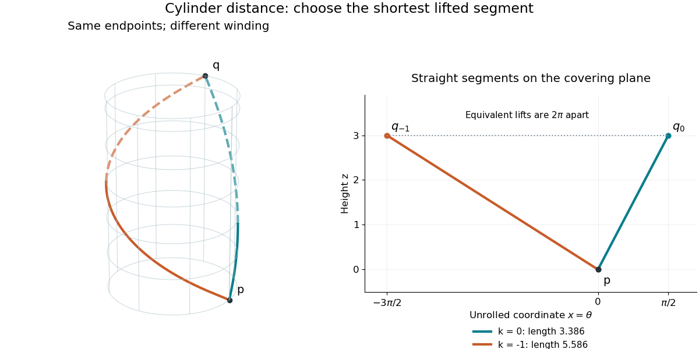

# Riemannian distance on a circular cylinder

↑ **Parent:** [Riemannian distance](riemannian-distance.md)

On the lateral [surface](topological-surface-split.md) of an infinite [circular cylinder](circular-cylinder.md) of radius $R$, the [induced metric](induced-metric.md) is $R^2d\theta^2+dz^2$. Lifting a [curve](curve.md) to the unrolled plane $(x,z)=(R\theta,z)$ preserves its [arc length](arc-length.md). If the endpoints differ by angular coordinate $\Delta\theta$ and height $\Delta z$, the possible lifted endpoint displacements are $(R(\Delta\theta+2\pi k),\Delta z)$ for [integers](integer-split.md) $k$. Each straight segment gives a [geodesic](geodesic.md), and the shortest of their [lengths](length.md) is

$$
d_g(p,q)=\min_{k\in\mathbb Z}
\sqrt{R^2(\Delta\theta+2\pi k)^2+(\Delta z)^2}.
$$

Choose the representative of $\Delta\theta$ with smallest absolute value modulo $2\pi$; if its absolute value is $\pi$, the two angular directions tie. This minimum is attained because the candidate [lengths](length.md) tend to infinity as $|k|\to\infty$. The formula concerns travel on the lateral surface; it does not allow a shortcut through the cylinder's interior or across end caps.

For $R=1$, take $p=(1,0,0)$ and $q=(0,1,3)$ in surrounding [Euclidean space](euclidean-norm.md). The angular difference is $\pi/2$ and height difference is $3$. The $k=0$ route has [length](length.md) $\sqrt{9+\pi^2/4}\approx3.386$. The $k=-1$ route goes the other way around and has [length](length.md) $\sqrt{9+9\pi^2/4}\approx5.586$. Both are among the [geodesics on a circular cylinder](geodesics-on-a-circular-cylinder.md), but only the first is a [minimizing geodesic](minimizing-geodesic.md) between these endpoints.

**[Figure 1](#image-cylinder-distance-compares-straight-segments-to-different-lifts-of-the-same-endpoint). Cylinder distance compares straight segments to different lifts of the same endpoint**.

This is a global consequence of [intrinsic flatness of a circular cylinder](intrinsic-flatness-of-a-circular-cylinder.md): locally everything is Euclidean, yet the periodic angular coordinate leaves several competing routes. A shortest-route problem on the curved surface becomes a family of ordinary planar distance calculations.

## ↑ Ancestors (8)

1. [Riemannian distance](riemannian-distance.md)
2. [Arc length](arc-length.md)
3. [Riemannian geometry](riemannian-geometry-split.md)
4. [Differential geometry](differential-geometry-split.md)
5. [Geometry and topology](geometry-and-topology-split.md)
6. [Area of mathematics](area-of-mathematics.md)
7. [Mathematics](mathematics-split.md)
8. [Codex Wiki](split.md)

## ← Incoming links (4)

- [Geodesic](geodesic.md)
- [Induced metric](induced-metric.md)
- [Riemannian distance](riemannian-distance.md)
- [Riemannian geometry](riemannian-geometry-split.md)
