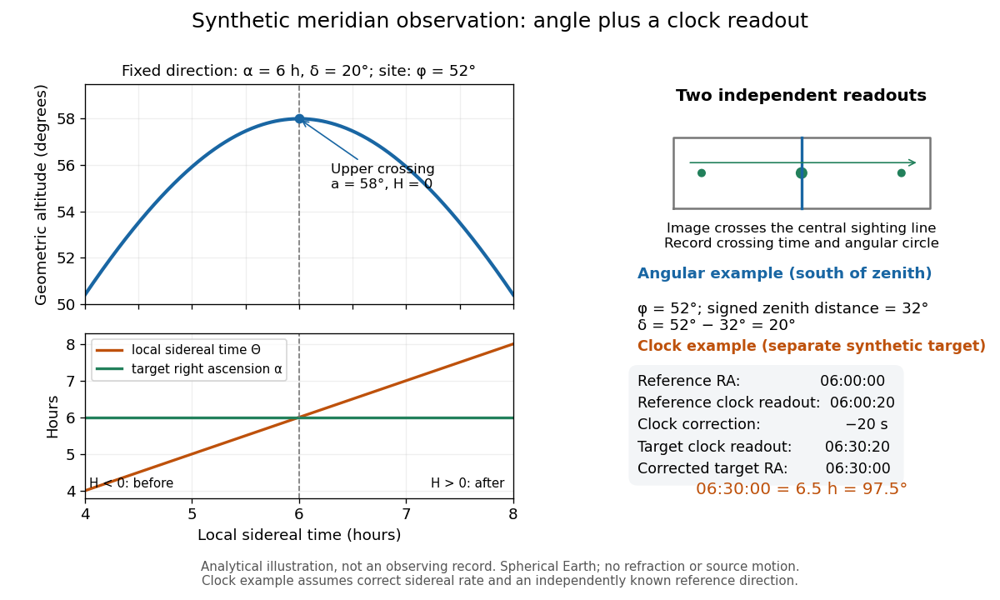

# Right ascension

↑ **Parent:** [Equatorial coordinate system](equatorial-coordinate-system.md)  
ⓦ [Wiki](https://en.wikipedia.org/wiki/Right_ascension)

[Right ascension](right-ascension.md) $\alpha$ is the eastward [angle](angle.md) along the reference [celestial equator](celestial-equator.md) from the [reference equinox](equinox-celestial-coordinates.md) to a direction's [hour circle](hour-circle.md), conventionally reduced to $0\leq\alpha<24^{\rm h}$. Its hours label [angles](angle.md): $24^{\rm h}=360^\circ$, $1^{\rm h}=15^\circ$, $1^{\rm m}=15'$ and $1^{\rm s}=15''$. Thus $6^{\rm h}30^{\rm m}=97.5^\circ=13\pi/24$ [radians](radian.md). A minute of [right ascension](right-ascension.md) differs from a minute of arc, and the actual arc on a fixed-[declination](declination.md) parallel also contains the [cosine](cosine.md) factor described under [declination](declination.md).

The hours become useful through [sidereal time](sidereal-time.md). At local [sidereal time](sidereal-time.md) $8^{\rm h}$, a synthetic direction of [right ascension](right-ascension.md) $6^{\rm h}30^{\rm m}$ has west-positive [hour angle](hour-angle.md) $1^{\rm h}30^{\rm m}=22.5^\circ$ and has passed its upper [meridian transit](meridian-transit.md). Conversely, at $5^{\rm h}30^{\rm m}$ it has [hour angle](hour-angle.md) $-1^{\rm h}$ and has yet to cross. Interpret these intervals in sidereal hours; ordinary civil hours are not interchangeable with them. The [right ascension](right-ascension.md) of the upper [celestial meridian](celestial-meridian.md) advances as the [Earth](earth.md) turns, while the synthetic fixed target's [right ascension](right-ascension.md) stays unchanged.

An instrument makes this geometry tangible. DePauw University's description of McKim Observatory documents a meridian [optical telescope](optical-telescope.md) with an angular circle, astronomical clocks and a chronograph. The circle measures zenith distance, and the crossing [time](time-in-physics.md) supplies [right ascension](right-ascension.md). Clock pulses and the observer's electrical key mark a rotating paper record, so crossing [time](time-in-physics.md) is read relative to the clock marks. One clock kept [sidereal time](sidereal-time.md) and another solar [time](time-in-physics.md). This apparatus separates two measured quantities: when a [star](star.md) crosses the [celestial meridian](celestial-meridian.md), and at what [angle](angle.md) from the [zenith](zenith.md). [DePauw University: McKim's meridian telescope, angular circle, clocks and chronograph](https://www.depauw.edu/about/campus/mckim-observatory/observatory-instruments/).

A teaching reconstruction would fix an [optical telescope](optical-telescope.md) to sweep the [celestial meridian](celestial-meridian.md), align its central sighting line, and observe a recognizable reference [star](star.md) followed by a target. Record each central-line crossing against a clock or timestamped camera, and read the angular circle at upper [meridian transit](meridian-transit.md). A short sequence shows the image moving across the stationary sighting line; the central crossing supplies a repeatable event. In the ideal model, successive upper crossings of a fixed direction recur once per sidereal day, and directions with increasing [right ascension](right-ascension.md) cross later in the same cycle. These are predictions for the reconstruction, rather than reported McKim measurements. Tatum derives the equality between local [sidereal time](sidereal-time.md) and [right ascension](right-ascension.md) at upper [meridian transit](meridian-transit.md). [Jeremy Tatum: Section 6.3, timing upper meridian transit](https://www.astro.uvic.ca/~tatum/celmechs/celm6.pdf).

Calibrate the clock's zero by comparing its reference crossing readout $C_r$ with the reference [star](star.md)'s predicted apparent [right ascension](right-ascension.md) $\alpha_r$ in the same date convention: the additive correction is $b=\alpha_r-C_r$, modulo $24^{\rm h}$. Then infer target [right ascension](right-ascension.md) $\alpha_t=C_t+b$ if the clock rate is correct between crossings. In a purely synthetic example, $\alpha_r=6^{\rm h}00^{\rm m}00^{\rm s}$ and $C_r=6^{\rm h}00^{\rm m}20^{\rm s}$ imply $b=-20^{\rm s}$. A target readout $C_t=6^{\rm h}30^{\rm m}20^{\rm s}$ therefore gives $\alpha_t=6^{\rm h}30^{\rm m}00^{\rm s}=97.5^\circ$. The $20^{\rm s}$ clock offset is $300''$ in [right ascension](right-ascension.md), while its local east-west angular effect at [declination](declination.md) $60^\circ$ is approximately $150''$. The reference and target in this calculation are invented directions, with no claim about any current [star](star.md)'s coordinates.

**[Figure 7](#image-synthetic-meridian-observation-changing-altitude-fixed-right-ascension-and-a-calibrated-sidereal-clock-readout). Synthetic meridian observation: changing altitude, fixed right ascension, and a calibrated sidereal-clock readout**.

Controls give the inference its meaning. Use independently established [geographical latitude](geographical-latitude.md) and an angular-circle zero for [declination](declination.md); check sighting-line alignment against several reference [stars](star.md), and bracket the target in [time](time-in-physics.md) with references to reveal clock drift. Record north or south of the [zenith](zenith.md), distinguish upper from lower [meridian transit](meridian-transit.md), and account for [atmospheric refraction](atmospheric-refraction.md). Convert the observing timestamp to local [sidereal time](sidereal-time.md) using the site's east-positive longitude correction, rather than a time-zone offset; precise conversion uses the [Earth](earth.md)'s measured rotation [time](time-in-physics.md). A reference [star](star.md) calibrates a zero only after its catalogue direction has been converted to the observation convention. Repeated crossings reduce random [measurement error](measurement-error.md), while an incorrect clock rate, axis alignment or catalogue convention remains a systematic limitation. [US Naval Observatory: Local sidereal time, longitude convention and rotation-time input](https://aa.usno.navy.mil/faq/GAST). These controls are requirements inferred from the geometric and clock model, not a claimed historical observing log.

## ↑ Ancestors (5)

1. [Equatorial coordinate system](equatorial-coordinate-system.md)
2. [Astrophysics](astrophysics-split.md)
3. [Branches of physics](branches-of-physics.md)
4. [Physics](physics-split.md)
5. [Codex Wiki](split.md)

## ← Incoming links (13)

- [Astrometry](astrometry.md)
- [Declination](declination.md)
- [Epoch (astronomy)](epoch-astronomy.md)
- [Equatorial coordinate system](equatorial-coordinate-system.md)
- [Equinox (celestial coordinates)](equinox-celestial-coordinates.md)
- [Horizontal coordinate system](horizontal-coordinate-system.md)
- [Hour angle](hour-angle.md)
- [Hour circle](hour-circle.md)
- [Solution](past-exam-of-the-mathematics-course-of-the-university-of-cambridge/2017/iii/paper-338/1/a/iii/solution.md)
- [Solution](past-exam-of-the-mathematics-course-of-the-university-of-cambridge/2018/iii/paper-338/1/a/i/solution.md)
- [Proper motion](proper-motion.md)
- [Right ascension](right-ascension.md)
- [Sidereal time](sidereal-time.md)
