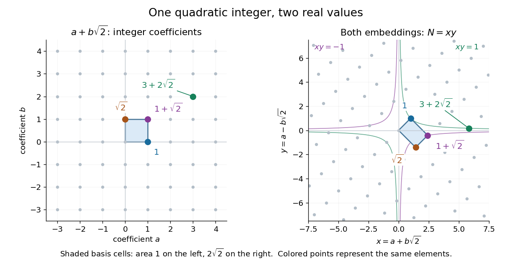

# Ring of integers of Q of square root two

↑ **Parent:** [Ring of integers of a quadratic field](ring-of-integers-of-a-quadratic-field.md)

Since $2\not\equiv1\pmod4$, the [ring of integers](ring-of-integers.md) of $\mathbb Q(\sqrt2)$ is

$$
\mathbb Z[\sqrt2]=\{a+b\sqrt2:a,b\in\mathbb Z\},
$$

with [integral basis](integral-basis.md) $1,\sqrt2$ and [field discriminant](field-discriminant.md) eight. Multiplication is ordinary [polynomial](polynomial-split.md) multiplication followed by $(\sqrt2)^2=2$:

$$
(a+b\sqrt2)(c+e\sqrt2)=(ac+2be)+(ae+bc)\sqrt2.
$$

For example, $(1+\sqrt2)^2=3+2\sqrt2$ and $(1+\sqrt2)^3=7+5\sqrt2$. The [integer](integer-split.md) coefficients stay integral, as required for a [ring](ring.md).

Under the two [field embeddings](field-embedding.md), the element $a+b\sqrt2$ becomes the point $(a+b\sqrt2,a-b\sqrt2)$. The [integral basis](integral-basis.md) vectors become $(1,1)$ and $(\sqrt2,-\sqrt2)$, giving a [Minkowski embedding of a real quadratic field](minkowski-embedding-of-a-real-quadratic-field.md). Their [determinant](determinant.md) has absolute value $2\sqrt2=\sqrt8$, consistent with the [field discriminant](field-discriminant.md).

**[Figure 1](#image-the-two-real-embeddings-turn-the-integers-adjoined-square-root-two-into-a-lattice). The two real embeddings turn the integers adjoined square root two into a lattice**. Left: the [integer lattice](integer-lattice.md) of coefficients $(a,b)$. Right: the [Minkowski embedding of a real quadratic field](minkowski-embedding-of-a-real-quadratic-field.md), $(x,y)=(a+b\sqrt2,a-b\sqrt2)$. The highlighted cells use the same [integral basis](integral-basis.md); their areas are $1$ and $2\sqrt2$. Each image point has [field norm](field-norm.md) $xy$, so the marked [units](unit-in-a-ring.md) lie on the [hyperbolas](hyperbola.md) $xy=\pm1$. Only a finite portion is shown.

**Table of contents**

- [Norm-Euclideanity of the integers adjoined square root two](norm-euclideanity-of-the-integers-adjoined-square-root-two.md)

## ↑ Ancestors (8)

1. [Ring of integers of a quadratic field](ring-of-integers-of-a-quadratic-field.md)
2. [Ring of integers](ring-of-integers.md)
3. [Algebraic integer](algebraic-integer.md)
4. [Algebraic number theory](algebraic-number-theory-split.md)
5. [Algebra](algebra-split.md)
6. [Area of mathematics](area-of-mathematics.md)
7. [Mathematics](mathematics-split.md)
8. [Codex Wiki](split.md)

## ← Incoming links (2)

- [Solution](past-exam-of-the-mathematics-course-of-the-university-of-cambridge/2013/iii/paper-21/5/solution.md)
- [Solution](past-exam-of-the-mathematics-course-of-the-university-of-cambridge/2019/ii/paper-1/20g/a/solution.md)
