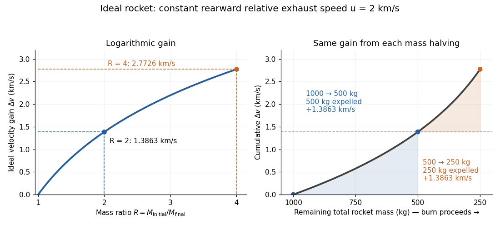
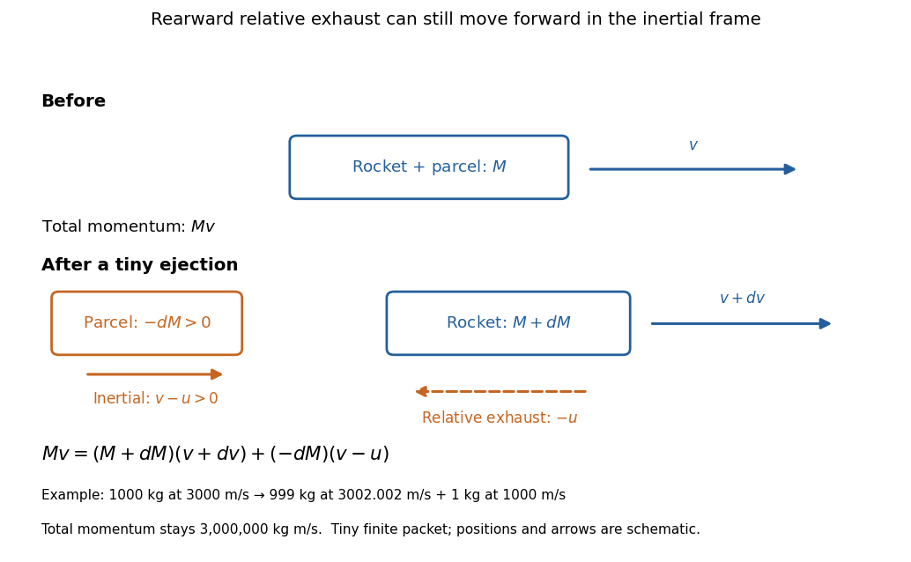

# Rocket equation

↑ **Parent:** [Momentum](momentum.md)

The ideal [rocket equation](rocket-equation.md) gives the change in signed [velocity](velocity.md) produced by ejecting [rocket propellant](rocket-propellant.md). Assume one-dimensional [Newtonian mechanics](newtonian-mechanics.md) in an [inertial frame](inertial-frame.md), no external [force](force.md), and a fixed positive [rocket exhaust speed](rocket-exhaust-speed.md) $u$ directed rearward relative to the instantaneous rocket. The rocket's instantaneous [mass](mass.md) $M$ includes its remaining [rocket propellant](rocket-propellant.md); burning it gives $dM<0$. For initial and final [masses](mass.md) $M_{\mathrm{initial}}\ge M_{\mathrm{final}}>0$,

$$
M\,dv=-u\,dM,\qquad
\Delta v=v_{\mathrm{final}}-v_{\mathrm{initial}}
=u\ln\frac{M_{\mathrm{initial}}}{M_{\mathrm{final}}}.
$$

Here $\ln$ is the [natural logarithm](natural-logarithm.md), and its argument is the [rocket mass ratio](rocket-mass-ratio.md). This is the constant-[rocket exhaust speed](rocket-exhaust-speed.md), zero-pressure-correction version of the ideal [rocket equation](rocket-equation.md). [NASA Glenn Research Center: Ideal Rocket Equation](https://www1.grc.nasa.gov/beginners-guide-to-aeronautics/ideal-rocket-equation/)

For a toy rocket with $u=2\,\mathrm{km/s}$, $M_{\mathrm{initial}}=1000\,\mathrm{kg}$ and [rocket dry mass](rocket-dry-mass.md) $M_{\mathrm{final}}=250\,\mathrm{kg}$ after all [rocket propellant](rocket-propellant.md) is spent, the [rocket mass ratio](rocket-mass-ratio.md) is $4$ and

$$
\Delta v=2\ln4\,\mathrm{km/s}\simeq2.7725887\,\mathrm{km/s}.
$$

Burning from $1000$ to $500\,\mathrm{kg}$ gains $2\ln2\,\mathrm{km/s}\simeq1.3863\,\mathrm{km/s}$. Burning from $500$ to $250\,\mathrm{kg}$ gains exactly the same [velocity](velocity.md) increment, using only $250\,\mathrm{kg}$ of [rocket propellant](rocket-propellant.md) instead of $500\,\mathrm{kg}$. Both burns halve the remaining [mass](mass.md). The second burn accelerates a lighter rocket; equal fractional [mass](mass.md) losses give equal [velocity](velocity.md) gains.

**[Figure 18](#image-equal-mass-halvings-give-equal-ideal-velocity-gains-for-an-exhaust-speed-of-2-kilometres-per-second). Equal mass halvings give equal ideal velocity gains for an exhaust speed of 2 kilometres per second**.

The [natural logarithm](natural-logarithm.md) makes the [rocket equation](rocket-equation.md) both useful and revealing: multiplying successive [rocket mass ratios](rocket-mass-ratio.md) adds their [velocity](velocity.md) gains. Conversely, the required [rocket mass ratio](rocket-mass-ratio.md) is the [exponential function](exponential-function.md) $M_{\mathrm{initial}}/M_{\mathrm{final}}=e^{\Delta v/u}$. Each extra $u\ln2$ of ideal [velocity](velocity.md) gain doubles the required initial [mass](mass.md) for fixed final [mass](mass.md). This explains why a larger [rocket exhaust speed](rocket-exhaust-speed.md) is valuable and why carrying ever more [rocket propellant](rocket-propellant.md) has diminishing returns. Changing the burn duration alone does not change this ideal endpoint result.

For a short proof outline, follow the rocket together with a tiny parcel about to be expelled. Before ejection, their total [momentum](momentum.md) is $Mv$. After ejection, the remaining rocket has [mass](mass.md) $M+dM$ and [velocity](velocity.md) $v+dv$, while the parcel has positive [mass](mass.md) $-dM$ and, to first order, inertial [velocity](velocity.md) $v-u$. [Momentum conservation](momentum-conservation.md) gives

$$
Mv=(M+dM)(v+dv)+(-dM)(v-u),\qquad
0=M\,dv+u\,dM+dM\,dv.
$$

Discarding the second-order product $dM\,dv$ gives $M\,dv=-u\,dM$; taking the [integral](integral.md) gives $\Delta v=-u\int_{M_{\mathrm{initial}}}^{M_{\mathrm{final}}}dM/M$. Evaluating the [integral](integral.md) yields the [natural logarithm](natural-logarithm.md) above. This is a [variable-mass system](variable-mass-system.md) calculation: the rocket alone is not a [closed system](closed-system.md), and its [momentum](momentum.md) changes as the expelled material carries away [momentum](momentum.md). The fixed collection consisting of the rocket and all its expelled material has conserved total [momentum](momentum.md) when external [forces](force.md) vanish.

**[Figure 19](#image-momentum-balance-for-a-tiny-expelled-parcel-rearward-relative-exhaust-can-still-move-forward-in-the-inertial-frame). Momentum balance for a tiny expelled parcel: rearward relative exhaust can still move forward in the inertial frame**.

Fixed [rocket exhaust speed](rocket-exhaust-speed.md) means fixed relative [speed](speed.md) at release, not fixed inertial [velocity](velocity.md). As the rocket's [velocity](velocity.md) $v$ changes, newly emitted material has changing inertial [velocity](velocity.md) $v-u$; previously released parcels coast at their own release [velocities](velocity.md) in this ideal model. If $v>u$, the exhaust even moves forward in the [inertial frame](inertial-frame.md), although it is emitted rearward relative to the rocket. No surrounding medium is needed for this exchange of [momentum](momentum.md).

Real flight adds [gravity](gravity.md), [drag force](drag-physics.md) and possibly a [pressure](pressure.md) correction to [rocket thrust](rocket-thrust.md). A varying [rocket thrust](rocket-thrust.md) due solely to a changing [mass loss rate](mass-loss-rate.md) still gives the same ideal [rocket equation](rocket-equation.md) if $u$ is constant; it changes the [acceleration](acceleration.md) and burn duration. A changing [rocket exhaust speed](rocket-exhaust-speed.md) instead requires $\Delta v=-\int u\,dM/M$, and external [forces](force.md) require their own contribution to the [velocity](velocity.md) change. The existing [constant mass-loss propulsion with quadratic drag](constant-mass-loss-propulsion-with-quadratic-drag.md) and [constant-burn rocket with ground friction](constant-burn-rocket-with-ground-friction.md) illustrate such additional [forces](force.md); the [forward-exhaust rocket equation](forward-exhaust-rocket-equation.md) reverses the ejection direction and therefore the sign of the recoil.

**Table of contents**

- [Rocket exhaust speed](rocket-exhaust-speed.md)
- [Rocket propellant](rocket-propellant.md)
  - [Rocket dry mass](rocket-dry-mass.md)
- [Rocket mass ratio](rocket-mass-ratio.md)
- [Rocket thrust](rocket-thrust.md)
- [Constant-burn rocket with ground friction](constant-burn-rocket-with-ground-friction.md)
- [Constant mass-loss propulsion with quadratic drag](constant-mass-loss-propulsion-with-quadratic-drag.md)
- [Zero-relative-velocity mass shedding](zero-relative-velocity-mass-shedding.md)
- [Dust-collecting rocket](dust-collecting-rocket.md)
  - [Rocket equation with stationary mass accretion](rocket-equation-with-stationary-mass-accretion.md)
    - [Equal-rate rocket burning and accretion](equal-rate-rocket-burning-and-accretion.md)
- [Relativistic rocket equation](relativistic-rocket-equation.md)
- [Two-stage rocket with proportional fuel and body masses](two-stage-rocket-with-proportional-fuel-and-body-masses.md)
- [Forward-exhaust rocket equation](forward-exhaust-rocket-equation.md)

## ↑ Ancestors (5)

1. [Momentum](momentum.md)
2. [Classical mechanics](classical-mechanics-split.md)
3. [Branches of physics](branches-of-physics.md)
4. [Physics](physics-split.md)
5. [Codex Wiki](split.md)

## ← Incoming links (25)

- [Constant-burn rocket with ground friction](constant-burn-rocket-with-ground-friction.md)
- [Constant mass-loss propulsion with quadratic drag](constant-mass-loss-propulsion-with-quadratic-drag.md)
- [Escape speed, circular speed, and propulsion](escape-speed-circular-speed-and-propulsion.md)
- [Solution](past-exam-of-the-mathematics-course-of-the-university-of-cambridge/2003/ia/paper-4/3e/solution.md)
- [Solution](past-exam-of-the-mathematics-course-of-the-university-of-cambridge/2007/ia/paper-4/3c/solution.md)
- [Solution](past-exam-of-the-mathematics-course-of-the-university-of-cambridge/2008/ia/paper-4/9b/solution.md)
- [Solution](past-exam-of-the-mathematics-course-of-the-university-of-cambridge/2009/ia/paper-4/3a/solution.md)
- [Solution](past-exam-of-the-mathematics-course-of-the-university-of-cambridge/2011/ia/paper-4/11b/a/solution.md)
- [Solution](past-exam-of-the-mathematics-course-of-the-university-of-cambridge/2013/ia/paper-4/3b/solution.md)
- [Solution](past-exam-of-the-mathematics-course-of-the-university-of-cambridge/2014/ia/paper-4/9c/solution.md)
- [Solution](past-exam-of-the-mathematics-course-of-the-university-of-cambridge/2016/ia/paper-4/9b/a/solution.md)
- [Solution](past-exam-of-the-mathematics-course-of-the-university-of-cambridge/2016/ia/paper-4/9b/c/solution.md)
- [Solution](past-exam-of-the-mathematics-course-of-the-university-of-cambridge/2017/ia/paper-4/12a/a/solution.md)
- [Solution](past-exam-of-the-mathematics-course-of-the-university-of-cambridge/2017/ia/paper-4/12a/b/solution.md)
- [Solution](past-exam-of-the-mathematics-course-of-the-university-of-cambridge/2021/ia/paper-4/3c/solution.md)
- [Rocket dry mass](rocket-dry-mass.md)
- [Rocket equation](rocket-equation.md)
- [Rocket equation with stationary mass accretion](rocket-equation-with-stationary-mass-accretion.md)
- [Rocket exhaust speed](rocket-exhaust-speed.md)
- [Rocket mass ratio](rocket-mass-ratio.md)
- [Rocket propellant](rocket-propellant.md)
- [Rocket thrust](rocket-thrust.md)
- [Two-stage rocket with proportional fuel and body masses](two-stage-rocket-with-proportional-fuel-and-body-masses.md)
- [Variable-mass system](variable-mass-system.md)
- [Zero-relative-velocity mass shedding](zero-relative-velocity-mass-shedding.md)
