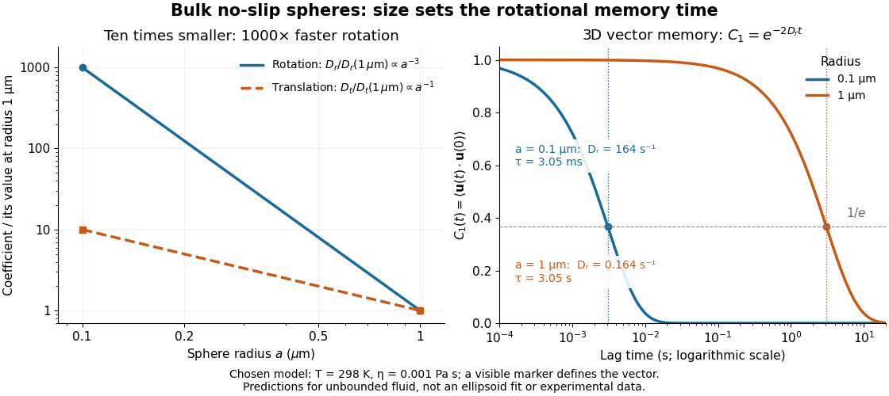

# Rotational diffusion of a sphere

↑ **Parent:** [Rotational diffusion](rotational-diffusion.md)

For a [sphere](sphere.md) of radius $a$ in an otherwise stationary, unbounded [Newtonian fluid](newtonian-fluid.md) with [dynamic viscosity](dynamic-viscosity-split.md) $\eta$, impose the [no-slip boundary condition](no-slip-boundary-condition.md) and the slow-flow assumptions of [Stokes flow](stokes-flow-split.md). The resisting [torque](torque.md) on a [rotating sphere in Stokes flow](rotating-sphere-in-stokes-flow.md) is $-\zeta_r\boldsymbol\Omega$, where $\boldsymbol\Omega$ is its [angular velocity](angular-velocity.md) and $\zeta_r=8\pi\eta a^3$. Thermal [rotational diffusion](rotational-diffusion.md) at absolute [temperature](temperature-split.md) $T$ then gives

$$
D_r=\frac{k_BT}{\zeta_r}=\frac{k_BT}{8\pi\eta a^3},\qquad
D_t=\frac{k_BT}{6\pi\eta a},\qquad
\frac{D_r}{D_t}=\frac3{4a^2}.
$$

Here $k_B$ is the [Boltzmann constant](boltzmann-constant.md); the translational expression is the [Stokes–Einstein relation](stokes-einstein-relation.md). The ratio has units of inverse length squared, so comparing the numerical values of $D_r$ and $D_t$ without their units is meaningless. At fixed [temperature](temperature-split.md) and [dynamic viscosity](dynamic-viscosity-split.md), decreasing radius tenfold increases $D_r$ a thousandfold but $D_t$ only tenfold. This strong size dependence explains why small particles can lose directional memory extremely quickly.

Choose $T=298\,\mathrm K$ and $\eta=0.001\,\mathrm{Pa\,s}$ as illustrative model inputs. Using $k_B=1.380649\times10^{-23}\,\mathrm{J\,K^{-1}}$ gives $k_BT=4.11433402\times10^{-21}\,\mathrm J$ and the following predictions:

$$
\begin{array}{c|c|c|c}
a\ (\mu\mathrm m)&D_r\ (\mathrm{s^{-1}})&D_t\ (\mu\mathrm{m^2\,s^{-1}})&\tau_1=1/(2D_r)\ (\mathrm s)\\
\hline
0.1&163.704&2.18272&0.00305429\\
1&0.163704&0.218272&3.05429
\end{array}
$$

These are bulk three-dimensional [sphere](sphere.md) calculations, explicitly not a fit to the confined [ellipsoid](ellipsoid.md) experiment below. Walls, nonspherical shape and departure from the [no-slip boundary condition](no-slip-boundary-condition.md) can change rotational resistance. A visible surface mark is still necessary to read the [sphere](sphere.md)'s turning in an image, even when its rotational [diffusion coefficient](diffusion-coefficient.md) is well defined physically.

**[Figure 18](#image-bulk-sphere-size-controls-rotational-diffusion-and-three-dimensional-directional-memory). Bulk sphere size controls rotational diffusion and three-dimensional directional memory**. Original model curves for $T=298\,\mathrm K$ and $\eta=0.001\,\mathrm{Pa\,s}$. Left: $D_r$ and $D_t$ are each divided by their own value at radius $1\,\mu\mathrm m$, making the plotted ratios [dimensionless](dimensionless-quantity.md). Right: the three-dimensional marked-vector [autocorrelation](autocorrelation.md) $e^{-2D_rt}$ for the two chosen radii; dots mark its $1/e$ times. The horizontal time axis is logarithmic. These are predictions for [spheres](sphere.md) in unbounded [fluid](fluid.md), not measurements or confined [ellipsoid](ellipsoid.md) fits.

## ↑ Ancestors (7)

1. [Rotational diffusion](rotational-diffusion.md)
2. [Diffusion](diffusion.md)
3. [Thermodynamics](thermodynamics-split.md)
4. [Statistical physics](statistical-physics-split.md)
5. [Branches of physics](branches-of-physics.md)
6. [Physics](physics-split.md)
7. [Codex Wiki](split.md)
