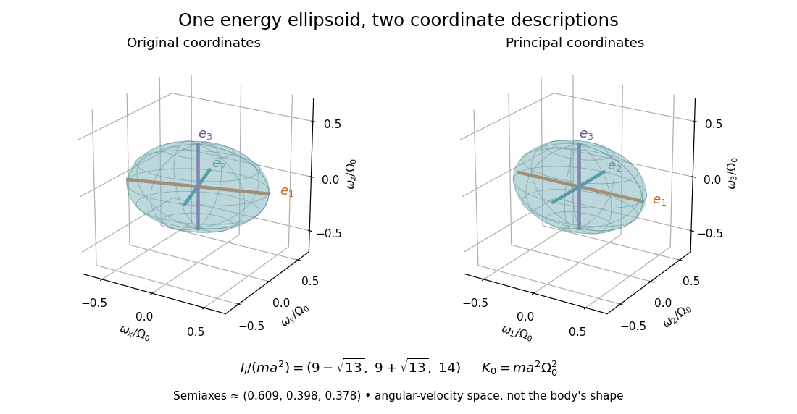

# Rotational energy ellipsoid

↑ **Parent:** [Principal moment of inertia](principal-moment-of-inertia.md)

For strictly positive [principal moments of inertia](principal-moment-of-inertia.md) and a fixed [rotational kinetic energy](rotational-kinetic-energy.md) $K_0>0$, the allowed [angular velocity](angular-velocity.md) components form an [ellipsoid](ellipsoid.md):

$$
I_1\omega_1^2+I_2\omega_2^2+I_3\omega_3^2=2K_0,
\qquad
s_i=\sqrt{\frac{2K_0}{I_i}}.
$$

Its semiaxis lengths $s_i$ have units of [angular speed](angular-speed.md). The longest semiaxis corresponds to the smallest [principal moment of inertia](principal-moment-of-inertia.md): that direction permits the greatest [angular speed](angular-speed.md) for the same [rotational kinetic energy](rotational-kinetic-energy.md). This is a surface in [angular velocity](angular-velocity.md) space, not the physical outline of the body. If one [principal moment of inertia](principal-moment-of-inertia.md) vanishes in an ideal line-mass model, this constant-energy surface is unbounded in that direction and is no longer an [ellipsoid](ellipsoid.md).

**[Figure 39](#image-principal-axes-and-the-constant-rotational-kinetic-energy-ellipsoid). Principal axes and the constant-rotational kinetic energy ellipsoid**. Original exact model using the six [point masses](point-mass.md) in [inertia tensor of paired point masses](inertia-tensor-of-paired-point-masses.md). With $K_0=ma^2\Omega_0^2$, the displayed surface in $\boldsymbol\omega/\Omega_0$ has semiaxes $\sqrt{2/(9-\sqrt{13})}$, $\sqrt{2/(9+\sqrt{13})}$ and $\sqrt{2/14}$. The left view uses the original coordinate directions and the right view the [principal body frame](principal-body-frame.md). Colors identify the same [principal axes](principal-axis.md) in both views; the surface describes possible [angular velocities](angular-velocity.md), not a material shell or a measured trajectory.

The [rotational energy ellipsoid](rotational-energy-ellipsoid.md) gives the geometry behind [Poinsot's ellipsoid](poinsot-s-ellipsoid.md), but a constant-energy surface alone does not determine a free-rotation trajectory. A torque-free trajectory must also satisfy the conserved [angular momentum](angular-momentum.md) constraint and the [Euler equations for a torque-free rigid body](euler-equations-for-a-torque-free-rigid-body.md).

## ↑ Ancestors (8)

1. [Principal moment of inertia](principal-moment-of-inertia.md)
2. [Inertia tensor](inertia-tensor.md)
3. [Moment of inertia](moment-of-inertia.md)
4. [Rigid body dynamics](rigid-body-dynamics.md)
5. [Classical mechanics](classical-mechanics-split.md)
6. [Branches of physics](branches-of-physics.md)
7. [Physics](physics-split.md)
8. [Codex Wiki](split.md)

## ← Incoming links (1)

- [Rotational energy ellipsoid](rotational-energy-ellipsoid.md)
