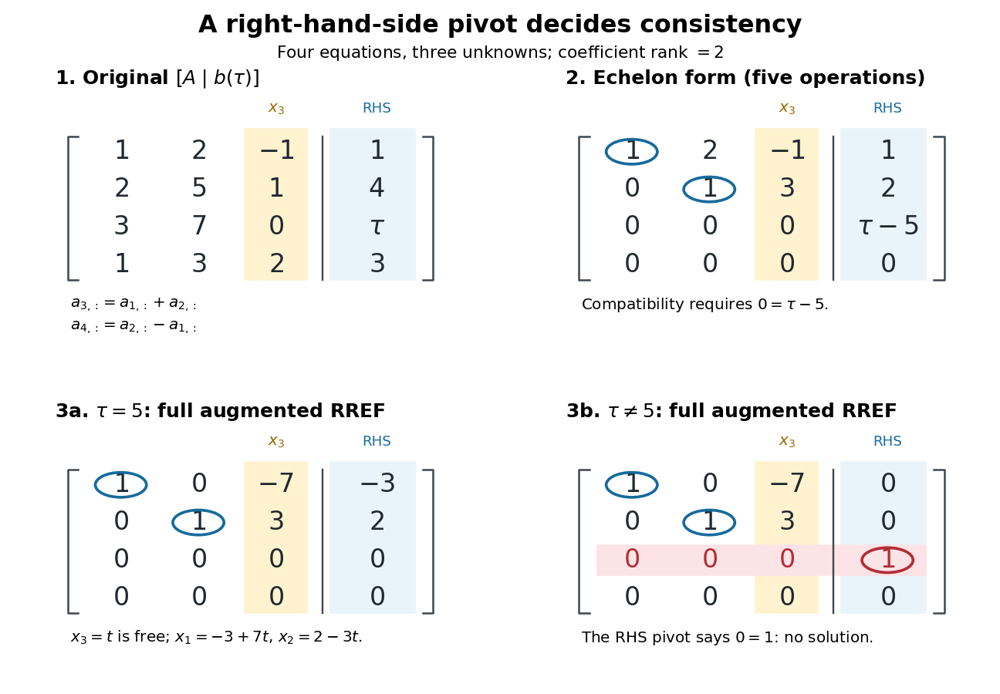

# Row reduction with a parameterized right-hand side

↑ **Parent:** [Row echelon form](row-echelon-form.md)

Work over the [rational numbers](rational-number.md), allowing unknowns in the [real numbers](real-number.md) when interpreting the geometry. Consider four equations in three unknowns:

$$
A=\begin{pmatrix}1&2&-1\\2&5&1\\3&7&0\\1&3&2\end{pmatrix},\qquad
b(\tau)=\begin{pmatrix}1\\4\\\tau\\3\end{pmatrix},\qquad Ax=b(\tau).
$$

The third row of $A$ is the sum of its first two rows, and the fourth is their difference, second minus first. The same relations must hold on the right: consistency requires $\tau=1+4=5$ and $3=4-1$. The latter condition already holds. [Gaussian elimination](gaussian-elimination.md) makes this compatibility test explicit while exposing the remaining freedom.

Apply the [elementary row operations](elementary-row-operation.md) in this order, using each row's current value:

$$
R_2\leftarrow R_2-2R_1,\quad R_3\leftarrow R_3-3R_1,\quad R_4\leftarrow R_4-R_1,
$$

then $R_3\leftarrow R_3-R_2$ and $R_4\leftarrow R_4-R_2$. The resulting [augmented matrix](augmented-matrix.md) is in [row echelon form](row-echelon-form.md) for every $\tau$:

$$
\left[\begin{array}{rrr|r}1&2&-1&1\\0&1&3&2\\0&0&0&\tau-5\\0&0&0&0\end{array}\right].
$$

When $\tau\ne5$, the third row has its [pivot element](pivot-element.md) in the augmented column. It says $0=\tau-5$, so the [linear system](system-of-linear-equations.md) has no solution. When $\tau=5$, that entire row vanishes and only two [pivot elements](pivot-element.md) remain. More equations than unknowns therefore do not force a unique solution: some equations may repeat information.

The final operation $R_1\leftarrow R_1-2R_2$ reduces the coefficient block to

$$
R=\begin{pmatrix}1&0&-7\\0&1&3\\0&0&0\\0&0&0\end{pmatrix},\qquad
Eb(\tau)=\begin{pmatrix}-3\\2\\\tau-5\\0\end{pmatrix}.
$$

The product of all six [elementary matrices](elementary-matrix.md) is

$$
E=\begin{pmatrix}5&-2&0&0\\-2&1&0&0\\-1&-1&1&0\\1&-1&0&1\end{pmatrix},\qquad EA=R.
$$

Direct [matrix multiplication](matrix-multiplication.md) verifies both displayed transformations. Its [determinant](determinant.md) is one, so this transformation is reversible. In particular, the third row of $E$ extracts the discrepancy between the third equation and the sum of the first two.

**[Figure 9](#image-row-echelon-form-exposes-compatibility-a-right-hand-side-pivot-element-distinguishes-inconsistency-from-a-free-variable-in-a-linear-system). Row echelon form exposes compatibility; a right-hand-side pivot element distinguishes inconsistency from a free variable in a linear system**.

For $\tau=5$, $[R\mid Eb]$ is the [reduced row echelon form](reduced-row-echelon-form.md) of the full [augmented matrix](augmented-matrix.md). For $\tau\ne5$, only its coefficient block is reduced: scale the third row by $1/(\tau-5)$ and clear the entries above its augmented [pivot element](pivot-element.md). The full [reduced row echelon form](reduced-row-echelon-form.md) is then

$$
\left[\begin{array}{rrr|r}1&0&-7&0\\0&1&3&0\\0&0&0&1\\0&0&0&0\end{array}\right].
$$

The last column is part of the [matrix](matrix.md) when testing the echelon conditions. Calling $[R\mid Eb]$ fully reduced before clearing that column would miss this distinction.

## ↑ Ancestors (8)

1. [Row echelon form](row-echelon-form.md)
2. [Gaussian elimination](gaussian-elimination.md)
3. [Numerical linear algebra](numerical-linear-algebra-split.md)
4. [Numerical analysis](numerical-analysis-split.md)
5. [Analysis](analysis-split.md)
6. [Area of mathematics](area-of-mathematics.md)
7. [Mathematics](mathematics-split.md)
8. [Codex Wiki](split.md)

## ← Incoming links (1)

- [Reading solutions from reduced row echelon form](reading-solutions-from-reduced-row-echelon-form.md)
