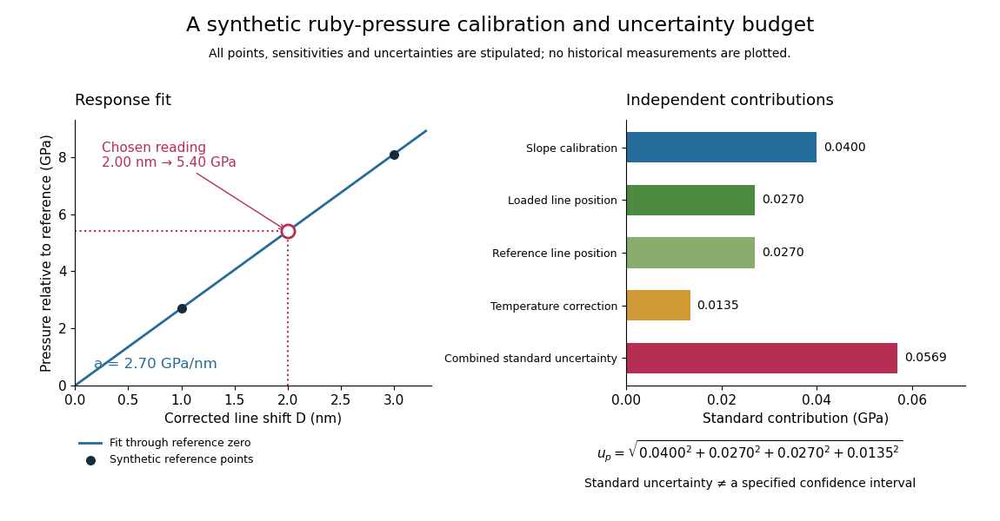

# Ruby pressure uncertainty worked example

↑ **Parent:** [Ruby pressure scale](ruby-pressure-scale.md)

Construct a synthetic local calibration to show the calculation independently of the historical data. Choose reference pairs $(\Delta\lambda_i,p_i)=(1.00,2.69),(2.00,5.42),(3.00,8.09)$, with shifts in $\mathrm{nm}$ and [pressures](pressure-split.md) in $\mathrm{GPa}$. The reference zero is already subtracted. Treat the shifts as exact for this fit and give the three reference [pressures](pressure-split.md) equal weights. Minimizing the [ordinary least squares](ordinary-least-squares.md) objective

$$
S(a)=\sum_i(p_i-a\Delta\lambda_i)^2
$$

and setting its [derivative](derivative.md) to zero gives

$$
a=\frac{\sum_i\Delta\lambda_i p_i}{\sum_i(\Delta\lambda_i)^2}
=\frac{37.80}{14.00}=2.70\,\mathrm{GPa\,nm^{-1}}.
$$

The [regression residuals](regression-residual.md) are $(-0.01,0.02,-0.01)\,\mathrm{GPa}$. Their weighted moment $\sum_i\Delta\lambda_i(p_i-a\Delta\lambda_i)$ vanishes, as required by the [least-squares normal equations](normal-equations-for-linear-least-squares.md). An unknown reference offset requires fitting an [intercept](regression-intercept.md) instead; forcing it to zero can bias the slope. If shift errors matter, this elementary fit is insufficient.

**[Figure 10](#image-synthetic-ruby-pressure-scale-fitting-the-response-and-propagating-measurement-uncertainty). Synthetic ruby pressure scale: fitting the response and propagating measurement uncertainty**. Original stipulated reference points and calculations, not measured historical calibration. The left panel shows the fitted slope and a chosen reading. The right panel separates independent contributions to [standard uncertainty](standard-uncertainty.md); bar lengths are standard contributions, which combine by sums of squares. The assigned slope [standard uncertainty](standard-uncertainty.md) includes a hypothetical reference-scale contribution and is not estimated from the three residuals.

Use the local measurement model

$$
p=aD,\qquad D=\lambda-\lambda_0-k_T(T-T_0).
$$

Here $p$ denotes [pressure](pressure-split.md) relative to the reference, $a$ is calibrated sensitivity, and $k_T$ is a local [wavelength](wavelength.md) sensitivity to [temperature](temperature-split.md) at fixed [pressure](pressure-split.md). Choose $a=2.70\,\mathrm{GPa\,nm^{-1}}$, $k_T=0.010\,\mathrm{nm\,K^{-1}}$ and a reading $\lambda-\lambda_0=2.00\,\mathrm{nm}$ at $T=T_0$. The inferred [pressure](pressure-split.md) is $5.40\,\mathrm{GPa}$. These coefficients and readings are stipulated, not measured [ruby](ruby.md) constants. With the same [pressure](pressure-split.md), a $10\,\mathrm K$ increase in [temperature](temperature-split.md) would add $0.100\,\mathrm{nm}$ to the shift in this model; neglecting it would overestimate [pressure](pressure-split.md) by $0.270\,\mathrm{GPa}$.

Assign independent [standard uncertainties](standard-uncertainty.md) $u_a=0.020\,\mathrm{GPa\,nm^{-1}}$, $u_\lambda=u_0=0.010\,\mathrm{nm}$ and $u_T=0.50\,\mathrm K$ for the [temperature](temperature-split.md) difference. Here $u_a$ is an independently assigned calibration uncertainty, not an estimate from the [regression residuals](regression-residual.md) above; treat $k_T$ as exact in this example. First-order [propagation of uncertainty](propagation-of-uncertainty.md) follows by differentiating the measurement model:

$$
dp=D\,da+a\,d\lambda-a\,d\lambda_0-a k_T\,d(T-T_0),
$$

$$
u_p^2=D^2u_a^2+a^2\left(u_\lambda^2+u_0^2+k_T^2u_T^2\right).
$$

The four standard contributions are $0.0400,0.0270,0.0270,0.0135\,\mathrm{GPa}$, giving $u_p=0.0569\,\mathrm{GPa}$. This is a [standard uncertainty](standard-uncertainty.md), not automatically a $95\%$ interval. Correlated reference and loaded [wavelength](wavelength.md) readings require the corresponding [covariance](covariance.md) term; common wavelength-axis drift may cancel in their difference. Uncertain $k_T$, nonzero $T-T_0$, model inadequacy and unresolved [deviatoric stress](deviatoric-stress.md) require a broader budget. Taking more optical readings reduces some random errors while leaving a common reference-scale error.

## ↑ Ancestors (10)

1. [Ruby pressure scale](ruby-pressure-scale.md)
2. [Diamond anvil cell](diamond-anvil-cell.md)
3. [High-pressure experimental metrology](high-pressure-experimental-metrology.md)
4. [Pressure measurement](pressure-measurement.md)
5. [Pressure](pressure-split.md)
6. [Thermodynamics](thermodynamics-split.md)
7. [Statistical physics](statistical-physics-split.md)
8. [Branches of physics](branches-of-physics.md)
9. [Physics](physics-split.md)
10. [Codex Wiki](split.md)
