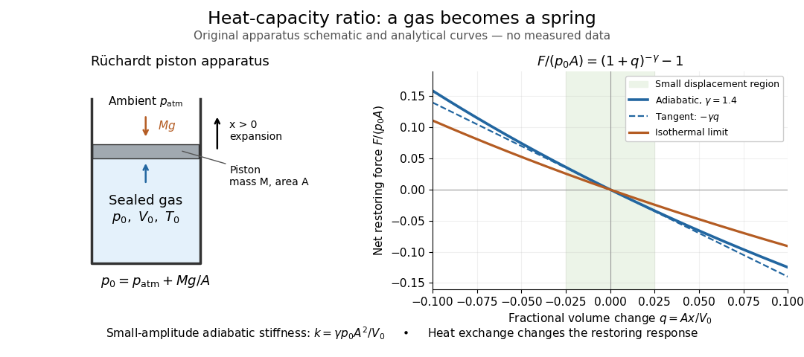

<h1 id="ruchardt-experiment">Rüchardt experiment</h1>

↑ **Parent:** [Heat capacity ratio](heat-capacity-ratio.md)

The Rüchardt experiment infers [heat capacity ratio](heat-capacity-ratio.md) from the [period of an oscillation](period-of-an-oscillation.md) of a piston supported by trapped [gas](gas.md). Use a vertical precision cylinder with a close-fitting movable piston, known moving [mass](mass.md) $M$, face [area](surface-area.md) $A$, trapped equilibrium [volume](volume-thermodynamics.md) $V_0$, and local atmospheric [pressure](pressure-split.md) $p_{\rm atm}$. With negligible static [friction](friction.md), [force balance](force-balance.md) gives the absolute gas [pressure](pressure-split.md) $p_0=p_{\rm atm}+Mg/A$, where $g$ is gravitational acceleration. Displace the piston slightly and release it: compression raises [pressure](pressure-split.md), and expansion lowers it, producing a restoring [force](force-split.md). The [oscillation](oscillation.md) is a mechanical probe of thermal response, without separately measuring two [heat](heat-split.md) inputs. [Instituto Superior Técnico e-lab, Determination of the Adiabatic Constant: piston apparatus and period model](https://groups.ist.utl.pt/wwwelab/wiki/index.php?title=Determination_of_the_Adiabatic_Constant)

Let $x$ be upward [displacement](displacement.md) from equilibrium, so $V=V_0+Ax$. For constant [heat capacity ratio](heat-capacity-ratio.md) and a reversible [adiabatic process](adiabatic-process.md), the net upward [force](force-split.md), including the ambient load and weight, is

$$
F(x)=A p_0\left[\left(1+\frac{Ax}{V_0}\right)^{-\gamma}-1\right]
\simeq-\frac{\gamma p_0A^2}{V_0}x.
$$

The [linear approximation](linear-approximation.md) requires $|Ax|/V_0\ll1$. Applying [Newton's second law](newton-s-second-law.md) gives [simple harmonic motion](simple-harmonic-motion.md) with

$$
\omega_0^2=\frac{\gamma p_0A^2}{MV_0},\qquad
\gamma=\frac{4\pi^2MV_0}{p_0A^2\mathcal T^2},\qquad
\mathcal T=\frac{2\pi}{\omega_0}.
$$

Here $\omega_0$ is the undamped [angular frequency](angular-frequency.md) and $\mathcal T$ the undamped [oscillation period](period-of-an-oscillation.md), rather than [temperature](temperature-split.md). Record repeated cycles, measure $M,A,V_0,p_{\rm atm}$ independently, and include all connected trapped [volume](volume-thermodynamics.md). An illustrative model with $M=0.020\,\mathrm{kg}$, $A=2.0\times10^{-4}\,\mathrm{m^2}$, $V_0=0.010\,\mathrm{m^3}$, $p_{\rm atm}=100000\,\mathrm{Pa}$, $g=9.81\,\mathrm{m\,s^{-2}}$ and $\gamma=1.4$ gives $p_0=100981\,\mathrm{Pa}$ and $\mathcal T\simeq1.182\,\mathrm s$. These stipulated values are not measurements.

**[Figure 3](#image-ruchardt-experiment-heat-capacity-ratio-sets-the-restoring-stiffness-of-trapped-gas). Rüchardt experiment: heat capacity ratio sets the restoring stiffness of trapped gas**. Original schematic and analytical [ideal gas](ideal-gas-split.md) curves. Upward piston [displacement](displacement.md) increases [volume](volume-thermodynamics.md); the blue curve uses constant $\gamma=1.4$, its dashed tangent gives the small-[amplitude](wave-amplitude.md) model, and the orange curve is the [isothermal process](isothermal-process.md) limit. The shaded central interval illustrates a small fractional [volume](volume-thermodynamics.md) change, without specifying an experimental acceptance threshold. No measured waveform is shown.

In Shearwood and Sloan's implementation, piston-mounted magnets induce an [electromotive force](electromotive-force.md) in a stationary coil through [Faraday's law of induction](faraday-s-law-of-induction.md); an oscilloscope records the signal. They observed faster [oscillations](oscillation.md) at smaller trapped [volume](volume-thermodynamics.md) values and stronger [damping](damping.md) at small cylinder [volume](volume-thermodynamics.md) values. The signal tracks [velocity](velocity.md) locally, so its [amplitude](wave-amplitude.md) is not directly piston [displacement](displacement.md). Calibration also identified inlet dead space beyond the graduated cylinder volume. [Chris Shearwood and Peter A. Sloan, The Rüchardt experiment revisited, §§3–4: signal, dead volume and observations](https://arxiv.org/html/2209.03323v1)

Repeat at smaller initial [amplitudes](wave-amplitude.md) to test the [linear approximation](linear-approximation.md), and compare several $V_0$ values. [Heat transfer](heat-transfer.md) weakens the restoring [force](force-split.md) toward the [isothermal process](isothermal-process.md) limit, biasing the inference toward $1$. Check leakage through resting-piston drift and before-and-after trapped [volume](volume-thermodynamics.md) readings. For viscous [damping](damping.md) with envelope $e^{-t/\tau}$, the measured [angular frequency](angular-frequency.md) obeys $\omega_0^2=\omega_d^2+\tau^{-2}$; this correction does not remove thermal leakage. Internal equilibration must be faster than an [oscillation period](period-of-an-oscillation.md), with [heat transfer](heat-transfer.md) and leakage slow over a run. Large [amplitude](wave-amplitude.md) or sticking [friction](friction.md) require a richer model. [Shearwood and Sloan, §§2.1, 2.4 and 3.2: damping, heat exchange and leakage limitations](https://arxiv.org/html/2209.03323v1)

## ↑ Ancestors (7)

1. [Heat capacity ratio](heat-capacity-ratio.md)
2. [Ideal gas](ideal-gas-split.md)
3. [Thermodynamics](thermodynamics-split.md)
4. [Statistical physics](statistical-physics-split.md)
5. [Branches of physics](branches-of-physics.md)
6. [Physics](physics-split.md)
7. [Codex Wiki](split.md)

## ← Incoming links (3)

- [Adiabatic process](adiabatic-process.md)
- [Heat capacity ratio](heat-capacity-ratio.md)
- [Rüchardt experiment](ruchardt-experiment.md)
