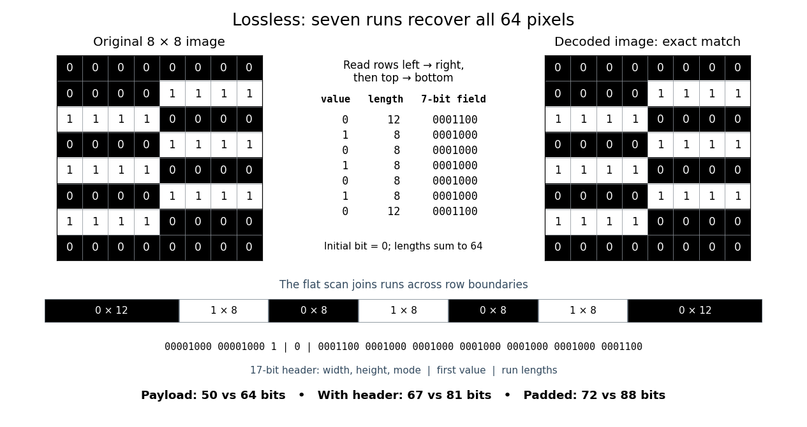

# Run-length encoding

↑ **Parent:** [Data compression](data-compression.md)  
ⓦ [Wiki](https://en.wikipedia.org/wiki/Run-length_encoding)

[Run-length encoding](run-length-encoding.md) replaces each maximal consecutive group of equal values, called a run, by its value and length. Decoding repeats each value the specified number of times. It is [lossless source coding](lossless-source-coding.md): no values are discarded. For a [binary string](binary-string.md), successive maximal runs alternate between 0 and 1, so storing the first [bit](bit.md) and all run lengths is enough.

Take this $8\times8$ [raster image](raster-graphics.md), with 0 black and 1 white, read left to right across each row and then top to bottom:
```
00000000
00001111
11110000
00001111
11110000
00001111
11110000
00000000
```
Reading the whole image as one 64-[bit](bit.md) [binary string](binary-string.md) gives exactly seven runs:

$$
(\text{value},\text{length})=(0,12),(1,8),(0,8),(1,8),(0,8),(1,8),(0,12).
$$

The lengths sum to $12+8+8+8+8+8+12=64$. Repeating the alternating values for these lengths and splitting after every eighth [pixel](pixel.md) reconstructs every displayed row exactly.

Here is a complete toy [file format](file-format.md). Its [file header](file-header.md) is an eight-[bit](bit.md) unsigned width, an eight-[bit](bit.md) unsigned height, then a one-[bit](bit.md) mode: 0 means raw [pixels](pixel.md), 1 means [run-length encoding](run-length-encoding.md). Fields are written most significant [bit](bit.md) first; this profile accepts only width and height 8, so both decoders know to stop at 64 [pixels](pixel.md). Raw mode contains 64 [bits](bit.md). [RLE](run-length-encoding.md) mode contains the initial [bit](bit.md), followed by seven-[bit](bit.md) unsigned run lengths in the range 1 to 64. Zero and lengths above 64 are invalid; a decoder rejects a run that would exceed the remaining [pixel](pixel.md) count. It stops when the decoded lengths sum to 64, so no run-count field or end marker is needed.

For this image, the complete [RLE](run-length-encoding.md) serialization is:
```
00001000 00001000 1 | 0 | 0001100 0001000 0001000 0001000 0001000 0001000 0001100
```
Spaces and vertical bars are explanatory separators, not stored characters. The seven-[bit](bit.md) fields directly store the lengths; 64 would be `1000000`. The payload costs $1+7\cdot7=50$ [bits](bit.md), versus 64 raw [bits](bit.md). The 17-[bit](bit.md) [file header](file-header.md) has the same size in either mode, giving complete sizes of 67 versus 81 [bits](bit.md). If packed into eight-[bit](bit.md) units, append zero padding only at the end: the sizes become 72 versus 88 [bits](bit.md). These are sizes of this toy representation, not sizes of [PNG](png.md) files.

The field design matters. Restarting [RLE](run-length-encoding.md) on every row costs eight initial [bits](bit.md) plus four [bits](bit.md) per run when lengths are stored directly: three [bits](bit.md) represent only 0 through 7, whereas a row can have length 8. This pattern has row-run counts $1,2,2,2,2,2,2,1$, totalling 14, so that payload costs $8+4\cdot14=64$ [bits](bit.md), with no saving. Storing length minus one would instead fit lengths 1 through 8 into three [bits](bit.md), but is a different declared [file format](file-format.md). An alternating flat 64-[bit](bit.md) [binary string](binary-string.md) has 64 runs and costs $1+7\cdot64=449$ payload [bits](bit.md) in our flat format; restarting each row costs $8+4\cdot64=264$ payload [bits](bit.md). A one-run image costs only eight payload [bits](bit.md). These extremes explain when [RLE](run-length-encoding.md) is useful: long uninterrupted regions make short instructions, while frequent changes make instructions expensive.

[Prefix codes](prefix-code.md) of unequal lengths can replace fixed-width run lengths, provided the decoder knows the code and any necessary code description is counted. [Run-length encoding](run-length-encoding.md) names a technique, not one universal serialization. For a real implementation, Microsoft's bitmap documentation specifies `BI_RLE8` with count and value fields plus special commands, rather than our initial-[bit](bit.md) convention.[Microsoft, Bitmap Compression, BI\_RLE8 encoded and absolute modes](https://learn.microsoft.com/en-us/windows/win32/gdi/bitmap-compression)

<a id="image-seven-runs-serialize-an-8-by-8-binary-image-and-reconstruct-every-pixel-exactly"></a>


**[Figure 6](#image-seven-runs-serialize-an-8-by-8-binary-image-and-reconstruct-every-pixel-exactly). Seven runs serialize an 8 by 8 binary image and reconstruct every pixel exactly**.

## ↑ Ancestors (3)

1. [Data compression](data-compression.md)
2. [Computer science](computer-science-split.md)
3. [Codex Wiki](split.md)

## ← Incoming links (7)

- [Data compression](data-compression.md)
- [Deflate](deflate.md)
- [Deflate backreference](deflate-backreference.md)
- [Deflate Huffman coding](deflate-huffman-coding.md)
- [Image compression](image-compression.md)
- [Pixel](pixel.md)
- [Run-length encoding](run-length-encoding.md)
