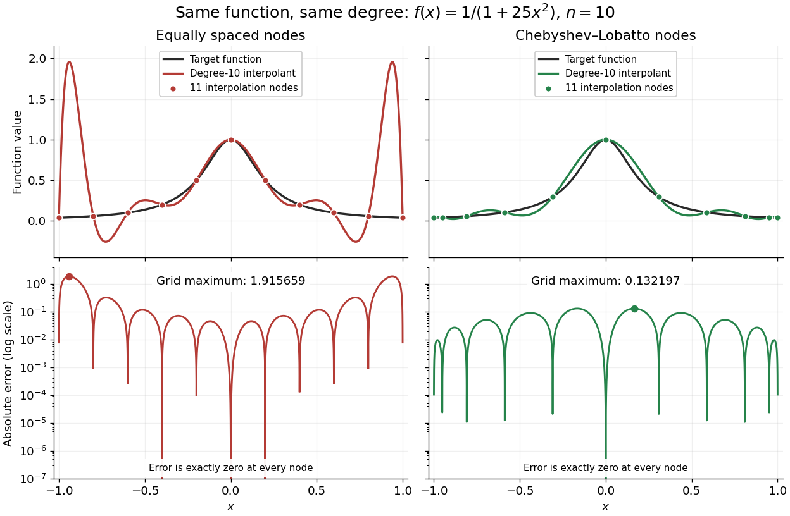

<h1 id="runge-s-phenomenon">Runge's phenomenon</h1>

↑ **Parent:** [Polynomial interpolation](polynomial-interpolation.md)  
ⓦ [Wiki](https://en.wikipedia.org/wiki/Runge's_phenomenon)

The [Runge phenomenon](runge-s-phenomenon.md) is the failure of increasing-degree [polynomial interpolation](polynomial-interpolation.md) at equally spaced [interpolation nodes](interpolation-node.md) to converge to some smooth target [functions](function-split.md), with large oscillations near the ends of the interval. It is a property of the approximation problem, and can occur even with exact arithmetic. A numerically stable evaluation method cannot remove it. Endpoint clustering, as in [Chebyshev-Lobatto nodes](chebyshev-lobatto-node.md), changes the approximation problem and can greatly improve it.[Driscoll and Braun, Fundamentals of Numerical Computation, §9.3.1–9.3.2](https://fncbook.com/python/stability-1/)

Take $f(x)=1/(1+25x^2)$ on $[-1,1]$ and [polynomial degree](degree-of-a-polynomial.md) at most $10$. Use either $x_k=-1+k/5$ or $x_k=\cos(k\pi/10)$ for $k=0,\ldots,10$. Each [interpolation polynomial](interpolation-polynomial.md) passes through all eleven of its own samples, yet the first has severe endpoint oscillations and the second stays much closer to the target [function](function-split.md). Evaluating both by the [barycentric interpolation formula](barycentric-interpolation-formula.md) on $20{,}001$ equally spaced points, including the endpoints, gives sampled maximum absolute errors of approximately $1.915659$ and $0.132197$, respectively: about a $14.49$-fold reduction. These are maxima over the stated grid, not certified maxima over the continuous interval. The generator separately checks exact reproduction of all stored nodal values.

**[Figure 27](#image-degree-10-interpolation-of-the-runge-function-at-equally-spaced-and-chebyshev-lobatto-nodes-with-absolute-errors). Degree-10 interpolation of the Runge function at equally spaced and Chebyshev-Lobatto nodes, with absolute errors**.

The [polynomial interpolation error](polynomial-interpolation-error.md) formula explains why [interpolation nodes](interpolation-node.md) enter the analysis. If $f$ has $n+1$ continuous [derivatives](derivative.md) on an interval containing $x$ and all the [interpolation nodes](interpolation-node.md), then for a suitable $\xi_x$ in that interval,

$$
f(x)-p_n(x)=\frac{f^{(n+1)}(\xi_x)}{(n+1)!}\prod_{i=0}^n(x-x_i).
$$

At an [interpolation node](interpolation-node.md) the error is zero directly. Away from the [interpolation nodes](interpolation-node.md), both the product and the high-order [derivative](derivative.md) matter. A short proof applies [Rolle's theorem](rolle-theorem.md) repeatedly to $f(t)-p_n(t)-[f(x)-p_n(x)]\prod_i(t-x_i)/\prod_i(x-x_i)$, which vanishes at $n+2$ distinct points.[Driscoll and Braun, Fundamentals of Numerical Computation, §9.1.2, Theorem 9.1.3](https://fncbook.com/polynomial/)

The successful comparison here does not assert that [Chebyshev-Lobatto nodes](chebyshev-lobatto-node.md) solve every approximation problem for every [function](function-split.md). The [derivatives](derivative.md), the [polynomial degree](degree-of-a-polynomial.md), and measurement errors still matter. The [Lebesgue constant of interpolation](lebesgue-constant-of-interpolation.md) measures worst-case amplification of nodal errors, while the [polynomial reproduction error bound](polynomial-reproduction-error-bound.md) relates interpolation to the [best uniform approximation](best-uniform-approximation.md) available at that [polynomial degree](degree-of-a-polynomial.md).

## ↑ Ancestors (7)

1. [Polynomial interpolation](polynomial-interpolation.md)
2. [Interpolation](interpolation.md)
3. [Numerical analysis](numerical-analysis-split.md)
4. [Analysis](analysis-split.md)
5. [Area of mathematics](area-of-mathematics.md)
6. [Mathematics](mathematics-split.md)
7. [Codex Wiki](split.md)

## ← Incoming links (1)

- [Chebyshev polynomial](chebyshev-polynomial.md)
