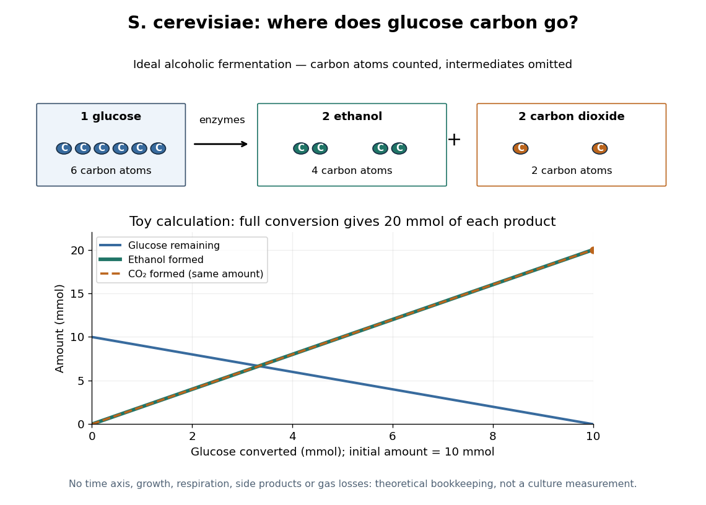

# Saccharomyces cerevisiae

↑ **Parent:** [Yeast](yeast.md)  
ⓦ [Wiki](https://en.wikipedia.org/wiki/Saccharomyces_cerevisiae)

[Saccharomyces cerevisiae](saccharomyces-cerevisiae.md) is a particular [species](species.md) of [yeast](yeast.md), used in baking, brewing and laboratory research. During ordinary vegetative growth it reproduces by [budding](budding.md): a smaller daughter grows from the mother before separation. Laboratory strains can be maintained as either [haploid](haploid.md) or [diploid](diploid.md) [biological cells](biological-cell.md). This makes it possible to investigate [genes](gene.md) in a single [eukaryote](eukaryote.md), then use controlled crosses and [meiosis](meiosis.md) to connect a [genotype](genotype.md) to a [phenotype](phenotype.md). See [Burgess, Powers and Mell, Budding Yeast Saccharomyces cerevisiae as a Model Genetic Organism (2017), pp. 1–2](https://smburgess.faculty.ucdavis.edu/wp-content/uploads/sites/33/2019/08/Burgess-Powers-Mell-eLS.pdf).

The practical value of [Saccharomyces cerevisiae](saccharomyces-cerevisiae.md) as a [model organism](model-organism.md) is the combination of easy laboratory cultivation, accessible [genetics](genetics.md), and cellular functions shared with other [eukaryotes](eukaryote.md). A [haploid](haploid.md) strain has one set of [chromosomes](chromosome.md), so a changed [allele](allele.md) is not accompanied by a second copy at that [genetic locus](genetic-locus.md). But a [mutation](mutation.md) need not produce an observable [phenotype](phenotype.md) under every condition. The [yeast](yeast.md) is also a whole [organism](organism.md), not a miniature human: transferring a result requires evidence that the relevant function is shared in the target system. See [Duina, Miller and Keeney, Budding Yeast for Budding Geneticists (2014): cultivation, genetic tools and conserved functions](https://pmc.ncbi.nlm.nih.gov/articles/PMC4012490/).

For a concrete example, Hartwell, Culotti and Reid's 1970 work followed temperature-sensitive [Saccharomyces cerevisiae](saccharomyces-cerevisiae.md) strains with successive microscope photographs. Failure to complete a particular part of the [cell cycle](cell-cycle.md) helped identify required [gene](gene.md) functions. Their distinction between when a function is required and where a cell finally stops is especially instructive: the visible endpoint need not be the time of the underlying defect. See [Hartwell, Culotti and Reid, Genetic control of the cell-division cycle in yeast. I. Detection of mutants (1970): primary abstract](https://pubmed.ncbi.nlm.nih.gov/5271168/). This is a useful way to turn an observable change in a [biological cell](biological-cell.md) into a question about [genes](gene.md) and causal order.

In [alcoholic fermentation](ethanol-fermentation.md), [Saccharomyces cerevisiae](saccharomyces-cerevisiae.md) converts [sugars](sugar.md) into [ethanol](ethanol.md) and [carbon dioxide](carbon-dioxide.md). The [carbon dioxide](carbon-dioxide.md) helps dough rise; the [ethanol](ethanol.md) is useful in alcoholic drinks. The [metabolism](metabolism.md) also supports production of [ATP](adenosine-triphosphate.md), a usable cellular [energy](energy.md) carrier. This is one metabolic ability of one [species](species.md), not the definition of every [yeast](yeast.md). See [Clark, Douglas and Choi, Biology 2e, 7.5: alcohol fermentation](https://openstax.org/books/biology-2e/pages/7-5-metabolism-without-oxygen) and the Burgess, Powers and Mell account above.

For [glucose](glucose.md), the ideal net [stoichiometry](stoichiometry.md) is

$$
\mathrm{C}_6\mathrm{H}_{12}\mathrm{O}_6\longrightarrow 2\mathrm{C}_2\mathrm{H}_5\mathrm{OH}+2\mathrm{CO}_2.
$$

One [molecule](molecule.md) of [glucose](glucose.md) supplies six [carbon](carbon.md) [chemical atoms](atom-physics.md): four end up in the two [ethanol](ethanol.md) [molecules](molecule.md) and two in the two [carbon dioxide](carbon-dioxide.md) [molecules](molecule.md). The twelve [hydrogen](hydrogen.md) and six [oxygen](oxygen.md) [chemical atoms](atom-physics.md) also balance. This is a net material balance across several [enzyme](enzyme.md)-catalyzed steps, not a single [chemical reaction](chemical-reaction.md) step or the complete bookkeeping for cellular [energy](energy.md) carriers. The standard pathway accounting yields a net two [ATP](adenosine-triphosphate.md) per [glucose](glucose.md): the initial breakdown produces the [ATP](adenosine-triphosphate.md), while the later conversion to [ethanol](ethanol.md) regenerates a [coenzyme](coenzyme.md) needed to keep the breakdown going. See [Clark, Douglas and Choi, Biology 2e, 7.2: net ATP accounting](https://openstax.org/books/biology-2e/pages/7-2-glycolysis) and the section 7.5 cited above.

**[Figure 21](#image-ideal-alcoholic-fermentation-glucose-carbon-divides-between-ethanol-and-carbon-dioxide). Ideal alcoholic fermentation: glucose carbon divides between ethanol and carbon dioxide**. Original schematic and theoretical toy calculation, not measured culture data. The dots count [carbon](carbon.md) [chemical atoms](atom-physics.md); they do not depict molecular bonds or traced individual atoms. Starting with $10\,\mathrm{mmol}$ of [glucose](glucose.md), conversion of $x\,\mathrm{mmol}$ leaves $10-x$ and forms $2x$ each of [ethanol](ethanol.md) and [carbon dioxide](carbon-dioxide.md). The coincident product lines count [molecules](molecule.md), not equal masses.

At complete conversion, this toy gives $20\,\mathrm{mmol}$ of [ethanol](ethanol.md) and $20\,\mathrm{mmol}$ of [carbon dioxide](carbon-dioxide.md). The [carbon](carbon.md) balance is $6\times10=2\times20+1\times20=60\,\mathrm{mmol}$ of [carbon](carbon.md) [chemical atoms](atom-physics.md). A real culture also builds cellular material, can use other metabolic routes, and may retain dissolved [carbon dioxide](carbon-dioxide.md); the toy is a reference balance rather than a prediction of collected gas or beverage yield.

Although [alcoholic fermentation](ethanol-fermentation.md) does not require [molecular oxygen](molecular-oxygen.md) as a reactant, the presence of [molecular oxygen](molecular-oxygen.md) does not force [Saccharomyces cerevisiae](saccharomyces-cerevisiae.md) to stop fermenting. De Deken's 1966 experiments reported predominantly fermentative [glucose](glucose.md) use during exponential growth in air. Consequently, bubbles do not establish either absence of [molecular oxygen](molecular-oxygen.md) or an exclusively fermentative [metabolism](metabolism.md). See [De Deken, The Crabtree Effect: A Regulatory System in Yeast (1966): primary abstract](https://www.microbiologyresearch.org/content/journal/micro/10.1099/00221287-44-2-149).

## ↑ Ancestors (6)

1. [Yeast](yeast.md)
2. [Fungus](fungus.md)
3. [Eukaryote](eukaryote.md)
4. [Organism](organism.md)
5. [Biology](biology-split.md)
6. [Codex Wiki](split.md)

## ← Incoming links (13)

- [Budding](budding.md)
- [Cell cycle](cell-cycle.md)
- [Ethanol](ethanol.md)
- [Ethanol fermentation](ethanol-fermentation.md)
- [Experimental tractability](experimental-tractability.md)
- [Model organism](model-organism.md)
- [Multicellular organism](multicellular-organism.md)
- [Saccharomyces cerevisiae](saccharomyces-cerevisiae.md)
- [Schizosaccharomyces pombe](schizosaccharomyces-pombe.md)
- [Snowflake yeast](snowflake-yeast.md)
- [Unicellular organism](unicellular-organism.md)
- [Yeast](yeast.md)
- [Yeast cross-species complementation experiment](yeast-cross-species-complementation-experiment.md)
