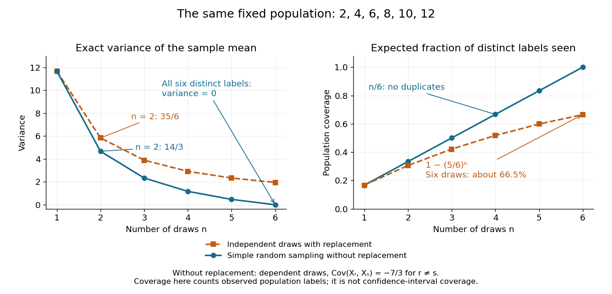

# Sample mean under simple random sampling

↑ **Parent:** [Simple random sampling](simple-random-sampling.md)

Fix $N>1$ real population values $y_1,\ldots,y_N$. Define the [finite population mean](finite-population-mean.md) and two normalizations of the [finite population variance](finite-population-variance.md) by

$$
\bar Y=\frac1N\sum_{i=1}^Ny_i,\qquad
S^2=\frac1{N-1}\sum_{i=1}^N(y_i-\bar Y)^2,\qquad
\sigma_N^2=\frac1N\sum_{i=1}^N(y_i-\bar Y)^2=\frac{N-1}{N}S^2.
$$

The values are fixed; only the selected [subset](subset.md) $A$ is random. For its [sample mean](sample-mean.md) $\bar y_A=n^{-1}\sum_{i\in A}y_i$, the exact design [expectation](expected-value-split.md) and [variance](variance-split.md) are

$$
\mathbb E[\bar y_A]=\bar Y,\qquad
\operatorname{Var}(\bar y_A)=\left(1-\frac nN\right)\frac{S^2}{n}
=\frac{N-n}{N-1}\frac{\sigma_N^2}{n}.
$$

The [sample mean](sample-mean.md) is an [unbiased estimator](unbiased-estimator.md) of the [finite population mean](finite-population-mean.md). At $n=N$, every unit is observed and $\bar y_A=\bar Y$ exactly, so the [variance](variance-split.md) is zero. The $N=1$ case is deterministic and is handled directly, since $S^2$ is undefined then.[Sampling Theory, Chapter 2, PDF pp. 2, 6–9: variance normalizations, unbiasedness, covariance derivation and finite population correction](sampling-theory/chapter-2-simple-random-sampling.md)

The [finite population correction](finite-population-correction.md) depends on the baseline. With the $N-1$ normalization it is $1-n/N$ multiplying $S^2/n$. With the $N$ normalization it is $(N-n)/(N-1)$ multiplying $\sigma_N^2/n$, the exact [variance](variance-split.md) for independent uniform [sampling with replacement](sampling-with-replacement.md). The [standard error](standard-error.md) uses the square root of the relevant [variance](variance-split.md) factor. Mixing the two normalizations gives a wrong answer even at $n=1$, when replacement cannot matter. For the six-value example, $\bar Y=7$, $\sum_i(y_i-7)^2=70$, $S^2=14$ and $\sigma_N^2=35/3$, reproducing $14/3$ without replacement and $35/6$ with replacement.

A short proof exposes the [statistical dependence](statistical-dependence.md). Let $X_r$ be the value at position $r$ in uniform sequential [sampling without replacement](sampling-without-replacement.md), so each $X_r$ has [expected value](expected-value-split.md) $\bar Y$ and [variance](variance-split.md) $\sigma_N^2$. Write $d_i=y_i-\bar Y$. Every ordered pair of distinct labels is equally likely, and $\sum_i d_i=0$, hence for $r\ne s$,

$$
\operatorname{Cov}(X_r,X_s)=\frac{\sum_{i\ne j}d_id_j}{N(N-1)}
=\frac{(\sum_i d_i)^2-\sum_i d_i^2}{N(N-1)}
=-\frac{\sigma_N^2}{N-1}=-\frac{S^2}{N}.
$$

[Linearity of expectation](linearity-of-expectation.md) proves unbiasedness without requiring [independence](independent-random-variables.md). The [variance of a sum](variance-of-a-sum.md) includes all $n(n-1)$ ordered [covariance](covariance.md) terms, giving

$$
\operatorname{Var}\left(\frac1n\sum_{r=1}^nX_r\right)
=\frac{n\sigma_N^2-n(n-1)\sigma_N^2/(N-1)}{n^2}.
$$

For the original population, each pair of distinct draw positions has [covariance](covariance.md) $-7/3$. Drawing a high value leaves a lower [mean](expected-value-split.md) among the remaining values, balancing subsequent draws. Equal marginal [probability distributions](probability-distribution-split.md) therefore coexist with negative [covariance](covariance.md).

When $2\leq n\leq N$, the [sample variance](sample-variance.md) $s_A^2=(n-1)^{-1}\sum_{i\in A}(y_i-\bar y_A)^2$ is an [unbiased estimator](unbiased-estimator.md) of $S^2$. To check this independently, use $\sum_{i\in A}(y_i-\bar y_A)^2=\sum_{i\in A}(y_i-\bar Y)^2-n(\bar y_A-\bar Y)^2$: its [expected value](expected-value-split.md) is $n\sigma_N^2-n\operatorname{Var}(\bar y_A)=(n-1)S^2$. Thus $(1-n/N)s_A^2/n$ unbiasedly estimates the [variance](variance-split.md) of the [sample mean](sample-mean.md); its square root estimates the [standard error](standard-error.md), but need not be unbiased.[Sampling Theory, Chapter 2, PDF pp. 10–12: sample-variance and standard-error estimation](sampling-theory/chapter-2-simple-random-sampling.md)

**[Figure 5](#image-exact-mean-variance-and-expected-distinct-unit-coverage-as-sample-size-grows-in-the-six-value-population). Exact mean variance and expected distinct-unit coverage as sample size grows in the six-value population**.

The diagram compares [variance](variance-split.md) with the expected fraction of distinct population labels observed. Without replacement this fraction is exactly $n/N$; with independent uniform [sampling with replacement](sampling-with-replacement.md), a label is missed with [probability](probability.md) $(1-1/N)^n$, so [linearity of expectation](linearity-of-expectation.md) gives expected fraction $1-(1-1/N)^n$. At six draws, replacement covers only about $66.5\%$ of labels on average and retains [sample mean](sample-mean.md) [variance](variance-split.md) $35/18$; sampling all six distinct labels covers the population completely and removes selection uncertainty. This population coverage is distinct from [confidence interval](confidence-interval.md) [coverage probability](coverage-probability.md).

The correction matters when the [sampling fraction](sampling-fraction.md) is appreciable. It calibrates uncertainty about this fixed population under the specified selection mechanism. It does not correct unequal selection weights, missing observations or measurement errors; observing every label also does not eliminate uncertainty about a larger unobserved population. Moreover, an exact [variance](variance-split.md) alone does not guarantee the [coverage probability](coverage-probability.md) of a proposed [confidence interval](confidence-interval.md): a small discrete [sampling distribution](sampling-distribution.md) can make a [normal approximation](normal-approximation.md) inaccurate.

**Table of contents**

- [Sampling fraction](sampling-fraction.md)

## ↑ Ancestors (7)

1. [Simple random sampling](simple-random-sampling.md)
2. [Probability sampling](probability-sampling.md)
3. [Statistical inference](statistical-inference-split.md)
4. [Probability and statistics](probability-and-statistics-split.md)
5. [Area of mathematics](area-of-mathematics.md)
6. [Mathematics](mathematics-split.md)
7. [Codex Wiki](split.md)

## ← Incoming links (1)

- [Finite population correction](finite-population-correction.md)
