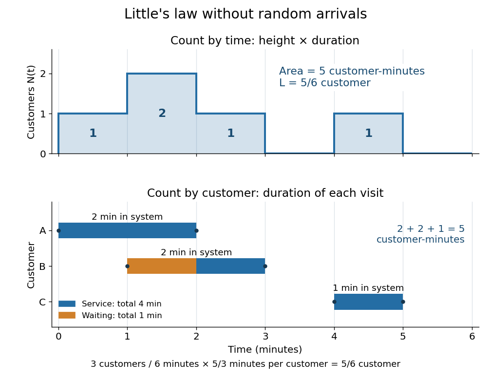

<h1 id="sample-path-area-identity-for-little-s-law">Sample-path area identity for Little's law</h1>

↑ **Parent:** [Little's law](little-s-law.md)

Let customer $k$ enter a [queue](queue-queueing-theory.md) at $a_k$ and leave at $d_k$, and count it in $N(t)$ for $a_k\leq t<d_k$. On a finite observation interval $[0,T]$, the [integral](integral-split.md) of the [queue population](queue-population.md) is exactly the sum of the lengths of the overlaps of customer visits with that interval, as displayed above; $x_+=\max(x,0)$ is the [positive part](positive-part-of-a-real-valued-function.md). This deterministic identity includes visits already in progress at time zero and visits still unfinished at time $T$. It needs no [probability distribution](probability-distribution-split.md) for arrivals or [service times](service-time.md). The area argument is also developed in [Richard C. Larson and Amedeo R. Odoni, Urban Operations Research, section 4.4](https://web.mit.edu/urban_or_book/www/book/chapter4/4.4.html).

For a fully computed example, start empty and observe through $T=6$ minutes. Three customers arrive at $a=(0,1,4)$ minutes, begin service at $b=(0,2,4)$ minutes, and depart at $d=(2,3,5)$ minutes. These times describe a single [first come first served](first-come-first-served.md) server with [service times](service-time.md) $(2,1,1)$ minutes. Their [customer sojourn times](customer-sojourn-time.md) are $(2,2,1)$ minutes, and their [queueing delays](queueing-delay.md) are $(0,1,0)$ minutes. The [queue population](queue-population.md) is respectively $1,2,1,0,1,0$ on the consecutive intervals $[0,1),[1,2),[2,3),[3,4),[4,5),[5,6]$, so

$$
\int_0^6 N(t)\,dt=1\cdot1+2\cdot1+1\cdot1+0\cdot1+1\cdot1+0\cdot1=5\ \text{customer-minutes}.
$$

The same area is $2+2+1=5$ when counted by customer. Hence the finite-window averages satisfy

$$
L=\frac56,\qquad \lambda_{\mathrm{eff}}=\frac36=\frac12\ \text{customer/minute},\qquad W=\frac53\ \text{minutes},\qquad \lambda_{\mathrm{eff}}W=\frac56.
$$

The waiting area is one customer-minute, giving $L_q=1/6$ and $W_q=1/3$ minute; $(1/2)(1/3)=1/6$. The server works for four minutes, so its [server utilization](server-utilization.md) is $4/6=2/3$ and $L-L_q=5/6-1/6=2/3$. Repeating this six-minute pattern indefinitely makes all these values long-run averages, without a [Poisson process](poisson-process-split.md) of arrivals.

**[Figure 1](#image-little-s-law-counts-the-same-five-customer-minutes-by-time-slices-and-by-customer-visits). Little's law counts the same five customer-minutes by time slices and by customer visits**.

An observation window that cuts visits short requires the overlap terms, rather than full [customer sojourn times](customer-sojourn-time.md). Starting empty, let $A(T)$ count admissions before $T$ and write $w_k=d_k-a_k$. Then

$$
\int_0^T N(t)\,dt=\sum_{k:a_k<T}w_k-R(T),\qquad R(T)=\sum_{k:a_k<T<d_k}(d_k-T).
$$

For the example cut at $T=2.5$ minutes, the area is $1+2+0.5=3.5$ customer-minutes, whereas the full durations of the two admitted customers sum to $4$; the remaining half-minute of the second visit is $R(2.5)=0.5$. A precise sufficient [sample path](sample-path.md) condition for the limiting [Little's law](little-s-law.md) is $A(T)/T\to\lambda_{\mathrm{eff}}\in(0,\infty)$, $A(T)^{-1}\sum_{a_k<T}w_k\to W<\infty$, and $R(T)/T\to0$. Dividing the identity by $T$ then gives $L=\lambda_{\mathrm{eff}}W$. Equating admission and departure rates additionally uses $N(T)/T\to0$, by the balance $N(T)=A(T)-D(T)$ for an initially empty [queue](queue-queueing-theory.md), where $D(T)$ counts all departures.

## ↑ Ancestors (7)

1. [Little's law](little-s-law.md)
2. [Queueing theory](queueing-theory-split.md)
3. [Probability theory](probability-theory-split.md)
4. [Probability and statistics](probability-and-statistics-split.md)
5. [Area of mathematics](area-of-mathematics.md)
6. [Mathematics](mathematics-split.md)
7. [Codex Wiki](split.md)

## ← Incoming links (1)

- [Little's law](little-s-law.md)
