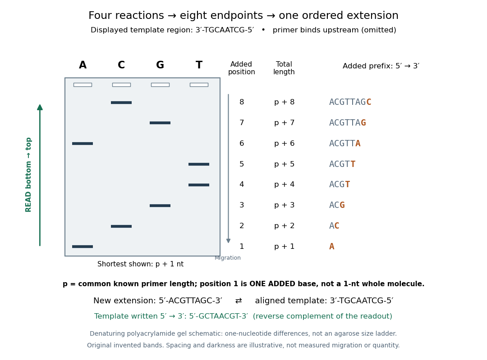

# Sanger ladder reading

↑ **Parent:** [Sanger sequencing](sanger-sequencing.md)

Consider an original teaching template whose next eight positions, encountered after the [sequencing primer](sequencing-primer.md), are

$$
3'\text{-}\mathrm{TGCAATCG}\text{-}5'.
$$

The [sequencing primer](sequencing-primer.md) binds an upstream region omitted from this display; the template also continues beyond the eight positions shown. [DNA polymerase](dna-polymerase.md) encounters the displayed template from left to right. Applying [base pairing](base-pairing.md) at each successive position gives the extension

$$
5'\text{-}\mathrm{ACGTTAGC}\text{-}3'.
$$

These eight letters are added material, not the entire primer-containing [DNA](deoxyribonucleic-acid.md) [molecule](molecule-split.md).

**[Figure 6](#image-read-an-original-four-lane-sanger-sequencing-ladder-from-the-shortest-fragment-upward-to-recover-5-text-mathrm-acgttagc-text-3). Read an original four-lane Sanger sequencing ladder from the shortest fragment upward to recover $5'\text{-}\mathrm{ACGTTAGC}\text{-}3'$**. Invented ideal endpoints: A at extension positions 1 and 6; C at 2 and 8; G at 3 and 7; T at 4 and 5. Every fragment contains the same [sequencing primer](sequencing-primer.md) of length $p$; the shortest drawn band is $p+1$ [nucleotides](nucleotide.md), not a one-[nucleotide](nucleotide.md) whole strand. The gel is a schematic of [denaturing polyacrylamide gel electrophoresis](denaturing-polyacrylamide-gel-electrophoresis.md); band spacing, widths and darkness are illustrative, with no measured migration, abundance or experimental photograph. The right panel shows the complete added prefix represented by each endpoint.

Here is the full endpoint accounting. A terminal letter denotes an incorporated terminating [nucleotide](nucleotide.md); all preceding letters of that extension were supplied by ordinary [deoxynucleoside triphosphates](deoxynucleoside-triphosphate.md).

| Added position $n$ | Reaction lane | Added prefix, $5'$ to $3'$ | Whole-fragment length |
| --- | --- | --- | --- |
| 1 | A | A | $p+1$ |
| 2 | C | AC | $p+2$ |
| 3 | G | ACG | $p+3$ |
| 4 | T | ACGT | $p+4$ |
| 5 | T | ACGTT | $p+5$ |
| 6 | A | ACGTTA | $p+6$ |
| 7 | G | ACGTTAG | $p+7$ |
| 8 | C | ACGTTAGC | $p+8$ |

The shortest fragments migrate farthest, placing position 1 at the bottom. Reading upward, the lane labels spell A, C, G, T, T, A, G, C: the new strand in its $5'$-to-$3'$ direction. The adjacent T bands at positions 4 and 5 encode two separate additions. A single unresolved T patch would leave that count uncertain. In the A lane, the position-6 fragment passed position 1 using ordinary dATP and stopped at position 6 using ddATP; it does not skip the intervening [nucleotides](nucleotide.md).

The common [sequencing primer](sequencing-primer.md) is an offset. For primer length $p$, endpoint $n$ has length $p+n$ [nucleotides](nucleotide.md). With an illustrative $p=20$, the drawn fragments would contain 21 through 28 [nucleotides](nucleotide.md), and adjacent endpoints still differ by one. Subtracting the common $p$ preserves their order because $(p+n+1)-(p+n)=1$. This supplies a short justification for [Sanger ladder reading](sanger-ladder-reading.md): nested fragments share a start, length orders their endpoints, and lane membership supplies each endpoint's letter. A missing early band cannot be relabeled position 1 without independent evidence about the starting point.

To report the original template region, first complement the readout in aligned orientation:

$$
\begin{aligned}
\text{new extension:}&\quad 5'\text{-}\mathrm{ACGTTAGC}\text{-}3',\\
\text{aligned template:}&\quad 3'\text{-}\mathrm{TGCAATCG}\text{-}5'.
\end{aligned}
$$

If the requested answer is that template written $5'$ to $3'$, reverse the aligned template to obtain $5'\text{-}\mathrm{GCTAACGT}\text{-}3'$, the [reverse complement](reverse-complement.md) of the readout. Reversing the readout alone would give CGATTGCA and would be wrong. Complementing without reversing gives the correct template letters in its displayed $3'$-to-$5'$ direction, but not in the usual reporting convention. Specify the strand and its direction before transforming the answer.

## ↑ Ancestors (6)

1. [Sanger sequencing](sanger-sequencing.md)
2. [DNA sequencing](dna-sequencing.md)
3. [Molecular genetics](molecular-genetics-split.md)
4. [Genetics](genetics-split.md)
5. [Biology](biology-split.md)
6. [Codex Wiki](split.md)

## ← Incoming links (2)

- [DNA sequencing](dna-sequencing.md)
- [Sanger ladder reading](sanger-ladder-reading.md)
