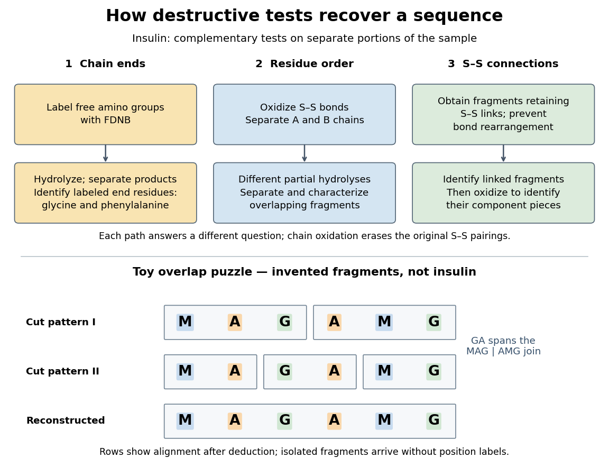

<h1 id="sanger-s-insulin-sequencing-experiment">Sanger's insulin sequencing experiment</h1>

↑ **Parent:** [Protein primary structure](protein-primary-structure.md)

The motivating question was experimental: how could one recover the order in a [protein](protein.md) when breaking all its [peptide bonds](peptide-bond.md) destroys that order? Frederick Sanger and colleagues used complementary tests on portions of [insulin](insulin.md). The following is an explanation of their evidence, not a laboratory recipe.

First, mark ends before destroying the chains. Sanger used the colored reagent fluorodinitrobenzene, abbreviated FDNB, to label free amino groups. After acid [hydrolysis](hydrolysis.md), the attached label remained on the end-residue products. Separating these derivatives by their different movement through solvents and comparing them with reference derivatives made the labels readable. The [N-terminus](n-terminus.md) products identified [glycine](glycine.md) and [phenylalanine](phenylalanine.md). Sanger emphasized that finding a stable label and a way to separate its products were both essential. See [Sanger, Citation Classic (1985), discussing The free amino groups of insulin (1945)](https://garfield.library.upenn.edu/classics1985/A1985ADE5900002.pdf). FDNB also labels suitable free amino groups on [amino acid side chains](amino-acid-side-chain.md), so a labeled product is not automatically an [N-terminus](n-terminus.md) product. See [Sanger, The Chemistry of Insulin, Nobel lecture (1958), pp. 546–547](https://www.nobelprize.org/uploads/2018/06/sanger-lecture.pdf).

Next, separate chains and preserve local order. [Oxidation](oxidation.md) with performic acid broke the [protein disulfide bonds](protein-disulfide-bond.md), allowing A and B chains to be isolated. Partial [hydrolysis](hydrolysis.md) and [enzyme](enzyme.md) treatments produced fragments; these were separated and their composition and local sequences characterized. Overlaps between different fragment sets linked smaller sequences into longer ones. Many more fragments than minimally necessary were checked for consistency. See [Sanger's authored Nobel lecture, pp. 547–552: chain separation, fragment analysis and sequence reconstruction](https://www.nobelprize.org/uploads/2018/06/sanger-lecture.pdf).

**[Figure 33](#image-complementary-evidence-in-sanger-s-insulin-sequencing-experiment-with-a-toy-overlap-puzzle). Complementary evidence in Sanger's insulin sequencing experiment, with a toy overlap puzzle**. Original schematic of tests on separate portions of [insulin](insulin.md), followed by invented fragments from MAGAMG. The lower rows are aligned after deduction; the isolated fragments do not arrive with position labels. The cut patterns are chosen for teaching and assert no real [enzyme](enzyme.md) specificity. This is neither a copied historical illustration nor measured experimental data.

The toy fragments make the logic visible. Suppose one cut pattern yields MAG and AMG, and another yields MA, GA and MG. The first set alone permits MAGAMG or AMGMAG. The fragment GA in the second set crosses the MAG–AMG boundary in MAGAMG; it does not occur in AMGMAG. Among concatenations of the first set, therefore, the second set selects MAGAMG. This example assumes intact, correctly identified fragments from one homogeneous chain and known fragment membership in each cut pattern. Repeated stretches, missing fragments or sample mixtures can leave ambiguities; the picture illustrates inference from overlaps, not a universal guarantee of reconstruction.

Finally, determine the [protein disulfide bonds](protein-disulfide-bond.md) separately. [Oxidation](oxidation.md) used to separate whole chains erases their original connections. Sanger and colleagues instead studied fragments still joined by [protein disulfide bonds](protein-disulfide-bond.md), then oxidized the isolated joined fragments to identify their component pieces and locate the connected chain regions. An important trap was rearrangement of [disulfide bonds](disulfide-bond.md) during treatment: products can acquire connections absent from the starting [protein](protein.md). Their work therefore had to establish conditions that prevented rearrangement before interpreting a linked fragment as evidence. See [Ryle and Sanger, A Disulphide Interchange Reaction, Nature 171, 1025–1026 (1953)](https://www.nature.com/articles/1711025a0) and [Sanger's Nobel lecture, pp. 553–554: preserving and identifying disulfide connections](https://www.nobelprize.org/uploads/2018/06/sanger-lecture.pdf). The result was an experimentally constrained chemical structure rather than a composition list or a photograph of a fold.

## ↑ Ancestors (5)

1. [Protein primary structure](protein-primary-structure.md)
2. [Protein structure](protein-structure.md)
3. [Protein](protein.md)
4. [Biology](biology-split.md)
5. [Codex Wiki](split.md)

## ← Incoming links (4)

- [Glycine](glycine.md)
- [Insulin](insulin.md)
- [Phenylalanine](phenylalanine.md)
- [Sanger's insulin sequencing experiment](sanger-s-insulin-sequencing-experiment.md)
