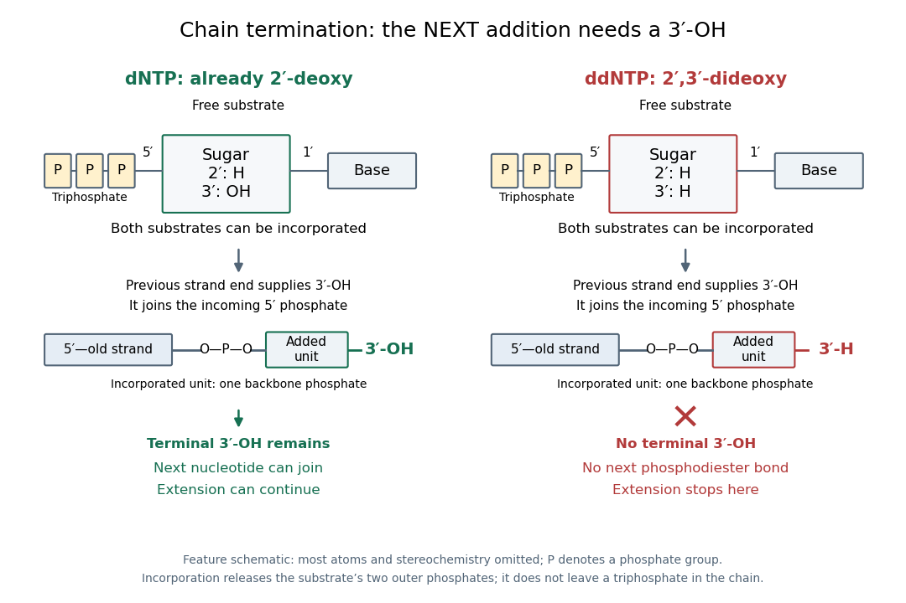

# Sanger sequencing

↑ **Parent:** [DNA sequencing](dna-sequencing.md)  
ⓦ [Wiki](https://en.wikipedia.org/wiki/Sanger_sequencing)

[Sanger sequencing](sanger-sequencing.md) determines a [DNA](deoxyribonucleic-acid.md) [nucleotide sequence](nucleic-acid-sequence.md) by extending a common [sequencing primer](sequencing-primer.md) and occasionally incorporating a [dideoxynucleoside triphosphate](dideoxynucleoside-triphosphate.md). A normal [deoxynucleoside triphosphate](deoxynucleoside-triphosphate.md) already has [hydrogen](hydrogen.md) in place of a $2'$ [hydroxy group](hydroxy-group.md); it retains the $3'$ [hydroxy group](hydroxy-group.md). A [dideoxynucleoside triphosphate](dideoxynucleoside-triphosphate.md) lacks that $3'$ [hydroxy group](hydroxy-group.md) too. It can join the growing strand because the preceding [nucleotide](nucleotide.md) supplies the reacting $3'$ [hydroxy group](hydroxy-group.md). Once incorporated, its own $3'$ end cannot form the next [phosphodiester bond](phosphodiester-bond.md). Thus the blocked step is the next addition, not attachment of the terminator itself.[Alberts and others, Molecular Biology of the Cell, 4th edition (2002), Isolating, Cloning, and Sequencing DNA, Figure 8-36 and accompanying dideoxy-method explanation](molecular-biology-of-the-cell-4th-edition-by-bruce-alberts-and-others/isolating-cloning-and-sequencing-dna.md)

**[Figure 5](#image-a-dntp-retains-a-3-hydroxy-group-a-ddntp-permits-incorporation-but-blocks-the-next-extension). A dNTP retains a $3'$ hydroxy group; a ddNTP permits incorporation but blocks the next extension**. Original chemical-feature and chain-extension schematic. Both substrates have $2'$-H; only the [dNTP](deoxynucleoside-triphosphate.md) has $3'$-OH. Boxes omit most [chemical atoms](atom-physics.md) and do not specify stereochemistry. The lower rows show incorporated units, which no longer carry the substrate's complete triphosphate group. The previous strand end attaches either substrate; the difference appears at the new terminal $3'$ end. This is a conceptual drawing, not molecular imaging or experimental data.

In the historical four-reaction format, each tube receives copies of the same template, the same [sequencing primer](sequencing-primer.md), a [DNA polymerase](dna-polymerase.md) and all four ordinary [deoxynucleoside triphosphates](deoxynucleoside-triphosphate.md). The tubes differ in their terminating substrate: ddATP, ddCTP, ddGTP or ddTTP. In the A reaction, ordinary dATP can allow copying to continue past one A position, whereas incorporation of ddATP stops another copy there. Competition produces a family of endpoints, rather than every strand stopping at the first A. Adjusting substrate proportions makes later endpoints detectable. A lane identifies the terminating [nucleobase](nucleotide-base.md) in the new strand, not the complementary template letter.[T. A. Brown, Genomes, 2nd edition (2002), section 6.1.1, Chain termination sequencing in outline](genomes-2nd-edition-by-terence-a-brown/sequencing-genomes.md)

The readout requires [gel electrophoresis](gel-electrophoresis.md) capable of separating single-stranded [DNA](deoxyribonucleic-acid.md) fragments differing by one [nucleotide](nucleotide.md). Historical [denaturing polyacrylamide gel electrophoresis](denaturing-polyacrylamide-gel-electrophoresis.md) suppressed strand folding and resolved these adjacent lengths; radioactive labels were detected by [autoradiography](autoradiography.md). An ordinary [agarose gel electrophoresis](agarose-gel-electrophoresis.md) comparison with a 100-[base pair](base-pair.md) [DNA ladder](dna-ladder.md) does not supply that resolution. Four separate reaction lanes carry the identities in this format.[T. A. Brown, Genomes, 2nd edition (2002), section 6.1.1, Figure 6.1, Figure 6.2 and Technical Note 6.1: single-nucleotide resolution and autoradiographic readout](genomes-2nd-edition-by-terence-a-brown/sequencing-genomes.md)

**Table of contents**

- [Sanger ladder reading](sanger-ladder-reading.md)
- [Sanger sequencing controls](sanger-sequencing-controls.md)
- [Sanger-Nicklen-Coulson sequencing experiment](sanger-nicklen-coulson-sequencing-experiment.md)

## ↑ Ancestors (5)

1. [DNA sequencing](dna-sequencing.md)
2. [Molecular genetics](molecular-genetics-split.md)
3. [Genetics](genetics-split.md)
4. [Biology](biology-split.md)
5. [Codex Wiki](split.md)

## ← Incoming links (7)

- [Dideoxynucleoside triphosphate](dideoxynucleoside-triphosphate.md)
- [DNA sequencing](dna-sequencing.md)
- [Frederick Sanger](frederick-sanger.md)
- [Solution](past-exam-of-the-biochemistry-and-molecular-biology-course-of-the-university-of-cambridge/2025/paper-2/section-c/14/c/solution.md)
- [Solution](past-exam-of-the-biochemistry-course-of-the-university-of-cambridge/2025/paper-2/section-i/1/solution.md)
- [Sanger ladder reading](sanger-ladder-reading.md)
- [Sanger sequencing](sanger-sequencing.md)
