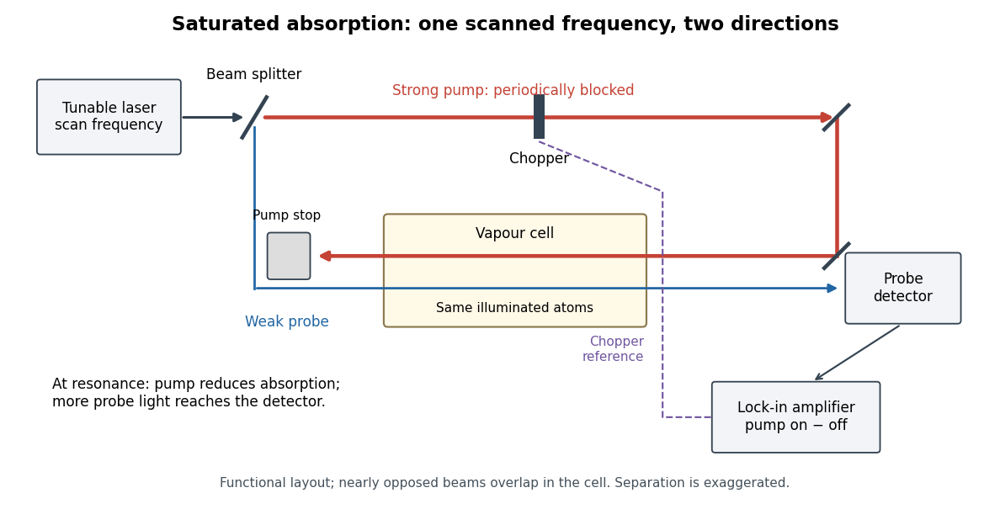

# Saturation spectroscopy preparation and detector readout

↑ **Parent:** [Doppler-free saturation spectroscopy](doppler-free-saturation-spectroscopy.md)

[Arthur Leonard Schawlow](arthur-leonard-schawlow.md)'s 1981 lecture describes an external-cell arrangement: a [beam splitter](beam-splitter.md) makes opposed beams, an [optical chopper](optical-chopper.md) interrupts the pump, and a [lock-in amplifier](lock-in-amplifier.md) reads the probe detector with the chopper reference. Pump-on reduces absorption and raises the detector signal; scanning the [laser](laser-split.md) finds the narrow resonance. Its first application used [iodine](iodine.md); pressure and laser jitter limited the resolution.[Schawlow, Spectroscopy in a New Light, pp. 39–40, Fig. 2](spectroscopy-in-a-new-light-by-arthur-leonard-schawlow.md)

**[Figure 9](#image-counterpropagating-pump-and-probe-with-synchronous-transmission-readout). Counterpropagating pump and probe with synchronous transmission readout**. Original functional drawing of the cited external-cell principle. Beam separation is exaggerated; this is not a reconstruction of the pulsed sodium apparatus.

For an original detector model, let $P_0$ be the probe [power](power.md) reaching a [photodetector](photodetector.md) without sample attenuation and let $\tau_{\rm off},\tau_{\rm on}$ be the sample's probe [optical depths](optical-depth.md). After subtracting a stable detector background, the transmitted powers are

$$
P_{\rm off}=P_0e^{-\tau_{\rm off}},\qquad
P_{\rm on}=P_0e^{-\tau_{\rm on}},\qquad
\frac{P_{\rm on}-P_{\rm off}}{P_{\rm off}}
=e^{\tau_{\rm off}-\tau_{\rm on}}-1.
$$

A positive synchronous change means less probe [photon absorption](photon-absorption.md), provided incident probe [power](power.md) is stable and scattered pump [light](light.md) is excluded. For small optical-depth changes the fractional signal is approximately $\tau_{\rm off}-\tau_{\rm on}$. A [lock-in amplifier](lock-in-amplifier.md)'s voltage also depends on gain, reference phase and chopping waveform; it is not automatically this dimensionless ratio.

Useful controls are blocking the pump, detuning far from the feature, reversing or adjusting beam alignment, and repeating the scan at several pump [light intensities](light-intensity.md). Frequency calibration, sample [pressure](pressure-split.md), transit through the beams and [laser](laser-split.md) frequency fluctuations must be assessed separately. Nearly opposed beams leave a residual [Doppler shift](doppler-effect.md): for wave vectors $\mathbf k_1,\mathbf k_2$, the simultaneous-resonance condition gives $2\delta=(\mathbf k_1+\mathbf k_2)\cdot\mathbf v$. Exact opposition removes this transverse sensitivity in the first-order model.

## ↑ Ancestors (6)

1. [Doppler-free saturation spectroscopy](doppler-free-saturation-spectroscopy.md)
2. [Laser spectroscopy](laser-spectroscopy.md)
3. [Atomic measurement methods](atomic-measurement-methods.md)
4. [Atomic physics](atomic-physics-split.md)
5. [Physics](physics-split.md)
6. [Codex Wiki](split.md)
