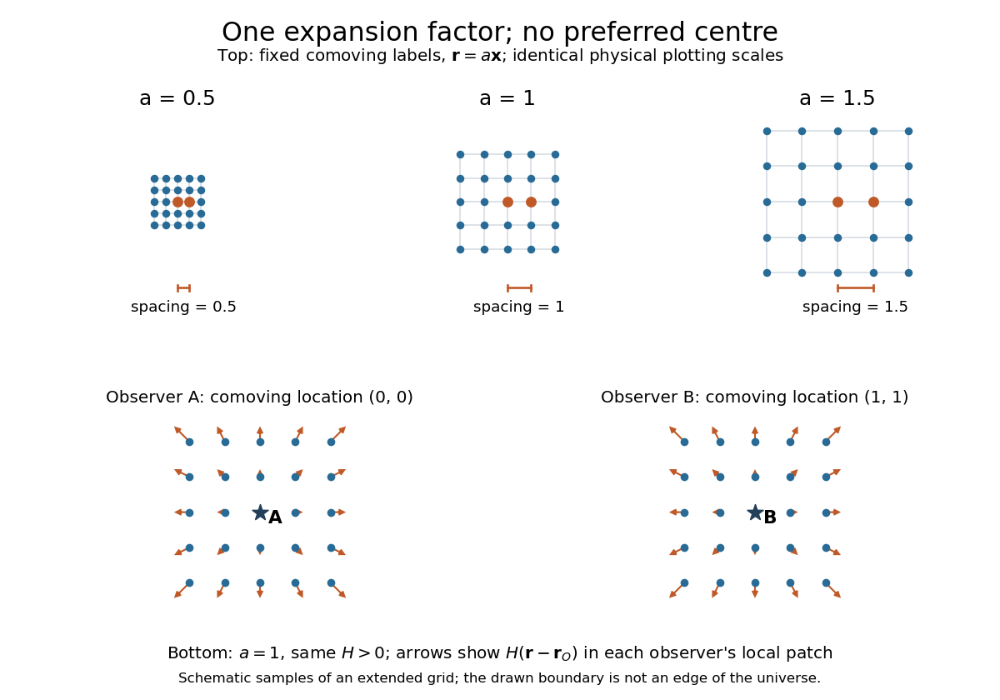

# Scale factor (cosmology)

↑ **Parent:** [Cosmology](cosmology-split.md)  
ⓦ [Wiki](https://en.wikipedia.org/wiki/Scale_factor_(cosmology))

The [scale factor](scale-factor-cosmology.md) $a(t)>0$ measures how spatial lengths in an [FLRW metric](friedmann-lemaitre-robertson-walker-metric.md) change with [cosmic time](cosmic-time.md) $t$. Choose $a$ to be a [dimensionless quantity](dimensionless-quantity.md) with $a(t_0)=1$ at a reference epoch, usually today. For two [comoving observers](comoving-observer.md), their fixed radial [comoving distance](comoving-radial-distance.md) $\chi$ and their [proper distance in cosmology](proper-distance-in-cosmology.md) $d(t)$ satisfy

$$
d(t)=a(t)\chi,\qquad \chi=\text{constant}.
$$

The [proper distance in cosmology](proper-distance-in-cosmology.md) is measured along a spatial slice at one [cosmic time](cosmic-time.md); it is not the distance that a travelling [photon](photon.md) covers between emission and reception. Only ratios of the [scale factor](scale-factor-cosmology.md) have a normalization-independent meaning: replacing $a$ by $Ca$ and $\chi$ by $\chi/C$ leaves $d$ unchanged.

For example, take $\chi=100\,\mathrm{Mpc}$, where $\mathrm{Mpc}$ means a million [parsecs](parsec.md). At $a=0.5,1,1.5$, the same pair of [comoving observers](comoving-observer.md) has [proper distance in cosmology](proper-distance-in-cosmology.md) $50,100,150\,\mathrm{Mpc}$ respectively. Every such separation changes by the same factor, although more distant pairs gain more distance. The illustration treats the marked objects as ideal [comoving observers](comoving-observer.md); internal motions in [galaxies](galaxy-split.md) need not follow this background scaling.

**[Figure 1](#image-the-same-comoving-coordinates-at-three-values-of-the-scale-factor-and-the-hubble-flow-recentered-on-two-comoving-observers). The same comoving coordinates at three values of the scale factor, and the Hubble flow recentered on two comoving observers**. The top row keeps the same marked [comoving observers](comoving-observer.md) and the same plotting scale: adjacent values of [proper distance in cosmology](proper-distance-in-cosmology.md) are $0.5,1,1.5$ arbitrary length units. The bottom row shows equal local patches of an extended ideal grid at $a=1$; arrows represent the [Hubble flow](hubble-flow.md) relative to each marked [comoving observer](comoving-observer.md). The drawn grid is a schematic, not a model of the arrangement of [galaxies](galaxy-split.md).

The beauty of the [scale factor](scale-factor-cosmology.md) is that one function describes the changing spatial ruler for every [comoving observer](comoving-observer.md). [Spatial homogeneity](spatial-homogeneity.md) gives no preferred centre of [cosmic expansion](expansion-of-the-universe.md): in a flat spatial patch, relative positions obey $\mathbf r-\mathbf r_O=a(\mathbf x-\mathbf x_O)$, so recentering on any [comoving observer](comoving-observer.md) preserves [Hubble's law](hubble-s-law.md). The evolution of the [scale factor](scale-factor-cosmology.md) is determined by the [Friedmann equations](friedmann-equations.md), while its ratio between emission and reception determines [cosmological redshift](cosmological-redshift.md).

**Table of contents**

- [Expansion of the universe](expansion-of-the-universe.md)
  - [Hubble's law](hubble-s-law.md)
  - [Hubble parameter](hubble-parameter.md)
    - [Local volume Hubble parameter](local-volume-hubble-parameter.md)
    - [Conformal Hubble parameter](conformal-hubble-parameter.md)
    - [Hubble radius](hubble-radius.md)
    - [Hubble constant](hubble-constant.md)
    - [Hubble parameter identity](hubble-parameter-identity.md)
    - [Comoving Hubble radius](comoving-hubble-radius.md)
      - [Cosmic-time derivative of the comoving Hubble radius](cosmic-time-derivative-of-the-comoving-hubble-radius.md)
    - [Hubble parameter for constant-equation-of-state components](hubble-parameter-for-constant-equation-of-state-components.md)
    - [Hubble parameter for matter and dynamical dark energy](hubble-parameter-for-matter-and-dynamical-dark-energy.md)
    - [Hubble friction](hubble-friction.md)
    - [Hubble flow](hubble-flow.md)
- [Comoving coordinate](comoving-coordinate.md)
  - [Comoving observer](comoving-observer.md)
  - [Comoving volume](comoving-volume.md)
    - [Comoving number density](comoving-number-density.md)
      - [Source counts on an FLRW past light cone](source-counts-on-an-flrw-past-light-cone.md)
  - [Peculiar velocity](peculiar-velocity.md)
    - [Radial peculiar velocity in spherical harmonics](radial-peculiar-velocity-in-spherical-harmonics.md)
    - [Peculiar-velocity equation](peculiar-velocity-equation.md)
    - [Peculiar-velocity divergence](peculiar-velocity-divergence.md)
- [Cosmological redshift](cosmological-redshift.md)
  - [Reception-event dependence of intergalactic redshift](reception-event-dependence-of-intergalactic-redshift.md)
  - [Combined kinematic and cosmological redshift](combined-kinematic-and-cosmological-redshift.md)
  - [Cosmological wavelength-redshift relation](cosmological-wavelength-redshift-relation.md)
    - [Proper absorber separation from a wavelength interval](proper-absorber-separation-from-a-wavelength-interval.md)
  - [Redshift drift](redshift-drift.md)
    - [Sandage-Loeb test](sandage-loeb-test.md)
    - [Spectroscopic velocity drift](spectroscopic-velocity-drift.md)
    - [Nonzero redshift-drift root in flat matter-Lambda cosmology](nonzero-redshift-drift-root-in-flat-matter-lambda-cosmology.md)
  - [Redshift-time relation](redshift-time-relation.md)
    - [Cosmic chronometer](cosmic-chronometer.md)
  - [Cosmological time dilation](cosmological-time-dilation.md)
  - [Redshift preservation of a thermal photon spectrum](redshift-preservation-of-a-thermal-photon-spectrum.md)

## ↑ Ancestors (4)

1. [Cosmology](cosmology-split.md)
2. [Branches of physics](branches-of-physics.md)
3. [Physics](physics-split.md)
4. [Codex Wiki](split.md)
