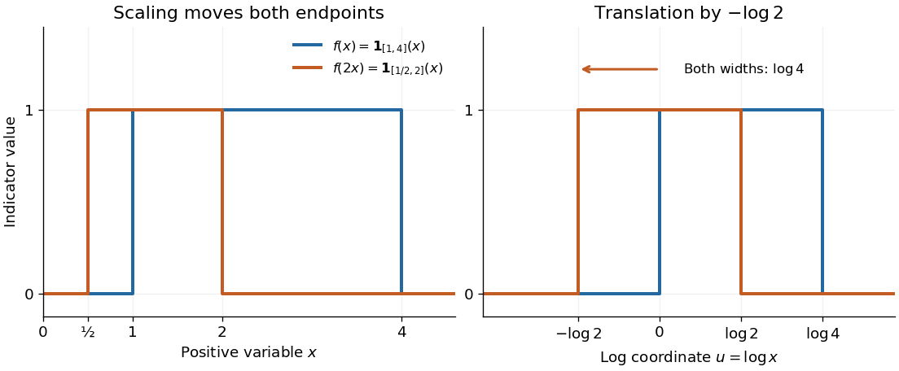

# Scaling property of the Mellin transform

↑ **Parent:** [Mellin transform](mellin-transform.md)

For $a>0$, let $g(x)=f(ax)$. Whenever the [Mellin transform](mellin-transform.md) of $f$ is [absolutely convergent](absolute-convergence.md),

$$
\mathcal Mg(s)=a^{-s}\mathcal Mf(s),\qquad a^{-s}=\exp(-s\log a).
$$

The [Mellin fundamental strip](fundamental-strip-of-a-mellin-transform.md) is unchanged: the corresponding [integrals](integral.md) of [absolute values](absolute-value.md) differ by the finite positive factor $a^{-\sigma}$. The [change of variables](change-of-variables-formula.md) $y=ax$ gives $x^{s-1}dx=a^{-s}y^{s-1}dy$, proving the rule. For $s=\sigma+i\tau$, the transform's [absolute value](absolute-value.md) changes by $a^{-\sigma}$, while the factor $e^{-i\tau\log a}$ changes its [phase](phase-waves.md). On the line $\sigma=0$, wherever [absolute convergence](absolute-convergence.md) holds, the transform's [absolute value](absolute-value.md) is preserved.

For the [Mellin transform of an interval indicator](mellin-transform-of-an-interval-indicator.md), replacing $\mathbf1_{[1,4]}(x)$ by $\mathbf1_{[1,4]}(2x)=\mathbf1_{[1/2,2]}(x)$ gives

$$
\frac{2^s-(1/2)^s}{s}=2^{-s}\frac{4^s-1}{s}.
$$

At the [removable singularity](removable-singularity.md) $s=0$, both sides have value $\log4$. Scaling leaves the width measured by the [natural logarithm](natural-logarithm.md) unchanged. Likewise, the [exponential function](exponential-function.md) $e^{-ax}$ has [Mellin transform](mellin-transform.md) $a^{-s}\Gamma(s)$ on $\operatorname{Re}s>0$.

**[Figure 3](#image-scaling-a-positive-variable-translates-its-logarithmic-coordinate). Scaling a positive variable translates its logarithmic coordinate**. Left: $f(2x)$ moves the support [interval](interval-mathematics.md) $[1,4]$ to $[1/2,2]$. Right: $u=\log x$ turns the same change into a [translation](translation-geometry.md) to the left by $\log2$; the [interval](interval-mathematics.md) width remains $\log4$. The [scaling property of the Mellin transform](scaling-property-of-the-mellin-transform.md) multiplies the transform by $2^{-s}$.

## ↑ Ancestors (6)

1. [Mellin transform](mellin-transform.md)
2. [Integral transform](integral-transform.md)
3. [Analysis](analysis-split.md)
4. [Area of mathematics](area-of-mathematics.md)
5. [Mathematics](mathematics-split.md)
6. [Codex Wiki](split.md)

## ← Incoming links (3)

- [Mellin transform](mellin-transform.md)
- [Mellin transform in logarithmic coordinates](mellin-transform-in-logarithmic-coordinates.md)
- [Scaling property of the Mellin transform](scaling-property-of-the-mellin-transform.md)
