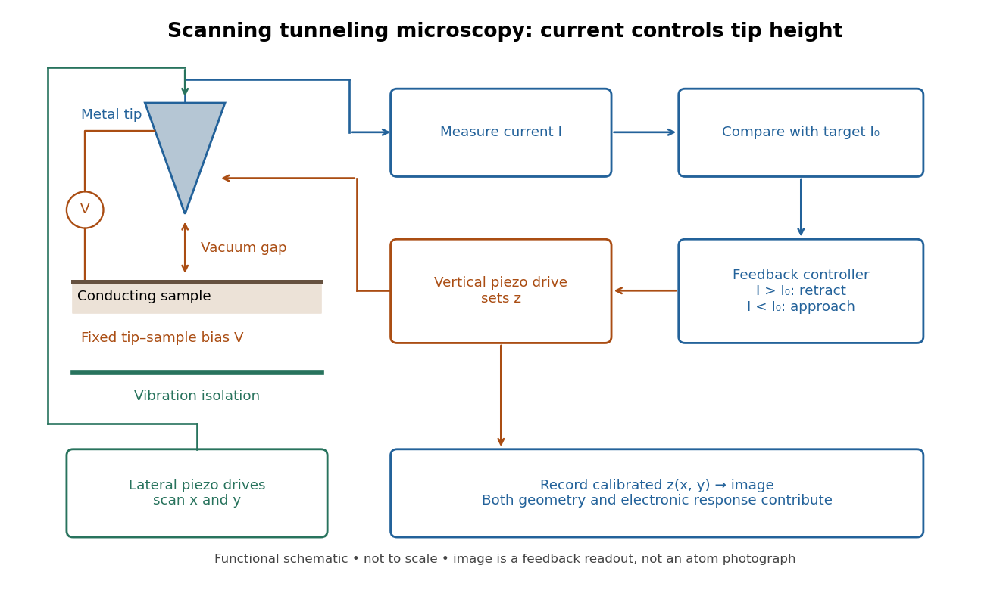

# Scanning tunneling microscope

↑ **Parent:** [Scanning tunneling microscopy](scanning-tunneling-microscopy.md)  
ⓦ [Wiki](https://en.wikipedia.org/wiki/Scanning_tunneling_microscope)

In the 1982 experiment, separate drives using [piezoelectricity](piezoelectricity.md) scanned a [metal](metal.md) tip laterally and adjusted its height. A control unit held [electric current](electric-current.md) fixed at constant tip-sample [electric potential difference](electric-potential-difference.md); calibrated drive voltages supplied the displacement readout. Their Fig. 1 explicitly contrasts a surface step with apparent height from contamination changing the [work function](work-function.md).[pp. 58–59, Fig. 1, equation (1), piezodrive calibration](surface-studies-by-scanning-tunneling-microscopy-by-gerd-binnig-and-others.md)

[Gerd Binnig](gerd-binnig.md) and [Heinrich Rohrer](heinrich-rohrer.md) describe a later [vibration isolation](vibration-isolation.md) system using two spring stages and [eddy current](eddy-current.md) [damping](damping.md) inside a [vacuum](vacuum.md) chamber, with [sputtering](sputtering.md) and [annealing](annealing-materials-science.md) for surface preparation. These measures addressed unwanted motion and surface condition separately.[p. 398, spring suspension, eddy-current damping and sample preparation](scanning-tunneling-microscopy-from-birth-to-adolescence-by-gerd-binnig-and-others.md)

**[Figure 17](#image-how-a-scanning-tunneling-microscope-turns-current-feedback-into-an-image). How a scanning tunneling microscope turns current feedback into an image**. Original functional schematic of [constant-current scanning tunneling microscopy](constant-current-scanning-tunneling-microscopy.md). The loop retracts the tip when measured [electric current](electric-current.md) exceeds its target. Recorded $z(x,y)$ includes [electronic contrast in scanning tunneling microscopy](electronic-contrast-in-scanning-tunneling-microscopy.md); the diagram is not to scale.

## ↑ Ancestors (8)

1. [Scanning tunneling microscopy](scanning-tunneling-microscopy.md)
2. [Tunnel junction](tunnel-junction.md)
3. [Quantum tunnelling](quantum-tunnelling.md)
4. [Potential barrier](potential-barrier.md)
5. [Quantum mechanics](quantum-mechanics-split.md)
6. [Branches of physics](branches-of-physics.md)
7. [Physics](physics-split.md)
8. [Codex Wiki](split.md)

## ← Incoming links (6)

- [Gerd Binnig](gerd-binnig.md)
- [Heinrich Rohrer](heinrich-rohrer.md)
- [Nobel Prize in Physics in 1986](nobel-prize-in-physics-in-1986.md)
- [Solution](past-exam-of-the-frontiers-of-experimental-condensed-matter-physics-course-of-the-university-of-cambridge/2013/paper-1/1/b/solution.md)
- [Solution](past-exam-of-the-physics-course-of-the-year-1-of-the-natural-sciences-course-of-the-university-of-cambridge/2022/section-b/9/c/solution.md)
- [Scanning tunneling microscopy](scanning-tunneling-microscopy.md)
