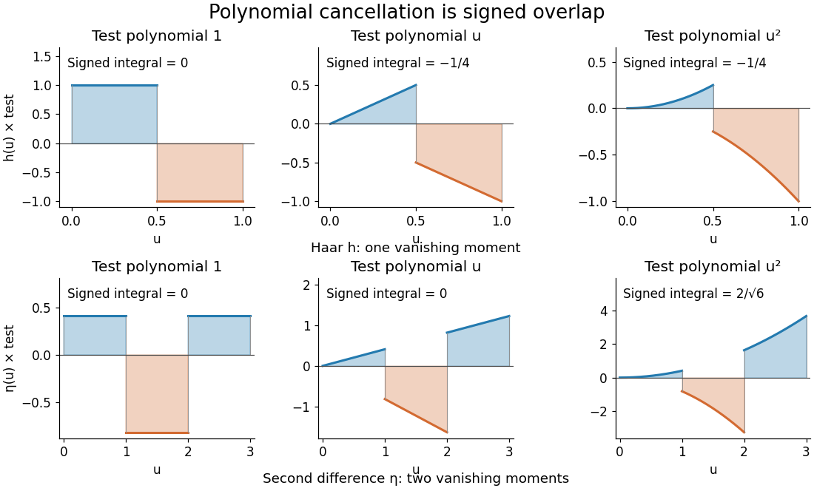

# Second-difference analyzing function

↑ **Parent:** [Vanishing moment](vanishing-moment.md)

The [Haar wavelet](haar-wavelet.md) provides an explicit one-[vanishing moment](vanishing-moment.md) comparison:

$$
h(u)=\begin{cases}1&0\leq u<1/2,\\-1&1/2\leq u<1,\\0&\text{otherwise},\end{cases}\qquad \int h=0,\quad \int uh(u)\,du=-\frac14,\quad\|h\|_2=1.
$$

It cancels a constant [polynomial](polynomial-split.md), but not a nonconstant [affine function](affine-function.md). To obtain two [vanishing moments](vanishing-moment.md) by an equally transparent construction, take three adjacent unit [intervals](interval-mathematics.md) with heights proportional to $1,-2,1$:

$$
\eta(u)=\frac1{\sqrt6}\begin{cases}1&0\leq u<1,\\-2&1\leq u<2,\\1&2\leq u<3,\\0&\text{otherwise}.\end{cases}
$$

The [L2 norm](l2-norm.md) normalization follows from $1^2+(-2)^2+1^2=6$. Direct [integration](integral-split.md) gives

$$
\int\eta=\frac{1-2+1}{\sqrt6}=0,\qquad \int u\eta(u)\,du=\frac{1/2-2(3/2)+5/2}{\sqrt6}=0,\qquad \int u^2\eta(u)\,du=\frac2{\sqrt6}\ne0.
$$

Thus $η$ has exactly two [vanishing moments](vanishing-moment.md). In fact its coefficient is a [finite difference](finite-difference-split.md) of adjacent local [integrals](integral-split.md):

$$
c_\eta(f;a,b)=\frac{\sqrt a}{\sqrt6}(A_0-2A_1+A_2),\qquad A_j=\int_j^{j+1}f(b+au)\,du.
$$

The weights are those of the [second-order central difference](second-order-central-difference.md). The first moment balances the centres of the three [intervals](interval-mathematics.md); it is not enough merely to balance their signed areas.

**[Figure 5](#image-signed-overlaps-of-the-haar-and-second-difference-analyzing-functions-with-constant-linear-and-quadratic-test-polynomials). Signed overlaps of the Haar and second-difference analyzing functions with constant, linear, and quadratic test polynomials**.

This $η$ is a normalized analyzing [function](function-split.md), with no [orthonormal basis](orthonormal-basis.md) assertion. Indeed, its unit translate has nonzero [L2 inner product](l2-inner-product.md):

$$
\int_{\mathbb R}\eta(u)\eta(u-1)\,du=\frac{(-2)(1)+(1)(-2)}6=-\frac23.
$$

Hence these translates already fail [orthogonality](orthogonal-vectors.md). The [Daubechies wavelet](daubechies-wavelet.md) construction imposes additional refinement and [orthogonality](orthogonal-vectors.md) requirements; two [vanishing moments](vanishing-moment.md) and unit [L2 norm](l2-norm.md) by themselves do not supply those requirements.

## ↑ Ancestors (7)

1. [Vanishing moment](vanishing-moment.md)
2. [Wavelet](wavelet.md)
3. [Fourier analysis](fourier-analysis-split.md)
4. [Analysis](analysis-split.md)
5. [Area of mathematics](area-of-mathematics.md)
6. [Mathematics](mathematics-split.md)
7. [Codex Wiki](split.md)

## ← Incoming links (1)

- [Jump response of a localized analyzing function](jump-response-of-a-localized-analyzing-function.md)
