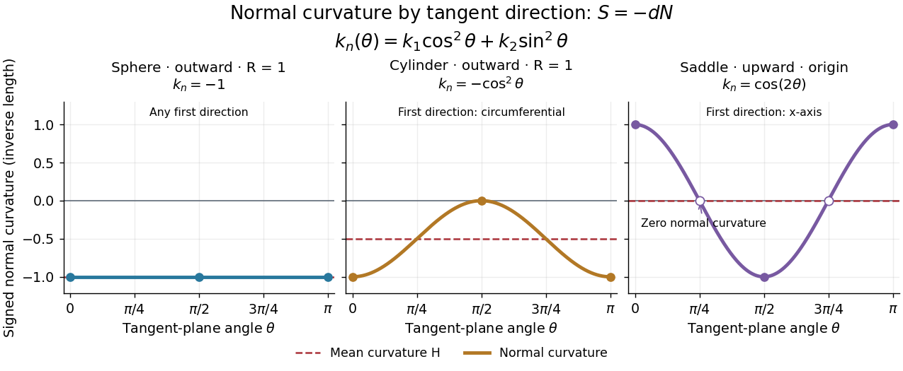
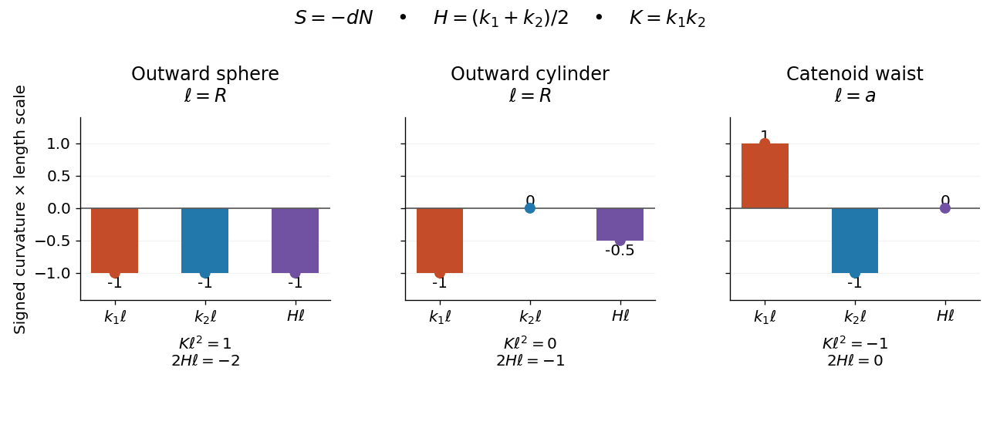
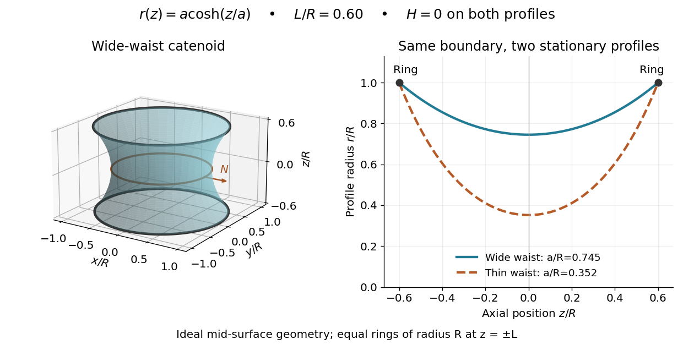

# Second fundamental form

↑ **Parent:** [Differential geometry](differential-geometry.md)  
ⓦ [Wiki](https://en.wikipedia.org/wiki/Second_fundamental_form)

For an [embedded submanifold](differential-geometry.md#embedded-submanifold) $M\subseteq N$ of a [Riemannian manifold](riemannian-geometry.md#riemannian-manifold), the vector-valued second fundamental form is

$$
A(X,Y)=(\overline\nabla_XY)^\perp.
$$

Here $\overline\nabla$ is the ambient [Levi-Civita connection](general-relativity.md#levi-civita-connection) and the superscript denotes projection onto the [normal bundle](algebraic-geometry.md#normal-bundle). For a hypersurface in Euclidean space with unit normal $N$, the scalar form is $II(X,Y)=\langle A(X,Y),N\rangle=\langle-dN(X),Y\rangle$. In a surface parametrization its coefficients are $e=N\cdot X_{uu}$, $f=N\cdot X_{uv}$, and $g=N\cdot X_{vv}$.

**Table of contents**

- [Totally umbilic hypersurface](#totally-umbilic-hypersurface)
  - [Scalar curvature of an umbilic vacuum hypersurface](#scalar-curvature-of-an-umbilic-vacuum-hypersurface)
- [Zero second fundamental form implies planar image](#zero-second-fundamental-form-implies-planar-image)
- [Fundamental forms of an elliptic ring torus](#fundamental-forms-of-an-elliptic-ring-torus)
- [Second fundamental form of a ring torus](#second-fundamental-form-of-a-ring-torus)
  - [Gaussian curvature of a ring torus](#gaussian-curvature-of-a-ring-torus)
- [Gauss–Codazzi equations](#gauss-codazzi-equations)
  - [Gauss–Codazzi equations for a non-null hypersurface](#gauss-codazzi-equations-for-a-non-null-hypersurface)
  - [Gauss formula](#gauss-formula)
  - [Gauss equation](#gauss-equation)
    - [Gauss equation in a curved ambient manifold](#gauss-equation-in-a-curved-ambient-manifold)
      - [Gauss equation for a nonnull hypersurface](#gauss-equation-for-a-nonnull-hypersurface)
      - [Gauss equation with reversed curvature convention](#gauss-equation-with-reversed-curvature-convention)
      - [Curvature comparison for a geodesically ruled surface](#curvature-comparison-for-a-geodesically-ruled-surface)
    - [Sectional curvature](#sectional-curvature)
      - [Ricci curvature](#ricci-curvature)
        - [Bishop-Gromov inequality](#bishop-gromov-inequality)
          - [Bishop volume comparison with a positive-curvature model](#bishop-volume-comparison-with-a-positive-curvature-model)
            - [Spherical rigidity of maximal total volume](#spherical-rigidity-of-maximal-total-volume)
              - [Maximal diameter rigidity from disjoint comparison balls](#maximal-diameter-rigidity-from-disjoint-comparison-balls)
          - [Euclidean rigidity of maximal asymptotic volume ratio](#euclidean-rigidity-of-maximal-asymptotic-volume-ratio)
        - [Normalized Ricci curvature](#normalized-ricci-curvature)
        - [Isotropic Ricci curvature](#isotropic-ricci-curvature)
        - [Einstein manifold](#einstein-manifold)
          - [Einstein metric](#einstein-metric)
          - [Constant Ricci curvature without constant sectional curvature](#constant-ricci-curvature-without-constant-sectional-curvature)
        - [Sectional curvatures from Ricci curvature in dimension three](#sectional-curvatures-from-ricci-curvature-in-dimension-three)
        - [Scalar curvature](#scalar-curvature)
          - [Constant scalar curvature does not imply an Einstein metric](#constant-scalar-curvature-does-not-imply-an-einstein-metric)
        - [Ricci-flat Riemannian manifold](#ricci-flat-riemannian-manifold)
        - [Myers's theorem](#myers-s-theorem)
          - [Complete positively curved paraboloid](#complete-positively-curved-paraboloid)
          - [Finite fundamental group from a uniform positive Ricci bound](#finite-fundamental-group-from-a-uniform-positive-ricci-bound)
          - [Incomplete positively curved strip with infinite diameter](#incomplete-positively-curved-strip-with-infinite-diameter)
        - [Cheeger-Gromoll splitting theorem](#cheeger-gromoll-splitting-theorem)
          - [Ricci-flat obstruction for a closed three-manifold times a line](#ricci-flat-obstruction-for-a-closed-three-manifold-times-a-line)
      - [Flat manifold](#flat-manifold)
        - [Isometry dimension of a compact flat manifold](#isometry-dimension-of-a-compact-flat-manifold)
        - [Bieberbach theorem](#bieberbach-theorem)
        - [Holonomy groups of closed orientable flat three-manifolds](#holonomy-groups-of-closed-orientable-flat-three-manifolds)
          - [Hantzsche-Wendt manifold](#hantzsche-wendt-manifold)
          - [Sixth-turn flat three-manifold](#sixth-turn-flat-three-manifold)
          - [Third-turn flat three-manifold](#third-turn-flat-three-manifold)
          - [Half-turn flat three-manifold](#half-turn-flat-three-manifold)
        - [Quarter-turn flat three-manifold](#quarter-turn-flat-three-manifold)
        - [Flat torus](#flat-torus)
          - [Short-vector cancellation for flat tori](#short-vector-cancellation-for-flat-tori)
          - [Spectrum of a flat torus](#spectrum-of-a-flat-torus)
            - [Two-dimensional lattice reconstruction from vector lengths](#two-dimensional-lattice-reconstruction-from-vector-lengths)
      - [Cartan-Hadamard theorem](#cartan-hadamard-theorem)
      - [Curvature of the round unit sphere](#curvature-of-the-round-unit-sphere)
  - [Codazzi equation](#codazzi-equation)
- [Tangential derivative of a normal field](#tangential-derivative-of-a-normal-field)
- [Totally geodesic submanifold](#totally-geodesic-submanifold)
  - [An isometry fixed set is totally geodesic](#an-isometry-fixed-set-is-totally-geodesic)
- [Normal curvature](#normal-curvature)
  - [Euler formula for normal curvature](#euler-formula-for-normal-curvature)
    - [Equally spaced normal curvatures average to mean curvature](#equally-spaced-normal-curvatures-average-to-mean-curvature)
- [Symmetry of the second fundamental form](#symmetry-of-the-second-fundamental-form)
- [Shape operator](#shape-operator)
  - [Shape operator in a normal direction](#shape-operator-in-a-normal-direction)
    - [Weingarten formula](#weingarten-formula)
  - [Principal curvature](#principal-curvature)
    - [Principal direction](#principal-direction)
    - [Umbilical point](#umbilical-point)
  - [Euclidean invariance of the shape operator](#euclidean-invariance-of-the-shape-operator)
- [Gaussian curvature](#gaussian-curvature)
  - [Supporting sphere](#supporting-sphere)
    - [Supporting-sphere curvature bound](#supporting-sphere-curvature-bound)
      - [Elliptic point](#elliptic-point)
  - [Gaussian curvature of a cone away from its vertex](#gaussian-curvature-of-a-cone-away-from-its-vertex)
- [Mean curvature](#mean-curvature)
  - [Mean curvature vector](#mean-curvature-vector)
  - [Mean curvature of a sphere and cylinder](#mean-curvature-of-a-sphere-and-cylinder)
  - [Mean curvature of a catenoid](#mean-curvature-of-a-catenoid)
  - [Minimal surface](#minimal-surface)
    - [Coercive-height intersection lemma for a minimal surface](#coercive-height-intersection-lemma-for-a-minimal-surface)
    - [Outer area-minimizing surface](#outer-area-minimizing-surface)
    - [Enneper surface](#enneper-surface)
    - [First variation of area formula](#first-variation-of-area-formula)
    - [Laplacian of a restricted ambient function](#laplacian-of-a-restricted-ambient-function)
      - [Nonexistence of compact Euclidean minimal submanifolds](#nonexistence-of-compact-euclidean-minimal-submanifolds)
    - [Stable minimal surface](#stable-minimal-surface)
  - [Soap film pressure balance](#soap-film-pressure-balance)
    - [Soap film between coaxial rings](#soap-film-between-coaxial-rings)
  - [Orientation reversal of surface curvature](#orientation-reversal-of-surface-curvature)
- [Fundamental forms of a graph surface](#fundamental-forms-of-a-graph-surface)
  - [Gaussian curvature of a graph surface](#gaussian-curvature-of-a-graph-surface)
  - [Mean-curvature comparison at tangential contact](#mean-curvature-comparison-at-tangential-contact)
    - [Gaussian curvature has no tangential-contact comparison principle](#gaussian-curvature-has-no-tangential-contact-comparison-principle)
  - [Tangency to a plane along a curve forces zero Gaussian curvature](#tangency-to-a-plane-along-a-curve-forces-zero-gaussian-curvature)
  - [Minimal surface equation for a graph](#minimal-surface-equation-for-a-graph)
    - [Bernstein theorem for minimal graphs](#bernstein-theorem-for-minimal-graphs)
    - [Ellipticity of the minimal surface flux](#ellipticity-of-the-minimal-surface-flux)
    - [Gradient maximum principle for a minimal graph](#gradient-maximum-principle-for-a-minimal-graph)
      - [Minimal graphical cone is a plane](#minimal-graphical-cone-is-a-plane)

## Totally umbilic hypersurface

↑ **Parent:** [Second fundamental form](second-fundamental-form.md)

At every point its second fundamental form is a scalar multiple of its induced metric. Equivalently its shape operator is scalar, so all principal normal curvatures agree. For a three-dimensional hypersurface, $K=3\lambda$ and $K_{ab}K^{ab}=3\lambda^2$. The sign of its intrinsic scalar in a vacuum Lorentzian ambient space then follows from the [Gauss equation for a nonnull hypersurface](#gauss-equation-for-a-nonnull-hypersurface).

### Scalar curvature of an umbilic vacuum hypersurface

↑ **Parent:** [Totally umbilic hypersurface](#totally-umbilic-hypersurface)

For a timelike unit normal with squared norm epsilon and vanishing ambient Ricci tensor, contraction of the [Gauss equation for a nonnull hypersurface](#gauss-equation-for-a-nonnull-hypersurface) gives the displayed formula. In signature $(+---)$ the timelike normal has epsilon plus one, so the scalar of the induced negative-definite metric is nonnegative. In signature $(-+++)$ the positive-definite spatial metric instead has scalar $-6\lambda^2$. Replacing the induced metric by its negative reverses the scalar, so the inequality must not be transferred between these conventions without adjustment.

// Target: general-relativity.bigb

## Zero second fundamental form implies planar image

↑ **Parent:** [Second fundamental form](second-fundamental-form.md)

Differentiate the orthogonality of the unit normal to the two independent coordinate tangent vectors. If the [second fundamental form](second-fundamental-form.md) vanishes, each derivative of the normal is orthogonal to both tangent vectors; differentiating its unit length also makes it orthogonal to the normal. Thus both normal derivatives vanish. On a connected parameter domain the normal is constant, and differentiating the position's scalar product with that constant normal proves the surface lies in a plane.

## Fundamental forms of an elliptic ring torus

↑ **Parent:** [Second fundamental form](second-fundamental-form.md)

Rotate an ellipse with positive semiaxes $a,b$ about an axis a distance $r>a$ from its centre. For the [parametrized surface](calculus.md#parametrized-surface) $\sigma(u,v)=((r+a\sin u)\cos v,(r+a\sin u)\sin v,b\cos u)$, put $R=r+a\sin u$ and $D^2=a^2\cos^2u+b^2\sin^2u$. An outward [unit normal](differential-geometry.md#unit-normal) is $N=(b\sin u\cos v,b\sin u\sin v,a\cos u)/D$. Direct [differentiation](calculus.md#differentiation) gives the [first fundamental form](differential-geometry.md#first-fundamental-form) and [second fundamental form](second-fundamental-form.md), with the convention $II_{ij}=\langle\sigma_{ij},N\rangle$:

$$
I=D^2du^2+R^2dv^2,\qquad II=-\frac{ab}{D}du^2-\frac{bR\sin u}{D}dv^2.
$$

Reversing the [unit normal](differential-geometry.md#unit-normal) reverses $II$, but the [Gaussian curvature](#gaussian-curvature) $K=ab^2\sin u/(RD^4)$ is unchanged.

## Second fundamental form of a ring torus

↑ **Parent:** [Second fundamental form](second-fundamental-form.md)

For major radius $a>b>0$ and minor radius $b$, let $R=a+b\cos u$. With the inward normal determined by the usual ordered $(u,v)$ parametrization, the [first fundamental form](differential-geometry.md#first-fundamental-form) and [second fundamental form](second-fundamental-form.md) are

$$
I=b^2du^2+R^2dv^2,\qquad II=bdu^2+R\cos u\,dv^2.
$$

Reversing the normal reverses $II$. The [Gaussian curvature of a ring torus](#gaussian-curvature-of-a-ring-torus) is independent of this orientation.

### Gaussian curvature of a ring torus

↑ **Parent:** [Second fundamental form of a ring torus](#second-fundamental-form-of-a-ring-torus)

For a ring [torus](topology.md#torus) of radii $a>b>0$, the [Gaussian curvature](#gaussian-curvature) is

$$
K=\frac{\cos u}{b(a+b\cos u)}.
$$

It is positive on the outer side, negative on the inner side and zero on the top and bottom circles. The sign contrast expresses two principal curvatures of the same sign outside and opposite signs inside.

<h2 id="gauss-codazzi-equations">Gauss–Codazzi equations</h2>

↑ **Parent:** [Second fundamental form](second-fundamental-form.md)  
ⓦ [Wiki](https://en.wikipedia.org/wiki/Gauss–Codazzi_equations)

The Gauss–Codazzi equations relate the intrinsic curvature and connection of an [embedded submanifold](differential-geometry.md#embedded-submanifold) to its [second fundamental form](second-fundamental-form.md) and the ambient curvature. The [Gauss equation](#gauss-equation) controls tangential curvature; the [Codazzi equation](#codazzi-equation) controls the covariant derivative of the [second fundamental form](second-fundamental-form.md). The [Gauss formula](#gauss-formula) is the tangential-normal splitting used to derive these relations.

<h3 id="gauss-codazzi-equations-for-a-non-null-hypersurface">Gauss–Codazzi equations for a non-null hypersurface</h3>

↑ **Parent:** [Gauss–Codazzi equations](#gauss-codazzi-equations)

For a [hypersurface](differential-geometry.md#hypersurface) with unit [normal vector](differential-geometry.md#normal-vector) $n$, put $\varepsilon=g(n,n)=\pm1$, $P=1-\varepsilon n\otimes n^\flat$, and $K(X,Y)=g(\nabla_Xn,Y)$ for tangent vectors. The [induced metric](riemannian-geometry.md#induced-metric) is nondegenerate precisely when the normal is non-null. With $R(X,Y)Z=[\nabla_X,\nabla_Y]Z-\nabla_{[X,Y]}Z$ and $R_{abcd}=g(e_a,R(e_c,e_d)e_b)$, the [Gauss formula](#gauss-formula) is $\nabla_XY=D_XY-\varepsilon K(X,Y)n$. Substituting twice into the ambient [Riemann curvature tensor](general-relativity.md#riemann-curvature-tensor) and projecting tangentially gives the displayed [Gauss equation](#gauss-equation). Its normal projection gives $g(n,R(X,Y)Z)=-(D_XK)(Y,Z)+(D_YK)(X,Z)$, the curved-ambient [Codazzi equation](#codazzi-equation). A null hypersurface needs additional geometric data because its induced metric is degenerate.

### Gauss formula

↑ **Parent:** [Gauss–Codazzi equations](#gauss-codazzi-equations)

For a submanifold with induced [Levi-Civita connection](general-relativity.md#levi-civita-connection) $\nabla$ and [second fundamental form](second-fundamental-form.md) $A$, the ambient derivative decomposes as

$$
\overline\nabla_XY=\nabla_XY+A(X,Y).
$$

For a parametrized surface this reads $X_{ij}=\Gamma^k_{ij}X_k+h_{ij}N$.

### Gauss equation

↑ **Parent:** [Gauss–Codazzi equations](#gauss-codazzi-equations)

For a Euclidean embedded submanifold,

$$
\langle R(X,Y)Z,W\rangle
=\langle A(X,W),A(Y,Z)\rangle-\langle A(X,Z),A(Y,W)\rangle.
$$

It expresses intrinsic curvature in terms of the [second fundamental form](second-fundamental-form.md).

#### Gauss equation in a curved ambient manifold

↑ **Parent:** [Gauss equation](#gauss-equation)

For an [embedded submanifold](differential-geometry.md#embedded-submanifold) of a [Riemannian manifold](riemannian-geometry.md#riemannian-manifold), use $R(v,w)y=\nabla_v\nabla_wy-\nabla_w\nabla_vy-\nabla_{[v,w]}y$. The [Gauss formula](#gauss-formula) and [tangential derivative of a normal field](#tangential-derivative-of-a-normal-field) give

$$
\langle\nabla_v\nabla_wy,x\rangle
=\langle D_vD_wy,x\rangle-\langle II(w,y),II(v,x)\rangle.
$$

Subtract the expression with $v,w$ interchanged and the bracket derivative, whose normal part pairs to zero. This proves the displayed curvature identity. For flat Euclidean ambient space, its ambient curvature term vanishes and one obtains the ordinary [Gauss equation](#gauss-equation). Declaring the four-slot convention $R(x,y,v,w)=\langle R(v,w)y,x\rangle$ avoids sign ambiguities when permuting arguments.

##### Gauss equation for a nonnull hypersurface

↑ **Parent:** [Gauss equation in a curved ambient manifold](#gauss-equation-in-a-curved-ambient-manifold)

Let the unit normal satisfy $n^an_a=\varepsilon=\pm1$, let $h_{ab}=g_{ab}-\varepsilon n_an_b$, and set $K_{ab}=h_a{}^ch_b{}^d\nabla_cn_d$. The normal component of an ambient derivative of tangent fields is $-\varepsilon K(X,Y)n$. Substitute that decomposition into the curvature commutator and project tangentially to obtain the displayed equation. Its scalar contraction is ${}^\Sigma R=R-2\varepsilon R_{ab}n^an^b+\varepsilon(K^2-K_{ab}K^{ab})$. Both metric signature and curvature-slot convention must be specified when assigning a sign.

##### Gauss equation with reversed curvature convention

↑ **Parent:** [Gauss equation in a curved ambient manifold](#gauss-equation-in-a-curved-ambient-manifold)

Here $R(X,Y)=D_{[X,Y]}-[D_X,D_Y]$, the negative of the convention in the ordinary [Gauss equation in a curved ambient manifold](#gauss-equation-in-a-curved-ambient-manifold). Insert the [Gauss formula](#gauss-formula) and [Weingarten formula](#weingarten-formula) into this definition and project tangentially to obtain the displayed identity. Positive [sectional curvature](#sectional-curvature) uses $\langle R(X,Y)X,Y\rangle/|X\wedge Y|^2$ with this convention. Thus a Euclidean surface still has [Gaussian curvature](#gaussian-curvature) $K=\det A_\xi$; reversing the operator sign without changing the slot order would give the wrong sign.

##### Curvature comparison for a geodesically ruled surface

↑ **Parent:** [Gauss equation in a curved ambient manifold](#gauss-equation-in-a-curved-ambient-manifold)

A surface locally swept out by ambient [geodesics](riemannian-geometry.md#geodesic) has $II(T,T)=0$ in its unit ruling direction $T$. For a perpendicular unit tangent $E$, the [Gauss equation in a curved ambient manifold](#gauss-equation-in-a-curved-ambient-manifold) therefore gives the displayed identity. Its [Gaussian curvature](#gaussian-curvature) is at most the ambient [sectional curvature](#sectional-curvature) in its tangent plane, with equality precisely when $II(T,E)=0$. An independent variation argument applies the [Jacobi field](general-relativity.md#jacobi-field) equation to the length of a perpendicular connecting field; its ambient derivative has the extra normal component $II(T,E)$. The Euclidean surface $(t,s,ts)$ is ruled by straight lines and has [Gaussian curvature](#gaussian-curvature) $-(1+t^2+s^2)^{-2}<0$.

#### Sectional curvature

↑ **Parent:** [Gauss equation](#gauss-equation)  
ⓦ [Wiki](https://en.wikipedia.org/wiki/Sectional_curvature)

For a two-plane $\sigma=\operatorname{span}(X,Y)$ in a Riemannian tangent space,

$$
K(\sigma)=\frac{\langle R(X,Y)Y,X\rangle}{|X|^2|Y|^2-\langle X,Y\rangle^2}.
$$

##### Ricci curvature

↑ **Parent:** [Sectional curvature](#sectional-curvature)  
ⓦ [Wiki](https://en.wikipedia.org/wiki/Ricci_curvature)

Ricci curvature is the trace of the Riemann curvature tensor in its first and third arguments. For a unit tangent vector $X$ and an orthonormal basis $X,e_2,\ldots,e_n$,

$$
\operatorname{Ric}(X,X)=\sum_{i=2}^n K(X,e_i).
$$

###### Bishop-Gromov inequality

↑ **Parent:** [Ricci curvature](#ricci-curvature)  
ⓦ [Wiki](https://en.wikipedia.org/wiki/Bishop–Gromov_inequality)

For a complete connected $n$-dimensional [Riemannian manifold](riemannian-geometry.md#riemannian-manifold) with nonnegative [Ricci curvature](#ricci-curvature), the displayed ratio is nonincreasing, tends to one at zero, and is at most one. In particular $\operatorname{Vol}B(p,r)\leq\omega_nr^n$. In [geodesic polar coordinates](riemannian-geometry.md#geodesic-polar-coordinates), the radial [Jacobi field](general-relativity.md#jacobi-field) determinant is at most the Euclidean density $r^{n-1}$ until the cut time. The trace of the [radial Riccati equation for distance spheres](riemannian-geometry.md#radial-riccati-equation-for-distance-spheres), with [Cauchy-Schwarz inequality](probability-and-statistics.md#cauchy-schwarz-inequality), proves this comparison. Equality for every radius forces the Euclidean polar metric and absence of a [cut locus](riemannian-geometry.md#cut-locus).

###### Bishop volume comparison with a positive-curvature model

↑ **Parent:** [Bishop-Gromov inequality](#bishop-gromov-inequality)

For a complete connected $n$-dimensional [Riemannian manifold](riemannian-geometry.md#riemannian-manifold) with $\operatorname{Ric}\geq(n-1)kg$, $k>0$, put $D=\pi/\sqrt k$ and

$$
s_k(t)=\frac{\sin(\sqrt k\,t)}{\sqrt k},\qquad v_k(r)=\omega_{n-1}\int_0^r s_k(t)^{n-1}\,dt.
$$

Here $\omega_{n-1}$ is the area of the unit $(n-1)$-sphere, and $v_k(r)$ is the [Riemannian volume](differential-geometry.md#riemannian-volume) of a radius-$r$ ball in the round curvature-$k$ [sphere](geometry-and-topology.md#sphere). The [Bishop-Gromov inequality](#bishop-gromov-inequality) asserts that $V_p(r)/v_k(r)$ is nonincreasing for $0<r<D$, tends to one at zero, and is at most one. In [geodesic polar coordinates](riemannian-geometry.md#geodesic-polar-coordinates), the radial volume density before the cut time is at most $s_k(t)^{n-1}$. The bound uses trace [Ricci curvature](#ricci-curvature); with [normalized Ricci curvature](#normalized-ricci-curvature) it reads $\overline{\operatorname{Ric}}\geq kg$.

###### Spherical rigidity of maximal total volume

↑ **Parent:** [Bishop volume comparison with a positive-curvature model](#bishop-volume-comparison-with-a-positive-curvature-model)

Under the hypotheses of [Bishop volume comparison with a positive-curvature model](#bishop-volume-comparison-with-a-positive-curvature-model), the [Bonnet-Myers theorem](#myers-s-theorem) gives diameter at most $D$. If total [Riemannian volume](differential-geometry.md#riemannian-volume) equals $v_k(D)$, every comparison ball ratio is one. In a small normal ball the pointwise radial density bound therefore becomes equality. Writing $h=\partial_r\log J$, the traced [radial Riccati equation for distance spheres](riemannian-geometry.md#radial-riccati-equation-for-distance-spheres) and [Cauchy-Schwarz inequality](probability-and-statistics.md#cauchy-schwarz-inequality) force the radial operator to equal $(s_k'/s_k)I$. The angular metric is consequently $s_k(r)^2g_{S^{n-1}}$, so the metric is locally round. The [classification of complete positive constant-curvature manifolds](riemannian-geometry.md#classification-of-complete-positive-constant-curvature-manifolds) gives a quotient $S_k^n/\Gamma$, whose volume is $v_k(D)/|\Gamma|$. Equality forces $\Gamma$ trivial.

###### Maximal diameter rigidity from disjoint comparison balls

↑ **Parent:** [Spherical rigidity of maximal total volume](#spherical-rigidity-of-maximal-total-volume)

Assume the trace [Ricci curvature](#ricci-curvature) satisfies $\operatorname{Ric}\geq(n-1)kg$, with $k>0$. If points $p,q$ have [Riemannian distance](riemannian-geometry.md#riemannian-distance) $D=\pi/\sqrt k$, the balls $B(p,r)$ and $B(q,D-r)$ are disjoint. [Bishop volume comparison with a positive-curvature model](#bishop-volume-comparison-with-a-positive-curvature-model) bounds their volumes below by $\operatorname{Vol}(M)v_k(r)/v_k(D)$ and $\operatorname{Vol}(M)v_k(D-r)/v_k(D)$. Since $v_k(r)+v_k(D-r)=v_k(D)$, both inequalities must be equalities. Taking $r\downarrow0$ gives $\operatorname{Vol}M=v_k(D)$, and [spherical rigidity of maximal total volume](#spherical-rigidity-of-maximal-total-volume) yields the round sphere.

###### Euclidean rigidity of maximal asymptotic volume ratio

↑ **Parent:** [Bishop-Gromov inequality](#bishop-gromov-inequality)

The [Bishop-Gromov inequality](#bishop-gromov-inequality) forces every volume ratio to equal one if the asymptotic ratio is one. Equality in the radial Jacobian comparison forces the radial operator $A(X)=\nabla_X\partial_r$ of each distance sphere to be $r^{-1}I$ (it is the negative of the outward [shape operator](#shape-operator) in the convention $S=-\nabla\nu$), by the traced [radial Riccati equation for distance spheres](riemannian-geometry.md#radial-riccati-equation-for-distance-spheres) and equality in [Cauchy-Schwarz inequality](probability-and-statistics.md#cauchy-schwarz-inequality). Any finite cut time would remove a positive cone of radial volume at a later radius, contradicting equality. Thus the [Riemannian exponential map](riemannian-geometry.md#exponential-map-riemannian-geometry) is global and one-to-one, and the polar metric is $dr^2+r^2g_{S^{n-1}}$, the Euclidean metric.

###### Normalized Ricci curvature

↑ **Parent:** [Ricci curvature](#ricci-curvature)

For a [Riemannian manifold](riemannian-geometry.md#riemannian-manifold) of dimension $n\geq2$, the normalized directional [Ricci curvature](#ricci-curvature) averages, rather than sums, the $n-1$ [sectional curvatures](#sectional-curvature) through a unit vector. Thus the [Bonnet-Myers theorem](#myers-s-theorem) gives $\operatorname{diam}M\leq\pi/\sqrt k$ from $\overline{\operatorname{Ric}}\geq kg$. With trace Ricci curvature the corresponding hypothesis is $\operatorname{Ric}\geq(n-1)kg$. The distinction changes positive constants but not the signs of Ricci curvature.

###### Isotropic Ricci curvature

↑ **Parent:** [Ricci curvature](#ricci-curvature)

At a point of a [Riemannian manifold](riemannian-geometry.md#riemannian-manifold), Ricci curvature is isotropic when $\operatorname{Ric}(v,v)/g(v,v)$ is independent of nonzero tangent direction. Polarization makes this equivalent to the displayed tensor identity. In dimension three, [sectional curvatures from Ricci curvature in dimension three](#sectional-curvatures-from-ricci-curvature-in-dimension-three) gives every sectional curvature at that point the value $c_p/2$. In higher dimensions isotropic Ricci curvature does not determine every two-plane curvature.

###### Einstein manifold

↑ **Parent:** [Ricci curvature](#ricci-curvature)  
ⓦ [Wiki](https://en.wikipedia.org/wiki/Einstein_manifold)

An [Einstein manifold](#einstein-manifold) has [Ricci curvature](#ricci-curvature) equal to a constant multiple of its metric. In the Riemannian setting, the round unit sphere has $\Lambda=n-1$. This condition is weaker than constant [sectional curvature](#sectional-curvature) in higher dimensions. The definition can also be applied to pseudo-Riemannian metrics, but positivity is assumed in the completeness theorems discussed here.

###### Einstein metric

↑ **Parent:** [Einstein manifold](#einstein-manifold)

A Riemannian or [pseudo-Riemannian metric](differential-geometry.md#pseudo-riemannian-metric) is Einstein when its [Ricci tensor](general-relativity.md#ricci-tensor) is a constant scalar multiple of the metric. Constant-sectional-curvature metrics satisfy this condition with $\Lambda=(d-1)k$. The Killing-form metric on a real [semisimple Lie group](lie-theory.md#semisimple-lie-group) is another example, with $\Lambda=-1/4$ for $g=B$ in the curvature convention $R(X,Y)Z=\nabla_X\nabla_YZ-\nabla_Y\nabla_XZ-\nabla_{[X,Y]}Z$.

###### Constant Ricci curvature without constant sectional curvature

↑ **Parent:** [Einstein manifold](#einstein-manifold)

The [product Riemannian metric](differential-geometry.md#product-riemannian-metric) of two round unit spheres has [Ricci curvature](#ricci-curvature) equal to its metric, since the factor Ricci tensors equal their metrics and the product connection splits. Its directional Ricci curvatures are all one. A two-plane tangent to a single sphere has [sectional curvature](#sectional-curvature) one, while a mixed plane has sectional curvature zero. This four-dimensional [Einstein manifold](#einstein-manifold) therefore need not have constant sectional curvature.

###### Sectional curvatures from Ricci curvature in dimension three

↑ **Parent:** [Ricci curvature](#ricci-curvature)

For an orthonormal triple and distinct $i,j,k$, tracing [sectional curvature](#sectional-curvature) gives $\operatorname{Ric}_{ii}=K_{ij}+K_{ik}$. Solving the three equations gives the displayed formula. Equivalently $K_{ij}=\operatorname{Ric}_{ii}+\operatorname{Ric}_{jj}-\operatorname{Scal}/2$. This pointwise assertion does not require the triple to diagonalize the [Ricci curvature](#ricci-curvature).

###### Scalar curvature

↑ **Parent:** [Ricci curvature](#ricci-curvature)  
ⓦ [Wiki](https://en.wikipedia.org/wiki/Scalar_curvature)

Scalar curvature is the complete trace of the Riemann curvature tensor:

$$
\operatorname{Scal}=\sum_{i,j}\langle R(e_i,e_j)e_j,e_i\rangle.
$$

An $n$-manifold of constant sectional curvature $K$ has $\operatorname{Scal}=n(n-1)K$.

###### Constant scalar curvature does not imply an Einstein metric

↑ **Parent:** [Scalar curvature](#scalar-curvature)

The [product Riemannian metric](differential-geometry.md#product-riemannian-metric) of the round unit two-sphere and a circle has [Ricci curvature](#ricci-curvature) equal to $g_{S^2}$ on the sphere directions and zero on the circle direction. Its [scalar curvature](#scalar-curvature) is constantly two, but no single scalar multiple of the whole metric equals that Ricci tensor. In two dimensions the identity $\operatorname{Ric}=\operatorname{Scal}\,g/2$ does make constant scalar curvature equivalent to an [Einstein metric](#einstein-metric).

###### Ricci-flat Riemannian manifold

↑ **Parent:** [Ricci curvature](#ricci-curvature)

This is the positive-definite metric case of a [Ricci-flat manifold](differential-geometry.md#ricci-flat-manifold).

A Ricci-flat Riemannian manifold has identically zero Ricci tensor. Every flat Riemannian manifold is Ricci-flat, while the converse can fail in dimension at least four.

<h6 id="myers-s-theorem">Myers's theorem</h6>

↑ **Parent:** [Ricci curvature](#ricci-curvature)  
ⓦ [Wiki](https://en.wikipedia.org/wiki/Myers's_theorem)

For a [connected](geometry-and-topology.md#connected-space) [Riemannian manifold](riemannian-geometry.md#riemannian-manifold) of dimension $n\geq2$, assume [geodesic completeness](riemannian-geometry.md#geodesic-completeness) and $\operatorname{Ric}\geq(n-1)\kappa g$ for a constant $\kappa>0$. The [Riemannian distance](riemannian-geometry.md#riemannian-distance) then has diameter at most $\pi/\sqrt\kappa$; the manifold is [compact](topology.md#compact-space) and its [fundamental group](algebraic-topology.md#fundamental-group) is finite. The dimension restriction excludes the vacuous one-dimensional Ricci bound.

###### Complete positively curved paraboloid

↑ **Parent:** [Myers's theorem](#myers-s-theorem)

The graph $z=x^2+y^2$ in Euclidean three-space has the displayed induced [Riemannian metric](differential-geometry.md#riemannian-metric) and positive [Gaussian curvature](#gaussian-curvature). It is smooth at its vertex; the polar-coordinate singularity is only a coordinate artifact. The metric dominates the Euclidean plane metric, so [upward stability of Riemannian completeness](riemannian-geometry.md#upward-stability-of-riemannian-completeness) proves completeness. It has infinite diameter. In dimension two [Ricci curvature](#ricci-curvature) equals Gaussian curvature times the metric, so this is a counterexample to compactness under merely pointwise positive Ricci curvature. Its curvature tends to zero at infinity.

###### Finite fundamental group from a uniform positive Ricci bound

↑ **Parent:** [Myers's theorem](#myers-s-theorem)

If a connected complete [Riemannian manifold](riemannian-geometry.md#riemannian-manifold) has $\operatorname{Ric}\ge(n-1)\kappa g$ with $\kappa>0$, its [universal cover](algebraic-topology.md#universal-cover) with the lifted metric is complete and satisfies the same bound. The [Bonnet-Myers theorem](#myers-s-theorem) makes that cover compact. A covering fiber is closed and discrete and hence finite; the number of its elements equals the order of the [fundamental group](algebraic-topology.md#fundamental-group). Applying the diameter theorem only to the base would not prove this conclusion: the positive lower bound must also be used on the cover.

###### Incomplete positively curved strip with infinite diameter

↑ **Parent:** [Myers's theorem](#myers-s-theorem)

This metric pulls back the round spherical metric by $(u,v)\mapsto(\cos u\cos v,\cos u\sin v,\sin u)$. It has unit [Gaussian curvature](#gaussian-curvature) and [Ricci curvature](#ricci-curvature) equal to its metric, yet the meridian reaches a missing boundary in finite time. Every curve between $(0,0)$ and $(0,L)$ has length at least $|L|/\sqrt2$, so its diameter is infinite. It shows that the positive Ricci bound alone does not replace [geodesic completeness](riemannian-geometry.md#geodesic-completeness) in the [Bonnet-Myers theorem](#myers-s-theorem).

###### Cheeger-Gromoll splitting theorem

↑ **Parent:** [Ricci curvature](#ricci-curvature)

This is a Riemannian [splitting theorem](differential-geometry.md#splitting-theorem) whose hypotheses include a globally minimizing geodesic line.

A complete connected Riemannian manifold with nonnegative Ricci curvature that contains a line splits isometrically as $N\times\mathbb R$.

###### Ricci-flat obstruction for a closed three-manifold times a line

↑ **Parent:** [Cheeger-Gromoll splitting theorem](#cheeger-gromoll-splitting-theorem)

If a connected [closed manifold](differential-geometry.md#closed-manifold) $M^3$ has a noncontractible [universal cover](algebraic-topology.md#universal-cover), then $M\times\mathbb R$ has no complete metric making it a [Ricci-flat Riemannian manifold](#ricci-flat-riemannian-manifold). The product has two ends and hence contains a [line in a Riemannian manifold](riemannian-geometry.md#line-in-a-riemannian-manifold) for any complete metric. The [Cheeger-Gromoll splitting theorem](#cheeger-gromoll-splitting-theorem) would split it isometrically as $N^3\times\mathbb R$. Its three-dimensional factor is Ricci-flat and therefore flat by [three-dimensional curvature from the Ricci tensor](general-relativity.md#three-dimensional-curvature-from-the-ricci-tensor). The complete simply connected cover of the product would be Euclidean four-space. But that cover is $\widetilde M\times\mathbb R$, which retracts onto $\widetilde M$, contradicting noncontractibility.

##### Flat manifold

↑ **Parent:** [Sectional curvature](#sectional-curvature)  
ⓦ [Wiki](https://en.wikipedia.org/wiki/Flat_manifold)

A Riemannian manifold is flat when every sectional curvature is zero. A complete simply connected flat $n$-manifold is isometric to Euclidean space $\mathbb R^n$.

###### Isometry dimension of a compact flat manifold

↑ **Parent:** [Flat manifold](#flat-manifold)

On a compact [flat Riemannian manifold](#flat-manifold), the integrated [Bochner identity for Killing vector fields](general-relativity.md#bochner-identity-for-killing-vector-fields) makes every [Killing vector field](general-relativity.md#killing-vector-field) parallel. Parallel vector fields are exactly the fixed vectors of the linear holonomy. Thus the six orientable closed flat three-manifold types have identity-component isometry dimensions three for the torus, one for each cyclic nontrivial holonomy, and zero for the [Hantzsche-Wendt manifold](#hantzsche-wendt-manifold).

###### Bieberbach theorem

↑ **Parent:** [Flat manifold](#flat-manifold)

The theorem classifies compact [flat manifolds](#flat-manifold) through their crystallographic covering groups.

For a compact [flat Riemannian manifold](#flat-manifold) $\mathbb R^n/\Gamma$, the translations in $\Gamma$ form a normal full-rank [Euclidean lattice](fourier-analysis.md#euclidean-lattice) of finite index. The quotient is its finite linear holonomy. Affine conjugacy of the torsion-free crystallographic groups classifies these manifolds up to affine diffeomorphism. An abelian $\Gamma$ must consist entirely of translations: commuting with every lattice translation forces each linear part to fix a spanning set of $\mathbb R^n$.

###### Holonomy groups of closed orientable flat three-manifolds

↑ **Parent:** [Flat manifold](#flat-manifold)

These are precisely the faithful linear holonomy groups of closed orientable Euclidean three-manifolds. Cyclic cases arise from planar lattice rotations combined with axial screw translations. The noncyclic case is generated by two perpendicular half-turn screws. The list refers to the maximal translation lattice, not to arbitrary finite quotients of a [fundamental group](algebraic-topology.md#fundamental-group).

###### Hantzsche-Wendt manifold

↑ **Parent:** [Holonomy groups of closed orientable flat three-manifolds](#holonomy-groups-of-closed-orientable-flat-three-manifolds)  
ⓦ [Wiki](https://en.wikipedia.org/wiki/Hantzsche–Wendt_manifold)

The closed orientable [flat Riemannian manifold](#flat-manifold) with holonomy $C_2\times C_2$ can be presented by Euclidean screws $\alpha(x,y,z)=(x+1/2,-y,-z)$ and $\beta(x,y,z)=(-x,y+1/2,-z+1/2)$. Their squares and the square of their product generate the unit translation lattice. Each nonidentity holonomy coset has a half-integer displacement along its fixed axis, so acts freely. The holonomy has no common fixed vector, giving first [Betti number](homology.md#betti-number) zero and a finite [isometry group](riemannian-geometry.md#isometry-group) for every flat metric.

###### Sixth-turn flat three-manifold

↑ **Parent:** [Holonomy groups of closed orientable flat three-manifolds](#holonomy-groups-of-closed-orientable-flat-three-manifolds)

The [mapping torus](algebraic-topology.md#mapping-torus) of an order-six rotation of a hexagonal [flat torus](#flat-torus) is a closed orientable [flat Riemannian manifold](#flat-manifold) with holonomy $C_6$. The screw rotation has angle $\pi/3$ and axial displacement $1/6$. Its first [Betti number](homology.md#betti-number) is one.

###### Third-turn flat three-manifold

↑ **Parent:** [Holonomy groups of closed orientable flat three-manifolds](#holonomy-groups-of-closed-orientable-flat-three-manifolds)

The [mapping torus](algebraic-topology.md#mapping-torus) of an order-three rotation of a hexagonal [flat torus](#flat-torus) is a closed orientable [flat Riemannian manifold](#flat-manifold) with holonomy $C_3$. A screw rotation through $2\pi/3$ with axial displacement $1/3$, together with the planar lattice, describes its deck group. Its first [Betti number](homology.md#betti-number) is one.

###### Half-turn flat three-manifold

↑ **Parent:** [Holonomy groups of closed orientable flat three-manifolds](#holonomy-groups-of-closed-orientable-flat-three-manifolds)

This closed [flat Riemannian manifold](#flat-manifold) is the [mapping torus](algebraic-topology.md#mapping-torus) of $-I$ on a two-dimensional [flat torus](#flat-torus). Equivalently, take planar lattice translations and the screw $(v,z)\mapsto(-v,z+1/2)$ in Euclidean three-space. Its square is a unit axial translation, its holonomy is $C_2$, and its first [Betti number](homology.md#betti-number) is one.

###### Quarter-turn flat three-manifold

↑ **Parent:** [Flat manifold](#flat-manifold)

The Euclidean transformations $a(x,y,z)=(x+1,y,z)$, $b(x,y,z)=(x,y+1,z)$ and $s(x,y,z)=(-y,x,z+1/4)$ generate a torsion-free cocompact group with $sas^{-1}=b$, $sbs^{-1}=a^{-1}$ and $s^4$ equal to unit translation along $z$. Every nontranslation has nonzero axial displacement modulo integers, hence no fixed point. Its maximal translation subgroup is $\mathbb Z^3$ and its holonomy is $C_4$.

###### Flat torus

↑ **Parent:** [Flat manifold](#flat-manifold)  
ⓦ [Wiki](https://en.wikipedia.org/wiki/Flat_torus)

A flat torus is $\mathbb R^d/\Lambda$ with its quotient [Euclidean metric](differential-geometry.md#euclidean-metric), where $\Lambda$ is a full-rank [Euclidean lattice](fourier-analysis.md#euclidean-lattice). Its volume is the lattice covolume. The [dual lattice](fourier-analysis.md#dual-lattice) indexes its complete [Fourier series](fourier-series.md) of [Laplacian eigenfunctions](partial-differential-equation.md#laplacian-eigenfunction).

###### Short-vector cancellation for flat tori

↑ **Parent:** [Flat torus](#flat-torus)

Let $\Lambda_1,\Lambda_2\subset\mathbb R^d$ be full-rank [Euclidean lattices](fourier-analysis.md#euclidean-lattice), and choose $\varepsilon$ smaller than every nonzero vector length in either. The shortest vectors of $\Lambda_i\oplus\varepsilon\mathbb Z^k$ are exactly the new coordinate vectors and their negatives. Any [isometry](riemannian-geometry.md#isometry) between the associated [flat tori](#flat-torus) lifts to an affine [Euclidean isometry](riemannian-geometry.md#euclidean-isometry), whose orthogonal part maps the lattices. It must preserve the span of the shortest vectors, hence also its orthogonal complement, and therefore maps $\Lambda_1$ to $\Lambda_2$. Consequently a nonisometric pair remains nonisometric after adding sufficiently short equal circle factors. The [spectrum of a flat torus](#spectrum-of-a-flat-torus) shows that adding the same factors preserves [isospectral manifolds](riemannian-geometry.md#isospectral-manifolds).

###### Spectrum of a flat torus

↑ **Parent:** [Flat torus](#flat-torus)

With the nonnegative [Laplace-Beltrami operator](differential-geometry.md#laplace-beltrami-operator), a frequency $w$ in the [dual lattice](fourier-analysis.md#dual-lattice) gives the [eigenfunction](linear-operator-theory.md#eigenfunction) $e^{2\pi i\langle w,x\rangle}$ and [eigenvalue](linear-operator-theory.md#eigenvalue) $4\pi^2|w|^2$. Its multiplicity is the number of dual vectors with that norm. [Fourier series](fourier-series.md) prove completeness. In dimension two the shortest vector, shortest independent vector and covolume determine a reduced [Gram matrix](linear-algebra.md#gram-matrix), proving [spectral rigidity](riemannian-geometry.md#spectral-rigidity).

###### Two-dimensional lattice reconstruction from vector lengths

↑ **Parent:** [Spectrum of a flat torus](#spectrum-of-a-flat-torus)

The vector-length multiset of a rank-two [Euclidean lattice](fourier-analysis.md#euclidean-lattice) determines it up to an orthogonal map. Let $a$ be the shortest nonzero length. Removing two copies of each positive integer multiple of $a$ removes one primitive lattice line; the shortest remaining length $b$ is the shortest independent-vector length. Those two vectors form a lattice [basis](vector-space.md#basis): otherwise a nonzero point in the centred basis parallelogram would be an independent lattice vector of length less than $b$. Lattice-point density determines the [covolume](fourier-analysis.md#covolume) $A$. The basis [Gram matrix](linear-algebra.md#gram-matrix) then has diagonal entries $a^2,b^2$ and absolute off-diagonal entry $\sqrt{a^2b^2-A^2}$. This proves two-dimensional [spectral rigidity](riemannian-geometry.md#spectral-rigidity) for a [flat torus](#flat-torus) through its [dual lattice](fourier-analysis.md#dual-lattice).

##### Cartan-Hadamard theorem

↑ **Parent:** [Sectional curvature](#sectional-curvature)  
ⓦ [Wiki](https://en.wikipedia.org/wiki/Cartan–Hadamard_theorem)

On a complete connected Riemannian manifold of nonpositive sectional curvature, the exponential map at every point is a covering map. If the manifold is simply connected, each exponential map is a diffeomorphism from a tangent space onto the manifold.

##### Curvature of the round unit sphere

↑ **Parent:** [Sectional curvature](#sectional-curvature)

With outward normal $N(x)=x$, the unit sphere has $A(X,Y)=-\langle X,Y\rangle N$. The [Gauss equation](#gauss-equation) therefore gives sectional curvature one on every tangent two-plane.

### Codazzi equation

↑ **Parent:** [Gauss–Codazzi equations](#gauss-codazzi-equations)

For a Euclidean embedded submanifold, the covariant derivative of the second fundamental form satisfies

$$
(\nabla_XA)(Y,Z)=(\nabla_YA)(X,Z).
$$

## Tangential derivative of a normal field

↑ **Parent:** [Second fundamental form](second-fundamental-form.md)

For the ambient [Levi-Civita connection](general-relativity.md#levi-civita-connection), a normal field $\eta$, and tangent fields $X,Y$, differentiate $\langle\eta,Y\rangle=0$ using metric compatibility. The tangential part of $\nabla_XY$ is orthogonal to $\eta$, giving the displayed identity. It controls how an ambient derivative of a normal vector can develop a tangential component, and is the vector-valued version of the [shape operator](#shape-operator) relation.

## Totally geodesic submanifold

↑ **Parent:** [Second fundamental form](second-fundamental-form.md)

For a [nondegenerate](linear-algebra.md#nondegenerate-bilinear-form) induced [metric tensor](general-relativity.md#metric-tensor), a [totally geodesic submanifold](#totally-geodesic-submanifold) has vanishing [second fundamental form](second-fundamental-form.md); equivalently, every ambient [geodesic](riemannian-geometry.md#geodesic) initially tangent to it remains in it. This extends the notion of a [totally geodesic hypersurface](differential-geometry.md#totally-geodesic-hypersurface) to arbitrary codimension.

### An isometry fixed set is totally geodesic

↑ **Parent:** [Totally geodesic submanifold](#totally-geodesic-submanifold)

A smooth [nondegenerate](linear-algebra.md#nondegenerate-bilinear-form) component of the [fixed-point set](riemannian-geometry.md#fixed-point-set) of an [isometry](riemannian-geometry.md#isometry) is a [totally geodesic submanifold](#totally-geodesic-submanifold). If a [geodesic](riemannian-geometry.md#geodesic) starts tangent to the fixed component, its image under the [isometry](riemannian-geometry.md#isometry) has identical position and tangent. Uniqueness of the [geodesic equation](riemannian-geometry.md#geodesic-equation) makes the two [geodesics](riemannian-geometry.md#geodesic) coincide throughout their common domain, so the original [geodesic](riemannian-geometry.md#geodesic) stays in the fixed set.

## Normal curvature

↑ **Parent:** [Second fundamental form](second-fundamental-form.md)  
ⓦ [Wiki](https://en.wikipedia.org/wiki/Normal_curvature)

The normal curvature of an oriented surface in a unit tangent direction $v$ is

$$
k_n(v)=II(v,v).
$$

It equals the normal component of the acceleration of any unit-speed surface curve tangent to $v$.

### Euler formula for normal curvature

↑ **Parent:** [Normal curvature](#normal-curvature)

If a unit tangent makes angle $\theta$ with the first principal direction, the [normal curvature](#normal-curvature) is $\kappa_n=\kappa_1\cos^2\theta+\kappa_2\sin^2\theta$. This follows by diagonalizing the [second fundamental form](second-fundamental-form.md) relative to the [first fundamental form](differential-geometry.md#first-fundamental-form). When the [Gaussian curvature](#gaussian-curvature) is nonnegative, $|\kappa_n|\leq2|H|$.

#### Equally spaced normal curvatures average to mean curvature

↑ **Parent:** [Euler formula for normal curvature](#euler-formula-for-normal-curvature)

For directions spaced in the same rotational sense, [Euler formula for normal curvature](#euler-formula-for-normal-curvature) gives $k_n(\theta)=H+(k_1-k_2)\cos(2\theta)/2$. The sum of the $m$ equally spaced complex exponentials $e^{2i\theta+2\pi ij/m}$ is zero when $m\geq2$, proving the formula. Consecutive unsigned angles alone do not imply this arrangement: they permit directions to double back.

## Symmetry of the second fundamental form

↑ **Parent:** [Second fundamental form](second-fundamental-form.md)

The [second fundamental form](second-fundamental-form.md) of an [embedded submanifold](differential-geometry.md#embedded-submanifold) of a [Riemannian manifold](riemannian-geometry.md#riemannian-manifold) is symmetric. Its ambient [Levi-Civita connection](general-relativity.md#levi-civita-connection) is a [torsion-free connection](fiber-bundle.md#torsion-free-connection), so

$$
II(X,Y)-II(Y,X)=\bigl(\overline\nabla_XY-\overline\nabla_YX-[X,Y]\bigr)^\perp=0.
$$

The [Lie bracket of vector fields](differential-geometry.md#lie-bracket-of-vector-fields) tangent to the submanifold is tangent and therefore has zero normal component. This proof applies to a curved ambient manifold as well as Euclidean space.

## Shape operator

↑ **Parent:** [Second fundamental form](second-fundamental-form.md)

The [shape operator](#shape-operator) measures how the [unit normal](differential-geometry.md#unit-normal) turns as we move along a [smooth surface](differential-geometry.md#smooth-surface). A [plane](geometry-and-topology.md#plane) has a constant [unit normal](differential-geometry.md#unit-normal), whereas the outward [unit normal](differential-geometry.md#unit-normal) of a [sphere](geometry-and-topology.md#sphere) turns in every direction in the [tangent plane](differential-geometry.md#tangent-plane). Keeping the direction of this change, rather than just its magnitude, lets one recover the [principal curvatures](#principal-curvature) and their [principal directions](#principal-direction).

Choose an [orientation of a surface](differential-geometry.md#orientation-of-a-surface) $M\subset\mathbb R^3$, with [Gauss map](differential-geometry.md#gauss-map) $N:M\to S^2$. The [shape operator](#shape-operator) at $p$ is the [linear map](vector-space.md#linear-map)

$$
S_p=-dN_p:T_pM\to T_pM.
$$

Here $dN_p$ is the [differential](differential-geometry.md#differential-of-a-smooth-map) of the [Gauss map](differential-geometry.md#gauss-map). Its output belongs to $T_{N(p)}S^2$, identified with $T_pM$ because both are the vector [plane](geometry-and-topology.md#plane) perpendicular to $N(p)$. The minus sign is our convention throughout this branch. [Ghomi, Lecture Notes 9, §2.2: Gauss map and shape operator](https://ghomi.math.gatech.edu/Classes/Math497C/LectureNotes9.pdf)

The [shape operator](#shape-operator) packages the [second fundamental form](second-fundamental-form.md) as an operator using the [inner product](linear-algebra.md#inner-product) supplied by the [first fundamental form](differential-geometry.md#first-fundamental-form):

$$
II(v,w)=I(S_pv,w).
$$

The [symmetry of the second fundamental form](#symmetry-of-the-second-fundamental-form) makes the [shape operator](#shape-operator) a [self-adjoint operator](linear-operator-theory.md#self-adjoint-operator) for this [inner product](linear-algebra.md#inner-product). Thus an [orthonormal basis](linear-algebra.md#orthonormal-basis) of [principal directions](#principal-direction) diagonalizes it. In a coordinate [basis](vector-space.md#basis) $X_u,X_v$ of a [parametric surface](differential-geometry.md#parametric-surface), write

$$
A=\begin{pmatrix}E&F\\F&G\end{pmatrix},\qquad B=\begin{pmatrix}e&f\\f&g\end{pmatrix},\qquad [S]=A^{-1}B.
$$

The [matrix](vector-space.md#matrix) $[S]$ need not be a [symmetric matrix](linear-algebra.md#symmetric-matrix) in this coordinate [basis](vector-space.md#basis): its [self-adjointness](linear-operator-theory.md#self-adjoint-operator) means $A[S]=[S]^TA=B$. Using the [eigenvalues](linear-operator-theory.md#eigenvalue) of $B$ alone gives the [principal curvatures](#principal-curvature) only when $A$ is the [identity matrix](vector-space.md#identity-matrix). [Ritter, Geometry of Surfaces, §12.1 and Theorem 12.8: self-adjointness and coordinate matrices](https://people.maths.ox.ac.uk/ritter/geometry-of-surfaces/ritter-geom-surf-67.pdf)

For a worked example, parametrize the lateral surface of an outward-oriented [circular cylinder](differential-geometry.md#circular-cylinder) of [radius](topology.md#radius) $R>0$ using circumferential [arc length](riemannian-geometry.md#arc-length) $u$ and axial coordinate $v$:

$$
X(u,v)=(R\cos(u/R),R\sin(u/R),v),\qquad N(u,v)=(\cos(u/R),\sin(u/R),0).
$$

The coordinate [tangent vectors](differential-geometry.md#tangent-vector) are an [orthonormal basis](linear-algebra.md#orthonormal-basis). Since $N_u=X_u/R$ and $N_v=0$, the [shape operator](#shape-operator) satisfies

$$
S(X_u)=-\frac1R X_u,\qquad S(X_v)=0,\qquad A=\begin{pmatrix}1&0\\0&1\end{pmatrix},\qquad B=\begin{pmatrix}-1/R&0\\0&0\end{pmatrix}.
$$

Changing to angular coordinate $\varphi=u/R$ gives $A=\operatorname{diag}(R^2,1)$ and $B=\operatorname{diag}(-R,0)$; $A^{-1}B$ still has [eigenvalues](linear-operator-theory.md#eigenvalue) $-1/R,0$. This is why the [first fundamental form](differential-geometry.md#first-fundamental-form) must participate in the calculation.

For a [sphere](geometry-and-topology.md#sphere) of [radius](topology.md#radius) $R$ centered at the origin, the outward [unit normal](differential-geometry.md#unit-normal) is $N(p)=p/R$. Hence $S_pv=-v/R$, so both [principal curvatures](#principal-curvature) are $-1/R$. For a [plane](geometry-and-topology.md#plane), $dN=0$ and the [shape operator](#shape-operator) vanishes. Reversing the [unit normal](differential-geometry.md#unit-normal) negates the [shape operator](#shape-operator) and both [principal curvatures](#principal-curvature); the [Gaussian curvature](#gaussian-curvature) remains unchanged while the [mean curvature](#mean-curvature) changes sign, as in [orientation reversal of surface curvature](#orientation-reversal-of-surface-curvature).

### Shape operator in a normal direction

↑ **Parent:** [Shape operator](#shape-operator)

For a normal vector $\xi$, this identity defines the corresponding [shape operator](#shape-operator) using the vector-valued [second fundamental form](second-fundamental-form.md). It is self-adjoint because of the [symmetry of the second fundamental form](#symmetry-of-the-second-fundamental-form). Differentiating $\langle\xi,Y\rangle=0$ shows that $A_\xi X=-(D_X\xi)^\top$. In higher codimension there is a different operator for each normal direction.

#### Weingarten formula

↑ **Parent:** [Shape operator in a normal direction](#shape-operator-in-a-normal-direction)

The [Weingarten formula](#weingarten-formula) decomposes the ambient derivative of a normal field into a tangential [shape operator](#shape-operator) term and the [normal connection](fiber-bundle.md#normal-connection). The minus sign corresponds to $\langle A_\xi X,Y\rangle=\langle II(X,Y),\xi\rangle$. For the outward unit normal of a unit [sphere](geometry-and-topology.md#sphere), $A_\xi=-I$ with this convention.

### Principal curvature

↑ **Parent:** [Shape operator](#shape-operator)  
ⓦ [Wiki](https://en.wikipedia.org/wiki/Principal_curvature)

At a point of a [smooth surface](differential-geometry.md#smooth-surface), a [normal section of a surface](riemannian-geometry.md#normal-section-of-a-surface) can bend by different amounts depending on its [tangent vector](differential-geometry.md#tangent-vector). The [principal curvatures](#principal-curvature) are the largest and smallest signed [normal curvatures](#normal-curvature) among unit [tangent vectors](differential-geometry.md#tangent-vector). Equivalently they are the two [eigenvalues](linear-operator-theory.md#eigenvalue) $k_1,k_2$ of the [shape operator](#shape-operator), with an [orthonormal basis](linear-algebra.md#orthonormal-basis) $e_1,e_2$ of corresponding [principal directions](#principal-direction). Here the labels follow the selected directions, without requiring $k_1\leq k_2$. [Ghomi, Lecture Notes 10, §2.3.3: normal curvature and principal curvatures](https://ghomi.math.gatech.edu/Classes/Math497C/LectureNotes10.pdf)

For a unit [tangent vector](differential-geometry.md#tangent-vector) making [angle](geometry-and-topology.md#angle) $\theta$ with $e_1$, [Euler formula for normal curvature](#euler-formula-for-normal-curvature) gives

$$
v=\cos\theta\,e_1+\sin\theta\,e_2,\qquad k_n(\theta)=II(v,v)=k_1\cos^2\theta+k_2\sin^2\theta.
$$

The [normal curvature](#normal-curvature) is a weighted average of the [principal curvatures](#principal-curvature); the extremes occur in the [principal directions](#principal-direction). If the [principal curvatures](#principal-curvature) coincide, every direction in the [tangent plane](differential-geometry.md#tangent-plane) is a [principal direction](#principal-direction): this is an [umbilical point](#umbilical-point). The [Gaussian curvature](#gaussian-curvature) and [mean curvature](#mean-curvature) summarize the pair by

$$
K=k_1k_2,\qquad H=\frac{k_1+k_2}{2}.
$$

For an outward-oriented [sphere](geometry-and-topology.md#sphere) of [radius](topology.md#radius) $R$, both [principal curvatures](#principal-curvature) are $-1/R$, so the [normal curvature](#normal-curvature) is $-1/R$ in every direction. For an outward-oriented [circular cylinder](differential-geometry.md#circular-cylinder), choose $e_1$ around the circumference and $e_2$ along the axis. The [principal curvatures](#principal-curvature) are $-1/R,0$, giving $k_n(\theta)=-\cos^2\theta/R$; halfway between the [principal directions](#principal-direction), $k_n(\pi/4)=-1/(2R)$.

At the origin of the upward-oriented [hyperbolic paraboloid](geometry-and-topology.md#hyperbolic-paraboloid) $z=(x^2-y^2)/2$, the [principal directions](#principal-direction) are the coordinate axes and the [principal curvatures](#principal-curvature) are $1,-1$ in the chosen length unit. Thus $k_n(\theta)=\cos(2\theta)$, with zero [normal curvature](#normal-curvature) at $\theta=\pi/4,3\pi/4$. Zero [normal curvature](#normal-curvature) in these directions coexists with [Gaussian curvature](#gaussian-curvature) $-1$: the [shape operator](#shape-operator) is not zero. The [mean curvature](#mean-curvature) is zero at this point; this does not say that the whole [hyperbolic paraboloid](geometry-and-topology.md#hyperbolic-paraboloid) is a [minimal surface](#minimal-surface).

**[Figure 1](#image-directional-normal-curvature-on-a-sphere-cylinder-and-saddle-with-the-convention-s-dn). Directional normal curvature on a sphere, cylinder, and saddle with the convention S=-dN**.

Each graph uses [angle](geometry-and-topology.md#angle) $\theta$ in the [tangent plane](differential-geometry.md#tangent-plane), measured from the indicated first [principal direction](#principal-direction). The [sphere](geometry-and-topology.md#sphere) and [circular cylinder](differential-geometry.md#circular-cylinder) have $R=1$; the saddle graph refers only to the origin. Reversing the [unit normal](differential-geometry.md#unit-normal) reflects each [normal curvature](#normal-curvature) graph through zero, negates both [principal curvatures](#principal-curvature) and the [mean curvature](#mean-curvature), and preserves their product, the [Gaussian curvature](#gaussian-curvature).

#### Principal direction

↑ **Parent:** [Principal curvature](#principal-curvature)  
ⓦ [Wiki](https://en.wikipedia.org/wiki/Principal_direction)

A principal direction is an [eigenvector](linear-operator-theory.md#eigenvector) of the [shape operator](#shape-operator). The [normal curvature](#normal-curvature) in a unit principal direction is the corresponding [principal curvature](#principal-curvature).

#### Umbilical point

↑ **Parent:** [Principal curvature](#principal-curvature)  
ⓦ [Wiki](https://en.wikipedia.org/wiki/Umbilical_point)

An umbilical point of a surface is a point where the two [principal curvatures](#principal-curvature) are equal, equivalently where the [shape operator](#shape-operator) is a scalar multiple of the identity.

### Euclidean invariance of the shape operator

↑ **Parent:** [Shape operator](#shape-operator)

For a [proper Euclidean motion of Euclidean three-space](differential-geometry.md#proper-euclidean-motion-of-euclidean-three-space) $E(x)=Ax+b$, transport the [unit normal](differential-geometry.md#unit-normal) by $\widetilde N(E(p))=AN(p)$. The corresponding shape operators are orthogonally conjugate:

$$
\widetilde S_{E(p)}=A S_p A^{-1}.
$$

Their [determinant](linear-algebra.md#determinant) and [trace](linear-algebra.md#matrix-trace), hence [Gaussian curvature](#gaussian-curvature) and [mean curvature](#mean-curvature), are unchanged.

## Gaussian curvature

↑ **Parent:** [Second fundamental form](second-fundamental-form.md)  
ⓦ [Wiki](https://en.wikipedia.org/wiki/Gaussian_curvature)

Rolling a sheet into a [circular cylinder](differential-geometry.md#circular-cylinder) bends it without changing its internal [lengths](physics.md#length) and [angles](geometry-and-topology.md#angle). Fitting that same sheet smoothly onto a [sphere](geometry-and-topology.md#sphere) requires distortion of its [first fundamental form](differential-geometry.md#first-fundamental-form). [Gaussian curvature](#gaussian-curvature) distinguishes these situations: it measures the intrinsic [curvature](differential-geometry.md#curvature) of a [smooth surface](differential-geometry.md#smooth-surface), even though its simplest definition uses how the surface bends in [Euclidean space](functional-analysis.md#euclidean-norm).

The [Gaussian curvature](#gaussian-curvature) at a point is the [determinant](linear-algebra.md#determinant) of the [shape operator](#shape-operator), or the product of the two [principal curvatures](#principal-curvature):

$$
K=\det S=k_1k_2=\frac{eg-f^2}{EG-F^2}.
$$

Here $I=E\,du^2+2F\,du\,dv+G\,dv^2$ is the [first fundamental form](differential-geometry.md#first-fundamental-form) and $II=e\,du^2+2f\,du\,dv+g\,dv^2$ is the [second fundamental form](second-fundamental-form.md), with $S=-dN$. Regularity makes $EG-F^2>0$. Reversing the [unit normal](differential-geometry.md#unit-normal) negates $e,f,g$ and both [principal curvatures](#principal-curvature), leaving [Gaussian curvature](#gaussian-curvature) unchanged. [Ghomi, Lecture Notes 9, §2.2: determinant formula and independence of normal choice](https://ghomi.math.gatech.edu/Classes/Math497C/LectureNotes9.pdf)

The sign describes bending at the point: positive [Gaussian curvature](#gaussian-curvature) means the [principal curvatures](#principal-curvature) have the same nonzero sign, as at an [elliptic point](#elliptic-point); negative [Gaussian curvature](#gaussian-curvature) means opposite signs, as on a saddle; zero [Gaussian curvature](#gaussian-curvature) means at least one [principal curvature](#principal-curvature) vanishes. Zero [Gaussian curvature](#gaussian-curvature) at a single point does not imply that a neighborhood is a [plane](geometry-and-topology.md#plane). [Ghomi, Lecture Notes 10, §2.3.1: the sign of Gaussian curvature](https://ghomi.math.gatech.edu/Classes/Math497C/LectureNotes10.pdf)

Four worked models make the signs concrete:
- On a [plane](geometry-and-topology.md#plane), the [unit normal](differential-geometry.md#unit-normal) is constant, so the [shape operator](#shape-operator) is zero and $k_1=k_2=K=H=0$.
- On a [sphere](geometry-and-topology.md#sphere) of [radius](topology.md#radius) $R$, the outward [unit normal](differential-geometry.md#unit-normal) gives $S=-\operatorname{Id}/R$. Thus $k_1=k_2=-1/R$, $K=1/R^2$, and $H=-1/R$.
- On the lateral surface of a [circular cylinder](differential-geometry.md#circular-cylinder) of [radius](topology.md#radius) $R$, the outward [unit normal](differential-geometry.md#unit-normal) gives $k_{\mathrm{circ}}=-1/R$ and $k_{\mathrm{axial}}=0$. Hence $K=0$ but $H=-1/(2R)$: there is [extrinsic curvature](differential-geometry.md#extrinsic-curvature) despite intrinsic flatness. The [shape operator](#shape-operator) calculation above gives $E=G=1$, $F=f=g=0$, $e=-1/R$, so the determinant formula gives the same result.
- For the upward-oriented saddle $X(x,y)=(x,y,h(x,y))$ with $h=(x^2-y^2)/2$, the [gradient](calculus.md#gradient) vanishes at the origin. The [fundamental forms of a graph surface](#fundamental-forms-of-a-graph-surface) therefore give$$
  A(0)=\begin{pmatrix}1&0\\0&1\end{pmatrix},\qquad B(0)=\operatorname{Hess}h(0)=\begin{pmatrix}1&0\\0&-1\end{pmatrix}.
  $$

  The [shape operator](#shape-operator) has [eigenvalues](linear-operator-theory.md#eigenvalue) $1,-1$, giving $K(0)=-1$ and $H(0)=0$. Away from the origin, [Gaussian curvature of a graph surface](#gaussian-curvature-of-a-graph-surface) gives $K(x,y)=-1/(1+x^2+y^2)^2$; the label $K=-1$ applies only at the marked point.

**[Figure 2](#image-plane-outward-cylinder-outward-sphere-and-upward-saddle-compared-by-their-principal-curvatures-and-gaussian-curvature). Plane, outward cylinder, outward sphere, and upward saddle compared by their principal curvatures and Gaussian curvature**.

The patches use a common length unit, with $R=1$ for the [sphere](geometry-and-topology.md#sphere) and [circular cylinder](differential-geometry.md#circular-cylinder). The marked red and blue curves have [principal directions](#principal-direction) at the black point; the arrow is the chosen [unit normal](differential-geometry.md#unit-normal). For physical [lengths](physics.md#length), [principal curvature](#principal-curvature) and [mean curvature](#mean-curvature) have units of inverse [length](physics.md#length), while [Gaussian curvature](#gaussian-curvature) has units of inverse squared [length](physics.md#length). Rescaling a surface by $\lambda>0$ divides its [principal curvatures](#principal-curvature) by $\lambda$ and its [Gaussian curvature](#gaussian-curvature) by $\lambda^2$. Writing the saddle as $h=(x^2-y^2)/(2L)$ restores an explicit [length](physics.md#length) scale: $K(0)=-1/L^2$.

The [Theorema Egregium](differential-geometry.md#theorema-egregium) says that [Gaussian curvature](#gaussian-curvature) depends only on the [first fundamental form](differential-geometry.md#first-fundamental-form) and its first two coordinate [derivatives](calculus.md#derivative). A [local isometry](differential-geometry.md#local-isometry) therefore preserves [Gaussian curvature](#gaussian-curvature), even if the [shape operator](#shape-operator) and the [principal curvatures](#principal-curvature) change. [Ghomi, Lecture Notes 11, §2.5: Theorema Egregium](https://ghomi.math.gatech.edu/Classes/Math497C/LectureNotes11.pdf)

Here is the outline, rather than a full proof. The [Gauss formula](#gauss-formula) splits second [derivatives](calculus.md#derivative) of a [parametric surface](differential-geometry.md#parametric-surface) into tangential [Christoffel symbols](riemannian-geometry.md#christoffel-symbol) and the [second fundamental form](second-fundamental-form.md). The [Christoffel symbols](riemannian-geometry.md#christoffel-symbol) are determined by the [first fundamental form](differential-geometry.md#first-fundamental-form) and its first [derivatives](calculus.md#derivative). Commuting the next [partial derivatives](calculus.md#partial-derivative) gives the [Gauss equation](#gauss-equation), which identifies $\det S$ with the intrinsic [sectional curvature](#sectional-curvature) computed from the [Riemann curvature tensor](general-relativity.md#riemann-curvature-tensor). Thus the apparently extrinsic product $k_1k_2$ is determined by the [Riemannian metric](differential-geometry.md#riemannian-metric). [Ghomi, Lecture Notes 12, §§2.6–2.7: Gauss formula and metric-based curvature](https://ghomi.math.gatech.edu/Classes/Math497C/LectureNotes12.pdf)

One can see the distinction directly by rolling a [plane](geometry-and-topology.md#plane) strip with coordinates $(u,v)$ into the [circular cylinder](differential-geometry.md#circular-cylinder) $X(u,v)=(R\cos(u/R),R\sin(u/R),v)$. Both have $I=du^2+dv^2$, so the map is a [local isometry](differential-geometry.md#local-isometry), and is one-to-one on an open strip of width less than $2\pi R$. Extending $u$ over all real numbers wraps around periodically; it does not give a global [isometry](riemannian-geometry.md#isometry) between the entire [plane](geometry-and-topology.md#plane) and the entire [circular cylinder](differential-geometry.md#circular-cylinder). A nonempty open patch of a [sphere](geometry-and-topology.md#sphere) cannot be flattened by a [local isometry](differential-geometry.md#local-isometry) into a [plane](geometry-and-topology.md#plane), because its [Gaussian curvature](#gaussian-curvature) $1/R^2$ cannot become zero. The obstruction concerns preservation of the [first fundamental form](differential-geometry.md#first-fundamental-form), rather than a particular drawing or choice of seam.

### Supporting sphere

↑ **Parent:** [Gaussian curvature](#gaussian-curvature)

A supporting sphere for an embedded surface at $p$ is a sphere tangent at $p$ such that the surface lies locally on one side of the sphere. Comparing second fundamental forms at the tangency controls the surface's [normal curvature](#normal-curvature).

#### Supporting-sphere curvature bound

↑ **Parent:** [Supporting sphere](#supporting-sphere)

If a compact regular surface lies in a closed Euclidean ball of radius $R$, maximize distance from the ball's centre. At a maximizing point, comparison of the [second fundamental form](second-fundamental-form.md) with the tangent [supporting sphere](#supporting-sphere) makes both [principal curvatures](#principal-curvature) have magnitude at least $R^{-1}$ and the same sign. The [Gaussian curvature](#gaussian-curvature) there is therefore at least $R^{-2}$.

##### Elliptic point

↑ **Parent:** [Supporting-sphere curvature bound](#supporting-sphere-curvature-bound)  
ⓦ [Wiki](https://en.wikipedia.org/wiki/Elliptic_point)

An elliptic point of a surface is a point at which the [Gaussian curvature](#gaussian-curvature) is positive, equivalently where the two [principal curvatures](#principal-curvature) have the same nonzero sign.

### Gaussian curvature of a cone away from its vertex

↑ **Parent:** [Gaussian curvature](#gaussian-curvature)

Every regular cone parametrized by $X(r,t)=r\,c(t)$ has zero Gaussian curvature away from its vertex. Its unit normal is independent of $r$, while

$$
X_{rr}=0,
\qquad
X_{rt}=c'(t)
$$

is tangent, so two coefficients of the [second fundamental form](second-fundamental-form.md) vanish and $\det II=0$.

## Mean curvature

↑ **Parent:** [Second fundamental form](second-fundamental-form.md)  
ⓦ [Wiki](https://en.wikipedia.org/wiki/Mean_curvature)

[Mean curvature](#mean-curvature) measures the average signed bending of a [smooth surface](differential-geometry.md#smooth-surface). Unlike [Gaussian curvature](#gaussian-curvature), it adds the two [principal curvatures](#principal-curvature) rather than multiplying them. A [circular cylinder](differential-geometry.md#circular-cylinder) therefore has nonzero [mean curvature](#mean-curvature) despite zero [Gaussian curvature](#gaussian-curvature), whereas a [catenoid](differential-geometry.md#catenoid) has zero [mean curvature](#mean-curvature) despite negative [Gaussian curvature](#gaussian-curvature). The cancellation on a [catenoid](differential-geometry.md#catenoid) explains how a curved [minimal surface](#minimal-surface) can be stationary for [surface area](differential-geometry.md#surface-area).

Choose a [unit normal](differential-geometry.md#unit-normal) $N$ and the [shape operator](#shape-operator) $S=-dN$, as in the [second fundamental form](second-fundamental-form.md) convention $II(v,w)=\langle Sv,w\rangle$. For a [smooth surface](differential-geometry.md#smooth-surface) in [Euclidean space](functional-analysis.md#euclidean-norm) of dimension three, define the signed scalar [mean curvature](#mean-curvature) by

$$
H=\frac{k_1+k_2}{2}=\frac12\operatorname{tr}S=\frac{eG-2fF+gE}{2(EG-F^2)}.
$$

Here $E,F,G$ are the coefficients of the [first fundamental form](differential-geometry.md#first-fundamental-form), and $e,f,g$ those of the [second fundamental form](second-fundamental-form.md). The factor $1/2$ makes $H$ an average; the scalar trace convention instead calls $k_1+k_2=2H$ the [mean curvature](#mean-curvature). Authors who use $S=+dN$ reverse both signs. A formula involving [mean curvature](#mean-curvature) is therefore incomplete unless its [shape operator](#shape-operator), [unit normal](differential-geometry.md#unit-normal), and averaging convention are specified.

In [orientation reversal of surface curvature](#orientation-reversal-of-surface-curvature), both [principal curvatures](#principal-curvature) and $H$ change sign, while [Gaussian curvature](#gaussian-curvature) and the [mean curvature vector](#mean-curvature-vector) do not. The units of [mean curvature](#mean-curvature) are inverse [length](physics.md#length), compared with inverse squared [length](physics.md#length) for [Gaussian curvature](#gaussian-curvature). The distinction matters in [soap film pressure balance](#soap-film-pressure-balance): [pressure](thermodynamics.md#pressure) couples to the sum of the signed [principal curvatures](#principal-curvature).

### Mean curvature vector

↑ **Parent:** [Mean curvature](#mean-curvature)

For an $n$-dimensional [embedded submanifold](differential-geometry.md#embedded-submanifold), let $A$ denote its vector-valued [second fundamental form](second-fundamental-form.md) and $e_1,\ldots,e_n$ an [orthonormal basis](linear-algebra.md#orthonormal-basis) of its [tangent space](differential-geometry.md#tangent-space). This branch uses the trace [mean curvature vector](#mean-curvature-vector)

$$
\mathbf H=\sum_{i=1}^n A(e_i,e_i).
$$

An alternative averaged [mean curvature vector](#mean-curvature-vector) is $\mathbf H/n$; on a [smooth surface](differential-geometry.md#smooth-surface) in three-dimensional [Euclidean space](functional-analysis.md#euclidean-norm), these are $2HN$ and $HN$, respectively. Reversing $N$ reverses $H$, so their product is independent of the chosen [orientation of a surface](differential-geometry.md#orientation-of-a-surface). With the trace convention, the [first variation of area formula](#first-variation-of-area-formula) has no additional factor $n$. For an outward-oriented [sphere](geometry-and-topology.md#sphere) of [radius](topology.md#radius) $R$, $\mathbf H=-2N/R$: it points toward the centre even though the scalar's sign depends on conventions.

### Mean curvature of a sphere and cylinder

↑ **Parent:** [Mean curvature](#mean-curvature)

For a [sphere](geometry-and-topology.md#sphere) of [radius](topology.md#radius) $R>0$, its outward [unit normal](differential-geometry.md#unit-normal) is $N(p)=p/R$. Applying the [shape operator](#shape-operator) gives $S(v)=-v/R$, so the two [principal curvatures](#principal-curvature) coincide:

$$
k_1=k_2=-\frac1R,\qquad H=-\frac1R,\qquad K=\frac1{R^2}.
$$

For the lateral surface of a [circular cylinder](differential-geometry.md#circular-cylinder) with outward [unit normal](differential-geometry.md#unit-normal), moving around a circle turns $N$ at rate $1/R$, while moving along the axis leaves $N$ constant. Thus the circumferential and axial [principal curvatures](#principal-curvature) give

$$
k_{\mathrm{circ}}=-\frac1R,\qquad k_{\mathrm{axial}}=0,\qquad H=-\frac1{2R},\qquad K=0.
$$

Here $K$ is [Gaussian curvature](#gaussian-curvature). The [circular cylinder](differential-geometry.md#circular-cylinder) bends in only one [principal direction](#principal-direction), so its [mean curvature](#mean-curvature) is half that of the equally sized [sphere](geometry-and-topology.md#sphere). These formulas concern the smooth lateral surface, excluding any edges where end caps meet it.

**[Figure 3](#image-signed-principal-curvatures-and-their-mean-on-an-outward-sphere-outward-cylinder-and-catenoid-waist). Signed principal curvatures and their mean on an outward sphere, outward cylinder, and catenoid waist**.

The common [length](physics.md#length) scale is $\ell$, equal to the [radius](topology.md#radius) $R$ for the [sphere](geometry-and-topology.md#sphere) and [circular cylinder](differential-geometry.md#circular-cylinder), and to the waist [radius](topology.md#radius) $a$ for the [catenoid](differential-geometry.md#catenoid). The [mean curvature](#mean-curvature) marker is halfway between the two [principal curvature](#principal-curvature) markers. [Gaussian curvature](#gaussian-curvature) has a different unit and is listed separately beneath each panel.

### Mean curvature of a catenoid

↑ **Parent:** [Mean curvature](#mean-curvature)

Scale the [catenoid](differential-geometry.md#catenoid) by its waist [radius](topology.md#radius) $a>0$ and choose a [unit normal](differential-geometry.md#unit-normal) with outward radial component:

$$
X(u,v)=(a\cosh u\cos v,a\cosh u\sin v,au),\qquad N(u,v)=\frac{(\cos v,\sin v,-\sinh u)}{\cosh u}.
$$

The [hyperbolic cosine](calculus.md#hyperbolic-cosine) controls the profile $r(z)=a\cosh(z/a)$. Direct [differentiation](calculus.md#differentiation) yields the [first fundamental form](differential-geometry.md#first-fundamental-form) and [second fundamental form](second-fundamental-form.md)

$$
I=a^2\cosh^2u\,(du^2+dv^2),\qquad II=a\,du^2-a\,dv^2.
$$

The coordinate [tangent vectors](differential-geometry.md#tangent-vector) are orthogonal, so the meridional and circumferential [principal curvatures](#principal-curvature) are

$$
k_{\mathrm{mer}}=\frac1{a\cosh^2u},\qquad k_{\mathrm{circ}}=-\frac1{a\cosh^2u},\qquad H=0,\qquad K=-\frac1{a^2\cosh^4u}.
$$

The opposite [principal curvatures](#principal-curvature) cancel at every point, not just at the waist. This is precisely why the [catenoid is a minimal surface](differential-geometry.md#catenoid-is-a-minimal-surface), while its nonzero [second fundamental form](second-fundamental-form.md) and negative [Gaussian curvature](#gaussian-curvature) show that it is not a [plane](geometry-and-topology.md#plane).

### Minimal surface

↑ **Parent:** [Mean curvature](#mean-curvature)  
ⓦ [Wiki](https://en.wikipedia.org/wiki/Minimal_surface)

A [minimal surface](#minimal-surface) has vanishing [mean curvature vector](#mean-curvature-vector). For a [smooth surface](differential-geometry.md#smooth-surface) in three-dimensional [Euclidean space](functional-analysis.md#euclidean-norm), this means $H=0$, equivalently $k_1+k_2=0$. Thus [Gaussian curvature](#gaussian-curvature) is $K=-k_1^2\leq0$, but neither [principal curvature](#principal-curvature) needs to vanish. A [plane](geometry-and-topology.md#plane) and a [catenoid](differential-geometry.md#catenoid) both satisfy the condition, with very different [Gaussian curvatures](#gaussian-curvature).

By the [first variation of area formula](#first-variation-of-area-formula), a [minimal surface](#minimal-surface) is a [stationary point](calculus-of-variations.md#stationary-point) of [surface area](differential-geometry.md#surface-area) for every smooth variation that fixes its boundary, or has [compact support](function.md#compact-support) in its interior. The word “minimal” specifies this differential equation; it does not guarantee a [global minimum](analysis.md#global-minimum) of [surface area](differential-geometry.md#surface-area), or even a [local minimum](analysis.md#local-minimum). A [stable minimal surface](#stable-minimal-surface) imposes a further condition on the [second variation](calculus-of-variations.md#second-variation).

#### Coercive-height intersection lemma for a minimal surface

↑ **Parent:** [Minimal surface](#minimal-surface)

Let a boundaryless [minimal surface](#minimal-surface) be closed in $\mathbb R^3$, and let its distance to a plane tend to infinity along every sequence escaping bounded sets. If it has no planar point, it must meet the plane. Otherwise absolute signed height has a positive attained minimum by properness. Its Hessian there is semidefinite and equals the [second fundamental form](second-fundamental-form.md) up to sign because the plane is tangent. Minimality makes its trace zero, so the entire form vanishes, contradicting the absence of planar points. This argument uses curvature and attained extrema, rather than an unproved contact comparison for [Gaussian curvature](#gaussian-curvature).

#### Outer area-minimizing surface

↑ **Parent:** [Minimal surface](#minimal-surface)

An [outer area-minimizing surface](#outer-area-minimizing-surface) is a closed surface in a Riemannian initial-data slice whose area is no greater than that of any enclosing competitor. This is a variational property, not a consequence of containment alone. It is important when choosing the horizon-area quantity in the [Riemannian Penrose inequality](general-relativity.md#riemannian-penrose-inequality) and when examining an [apparent-horizon area comparison](general-relativity.md#apparent-horizon-area-comparison).

#### Enneper surface

↑ **Parent:** [Minimal surface](#minimal-surface)  
ⓦ [Wiki](https://en.wikipedia.org/wiki/Enneper_surface)

The [isothermal coordinates](differential-geometry.md#isothermal-coordinates) $(u,v)$ give the [immersion](differential-geometry.md#immersion) $(u-u^3/3+uv^2,v-v^3/3+u^2v,u^2-v^2)$. Its coordinate functions are harmonic and its metric is $(1+u^2+v^2)^2(du^2+dv^2)$, so it is a complete immersed [minimal surface](#minimal-surface) with self-intersections.

#### First variation of area formula

↑ **Parent:** [Minimal surface](#minimal-surface)  
ⓦ [Wiki](https://en.wikipedia.org/wiki/First_variation_of_area_formula)

With $A(X,Y)=(\overline\nabla_XY)^\perp$ and $\mathbf H=\operatorname{tr}A$, a variation with velocity $V$ satisfies

$$
\left.\frac d{dt}\operatorname{Area}(M_t)\right|_{t=0}
=-\int_M\langle\mathbf H,V\rangle,d\mu
+\int_{\partial M}\langle V,\eta\rangle,d\sigma.
$$

Thus a boundaryless submanifold is stationary for every compactly supported variation exactly when it is minimal.

#### Laplacian of a restricted ambient function

↑ **Parent:** [Minimal surface](#minimal-surface)

If $M\subseteq\mathbb R^{n+m}$ and $f$ is smooth in the ambient space, then

$$
\Delta_M(f|_M)=\operatorname{tr}_{TM}(\overline{\operatorname{Hess}}f)+\langle\overline\nabla f,\mathbf H\rangle.
$$

##### Nonexistence of compact Euclidean minimal submanifolds

↑ **Parent:** [Laplacian of a restricted ambient function](#laplacian-of-a-restricted-ambient-function)

For the squared distance $r^2(x)=|x|^2$, a minimal $n$-submanifold satisfies $\Delta_Mr^2=2n$. On a compact boundaryless manifold, $r^2$ attains a maximum where the Laplacian is nonpositive, a contradiction for $n>0$.

#### Stable minimal surface

↑ **Parent:** [Minimal surface](#minimal-surface)

A [stable minimal surface](#stable-minimal-surface) has nonnegative [second variation](calculus-of-variations.md#second-variation) of [surface area](differential-geometry.md#surface-area) for every admissible normal variation $fN$ fixing the boundary. For a two-sided [minimal surface](#minimal-surface) in three-dimensional [Euclidean space](functional-analysis.md#euclidean-norm), the quadratic form is

$$
\delta^2\operatorname{Area}[f]=\int_M\bigl(|\nabla_M f|^2-(k_1^2+k_2^2)f^2\bigr)\,dA.
$$

Here $\nabla_M f$ is the [gradient](calculus.md#gradient) for the induced [Riemannian metric](differential-geometry.md#riemannian-metric). The [gradient](calculus.md#gradient) term penalizes rapid changes in the displacement; the [principal curvature](#principal-curvature) term can make the [second variation](calculus-of-variations.md#second-variation) negative. A [plane](geometry-and-topology.md#plane) has only the nonnegative [gradient](calculus.md#gradient) term. Nonnegativity alone, especially with zero modes, does not prove a strict [local minimum](analysis.md#local-minimum) or a [global minimum](analysis.md#global-minimum).

For a finite [catenoid](differential-geometry.md#catenoid) between fixed rings, the answer depends on the ring separation, waist [radius](topology.md#radius), and allowed variations. The [axisymmetric second variation of a catenoid](differential-geometry.md#axisymmetric-second-variation-of-a-catenoid) tests a specified restricted class. Comparing with two disconnected disks tests a different class of competitors, including a change in [topology](topology.md). Consequently, a stationary [catenoid](differential-geometry.md#catenoid) can have greater [surface area](differential-geometry.md#surface-area) than two disks without immediately collapsing under every small perturbation.

### Soap film pressure balance

↑ **Parent:** [Mean curvature](#mean-curvature)

For an ideal soap film with equal constant [surface tension](fluid-mechanics.md#surface-tension) $\gamma$ on both faces, the effective tension is $\tau=2\gamma$. Choose a [unit normal](differential-geometry.md#unit-normal) $N$ from the minus side to the plus side, and $\Delta p=p_- -p_+$. Translating the [Young–Laplace equation](fluid-mechanics.md#young-laplace-equation) to $S=-dN$ gives

$$
\Delta p=-\tau(k_1+k_2)=-2\tau H.
$$

A single interface uses $\tau=\gamma$. An outward-oriented spherical soap bubble has $H=-1/R$, giving $\Delta p=4\gamma/R$. The positive-convex curvature sum in the [Young–Laplace equation](fluid-mechanics.md#young-laplace-equation) article is $-2H$. [18.357 Interfacial Phenomena, §2.6, pp. 9–10: drop pressure and the two-interface soap-bubble factor](mathematics-bibliography.md#18-357-interfacial-phenomena-lecture-notes-fall-2010)

An open film with the same resting [gas](thermodynamics.md#gas) on both sides has zero [pressure](thermodynamics.md#pressure) jump. Neglecting film weight, [soap film pressure balance](#soap-film-pressure-balance) gives $H=0$: a [minimal surface](#minimal-surface). A pressurized bubble instead has nonzero [mean curvature](#mean-curvature). These statements assume [equilibrium](dynamical-systems.md#equilibrium-point-of-a-dynamical-system), constant [surface tension](fluid-mechanics.md#surface-tension), and negligible normal [viscous stress](fluid-mechanics.md#viscous-stress-tensor). [Surfactant](fluid-mechanics.md#surfactant) gradients or motion require the fuller [normal stress](continuum-mechanics.md#normal-stress) balance. [§2.4, p. 7, equations (2.3)–(2.4): normal and tangential interfacial stress balances](mathematics-bibliography.md#18-357-interfacial-phenomena-lecture-notes-fall-2010)

The variational outline is short. With fixed boundary, a normal displacement $fN$ gives $\delta A=-2\int_M Hf\,dA$ by the [first variation of area formula](#first-variation-of-area-formula). For a closed interface oriented outward, $\delta V=\int_M f\,dA$, so stationarity of $\tau A-\Delta p\,V$ gives $-2\tau H-\Delta p=0$. This is a [first variation](calculus-of-variations.md#first-variation) calculation; testing for a [stable minimal surface](#stable-minimal-surface) needs the [second variation](calculus-of-variations.md#second-variation), and deciding a [global minimum](analysis.md#global-minimum) needs a comparison of competitors.

#### Soap film between coaxial rings

↑ **Parent:** [Soap film pressure balance](#soap-film-pressure-balance)

Two equal circular rings of [radius](topology.md#radius) $R$ in parallel [planes](geometry-and-topology.md#plane) at $z=\pm L$ provide a boundary for an open film. In the ideal axisymmetric model, a stationary [connected](geometry-and-topology.md#connected-space) film has the [catenoid](differential-geometry.md#catenoid) profile

$$
r(z)=a\cosh(z/a),\qquad R=a\cosh(L/a).
$$

The [catenoid existence threshold for equal rings](differential-geometry.md#catenoid-existence-threshold-for-equal-rings) explains why this equation can have two solutions, one solution, or none. The cancellation of [principal curvatures](#principal-curvature) holds for both solutions whenever they exist; the [mean curvature](#mean-curvature) equation alone does not select a [stable minimal surface](#stable-minimal-surface).

**[Figure 4](#image-a-catenoid-spanning-equal-coaxial-rings-and-two-stationary-profiles-at-the-same-separation). A catenoid spanning equal coaxial rings and two stationary profiles at the same separation**.

This ideal geometry uses $R=1$ and $L/R=0.60$. The two profiles have different waist [radii](topology.md#radius) $a$, although both have $H=0$. For either profile the [surface area](differential-geometry.md#surface-area) follows by [integration](calculus.md#integral):

$$
A_{\mathrm{cat}}=2\pi a^2\left(U+\sinh U\cosh U\right),\qquad U=L/a.
$$

At this illustrated separation both profiles have greater [surface area](differential-geometry.md#surface-area) than the two disconnected disks, whose total is $2\pi R^2$. This comparison disproves a claim of global area minimization in a class allowing disconnected competitors; it does not determine the sign of the [second variation](calculus-of-variations.md#second-variation) for small variations of a [connected](geometry-and-topology.md#connected-space) film.

A reported experiment used coaxial wire rings of [radius](topology.md#radius) $4\,\mathrm{cm}$, drawn from a [surfactant](fluid-mechanics.md#surfactant) solution and slowly separated until collapse. The solution contained [tetradecyltrimethylammonium bromide](chemistry.md#tetradecyltrimethylammonium-bromide) in deionized [water](chemistry.md#water), with [glycerol](chemistry.md#glycerol) added to vary [viscosity](fluid-mechanics.md#dynamic-viscosity). [Fluorescein](chemistry.md#fluorescein) enabled [fluorescence](optics.md#fluorescence) imaging under cyan LED arrays; a Phantom V641 camera recorded 4,000 or 5,600 frames per second. Extracted contours gave neck [radius](topology.md#radius), attachment [angle](geometry-and-topology.md#angle), and inferred [surface area](differential-geometry.md#surface-area). They showed neck narrowing and eventual breakup, rather than indefinite persistence of a stationary [catenoid](differential-geometry.md#catenoid). Comparing solutions across [viscosities](fluid-mechanics.md#dynamic-viscosity) helped distinguish liquid dissipation from the surrounding air's [inertia](classical-mechanics.md#inertia), but the ring displacement beyond the last stable state was not precisely controlled. These are collapse observations, not direct measurements of equilibrium $H$. [Geometry of Catenoidal Soap Film Collapse Induced by Boundary Deformation, §II, manuscript pp. 3–4, Figs. 1–3: apparatus, contour readouts, viscosity comparison, and displacement limitation](mathematics-bibliography.md#geometry-of-catenoidal-soap-film-collapse-induced-by-boundary-deformation-by-raymond-e-goldstein-and-others)

A proposed classroom measurement would instead hold two equal rings coaxial on a translation stage, leave both sides open to the same [gas](thermodynamics.md#gas), and photograph the settled silhouette beside a scale. Fit $r(z)=a\cosh(z/a)$ and inspect fit residuals before inferring cancellation of the [principal curvatures](#principal-curvature). Repeat at several separations and with the camera rotated about the axis to test [rotational symmetry](linear-algebra.md#rotational-symmetry). Keep solution composition, ring wetting, and elapsed drainage time comparable, and shield the film from drafts. Film weight, drainage, evaporation, [surfactant](fluid-mechanics.md#surfactant) gradients, and rupture can invalidate the ideal [soap film pressure balance](#soap-film-pressure-balance). A silhouette fit alone neither measures the [pressure](thermodynamics.md#pressure) jump nor tests all possible perturbations of a [stable minimal surface](#stable-minimal-surface).

### Orientation reversal of surface curvature

↑ **Parent:** [Mean curvature](#mean-curvature)

Replacing the chosen [unit normal](differential-geometry.md#unit-normal) $N$ by $-N$ replaces the [shape operator](#shape-operator) $S$ by $-S$. On a surface, [Gaussian curvature](#gaussian-curvature) $K=\det S$ is unchanged, while [mean curvature](#mean-curvature) $H=\operatorname{tr}(S)/2$ changes sign.

## Fundamental forms of a graph surface

↑ **Parent:** [Second fundamental form](second-fundamental-form.md)

For $X(x,y)=(x,y,h(x,y))$ and $W=\sqrt{1+h_x^2+h_y^2}$,

$$
I=
\begin{pmatrix}1+h_x^2&h_xh_y\\h_xh_y&1+h_y^2\end{pmatrix},
\qquad
II=\frac1W
\begin{pmatrix}h_{xx}&h_{xy}\\h_{xy}&h_{yy}\end{pmatrix}.
$$

The upward unit normal is $(-h_x,-h_y,1)/W$.

### Gaussian curvature of a graph surface

↑ **Parent:** [Fundamental forms of a graph surface](#fundamental-forms-of-a-graph-surface)

For the graph of $h$,

$$
K=\frac{h_{xx}h_{yy}-h_{xy}^2}{(1+h_x^2+h_y^2)^2}.
$$

### Mean-curvature comparison at tangential contact

↑ **Parent:** [Fundamental forms of a graph surface](#fundamental-forms-of-a-graph-surface)

Suppose two graph surfaces $z=f(x,y)$ and $z=g(x,y)$ are tangent at the origin, are oriented upward, and $g\geq f$ nearby. Then $g-f$ has a local minimum, so its [Hessian matrix](calculus.md#hessian-matrix) is [positive semidefinite](linear-algebra.md#positive-semidefinite-matrix). At the common horizontal tangent plane,

$$
H_g-H_f=\frac12\operatorname{tr}\operatorname{Hess}(g-f)\geq0.
$$

#### Gaussian curvature has no tangential-contact comparison principle

↑ **Parent:** [Mean-curvature comparison at tangential contact](#mean-curvature-comparison-at-tangential-contact)

The same contact does not order [Gaussian curvature](#gaussian-curvature), because determinant is not monotone under addition of a positive-semidefinite matrix when the original Hessian is indefinite or negative definite. For example,

$$
f=-x^2-y^2,
\qquad
g=-\frac{x^2+y^2}{2}
$$

satisfy $g\geq f$ and are tangent at zero, but $K_g(0)=1<4=K_f(0)$.

### Tangency to a plane along a curve forces zero Gaussian curvature

↑ **Parent:** [Fundamental forms of a graph surface](#fundamental-forms-of-a-graph-surface)

After a rigid motion, write the plane as $z=0$ and the surface locally as $z=h(x,y)$. Along the curve of tangency, $h=0$ and $\nabla h=0$. Differentiating $\nabla h(\gamma(s))=0$ shows that the Hessian annihilates the nonzero tangent $\gamma'(s)$, so its determinant and therefore the Gaussian curvature vanish.

### Minimal surface equation for a graph

↑ **Parent:** [Fundamental forms of a graph surface](#fundamental-forms-of-a-graph-surface)

This equation characterizes a [minimal surface](#minimal-surface) presented as a graph.

The graph of $h$ is minimal exactly when

$$
(1+h_y^2)h_{xx}-2h_xh_yh_{xy}+(1+h_x^2)h_{yy}=0.
$$

Equivalently, it is the Euler--Lagrange equation

$$
\operatorname{div}\frac{\nabla h}{\sqrt{1+|\nabla h|^2}}=0
$$

for the area functional $\int\sqrt{1+|\nabla h|^2}$.

#### Bernstein theorem for minimal graphs

↑ **Parent:** [Minimal surface equation for a graph](#minimal-surface-equation-for-a-graph)

Every entire classical minimal graph over $\mathbb R^n$ is affine for $1\leq n\leq7$. The dimension restriction is essential. This theorem applies to the [minimal surface equation for a graph](#minimal-surface-equation-for-a-graph), without assuming a global bound on its gradient.

// Target: analysis.bigb

#### Ellipticity of the minimal surface flux

↑ **Parent:** [Minimal surface equation for a graph](#minimal-surface-equation-for-a-graph)

The flux $F(p)=p/\sqrt{1+|p|^2}$ of the [minimal surface equation for a graph](#minimal-surface-equation-for-a-graph) has a positive definite [symmetric matrix](linear-algebra.md#symmetric-matrix) derivative. Its [eigenvalues](linear-operator-theory.md#eigenvalue) are $(1+|p|^2)^{-3/2}$ in the direction of $p$ and $(1+|p|^2)^{-1/2}$ orthogonally; at $p=0$ every [eigenvalue](linear-operator-theory.md#eigenvalue) is one. On $|p|\leq M$ it satisfies

$$
(1+M^2)^{-3/2}|\xi|^2\leq\xi\cdot DF(p)\xi\leq|\xi|^2.
$$

Thus an [averaged linearization of a nonlinear divergence-form equation](partial-differential-equation.md#averaged-linearization-of-a-nonlinear-divergence-form-equation) is uniformly elliptic where the relevant [gradients](calculus.md#gradient) are bounded. Pointwise positivity alone does not supply a uniform bound on an unbounded gradient range.

#### Gradient maximum principle for a minimal graph

↑ **Parent:** [Minimal surface equation for a graph](#minimal-surface-equation-for-a-graph)

For a $C^2$ solution $u$ of the [minimal surface equation for a graph](#minimal-surface-equation-for-a-graph) on the closure of a bounded domain,

$$
\sup_\Omega|Du|=\sup_{\partial\Omega}|Du|.
$$

Write $a^{ij}(Du)u_{ij}=0$ with $a^{ij}(p)=\delta_{ij}-p_ip_j/(1+|p|^2)$. Its differentiated operator $\mathcal L=a^{ij}D_{ij}+b^\ell D_\ell$, where $b^\ell=(\partial a^{ij}/\partial p_\ell)u_{ij}$, satisfies

$$
\mathcal L|Du|^2=2\sum_k a^{ij}u_{ki}u_{kj}\geq0.
$$

The [weak maximum principle for elliptic operators](elliptic-boundary-value-problem.md#weak-maximum-principle-for-elliptic-operators) gives the result. Interior [Schauder estimates](elliptic-boundary-value-problem.md#schauder-estimates) justify differentiating a solution initially assumed only $C^2$.

##### Minimal graphical cone is a plane

↑ **Parent:** [Gradient maximum principle for a minimal graph](#gradient-maximum-principle-for-a-minimal-graph)

If a smooth [minimal surface equation for a graph](#minimal-surface-equation-for-a-graph) solution on $\mathbb R^n\setminus\{0\}$ is homogeneous of degree one, with $n\geq2$, then its graph extends to a plane through zero. Its [gradient](calculus.md#gradient) is homogeneous of degree zero, so $|Du|^2$ attains a global maximum on the unit sphere. The [strong maximum principle for elliptic operators](elliptic-boundary-value-problem.md#strong-maximum-principle-for-elliptic-operators) makes it constant. The differentiated equation in the [gradient maximum principle for a minimal graph](#gradient-maximum-principle-for-a-minimal-graph) then forces $D^2u=0$, and degree-one homogeneity removes the affine constant. This argument applies to cones that are graphs of smooth functions away from their vertex; it is not a claim that every [minimal surface](#minimal-surface) cone is flat.

## ↑ Ancestors (5)

1. [Differential geometry](differential-geometry.md)
2. [Geometry and topology](geometry-and-topology.md)
3. [Area of mathematics](mathematics.md#area-of-mathematics)
4. [Mathematics](mathematics.md)
5. [Codex Wiki](README.md)

## ← Incoming links (59)

- [Basic-function Laplacian identity](differential-geometry.md#basic-function-laplacian-identity)
- [Coercive-height intersection lemma for a minimal surface](#coercive-height-intersection-lemma-for-a-minimal-surface)
- [Differential geometry](differential-geometry.md)
- [Differential geometry of surfaces](differential-geometry.md#differential-geometry-of-surfaces)
- [Euler formula for normal curvature](#euler-formula-for-normal-curvature)
- [Fundamental forms of an elliptic ring torus](#fundamental-forms-of-an-elliptic-ring-torus)
- [Gauss–Codazzi equations](#gauss-codazzi-equations)
- [Gauss equation](#gauss-equation)
- [Gauss formula](#gauss-formula)
- [Gaussian curvature](#gaussian-curvature)
- [Gaussian curvature of a cone away from its vertex](#gaussian-curvature-of-a-cone-away-from-its-vertex)
- [Mean curvature](#mean-curvature)
- [Mean curvature of a catenoid](#mean-curvature-of-a-catenoid)
- [Mean curvature vector](#mean-curvature-vector)
- [Parametric surface interrogation](differential-geometry.md#parametric-surface-interrogation)
- [Solution](past-exam-of-the-mathematics-course-of-the-university-of-cambridge/2001/iii/paper-12.md#1/solution)
- [Solution](past-exam-of-the-mathematics-course-of-the-university-of-cambridge/2001/iii/paper-12.md#2/solution)
- [Solution](past-exam-of-the-mathematics-course-of-the-university-of-cambridge/2002/iii/paper-74.md#2/solution)
- [Solution](past-exam-of-the-mathematics-course-of-the-university-of-cambridge/2004/iii/paper-57.md#3/solution)
- [Solution](past-exam-of-the-mathematics-course-of-the-university-of-cambridge/2005/ib/paper-4.md#12a/solution)
- [Solution](past-exam-of-the-mathematics-course-of-the-university-of-cambridge/2005/iii/paper-15.md#4/solution)
- [Solution](past-exam-of-the-mathematics-course-of-the-university-of-cambridge/2005/iii/paper-66.md#5/ii/solution)
- [Solution](past-exam-of-the-mathematics-course-of-the-university-of-cambridge/2006/ib/paper-2.md#12h/solution)
- [Solution](past-exam-of-the-mathematics-course-of-the-university-of-cambridge/2006/ib/paper-3.md#2h/solution)
- [Solution](past-exam-of-the-mathematics-course-of-the-university-of-cambridge/2006/ii/paper-2.md#24h/b/solution)
- [Solution](past-exam-of-the-mathematics-course-of-the-university-of-cambridge/2006/ii/paper-3.md#23h/b/solution)
- [Solution](past-exam-of-the-mathematics-course-of-the-university-of-cambridge/2006/iii/paper-15.md#1/solution)
- [Solution](past-exam-of-the-mathematics-course-of-the-university-of-cambridge/2007/ib/paper-3.md#12a/solution)
- [Solution](past-exam-of-the-mathematics-course-of-the-university-of-cambridge/2007/ii/paper-2.md#24h/i/solution)
- [Solution](past-exam-of-the-mathematics-course-of-the-university-of-cambridge/2008/ib/paper-3.md#2g/solution)
- [Solution](past-exam-of-the-mathematics-course-of-the-university-of-cambridge/2008/ii/paper-3.md#23h/b/solution)
- [Solution](past-exam-of-the-mathematics-course-of-the-university-of-cambridge/2009/ib/paper-4.md#12g/solution)
- [Solution](past-exam-of-the-mathematics-course-of-the-university-of-cambridge/2009/ii/paper-3.md#24h/a/solution)
- [Solution](past-exam-of-the-mathematics-course-of-the-university-of-cambridge/2009/ii/paper-3.md#24h/b/solution)
- [Solution](past-exam-of-the-mathematics-course-of-the-university-of-cambridge/2009/iii/paper-58.md#1/solution)
- [Solution](past-exam-of-the-mathematics-course-of-the-university-of-cambridge/2011/ii/paper-3.md#24i/solution)
- [Solution](past-exam-of-the-mathematics-course-of-the-university-of-cambridge/2013/iii/paper-16.md#1/solution)
- [Solution](past-exam-of-the-mathematics-course-of-the-university-of-cambridge/2014/ib/paper-1.md#3f/solution)
- [Solution](past-exam-of-the-mathematics-course-of-the-university-of-cambridge/2016/ib/paper-4.md#15f/a/solution)
- [Solution](past-exam-of-the-mathematics-course-of-the-university-of-cambridge/2017/ib/paper-3.md#14g/a/solution)
- [Solution](past-exam-of-the-mathematics-course-of-the-university-of-cambridge/2017/ib/paper-3.md#14g/b/solution)
- [Solution](past-exam-of-the-mathematics-course-of-the-university-of-cambridge/2018/ii/paper-3.md#25i/a/solution)
- [Solution](past-exam-of-the-mathematics-course-of-the-university-of-cambridge/2019/ii/paper-4.md#25h/a/solution)
- [Solution](past-exam-of-the-mathematics-course-of-the-university-of-cambridge/2019/iii/paper-311.md#2/i/solution)
- [Solution](past-exam-of-the-mathematics-course-of-the-university-of-cambridge/2021/ib/paper-1.md#11f/solution)
- [Solution](past-exam-of-the-mathematics-course-of-the-university-of-cambridge/2021/ii/paper-1.md#26f/c/solution)
- [Solution](past-exam-of-the-mathematics-course-of-the-university-of-cambridge/2022/ii/paper-1.md#26i/a/solution)
- [Solution](past-exam-of-the-mathematics-course-of-the-university-of-cambridge/2023/ib/paper-2.md#11f/solution)
- [Solution](past-exam-of-the-mathematics-course-of-the-university-of-cambridge/2024/ii/paper-1.md#26j/a/solution)
- [Solution](past-exam-of-the-mathematics-course-of-the-university-of-cambridge/2025/ii/paper-3.md#25i/a/solution)
- [Solution](past-exam-of-the-mathematics-course-of-the-university-of-cambridge/2026/iii/paper-115.md#1/a/solution)
- [Second fundamental form of a ring torus](#second-fundamental-form-of-a-ring-torus)
- [Shape operator](#shape-operator)
- [Shape operator in a normal direction](#shape-operator-in-a-normal-direction)
- [Smooth embedded surface](differential-geometry.md#smooth-embedded-surface)
- [Supporting-sphere curvature bound](#supporting-sphere-curvature-bound)
- [Symmetry of the second fundamental form](#symmetry-of-the-second-fundamental-form)
- [Totally geodesic submanifold](#totally-geodesic-submanifold)
- [Zero second fundamental form implies planar image](#zero-second-fundamental-form-implies-planar-image)
