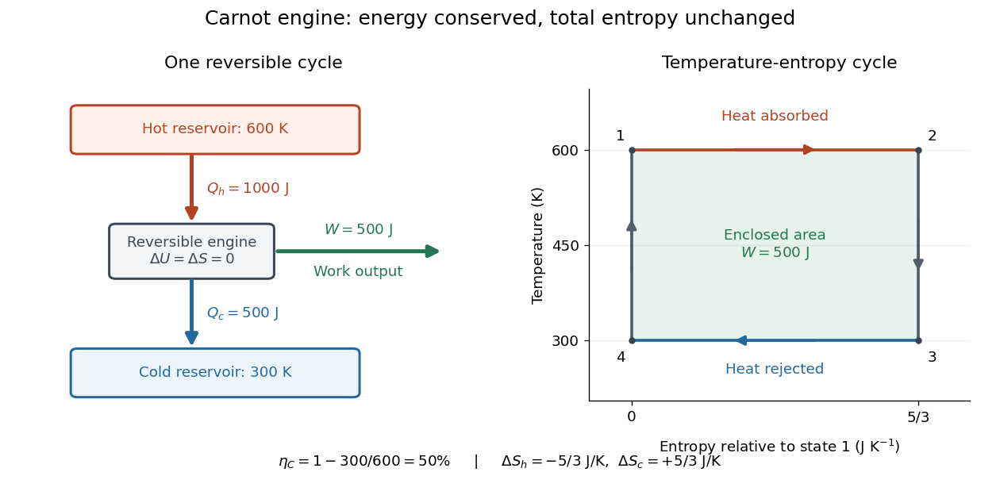
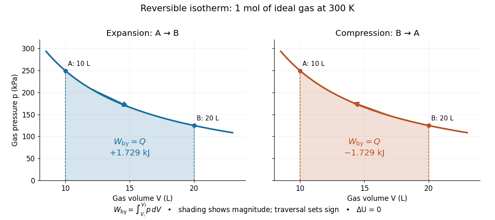
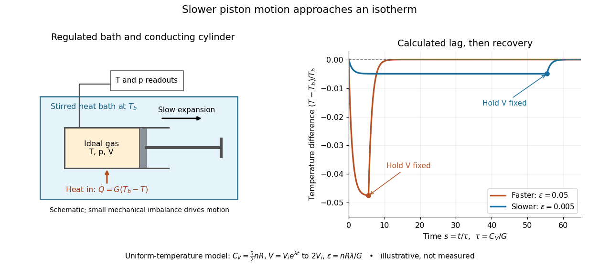
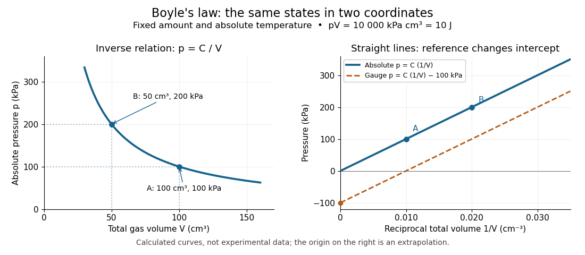
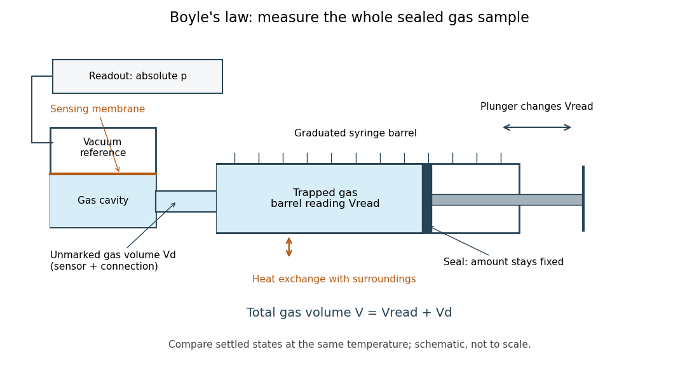

# Second law of thermodynamics

↑ **Parent:** [Thermodynamics](thermodynamics.md)  
ⓦ [Wiki](https://en.wikipedia.org/wiki/Second_law_of_thermodynamics)

For an [isolated system](thermodynamics.md#isolated-system), the second law requires $\Delta S\ge0$. More generally, include all affected surroundings to obtain

$$
\Delta S_{\rm tot}=\Delta S_{\rm system}+\Delta S_{\rm surroundings}\ge0.
$$

Equality describes the reversible limit; irreversible macroscopic processes produce [entropy](entropy.md). A [closed system](thermodynamics.md#closed-system) can lose [entropy](entropy.md) by exporting [heat](heat.md), so nondecrease does not apply to that system alone. The [Clausius statement of the second law](#clausius-statement-of-the-second-law) forbids a cyclic device whose sole effect is transferring [heat](heat.md) from cold to hot. The [Kelvin-Planck statement of the second law](#kelvin-planck-statement-of-the-second-law) forbids a cyclic device whose sole effect is converting [heat](heat.md) from one [thermal reservoir](thermal-equilibrium.md#heat-bath) completely into [work](energy.md#work). "Sole effect" matters: a [refrigerator](thermodynamics.md#refrigerator) moves [heat](heat.md) from cold to hot by consuming [work](energy.md#work). [5.1 Concept and Statements of the Second Law (Why do we need a second law?)](physics-bibliography.md#thermodynamics-and-propulsion/5-1-concept-and-statements-of-the-second-law-why-do-we-need-a-second-law)

For direct transfer of $Q=1000\,\mathrm J$ from a [thermal reservoir](thermal-equilibrium.md#heat-bath) at $600\,\mathrm K$ to one at $300\,\mathrm K$, with no [work](energy.md#work) extracted,

$$
\Delta S_{\rm tot}=-\frac{1000}{600}+\frac{1000}{300}
=\frac53\,\mathrm{J\,K^{-1}}>0.
$$

The reverse transfer alone would have negative total [entropy](entropy.md) change. Both directions conserve [energy](energy.md), but only the hot-to-cold direction is spontaneous. The finite-body example under [entropy](entropy.md) replaces these constant [temperatures](temperature.md) by changing ones.

[Friction](newtonian-mechanics.md#friction), [free expansion](thermodynamics.md#free-expansion) and [heat transfer](heat.md#heat-transfer) across a finite [temperature](temperature.md) difference all introduce irreversibility. Moving arbitrarily slowly is insufficient if [friction](newtonian-mechanics.md#friction) remains. A [reversible thermodynamic process](#reversible-thermodynamic-process) must permit restoration of both the system and surroundings. This gives engineers a useful ideal benchmark: irreversibility spends an opportunity to obtain [work](energy.md#work), even though [energy](energy.md) itself is conserved. [MIT, Irreversibility and lost opportunities for work](https://www.ocw.mit.edu/ans7870/16/16.unified/thermoF03/chapter_7.htm)

**Table of contents**

- [Entropy generation in finite-temperature heat transfer](#entropy-generation-in-finite-temperature-heat-transfer)
  - [Entropy generation by mixing equal thermal masses](#entropy-generation-by-mixing-equal-thermal-masses)
- [Maximum work from two finite heat reservoirs](#maximum-work-from-two-finite-heat-reservoirs)
- [Clausius inequality](#clausius-inequality)
- [Reversible thermodynamic process](#reversible-thermodynamic-process)
- [Clausius statement of the second law](#clausius-statement-of-the-second-law)
- [Kelvin-Planck statement of the second law](#kelvin-planck-statement-of-the-second-law)
- [Carnot's theorem](#carnot-s-theorem)
  - [Thermodynamic temperature](#thermodynamic-temperature)
  - [Carnot cycle](#carnot-cycle)
    - [Carnot efficiency](#carnot-efficiency)
    - [Isothermal process](#isothermal-process)
      - [Isotherm](#isotherm)
      - [Isothermal ideal-gas work](#isothermal-ideal-gas-work)
      - [Finite-rate isothermal piston model](#finite-rate-isothermal-piston-model)
      - [Boyle's law](#boyle-s-law)
        - [Absolute pressure in Boyle's law](#absolute-pressure-in-boyle-s-law)
        - [Linearized plot of Boyle's law](#linearized-plot-of-boyle-s-law)
        - [Gas-syringe measurement of Boyle's law](#gas-syringe-measurement-of-boyle-s-law)
          - [Gas-syringe dead-volume correction](#gas-syringe-dead-volume-correction)
      - [Isothermal compression](#isothermal-compression)
        - [Isothermal gas syringe experiment](#isothermal-gas-syringe-experiment)
          - [Gas syringe](#gas-syringe)
      - [Isothermal expansion](#isothermal-expansion)

## Entropy generation in finite-temperature heat transfer

↑ **Parent:** [Second law of thermodynamics](second-law-of-thermodynamics.md)

When a system at instantaneous [temperature](temperature.md) $T$ absorbs [heat](heat.md) $dQ$ from a reservoir at $T_R$, with no other [entropy](entropy.md) production in the system, its [entropy](entropy.md) increases by $dQ/T$ while the reservoir changes by $-dQ/T_R$. The total is positive for spontaneous [heat](heat.md) transfer across a finite [temperature](temperature.md) difference. A quasistatic mechanical path can therefore be thermally irreversible.

### Entropy generation by mixing equal thermal masses

↑ **Parent:** [Entropy generation in finite-temperature heat transfer](#entropy-generation-in-finite-temperature-heat-transfer)

For equal [masses](classical-mechanics.md#mass) $M$ of the same liquid with constant specific heat $c_P$, adiabatic constant-pressure mixing gives final [temperature](temperature.md) $T_f=(T_1+T_2)/2$ by [enthalpy](enthalpy.md) conservation. The [entropy](entropy.md) change is $Mc_P\ln(T_f/T_1)+Mc_P\ln(T_f/T_2)=2Mc_P\ln[(T_1+T_2)/(2\sqrt{T_1T_2})]$. The [arithmetic-geometric mean inequality](mathematical-optimization.md#arithmetic-geometric-mean-inequality) proves nonnegativity, with equality only for equal initial [temperatures](temperature.md). There is no separate compositional mixing [entropy](entropy.md) for identical fluids.

## Maximum work from two finite heat reservoirs

↑ **Parent:** [Second law of thermodynamics](second-law-of-thermodynamics.md)

With constant [heat capacities](heat.md#heat-capacity) $C_1,C_2$, a [reversible heat engine](thermodynamics.md#reversible-heat-engine) taking two bodies to a common [temperature](temperature.md) has $T_f=T_1^{C_1/(C_1+C_2)}T_2^{C_2/(C_1+C_2)}$. The maximum [work](energy.md#work) is $C_1T_1+C_2T_2-(C_1+C_2)T_f$. [heat](heat.md) isolation does not prohibit transferring [work](energy.md#work) to a store included in the total isolated system.

## Clausius inequality

↑ **Parent:** [Second law of thermodynamics](second-law-of-thermodynamics.md)

For a thermodynamic cycle, with heat positive into the system and each transfer divided by the absolute temperature of the relevant thermal boundary or reservoir, the cyclic integral is nonpositive. Equality holds for a reversible cycle. Closing an arbitrary process by a reversible return path yields $\Delta S\geq\int\delta Q/T$, because the reversible integral defines the [entropy](entropy.md) difference. The difference is the nonnegative entropy production; entropy transferred with heat need not itself be positive.

## Reversible thermodynamic process

↑ **Parent:** [Second law of thermodynamics](second-law-of-thermodynamics.md)

A thermodynamically reversible process can be reversed without a net change of the system and surroundings. Its entropy change equals reversible heat transfer divided by temperature. A reversible [adiabatic process](first-law-of-thermodynamics.md#adiabatic-process) conserves [entropy](entropy.md); adiabaticity alone does not forbid internal entropy production in an irreversible evolution.

## Clausius statement of the second law

↑ **Parent:** [Second law of thermodynamics](second-law-of-thermodynamics.md)

No cyclic device can have as its sole effect the transfer of [heat](heat.md) from a colder [thermal reservoir](thermal-equilibrium.md#heat-bath) to a hotter [thermal reservoir](thermal-equilibrium.md#heat-bath). The word “sole” includes the surroundings: the device must return to its starting state, and there must be no net supplied [work](energy.md#work), depletion of a stored resource, or accompanying change elsewhere. The statement excludes a self-running [refrigerator](thermodynamics.md#refrigerator), while allowing an ordinary [refrigerator](thermodynamics.md#refrigerator) or [heat pump](thermodynamics.md#heat-pump) supplied with [work](energy.md#work).[§5.1, statement 2 and Figure 5.2: sole-result restriction](physics-bibliography.md#thermodynamics-and-propulsion/5-1-concept-and-statements-of-the-second-law-why-do-we-need-a-second-law)

For a proposed transfer $Q>0$ from a fixed cold [thermal reservoir](thermal-equilibrium.md#heat-bath) at $T_c$ to a fixed hot [thermal reservoir](thermal-equilibrium.md#heat-bath) at $T_h>T_c>0$, with no other effect, the total [entropy](entropy.md) change would be

$$
\Delta S_{\rm tot}=\frac{Q}{T_h}-\frac{Q}{T_c}<0.
$$

The [first law of thermodynamics](first-law-of-thermodynamics.md) permits this [energy](energy.md) balance; the [Second law of thermodynamics](second-law-of-thermodynamics.md) forbids the negative total [entropy](entropy.md) change. For $Q=600\,\mathrm J$, $T_c=300\,\mathrm K$ and $T_h=600\,\mathrm K$, it is $-1\,\mathrm{J\,K^{-1}}$. Direct [heat transfer](heat.md#heat-transfer) in the opposite direction has positive total [entropy](entropy.md) change. A powered [heat pump](thermodynamics.md#heat-pump) has a different budget: it supplies [work](energy.md#work) and delivers more [heat](heat.md) to the hot side than it extracts from the cold side.

A short equivalence argument links this restriction to the [Kelvin-Planck statement of the second law](#kelvin-planck-statement-of-the-second-law). Couple a hypothetical device that moves $600\,\mathrm J$ from cold to hot with no other effect to the [heat engine](thermodynamics.md#heat-engine) illustrated above, which absorbs $1000\,\mathrm J$, rejects $600\,\mathrm J$, and delivers $400\,\mathrm J$. The cold-side transfers cancel; the combined cyclic device takes $400\,\mathrm J$ from the hot [thermal reservoir](thermal-equilibrium.md#heat-bath) and delivers exactly $400\,\mathrm J$ of [work](energy.md#work), violating the [Kelvin-Planck statement of the second law](#kelvin-planck-statement-of-the-second-law). Matching transfers is an ideal composition argument, not a claim that such a device exists.[§I.D, printed pp. 7–8: equivalence by coupling devices](physics-bibliography.md#8-333-statistical-mechanics-i-statistical-mechanics-of-particles/statistical-mechanics-i-lecture-2)

## Kelvin-Planck statement of the second law

↑ **Parent:** [Second law of thermodynamics](second-law-of-thermodynamics.md)

No cyclic device can have as its sole effect the extraction of [heat](heat.md) from one [thermal reservoir](thermal-equilibrium.md#heat-bath) and its complete conversion into net [work](energy.md#work). A putative device absorbing $Q_h>0$ and returning to its starting state with $W=Q_h$ and no other transfer would conserve [energy](energy.md), yet violate the [Second law of thermodynamics](second-law-of-thermodynamics.md). Rejecting [heat](heat.md) to colder surroundings is an essential part of the ordinary two-[thermal reservoir](thermal-equilibrium.md#heat-bath) [heat engine](thermodynamics.md#heat-engine) budget.[§5.1, statement 1 and Figure 5.1: complete conversion as the sole result](physics-bibliography.md#thermodynamics-and-propulsion/5-1-concept-and-statements-of-the-second-law-why-do-we-need-a-second-law)

The cyclic and sole-effect qualifications matter. A single [isothermal expansion](#isothermal-expansion) of an [ideal gas](ideal-gas.md) can absorb [heat](heat.md) and deliver equal [work](energy.md#work) while leaving its [volume](thermodynamics.md#volume-thermodynamics) changed; restoring the initial state must also be counted. Likewise, a device discharging stored [internal energy](internal-energy.md) or consuming fuel has another effect. Converting supplied electrical [work](energy.md#work) completely to [heat](heat.md) through [Joule heating](electric-charge.md#joule-heating) reverses the proposed conversion and is allowed. The statement also allows cyclic devices that exchange [heat](heat.md) with one [thermal reservoir](thermal-equilibrium.md#heat-bath) while consuming net [work](energy.md#work); it forbids positive net [work](energy.md#work) output with that single [heat](heat.md) source as the only external change.

Conversely, a hypothetical complete-conversion device could take $100\,\mathrm J$ from the hot [thermal reservoir](thermal-equilibrium.md#heat-bath) and supply $100\,\mathrm J$ of [work](energy.md#work) to an ideal [refrigerator](thermodynamics.md#refrigerator) that extracts $100\,\mathrm J$ from the cold [thermal reservoir](thermal-equilibrium.md#heat-bath) and delivers $200\,\mathrm J$ to the hot one. At $600\,\mathrm K$ and $300\,\mathrm K$, that [refrigerator](thermodynamics.md#refrigerator) is itself admissible: its reservoir [entropy](entropy.md) changes cancel. The composite would consume no external [work](energy.md#work) and move a net $100\,\mathrm J$ from cold to hot, violating the [Clausius statement of the second law](#clausius-statement-of-the-second-law). Together with the construction there, this proves the equivalence of the two impossibility statements.[§I.D, printed p. 8: engine driving a refrigerator](physics-bibliography.md#8-333-statistical-mechanics-i-statistical-mechanics-of-particles/statistical-mechanics-i-lecture-2)

For the two fixed positive-[temperature](temperature.md) [thermal reservoir](thermal-equilibrium.md#heat-bath) hypotheses, [Carnot's theorem](#carnot-s-theorem) gives the sharper restriction $\eta\le1-T_c/T_h<1$. A [reversible thermodynamic process](#reversible-thermodynamic-process) reaches that bound in the ideal [Carnot cycle](#carnot-cycle); an ordinary device's smaller [thermal efficiency](thermodynamics.md#thermal-efficiency) reflects its [entropy production](stochastic-thermodynamics.md#entropy-production) and measurement boundary. An inefficient observed engine is compatible with the [Second law of thermodynamics](second-law-of-thermodynamics.md), rather than evidence that the bound has been experimentally determined.

<h2 id="carnot-s-theorem">Carnot's theorem</h2>

↑ **Parent:** [Second law of thermodynamics](second-law-of-thermodynamics.md)  
ⓦ [Wiki](https://en.wikipedia.org/wiki/Carnot's_theorem_(thermodynamics))

No cyclic [heat engine](thermodynamics.md#heat-engine) exchanging [heat](heat.md) only with two fixed [thermal reservoirs](thermal-equilibrium.md#heat-bath) at positive absolute [temperatures](temperature.md) $T_h>T_c$ can exceed the [thermal efficiency](thermodynamics.md#thermal-efficiency) of an engine whose cycle is a [reversible thermodynamic process](#reversible-thermodynamic-process) between them. All such reversible engines have the same [thermal efficiency](thermodynamics.md#thermal-efficiency), regardless of their working substance. Let $Q_h>0$ be [heat](heat.md) absorbed from the hot [thermal reservoir](thermal-equilibrium.md#heat-bath) and $Q_c>0$ the magnitude rejected to the cold one. Then

$$
W=Q_h-Q_c,\qquad
\eta=\frac W{Q_h}\le\eta_C=1-\frac{T_c}{T_h}.
$$

The [work](energy.md#work) convention is the one in the [first law of thermodynamics](first-law-of-thermodynamics.md): $W>0$ is net output by the engine. Use absolute [thermodynamic temperatures](#thermodynamic-temperature), such as values in [kelvin](temperature.md#kelvin); ratios of readings in [degree Celsius](temperature.md#degree-celsius) are invalid because their zero is shifted.

For $T_h=600\,\mathrm K$, $T_c=300\,\mathrm K$ and $Q_h=1000\,\mathrm J$, the maximum [thermal efficiency](thermodynamics.md#thermal-efficiency) is $50\%$. A reversible engine delivers $W=500\,\mathrm J$ and rejects $Q_c=500\,\mathrm J$. The [thermal reservoirs](thermal-equilibrium.md#heat-bath) have [entropy](entropy.md) changes $-1000/600$ and $+500/300\,\mathrm{J\,K^{-1}}$, which cancel. The engine's own [entropy](entropy.md) change is zero over its [thermodynamic cycle](thermodynamics.md#thermodynamic-cycle).

**[Figure 1](#image-carnot-engine-energy-transfers-and-the-reversible-cycle-between-600-k-and-300-k). Carnot engine energy transfers and the reversible cycle between 600 K and 300 K**.

A short derivation now becomes transparent: the [Second law of thermodynamics](second-law-of-thermodynamics.md) gives $-Q_h/T_h+Q_c/T_c\ge0$, and the [first law of thermodynamics](first-law-of-thermodynamics.md) gives $W=Q_h-Q_c$. Together they yield the bound and, more precisely,

$$
W=Q_h\left(1-\frac{T_c}{T_h}\right)-T_c\Delta S_{\rm tot}.
$$

At fixed $Q_h,T_h,T_c$, every extra unit of total [entropy production](stochastic-thermodynamics.md#entropy-production) reduces output by $T_c$ units of [energy](energy.md). [MIT, Maximum heat-engine work](https://web.mit.edu/16.unified/www/FALL/thermodynamics/notes/node44.html)

Fixed [thermal reservoirs](thermal-equilibrium.md#heat-bath) are essential. Finite bodies cool and warm, so their initial [temperature](temperature.md) ratio cannot be used throughout an entire extraction process. As a computed contrast, the bodies with equal constant [heat capacity](heat.md#heat-capacity) in the [entropy](entropy.md) example would reach $T_f=\sqrt{600\times300}=424.26\,\mathrm K$ if a reversible engine extracted [work](energy.md#work) until their [temperatures](temperature.md) matched. Zero total [entropy](entropy.md) change gives this geometric mean; the [first law of thermodynamics](first-law-of-thermodynamics.md) then gives $W_{\max}=C(600+300-2T_f)=5147.19\,\mathrm J$. Direct contact reaches $450\,\mathrm K$ and extracts no [work](energy.md#work).

Carnot's 1824 book asked whether the useful output of machines driven by [heat](heat.md) was fundamentally limited and whether changing the working substance could improve that limit. Its reversible comparisons are the historical setting of [Carnot's theorem](#carnot-s-theorem). Carnot used the then-current caloric picture, treating [heat](heat.md) as conserved in its passage through an engine; the modern balance $Q_h-Q_c=W$ should not be read back into that text.[pp. 6–7 and 20–23](physics-bibliography.md#reflexions-sur-la-puissance-motrice-du-feu-et-sur-les-machines-propres-a-developper-cette-puissance-by-sadi-carnot)

### Thermodynamic temperature

↑ **Parent:** [Carnot's theorem](#carnot-s-theorem)  
ⓦ [Wiki](https://en.wikipedia.org/wiki/Thermodynamic_temperature)

Absolute thermodynamic temperature can be defined so that a reversible engine exchanging heats $Q_h$ and $Q_c$ with reservoirs at $T_h$ and $T_c$ satisfies

$$
\frac{Q_c}{Q_h}=\frac{T_c}{T_h},
\qquad
\eta=1-\frac{T_c}{T_h}.
$$

A choice of one reference temperature fixes the scale.

### Carnot cycle

↑ **Parent:** [Carnot's theorem](#carnot-s-theorem)  
ⓦ [Wiki](https://en.wikipedia.org/wiki/Carnot_cycle)

A Carnot cycle realizes the reversible bound in [Carnot's theorem](#carnot-s-theorem). Its four steps for an [ideal gas](ideal-gas.md) working substance are:

- Reversible [isothermal expansion](#isothermal-expansion) at $T_h$, absorbing $Q_h$ and increasing [entropy](entropy.md) by $\Delta S$.
- Reversible [adiabatic expansion](first-law-of-thermodynamics.md#adiabatic-expansion), doing [work](energy.md#work) while the [temperature](temperature.md) falls from $T_h$ to $T_c$ and [entropy](entropy.md) stays fixed.
- Reversible [isothermal compression](#isothermal-compression) at $T_c$, rejecting $Q_c$ and decreasing [entropy](entropy.md) by $\Delta S$.
- Reversible [adiabatic compression](first-law-of-thermodynamics.md#adiabatic-compression), requiring [work](energy.md#work) to restore $T_h$ at fixed [entropy](entropy.md).

The [temperature](temperature.md) versus [entropy](entropy.md) plot in the [Carnot's theorem](#carnot-s-theorem) figure is therefore a rectangle traversed clockwise. Because $\delta Q_{\rm rev}=T\,dS$, its width is $\Delta S=Q_h/T_h$. For the illustrated engine, $\Delta S=5/3\,\mathrm{J\,K^{-1}}$: the upper step absorbs $600\times5/3=1000\,\mathrm J$, the lower step rejects $300\times5/3=500\,\mathrm J$, and the enclosed area is the $500\,\mathrm J$ net [work](energy.md#work). Geometry displays the [thermal efficiency](thermodynamics.md#thermal-efficiency) without solving the gas motion. The two vertical steps are [isentropic processes](first-law-of-thermodynamics.md#isentropic-process), not constant-[temperature](temperature.md) steps. [MIT, Four steps of a Carnot cycle](https://web.mit.edu/16.unified/www/FALL/thermodynamics/notes/node24.html) [MIT, Temperature-entropy diagrams](https://web.mit.edu/16.unified/www/FALL/thermodynamics/notes/node46.html)

Reversible [heat transfer](heat.md#heat-transfer) is a limit of vanishing [temperature](temperature.md) differences; ordinary finite-rate transfer introduces [entropy production](stochastic-thermodynamics.md#entropy-production). The [Carnot cycle](#carnot-cycle) is a performance benchmark rather than a guarantee of useful [power](energy.md#power). Running it backward gives the ideal operation of a [refrigerator](thermodynamics.md#refrigerator) or [heat pump](thermodynamics.md#heat-pump), with [work](energy.md#work) supplied to move [heat](heat.md) toward the hotter [thermal reservoir](thermal-equilibrium.md#heat-bath). [MIT, Reversed cycles and refrigeration](https://web.mit.edu/16.unified/www/FALL/thermodynamics/notes/node25.html)

#### Carnot efficiency

↑ **Parent:** [Carnot cycle](#carnot-cycle)

The reversible heat-engine efficiency between absolute temperatures $T_H$ and $T_C$, $\eta_C=1-T_C/T_H$. Real conversion between the same reservoirs cannot exceed it.

#### Isothermal process

↑ **Parent:** [Carnot cycle](#carnot-cycle)  
ⓦ [Wiki](https://en.wikipedia.org/wiki/Isothermal_process)

An [isothermal process](#isothermal-process) changes a [thermodynamic system](thermodynamics.md#thermodynamic-system) while keeping its [temperature](temperature.md) constant. It need not keep its [pressure](pressure.md), [volume](thermodynamics.md#volume-thermodynamics) or [internal energy](internal-energy.md) constant, and it does not generally have zero [heat](heat.md) transfer. An [adiabatic process](first-law-of-thermodynamics.md#adiabatic-process) specifies zero [heat](heat.md) transfer instead. For example, a slowly expanding [ideal gas](ideal-gas.md) can absorb [heat](heat.md) from a [heat bath](thermal-equilibrium.md#heat-bath) and deliver the same amount of [work](energy.md#work) while its [temperature](temperature.md) stays fixed.

For a fixed [amount of substance](physics.md#amount-of-substance) and composition, [internal energy of an ideal gas](ideal-gas.md#internal-energy-of-an-ideal-gas) depends only on [temperature](temperature.md). With $Q>0$ for [heat](heat.md) entering and $W_{\rm by}>0$ for [work](energy.md#work) delivered to the surroundings, the [first law of thermodynamics](first-law-of-thermodynamics.md) therefore gives

$$
\Delta U=Q-W_{\rm by}=0,\qquad Q=W_{\rm by}.
$$

This equality does not determine either transfer until the path is specified. [Isothermal ideal-gas work](#isothermal-ideal-gas-work) gives the reversible value; an insulated [free expansion](thermodynamics.md#free-expansion) has a different value even when its equilibrium endpoints have the same [temperature](temperature.md). The [closed system](thermodynamics.md#closed-system) convention here excludes changes in bulk [kinetic energy](energy.md#kinetic-energy) and external [potential energy](energy.md#potential-energy).

A conducting cylinder in a large, stirred [heat bath](thermal-equilibrium.md#heat-bath) approximates an [isothermal process](#isothermal-process) when the piston moves slowly enough for [thermal conduction](heat.md#thermal-conduction) to keep up. A [quasistatic process](thermodynamics.md#quasistatic-process) keeps the [gas](thermodynamics.md#gas) close to internal [thermodynamic equilibrium](thermodynamics.md#thermodynamic-equilibrium); a [reversible thermodynamic process](#reversible-thermodynamic-process) additionally requires negligible [friction](newtonian-mechanics.md#friction) and vanishing driving differences in [pressure](pressure.md) and [temperature](temperature.md). Exact equality of the [gas](thermodynamics.md#gas) and [heat bath](thermal-equilibrium.md#heat-bath) [temperatures](temperature.md) gives no finite [heat transfer](heat.md#heat-transfer) rate through a finite [thermal resistance](heat.md#thermal-resistance). The reversible description is a limit of arbitrarily small differences and arbitrarily slow motion, illustrated by the [finite-rate isothermal piston model](#finite-rate-isothermal-piston-model).[§3.4, “Isothermal Processes”, Figure 3.9 and the discussion of removing piston weights in infinitesimal steps](physics-bibliography.md#university-physics-volume-2-by-samuel-j-ling-and-others/3-4-thermodynamic-processes)

For a [real gas](thermodynamics.md#real-gas), [internal energy at constant temperature](internal-energy.md#internal-energy-at-constant-temperature) can change with [volume](thermodynamics.md#volume-thermodynamics) because molecular interaction [potential energy](energy.md#potential-energy) changes. In one smooth [thermodynamic phase](thermodynamics.md#thermodynamic-phase) of a fixed-composition [simple compressible system](thermodynamics.md#simple-compressible-system),

$$
\left(\frac{\partial U}{\partial V}\right)_{T,n}
=T\left(\frac{\partial p}{\partial T}\right)_{V,n}-p.
$$

Thus an [isothermal process](#isothermal-process) generally has $Q=\Delta U+W_{\rm by}$, with no reason to set $\Delta U=0$. The right-hand side vanishes for the [ideal gas law](ideal-gas.md#ideal-gas-law), but not generally for another [equation of state](pressure.md#equation-of-state).[Equations 6.151–6.154: the volume contribution to internal-energy changes](physics-bibliography.md#thermodynamics-and-statistical-mechanics-by-richard-fitzpatrick/free-expansion-of-gas)

##### Isotherm

↑ **Parent:** [Isothermal process](#isothermal-process)

An [isotherm](#isotherm) is a curve of equilibrium states at fixed [temperature](temperature.md), often drawn in the pressure-volume plane. For an [ideal gas](ideal-gas.md) of fixed amount it obeys $pV=\mathrm{constant}$. The curve is not itself a specification of the rate, reversibility or experimental mechanism by which the states are visited.

##### Isothermal ideal-gas work

↑ **Parent:** [Isothermal process](#isothermal-process)

For a [reversible thermodynamic process](#reversible-thermodynamic-process) that changes the [volume](thermodynamics.md#volume-thermodynamics) of a fixed amount of [ideal gas](ideal-gas.md) at absolute [temperature](temperature.md) $T$, the [work](energy.md#work) done by the [gas](thermodynamics.md#gas) is

$$
W_{\rm by,rev}=\int_{V_i}^{V_f}p\,dV
=nRT\int_{V_i}^{V_f}\frac{dV}{V}
=nRT\ln\frac{V_f}{V_i}
=nRT\ln\frac{p_i}{p_f}.
$$

Here $n$ is the [amount of substance](physics.md#amount-of-substance), $R$ the [molar gas constant](ideal-gas.md#molar-gas-constant), $p$ the [pressure](pressure.md), and $\ln$ the [natural logarithm](calculus.md#natural-logarithm). The [ideal gas law](ideal-gas.md#ideal-gas-law) supplies $p=nRT/V$; the [integral](integral.md) is the signed [area](differential-geometry.md#surface-area) under the [pressure](pressure.md)-[volume](thermodynamics.md#volume-thermodynamics) curve. [Isothermal expansion](#isothermal-expansion) gives positive [work](energy.md#work); [isothermal compression](#isothermal-compression) gives negative [work](energy.md#work). A convention counting [work](energy.md#work) done on the [gas](thermodynamics.md#gas) instead has $W_{\rm on}=-W_{\rm by}$.[§3.2, equations 3.3–3.4, Figure 3.5 and the isothermal integral following Figure 3.6](physics-bibliography.md#university-physics-volume-2-by-samuel-j-ling-and-others/3-2-work-heat-and-internal-energy)

For a calculated example, let $n=1\,\mathrm{mol}$, $T=300\,\mathrm K$ and $V_i=10\,\mathrm L$, $V_f=20\,\mathrm L$. The [pressure](pressure.md) falls from approximately $249.4$ to $124.7\,\mathrm{kPa}$, and

$$
W_{\rm by,rev}=Q=nRT\ln2\approx1.729\,\mathrm{kJ},\qquad \Delta U=0.
$$

Traversing the same [isothermal process](#isothermal-process) backward changes both transfer signs: $W_{\rm by,rev}=Q\approx-1.729\,\mathrm{kJ}$. Neither direction changes [internal energy of an ideal gas](ideal-gas.md#internal-energy-of-an-ideal-gas). These stipulated values illustrate the [energy](energy.md) balance; they are not experimental measurements.

**[Figure 2](#image-signed-work-along-an-ideal-gas-isotherm-expansion-and-compression). Signed work along an ideal-gas isotherm: expansion and compression**.

The shaded geometric [area](differential-geometry.md#surface-area) is positive in both panels; the direction of the [integral](integral.md) supplies the sign of [work](energy.md#work). Knowing only the two equilibrium endpoints does not justify shading this curve for an irreversible process. For an idealized piston moving against a specified external resisting [pressure](pressure.md), boundary [work](energy.md#work) is $W_{\rm by}=\int p_{\rm ext}\,dV$. Substitution of the equilibrium [gas](thermodynamics.md#gas) [pressure](pressure.md) requires the appropriate reversible limit. In [free expansion](thermodynamics.md#free-expansion) into [vacuum](physics.md#vacuum), $p_{\rm ext}=0$ and this boundary [work](energy.md#work) is zero.

##### Finite-rate isothermal piston model

↑ **Parent:** [Isothermal process](#isothermal-process)

Why must a conducting piston move slowly? A simple model couples the [first law of thermodynamics](first-law-of-thermodynamics.md) to [Newton's law of cooling](linear-ordinary-differential-equation.md#newton-s-law-of-cooling). Assume a fixed amount of [ideal gas](ideal-gas.md) with uniform [temperature](temperature.md) $T(t)$ and constant whole-sample [heat capacity at constant volume](heat.md#heat-capacity-at-constant-volume) $C_V$, a [heat bath](thermal-equilibrium.md#heat-bath) maintained at $T_b$, negligible [friction](newtonian-mechanics.md#friction), and mechanically slow motion. Let $G>0$ be the effective thermal conductance, the reciprocal of the [thermal resistance](heat.md#thermal-resistance), in $\mathrm{W\,K^{-1}}$. Then

$$
\dot Q=G(T_b-T),\qquad p=\frac{nRT}{V},\qquad
C_V\dot T=G(T_b-T)-p\dot V.
$$

Positive [heat transfer](heat.md#heat-transfer) must offset expansion [work](energy.md#work) to keep $T$ near $T_b$. A finite $G$ and nonzero piston speed therefore require a [temperature](temperature.md) difference. This uniform-[temperature](temperature.md) model neglects spatial [temperature gradients](heat.md#temperature-gradient), sensor response, cylinder [heat capacity](heat.md#heat-capacity) and any change of $G$ with piston position; it is an illustrative calculation, not a fit to the [isothermal gas syringe experiment](#isothermal-gas-syringe-experiment).

**[Figure 3](#image-conducting-piston-in-a-thermal-bath-and-modeled-temperature-lag-during-expansion). Conducting piston in a thermal bath and modeled temperature lag during expansion**.

For a prescribed exponential [volume](thermodynamics.md#volume-thermodynamics) change $V=V_i e^{\lambda t}$, define $\tau=C_V/G$, $s=t/\tau$ and $\epsilon=nR\lambda/G$. The dimensionless [temperature](temperature.md) $\theta=T/T_b$ obeys a [linear ordinary differential equation](linear-ordinary-differential-equation.md) with initial value $\theta(0)=1$:

$$
\frac{d\theta}{ds}=1-(1+\epsilon)\theta,\qquad
\theta(s)=\frac{1}{1+\epsilon}
+\frac{\epsilon}{1+\epsilon}e^{-(1+\epsilon)s}.
$$

The plotted expansion uses stipulated $C_V=(5/2)nR$ and stops at $V_f=2V_i$, at $s_f=\ln2/[(5/2)\epsilon]$. During expansion, the larger $\epsilon$ produces the larger [temperature](temperature.md) deficit; once the piston is held fixed, the deficit undergoes [exponential decay](analysis.md#exponential-decay) as $e^{-(s-s_f)}$. Reducing $|\epsilon|$ makes the path more nearly an [isothermal process](#isothermal-process), while increasing its duration. Reversing the piston with $\lambda<0$ produces a [temperature](temperature.md) excess and outward [heat transfer](heat.md#heat-transfer); the small-$|\epsilon|$ regime is the intended near-isothermal approximation. Mechanical slowness alone does not ensure sufficient [heat transfer](heat.md#heat-transfer).

<h5 id="boyle-s-law">Boyle's law</h5>

↑ **Parent:** [Isothermal process](#isothermal-process)  
ⓦ [Wiki](https://en.wikipedia.org/wiki/Boyle's_law)

[Boyle's law](#boyle-s-law) states that a fixed [amount of substance](physics.md#amount-of-substance) of an [ideal gas](ideal-gas.md) at constant absolute [thermodynamic temperature](#thermodynamic-temperature) has constant product of [absolute pressure](fluid-mechanics.md#absolute-pressure) and total [volume](thermodynamics.md#volume-thermodynamics):

$$
pV=C,\qquad p_1V_1=p_2V_2,\qquad p_2=p_1\frac{V_1}{V_2}.
$$

Here $p$ is measured relative to a [vacuum](physics.md#vacuum), not relative to the surrounding [atmospheric pressure](pressure.md#atmospheric-pressure). Halving the [volume](thermodynamics.md#volume-thermodynamics) doubles the [absolute pressure](fluid-mechanics.md#absolute-pressure); doubling the [volume](thermodynamics.md#volume-thermodynamics) halves it. A [real gas](thermodynamics.md#real-gas) approximately follows [Boyle's law](#boyle-s-law) when it is sufficiently dilute and far from a [phase transition](critical-phenomenon.md#phase-transition).[§2.1, The Gas Laws, Figure 2.4, and equations 2.1–2.2: fixed temperature and particle number, absolute pressure, and the dilute-gas limit](physics-bibliography.md#university-physics-volume-2-by-samuel-j-ling-and-others/2-1-molecular-model-of-an-ideal-gas)

For an original calculated example, suppose a sealed [gas](thermodynamics.md#gas) sample has $p_1=100\,\mathrm{kPa}$ and $V_1=100\,\mathrm{cm^3}$. After [isothermal compression](#isothermal-compression) to $V_2=50\,\mathrm{cm^3}$,

$$
p_2=(100\,\mathrm{kPa})\frac{100\,\mathrm{cm^3}}{50\,\mathrm{cm^3}}
=200\,\mathrm{kPa}.
$$

Both states have $C=10\,000\,\mathrm{kPa\,cm^3}=10\,\mathrm J$, since $1\,\mathrm{kPa\,cm^3}=10^{-3}\,\mathrm J$. The [volume](thermodynamics.md#volume-thermodynamics) ratio is dimensionless, so using the same [volume](thermodynamics.md#volume-thermodynamics) units in numerator and denominator leaves the [pressure](pressure.md) in kilopascals. Although $pV$ has units of [energy](energy.md), its value is not the compression [work](energy.md#work): [isothermal ideal-gas work](#isothermal-ideal-gas-work) involves an [integral](integral.md) along the path.

**[Figure 4](#image-boyle-s-law-a-pressure-volume-curve-becomes-a-straight-line-against-reciprocal-volume). Boyle's law: a pressure-volume curve becomes a straight line against reciprocal volume**.

The blue curves show calculated [ideal gas](ideal-gas.md) states, not measurements. The left panel is a branch of a [hyperbola](euclidean-geometry.md#hyperbola); the right panel plots exactly the same [absolute pressures](fluid-mechanics.md#absolute-pressure) against $1/V$. The dashed line uses [gauge pressure](fluid-mechanics.md#gauge-pressure) with a stipulated constant [atmospheric pressure](pressure.md#atmospheric-pressure) of $100\,\mathrm{kPa}$. Its displaced intercept explains why [absolute pressure in Boyle's law](#absolute-pressure-in-boyle-s-law) matters.

A short derivation starts from the [ideal gas law](ideal-gas.md#ideal-gas-law), $pV=nRT$. Fixing the [amount of substance](physics.md#amount-of-substance) $n$ and absolute [thermodynamic temperature](#thermodynamic-temperature) $T$ fixes $C=nRT$, where $R$ is the [molar gas constant](ideal-gas.md#molar-gas-constant). The microscopic picture in [ideal gas pressure from wall collisions](ideal-gas.md#ideal-gas-pressure-from-wall-collisions) is equally appealing: at fixed [temperature](temperature.md), the typical particle [kinetic energy](energy.md#kinetic-energy) stays fixed, while compression increases the [number density](statistical-physics.md#number-density) and wall [momentum](momentum.md) transfer per unit [surface area](differential-geometry.md#surface-area) and time. A larger [absolute pressure](fluid-mechanics.md#absolute-pressure) follows without requiring hotter particles.

The constraints are essential. A leak changes the [amount of substance](physics.md#amount-of-substance). Rapid compression can raise the [temperature](temperature.md) before [heat transfer](heat.md#heat-transfer) restores [thermal equilibrium](thermal-equilibrium.md), as in the [isothermal gas syringe experiment](#isothermal-gas-syringe-experiment). Molecular size and interactions in a dense [real gas](thermodynamics.md#real-gas) invalidate the [ideal gas](ideal-gas.md) approximation; the [Van der Waals equation](pressure.md#van-der-waals-equation) describes one such correction. Equal endpoint [temperatures](temperature.md) allow an endpoint test of [Boyle's law](#boyle-s-law), but do not establish that every intervening state lies on an [isothermal process](#isothermal-process).

For fixed [mass](classical-mechanics.md#mass) $m$, [mass density](fluid-mechanics.md#density) satisfies $\rho=m/V=mp/C$, so it is proportional to [absolute pressure](fluid-mechanics.md#absolute-pressure). In a dilute bubbly flow, [Boyle's law](#boyle-s-law) allows bubble [volume](thermodynamics.md#volume-thermodynamics) and its contribution to [buoyancy](fluid-mechanics.md#buoyancy) to increase as [hydrostatic pressure](fluid-mechanics.md#hydrostatic-pressure) decreases, provided [gas](thermodynamics.md#gas) [mass](classical-mechanics.md#mass) is retained, dissolution is negligible, and the [temperature](temperature.md) stays approximately fixed. Its usefulness is that a simple ratio predicts a substantial size change without tracking individual [molecules](molecule.md).

<h6 id="absolute-pressure-in-boyle-s-law">Absolute pressure in Boyle's law</h6>

↑ **Parent:** [Boyle's law](#boyle-s-law)

With [gauge pressure](fluid-mechanics.md#gauge-pressure) $p_g$ referenced to [atmospheric pressure](pressure.md#atmospheric-pressure) $p_{\rm atm}$, [absolute pressure](fluid-mechanics.md#absolute-pressure) is $p=p_g+p_{\rm atm}$. Thus [Boyle's law](#boyle-s-law) becomes

$$
(p_{g,1}+p_{{\rm atm},1})V_1
=(p_{g,2}+p_{{\rm atm},2})V_2.
$$

Even a constant [atmospheric pressure](pressure.md#atmospheric-pressure) cannot be dropped from these sums. For the calculated $100\,\mathrm{kPa}$ to $200\,\mathrm{kPa}$ example, take $p_{\rm atm}=100\,\mathrm{kPa}$. The initial and final [gauge pressures](fluid-mechanics.md#gauge-pressure) are $0$ and $100\,\mathrm{kPa}$; their products with the respective [volume](thermodynamics.md#volume-thermodynamics) are $0$ and $5000\,\mathrm{kPa\,cm^3}$, which are unequal. Zero [gauge pressure](fluid-mechanics.md#gauge-pressure) means balance with the surroundings, not absence of [gas](thermodynamics.md#gas) or absence of wall [momentum](momentum.md) transfer.

For a frictionless piston of [surface area](differential-geometry.md#surface-area) $A$ with its outer face exposed to [atmospheric pressure](pressure.md#atmospheric-pressure), the additional inward [force](force.md) required for [mechanical equilibrium](thermodynamics.md#mechanical-equilibrium) is $F=(p-p_{\rm atm})A=p_gA$. This is why a mechanical load can reveal a [pressure](pressure.md) difference even though the [equation of state](pressure.md#equation-of-state) requires [absolute pressure](fluid-mechanics.md#absolute-pressure). With piston [friction](newtonian-mechanics.md#friction), the load alone no longer determines $p_gA$; a direct [pressure sensor](pressure.md#pressure-sensor) avoids that particular inference.

<h6 id="linearized-plot-of-boyle-s-law">Linearized plot of Boyle's law</h6>

↑ **Parent:** [Boyle's law](#boyle-s-law)

A [linearized plot of Boyle's law](#linearized-plot-of-boyle-s-law) uses $x=1/V$ as its horizontal coordinate. Then [absolute pressure](fluid-mechanics.md#absolute-pressure) satisfies $p=Cx$: the [slope](euclidean-geometry.md#slope) is $C=nRT$, and the ideal intercept is zero. In the figure, $(V,p)=(100,100)$ and $(50,200)$ in $\mathrm{cm^3}$ and $\mathrm{kPa}$ become $(x,p)=(0.010,100)$ and $(0.020,200)$ in $\mathrm{cm^{-3}}$ and $\mathrm{kPa}$. Both give [slope](euclidean-geometry.md#slope) $10\,000\,\mathrm{kPa\,cm^3}$. The Vernier experiment includes this reciprocal-[volume](thermodynamics.md#volume-thermodynamics) graph as its extension.[Experiment 6, printed p. 6–4, Extension steps 1–2: pressure versus reciprocal total volume and linear fitting](physics-bibliography.md#chemistry-with-vernier/6-boyle-s-law-pressure-volume-relationship-in-gases)

At constant [atmospheric pressure](pressure.md#atmospheric-pressure), [gauge pressure](fluid-mechanics.md#gauge-pressure) instead obeys $p_g=Cx-p_{\rm atm}$, with the same [slope](euclidean-geometry.md#slope) and a negative intercept. A nonzero fitted intercept in an intended [absolute pressure](fluid-mechanics.md#absolute-pressure) plot can indicate [sensor bias](control-theory.md#sensor-bias) or an incorrect [volume](thermodynamics.md#volume-thermodynamics) correction, but is not by itself a unique diagnosis. The origin is a mathematical extrapolation to infinite [volume](thermodynamics.md#volume-thermodynamics) and zero [absolute pressure](fluid-mechanics.md#absolute-pressure), rather than an additional measured state.

<h6 id="gas-syringe-measurement-of-boyle-s-law">Gas-syringe measurement of Boyle's law</h6>

↑ **Parent:** [Boyle's law](#boyle-s-law)

Vernier's Boyle's Law: Pressure-Volume Relationship in Gases, Experiment 6 of Chemistry with Vernier, specifies a graduated $20\,\mathrm{mL}$ [gas syringe](#gas-syringe), a [pressure sensor](pressure.md#pressure-sensor) and LabQuest recording. Preparation sets the disconnected syringe to $10.0\,\mathrm{mL}$, then attaches it to the sensor valve, trapping air. At several plunger positions, the displayed [pressure](pressure.md) is allowed to stabilize before the paired [volume](thermodynamics.md#volume-thermodynamics) is entered. The analysis tests whether $pV$ remains approximately constant. It adds $0.8\,\mathrm{mL}$ to each syringe reading for the sensor's internal [volume](thermodynamics.md#volume-thermodynamics); this correction belongs to that apparatus. The worksheet supplies a blank results table, not measured values.[Experiment 6, printed pp. 6–1 to 6–3: Figure 1, preparation 1b–c, procedure 3–6, blank data table, and Processing the Data 7–9](physics-bibliography.md#chemistry-with-vernier/6-boyle-s-law-pressure-volume-relationship-in-gases)

**[Figure 5](#image-a-closed-gas-syringe-measures-total-trapped-volume-and-absolute-pressure-after-thermal-settling). A closed gas syringe measures total trapped volume and absolute pressure after thermal settling**.

The manufacturer's Gas Pressure Sensor User Manual identifies a membrane sensor referenced to a [vacuum](physics.md#vacuum), hence an [absolute pressure](fluid-mechanics.md#absolute-pressure) readout. Its calibration section uses the actual local [atmospheric pressure](pressure.md#atmospheric-pressure) for an ambient reference check, rather than a weather report corrected to sea level. Checking this baseline before sealing separates an offset error from compression physics.[Calibration: station pressure and one-point reference; Specifications: internal volume; How the Sensor Works: vacuum-referenced membrane and absolute-pressure output](physics-bibliography.md#gas-pressure-sensor-user-manual-vernier)

Additional controls follow from the model. Keep the same sealed [amount of substance](physics.md#amount-of-substance), connections and ambient [temperature](temperature.md); persistent [pressure](pressure.md) drift at held [volume](thermodynamics.md#volume-thermodynamics) after [thermal equilibrium](thermal-equilibrium.md) suggests a leak or another uncontrolled change. Small steps and waiting allow compression [heat](heat.md) to leave the [gas](thermodynamics.md#gas); avoiding hand warming reduces another [heat](heat.md) input. Compare settled readings when approaching a position from either direction. Plunger [friction](newtonian-mechanics.md#friction) affects the applied [force](force.md) and position reproducibility, so record actual [pressure](pressure.md) and actual plunger position rather than predicting [pressure](pressure.md) from the load. These are proposed controls, not reported experimental outcomes.

Nearly constant $pV$ across equilibrated states supports the fixed-[temperature](temperature.md) [ideal gas](ideal-gas.md) approximation over the tested range. Stabilized [pressure](pressure.md) alone does not demonstrate uniform or constant [temperature](temperature.md); the [isothermal gas syringe experiment](#isothermal-gas-syringe-experiment) adds a [temperature](temperature.md) readout to distinguish a transient from its cooled endpoint. Finite sensor accuracy and uncertain total [volume](thermodynamics.md#volume-thermodynamics) limit the test, and agreement does not establish ideal behavior at every [pressure](pressure.md). Repeated return readings help distinguish reproducibility from a one-direction trend.

###### Gas-syringe dead-volume correction

↑ **Parent:** [Gas-syringe measurement of Boyle's law](#gas-syringe-measurement-of-boyle-s-law)

In a [gas syringe](#gas-syringe), the graduated barrel reading $V_{\rm read}$ can omit a fixed connecting or sensor [volume](thermodynamics.md#volume-thermodynamics) $V_d$ occupied by the same sealed [gas](thermodynamics.md#gas). For a common settled [temperature](temperature.md), [Boyle's law](#boyle-s-law) then requires

$$
p_1(V_{{\rm read},1}+V_d)=p_2(V_{{\rm read},2}+V_d),\qquad
\frac1p=\frac{V_{\rm read}}{C}+\frac{V_d}{C}.
$$

This second relation makes a graph of $1/p$ against $V_{\rm read}$ a straight line; its intercept divided by its [slope](euclidean-geometry.md#slope) estimates $V_d$ under these assumptions. Unequal [temperatures](temperature.md) between the barrel and the connecting space require a different correction, analogous to the [gas thermometer dead-space correction](temperature.md#gas-thermometer-dead-space-correction).

For an original hypothetical example, let $V_d=1\,\mathrm{cm^3}$, $V_{{\rm read},1}=20\,\mathrm{cm^3}$, $p_1=100\,\mathrm{kPa}$, and $V_{{\rm read},2}=10\,\mathrm{cm^3}$. The total [volume](thermodynamics.md#volume-thermodynamics) falls from $21$ to $11\,\mathrm{cm^3}$, so $p_2=100(21/11)\,\mathrm{kPa}\approx190.91\,\mathrm{kPa}$, rather than $200\,\mathrm{kPa}$. The omitted [volume](thermodynamics.md#volume-thermodynamics) makes the total compression ratio smaller than the barrel-reading ratio. These stipulated values are independent of the manufacturer's apparatus correction and are not measurements.

##### Isothermal compression

↑ **Parent:** [Isothermal process](#isothermal-process)

An [isothermal compression](#isothermal-compression) reduces the [volume](thermodynamics.md#volume-thermodynamics) of a [thermodynamic system](thermodynamics.md#thermodynamic-system) at fixed [temperature](temperature.md). For a fixed-composition [ideal gas](ideal-gas.md) compressed reversibly from $V_i$ to $V_f<V_i$, [isothermal ideal-gas work](#isothermal-ideal-gas-work) gives

$$
W_{\rm by,rev}=nRT\ln(V_f/V_i)<0,\qquad
Q=W_{\rm by,rev}<0,\qquad \Delta U=0.
$$

The surroundings supply positive [work](energy.md#work) $W_{\rm on}$, and the [gas](thermodynamics.md#gas) rejects the same amount of [heat](heat.md) to the [heat bath](thermal-equilibrium.md#heat-bath). Compressing $1\,\mathrm{mol}$ at $300\,\mathrm K$ from $20$ to $10\,\mathrm L$ requires approximately $1.729\,\mathrm{kJ}$ of [work](energy.md#work) input and rejects $1.729\,\mathrm{kJ}$ of [heat](heat.md). If that [heat transfer](heat.md#heat-transfer) cannot keep up, the [temperature](temperature.md) rises: the process departs from [isothermal compression](#isothermal-compression) toward [adiabatic compression](first-law-of-thermodynamics.md#adiabatic-compression). The [finite-rate isothermal piston model](#finite-rate-isothermal-piston-model) explains the required small [temperature](temperature.md) excess.

###### Isothermal gas syringe experiment

↑ **Parent:** [Isothermal compression](#isothermal-compression)

A [gas syringe](#gas-syringe) makes the distinction between a constant-[temperature](temperature.md) path and equal-[temperature](temperature.md) endpoints observable. The [Ideal Gas Law Apparatus (TD-8596A), Instruction Manual 012-08420B by PASCO scientific](physics-bibliography.md#ideal-gas-law-apparatus-td-8596a-instruction-manual-012-08420b-by-pasco-scientific) specifies a TD-8596A [gas syringe](#gas-syringe) with a mechanical stop, an internal thermistor, an attached [pressure](pressure.md) sensor and data acquisition. Record the stop [volume](thermodynamics.md#volume-thermodynamics) with the coupling disconnected, then set $40\,\mathrm{mL}$ and seal the coupling. Record [pressure](pressure.md) and [temperature](temperature.md), compress quickly to the stop near $20\,\mathrm{mL}$, and hold until both readouts settle. The manual gives roughly $30\,\mathrm s$ for settling and about $0.5\,\mathrm s$ for the thermistor response. Releasing the plunger gives a second transient and a final [volume](thermodynamics.md#volume-thermodynamics) to record.[pp. 2–4: Introduction, Equipment Setup and Experiment 1 procedure](physics-bibliography.md#ideal-gas-law-apparatus-td-8596a-instruction-manual-012-08420b-by-pasco-scientific)

The manual describes a [pressure](pressure.md) overshoot and [temperature](temperature.md) rise during rapid compression, followed by cooling at the held [volume](thermodynamics.md#volume-thermodynamics); the settled [pressure](pressure.md) remains higher than initially. This illustrates approximately [adiabatic compression](first-law-of-thermodynamics.md#adiabatic-compression) followed by [heat](heat.md) rejection, rather than an [isothermal compression](#isothermal-compression) throughout. Use the settled initial and compressed readings to test [Boyle's law](#boyle-s-law), correcting both syringe readings by the unmarked tubing [volume](thermodynamics.md#volume-thermodynamics) $V_d$:

$$
p_i(V_{\rm read,i}+V_d)=p_f(V_{\rm read,f}+V_d).
$$

Use [absolute pressure](fluid-mechanics.md#absolute-pressure), not [gauge pressure](fluid-mechanics.md#gauge-pressure). A transient comparison of $pV/T$ must pair simultaneous [pressure](pressure.md) and [temperature](temperature.md) readings: the sensor lag can separate their peaks.[pp. 4–5: Constant Temperature and Varying Temperature analyses; p. 8: answers 1–3](physics-bibliography.md#ideal-gas-law-apparatus-td-8596a-instruction-manual-012-08420b-by-pasco-scientific)

For an additional test of the path, repeat with small compression steps, wait for stable [temperature](temperature.md) and [pressure](pressure.md) at every step, and repeat in reverse. Keep the sealed [amount of substance](physics.md#amount-of-substance), connecting tubing and ambient [temperature](temperature.md) fixed; prevent hand warming of the barrel and check for leaks by watching for continued [pressure](pressure.md) drift at held [volume](thermodynamics.md#volume-thermodynamics) after [thermal equilibrium](thermal-equilibrium.md). These are proposed controls, rather than reported measurements. Agreement of equilibrated points with [Boyle's law](#boyle-s-law) supports the fixed-[temperature](temperature.md) [ideal gas law](ideal-gas.md#ideal-gas-law) approximation, but does not prove that the rapid segments between them were [isothermal processes](#isothermal-process). A single local [temperature](temperature.md) sensor can miss [temperature gradients](heat.md#temperature-gradient); plunger [friction](newtonian-mechanics.md#friction) can produce direction-dependent readings. The [pressure](pressure.md) and [volume](thermodynamics.md#volume-thermodynamics) data estimate reversible [work](energy.md#work) only insofar as the path approaches a [reversible thermodynamic process](#reversible-thermodynamic-process); they do not directly measure [heat](heat.md). After motion stops, cooling at fixed [volume](thermodynamics.md#volume-thermodynamics) has zero boundary [work](energy.md#work) and $Q=\Delta U<0$, even though the complete equal-endpoint-[temperature](temperature.md) [ideal gas](ideal-gas.md) run has $\Delta U=0$.

###### Gas syringe

↑ **Parent:** [Isothermal gas syringe experiment](#isothermal-gas-syringe-experiment)

A [gas syringe](#gas-syringe) traps a [gas](thermodynamics.md#gas) in a graduated barrel with a movable plunger, allowing its [volume](thermodynamics.md#volume-thermodynamics) to be varied and read. In an [isothermal gas syringe experiment](#isothermal-gas-syringe-experiment), the relevant total [volume](thermodynamics.md#volume-thermodynamics) also includes any connected tubing and sensor cavity containing the same [gas](thermodynamics.md#gas).

##### Isothermal expansion

↑ **Parent:** [Isothermal process](#isothermal-process)

An [isothermal expansion](#isothermal-expansion) increases the [volume](thermodynamics.md#volume-thermodynamics) of a [thermodynamic system](thermodynamics.md#thermodynamic-system) at fixed [temperature](temperature.md). For a reversible [ideal gas](ideal-gas.md) path, the [gas](thermodynamics.md#gas) delivers positive [work](energy.md#work) and absorbs positive [heat](heat.md), with $Q=W_{\rm by,rev}=nRT\ln(V_f/V_i)$ and $\Delta U=0$. The [heat bath](thermal-equilibrium.md#heat-bath) supplies the expansion [energy](energy.md); without sufficient [heat transfer](heat.md#heat-transfer), doing [work](energy.md#work) instead lowers the [temperature](temperature.md). This transfer is the hot step of a [Carnot cycle](#carnot-cycle), and it is why an expanding [gas](thermodynamics.md#gas) need not cool when its surroundings continuously replenish its [internal energy](internal-energy.md).

An insulated [free expansion](thermodynamics.md#free-expansion) into an evacuated compartment is different. In the idealization with no [heat](heat.md) exchange, no external [work](energy.md#work) and no container [energy](energy.md) change, $Q=W_{\rm by}=0$. Since [internal energy of an ideal gas](ideal-gas.md#internal-energy-of-an-ideal-gas) depends only on [temperature](temperature.md), its final equilibrium [temperature](temperature.md) equals its initial value. The transient need not have a uniform [temperature](temperature.md) or [pressure](pressure.md), so equal endpoint [temperatures](temperature.md) do not make it a reversible isotherm. Do not apply the logarithmic [isothermal ideal-gas work](#isothermal-ideal-gas-work) formula to this irreversible process. Its [entropy](entropy.md) still increases by $\Delta S=nR\ln(V_f/V_i)$; [entropy change in free expansion](thermodynamics.md#entropy-change-in-free-expansion) evaluates this [state function](thermodynamics.md#state-function) difference using a hypothetical reversible path.[Equations 6.144–6.148 and the negligible-container-heat-capacity assumption](physics-bibliography.md#thermodynamics-and-statistical-mechanics-by-richard-fitzpatrick/free-expansion-of-gas)

For a [real gas](thermodynamics.md#real-gas), even equal-[temperature](temperature.md) equilibrium endpoints need not have equal [internal energy](internal-energy.md). An insulated [free expansion](thermodynamics.md#free-expansion) can therefore change the [temperature](temperature.md), while a controlled [isothermal expansion](#isothermal-expansion) must provide the [heat](heat.md) needed for both its [internal energy](internal-energy.md) change and its delivered [work](energy.md#work). The [internal energy at constant temperature](internal-energy.md#internal-energy-at-constant-temperature) article gives the [Van der Waals equation](pressure.md#van-der-waals-equation) example.[Equations 6.163–6.166: attractive interactions and free-expansion cooling](physics-bibliography.md#thermodynamics-and-statistical-mechanics-by-richard-fitzpatrick/van-der-waals-gas)

## ↑ Ancestors (5)

1. [Thermodynamics](thermodynamics.md)
2. [Statistical physics](statistical-physics.md)
3. [Branches of physics](physics.md#branches-of-physics)
4. [Physics](physics.md)
5. [Codex Wiki](README.md)

## ← Incoming links (40)

- [Carnot's theorem](#carnot-s-theorem)
- [Clausius statement of the second law](#clausius-statement-of-the-second-law)
- [Coefficient of performance](thermodynamics.md#coefficient-of-performance)
- [Constrained Gibbs minimization for chemical equilibrium](thermodynamic-potential.md#constrained-gibbs-minimization-for-chemical-equilibrium)
- [Dragged-bead fluctuation theorem experiment](stochastic-thermodynamics.md#dragged-bead-fluctuation-theorem-experiment)
- [Entropy](entropy.md)
- [Entropy change in free expansion](thermodynamics.md#entropy-change-in-free-expansion)
- [Exergy](thermodynamic-potential.md#exergy)
- [Fourth-power thermal boundary model](temperature.md#fourth-power-thermal-boundary-model)
- [Heat bath relaxation with finite capacity](thermal-equilibrium.md#heat-bath-relaxation-with-finite-capacity)
- [Heat engine](thermodynamics.md#heat-engine)
- [Heat pump](thermodynamics.md#heat-pump)
- [Helmholtz free energy](thermodynamic-potential.md#helmholtz-free-energy)
- [Integral fluctuation theorem](stochastic-thermodynamics.md#integral-fluctuation-theorem)
- [Isolated system](thermodynamics.md#isolated-system)
- [Kelvin-Planck statement of the second law](#kelvin-planck-statement-of-the-second-law)
- [Laws of thermodynamics](thermodynamics.md#laws-of-thermodynamics)
- [Maxwell's demon](thermodynamics.md#maxwell-s-demon)
- [Solution](past-exam-of-the-astrophysical-fluid-dynamics-course-of-the-university-of-cambridge/2014/paper-1.md#4/solution)
- [Solution](past-exam-of-the-atmospheric-physics-course-of-the-university-of-cambridge/2012/paper-1.md#1/b/solution)
- [Solution](past-exam-of-the-chemistry-course-of-the-year-1-of-the-natural-sciences-course-of-the-university-of-cambridge/2022/paper-1.md#4/a/iv/solution)
- [Solution](past-exam-of-the-mathematics-course-of-the-university-of-cambridge/2006/iii/paper-76.md#2/solution)
- [Solution](past-exam-of-the-mathematics-course-of-the-university-of-cambridge/2016/iii/paper-310.md#3/c/solution)
- [Solution](past-exam-of-the-mathematics-course-of-the-university-of-cambridge/2017/iii/paper-315.md#2/b/i/solution)
- [Solution](past-exam-of-the-mathematics-course-of-the-university-of-cambridge/2019/iii/paper-314.md#2/c/solution)
- [Solution](past-exam-of-the-mathematics-course-of-the-university-of-cambridge/2020/ii/paper-1.md#36a/solution)
- [Solution](past-exam-of-the-mathematics-course-of-the-university-of-cambridge/2023/ii/paper-4.md#35a/a/solution)
- [Solution](past-exam-of-the-physics-b-course-of-the-university-of-cambridge/2010/paper-1.md#section-c/c13/solution)
- [Solution](past-exam-of-the-physics-b-course-of-the-university-of-cambridge/2014/paper-2.md#section-c/c10/a/solution)
- [Solution](past-exam-of-the-physics-b-course-of-the-university-of-cambridge/2015/paper-2.md#section-c/c13/solution)
- [Solution](past-exam-of-the-physics-b-course-of-the-university-of-cambridge/2019/paper-2.md#section-a/a1/a/solution)
- [Solution](past-exam-of-the-physics-b-course-of-the-university-of-cambridge/2019/paper-2.md#section-c/c13/solution)
- [Solution](past-exam-of-the-physics-b-course-of-the-university-of-cambridge/2022/paper-2.md#section-a/a3/solution)
- [Solution](past-exam-of-the-physics-b-course-of-the-university-of-cambridge/2022/paper-2.md#section-c/c8/c/solution)
- [Solution](past-exam-of-the-thermal-and-statistical-physics-course-of-the-university-of-cambridge/2019.md#section-b/5/solution)
- [Refrigerator](thermodynamics.md#refrigerator)
- [Thermodynamic equilibrium](thermodynamics.md#thermodynamic-equilibrium)
- [Thermodynamics](thermodynamics.md)
- [Wien's displacement law](astrophysics.md#wien-s-displacement-law)
- [Zeroth law of thermodynamics](thermodynamics.md#zeroth-law-of-thermodynamics)
