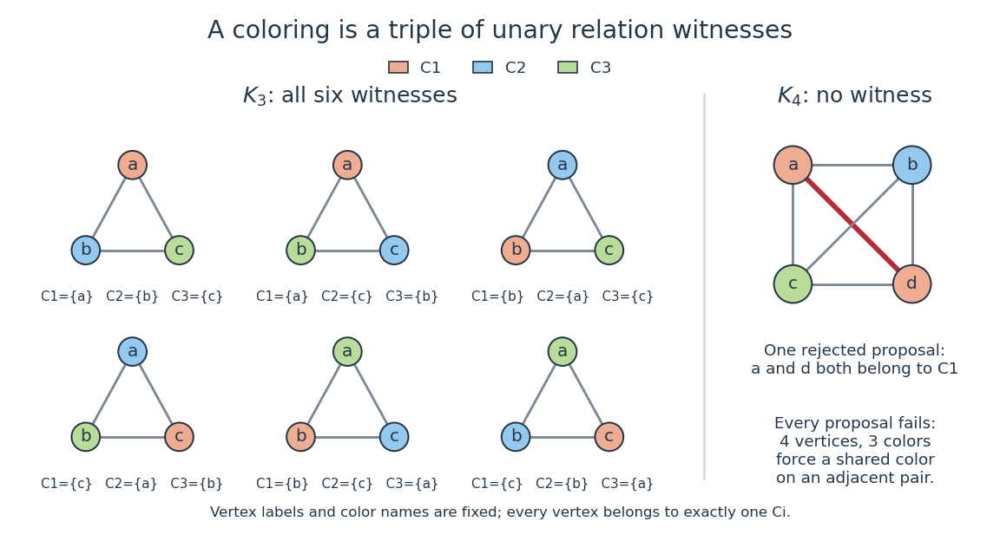

# Second-order encoding of three-colorability

↑ **Parent:** [Existential second-order logic](existential-second-order-logic.md)

Represent a finite [simple graph](simple-graph.md) by a domain $D$ of [vertices](vertex-graph-theory.md) and a symmetric, irreflexive [binary relation](binary-relation.md) $E$ for [graph adjacency](graph-adjacency.md). Introduce three unary [second-order relation variables](second-order-relation-variable.md) $C_1,C_2,C_3$, one for each fixed named colour. Define the following abbreviations for [first-order formulas](first-order-formula.md) in this expanded [first-order signature](first-order-signature.md):

$$
\begin{aligned}
\operatorname{One}(x)&:=(C_1(x)\lor C_2(x)\lor C_3(x))\\
&\quad\land\neg(C_1(x)\land C_2(x))\\
&\quad\land\neg(C_1(x)\land C_3(x))\\
&\quad\land\neg(C_2(x)\land C_3(x)),\\
\operatorname{Different}(x,y)&:=\neg(C_1(x)\land C_1(y))\\
&\quad\land\neg(C_2(x)\land C_2(y))\\
&\quad\land\neg(C_3(x)\land C_3(y)).
\end{aligned}
$$

Then the [existential second-order logic](existential-second-order-logic.md) sentence

$$
\Phi_3:=\exists C_1\exists C_2\exists C_3\,
\bigl(\forall x\,\operatorname{One}(x)\ \land\ \forall x\forall y\,(E(x,y)\to\operatorname{Different}(x,y))\bigr)
$$

asserts that every [vertex](vertex-graph-theory.md) receives exactly one of the three colours and adjacent [vertices](vertex-graph-theory.md) receive different colours. The first clause gives coverage and pairwise disjointness of the three [subsets](subset.md); the second makes each [subset](subset.md) an [independent set](independent-set-graph-theory.md). Empty colour classes are allowed, so $\Phi_3$ expresses existence of a [proper vertex coloring](proper-vertex-coloring.md) using at most three colours.

For the [complete graph](complete-graph.md) $K_3$ on the fixed [vertices](vertex-graph-theory.md) $a,b,c$, one witness is $C_1=\{a\}$, $C_2=\{b\}$, $C_3=\{c\}$. Each [vertex](vertex-graph-theory.md) satisfies exactly one predicate, and each of the three [edges](edge-of-a-graph.md) joins different predicates. Every valid witness assigns different colours to all three [vertices](vertex-graph-theory.md); there are $3!=6$ witness triples with these fixed [vertex](vertex-graph-theory.md) labels and fixed named colours. We are counting assignments, without identifying them under colour permutations or [graph isomorphisms](graph-isomorphism.md). For the [complete graph](complete-graph.md) $K_4$, the [pigeonhole principle](pigeonhole-principle.md) forces two of its four [vertices](vertex-graph-theory.md) to share a colour, and those [vertices](vertex-graph-theory.md) are adjacent. Thus it has no witness triple. This calculation illustrates a [complexity certificate](certificate-complexity.md) without requiring the reader to reconstruct a machine computation.

**[Figure 1](#image-six-relation-witnesses-for-the-labeled-complete-graph-k3-and-why-k4-has-none). Six relation witnesses for the labeled complete graph K3, and why K4 has none**.

Reproduce the diagram by running `python ../second-order-coloring-witness.py` from the repository's `_media` directory. The script checks all witness triples for these two [complete graphs](complete-graph.md) before drawing them.

## ↑ Ancestors (7)

1. [Existential second-order logic](existential-second-order-logic.md)
2. [Second-order logic](second-order-logic.md)
3. [Mathematical logic](mathematical-logic-split.md)
4. [Foundations of mathematics](foundations-of-mathematics-split.md)
5. [Area of mathematics](area-of-mathematics.md)
6. [Mathematics](mathematics-split.md)
7. [Codex Wiki](split.md)

## ← Incoming links (5)

- [Existential second-order logic](existential-second-order-logic.md)
- [Fagin's theorem](fagin-s-theorem.md)
- [Full semantics for second-order logic](full-semantics-for-second-order-logic.md)
- [Henkin semantics](henkin-semantics.md)
- [Second-order logic](second-order-logic.md)
