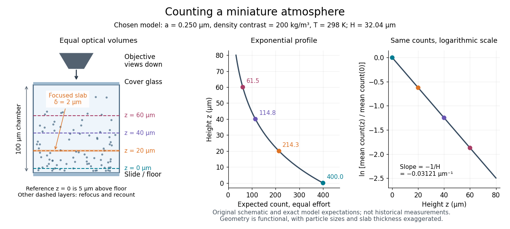

# Sedimentation scale height

↑ **Parent:** [Perrin sedimentation experiment](perrin-sedimentation-experiment.md)

Take identical rigid [spheres](sphere.md) of radius $a$, particle [density](density.md) $\rho_p$ and displaced [liquid](liquid.md) [density](density.md) $\rho_f$, at uniform absolute [temperature](temperature-split.md) $T$. Let $z$ increase upwards from a reference layer and write $\Delta\rho=\rho_p-\rho_f>0$. The [buoyancy](buoyancy.md) correction gives the effective gravitational [mass](mass.md)

$$
V=\frac{4\pi a^3}{3},\qquad m_b=(\rho_p-\rho_f)V,\qquad U(z)-U(0)=m_bgz.
$$

The actual grain [mass](mass.md) is $\rho_pV$; the displaced [liquid](liquid.md) subtracts $\rho_fV$ from the effective gravitational [mass](mass.md). In a dilute, noninteracting [particle suspension](suspension-chemistry-split.md), the [Boltzmann distribution](boltzmann-distribution.md) therefore gives

$$
\frac{n(z)}{n(0)}=\exp\!\left(-\frac{m_bgz}{k_BT}\right)=e^{-z/H},\qquad H=\frac{k_BT}{m_bg}=\frac{k_BT}{\Delta\rho Vg}.
$$

Here $n$ is [number density](number-density.md) and $k_B$ is the [Boltzmann constant](boltzmann-constant.md). Equivalently, the dilute [osmotic pressure](osmotic-pressure.md) $\Pi=nk_BT$ supports the grains above it: $d\Pi/dz=-nm_bg$. Dividing by $n$ and integrating yields the same [exponential function](exponential-function.md). No [dynamic viscosity](dynamic-viscosity-split.md) appears in this [equilibrium](equilibrium-point-of-a-dynamical-system.md) argument. If $\rho_p<\rho_f$, the population instead increases upwards; at equal [densities](density.md) this gravitational model predicts uniform $n$.

A [microscope](microscope.md) counts a finite optical slab, not an infinitesimal plane. For equal viewed area $A$ and slab thickness $\delta$, an ideal uniform detection window centred at $z$ gives

$$
\overline C(z)=A\int_{z-\delta/2}^{z+\delta/2}n(s)\,ds
=2AHn(0)\sinh\!\left(\frac{\delta}{2H}\right)e^{-z/H}.
$$

Thus equal optical volumes preserve the [exponential function](exponential-function.md) count ratio exactly, even for finite $\delta$, provided the windows lie wholly inside the accessible chamber and have the same detection response. Unequal depth response or overlapping a boundary can corrupt this inference. Repeated observations estimate the mean count; closely spaced visits need not be [independent](independent-random-variables.md) because grains remain in view.

For an original chosen model, set $a=0.250\,\mathrm{\mu m}$, $\rho_p=1200\,\mathrm{kg\,m^{-3}}$, $\rho_f=1000\,\mathrm{kg\,m^{-3}}$, $T=298\,\mathrm K$ and $g=9.81\,\mathrm{m\,s^{-2}}$. These are illustrative inputs, not [Jean Baptiste Perrin](jean-baptiste-perrin.md)'s measurements. Using $k_B=1.380649\times10^{-23}\,\mathrm{J\,K^{-1}}$ gives

$$
V\simeq6.5450\times10^{-20}\,\mathrm{m^3},\qquad m_b\simeq1.3090\times10^{-17}\,\mathrm{kg},\qquad H\simeq32.04\,\mathrm{\mu m}.
$$

If equal observation effort gives expected count $400$ in the reference layer, the expected counts $20$, $40$ and $60\,\mathrm{\mu m}$ higher are approximately $214.3$, $114.8$ and $61.49$. Fractions describe [expected values](expected-value-split.md) over observations, not fractional grains. Using the actual grain [mass](mass.md) instead of its [buoyancy](buoyancy.md)-corrected value would make the inferred [Avogadro constant](avogadro-constant.md) six times too small for these chosen [densities](density.md).

**[Figure 2](#image-counting-equal-optical-layers-in-a-chosen-colloidal-atmosphere). Counting equal optical layers in a chosen colloidal atmosphere**. Original functional schematic and calculated count profile; no historical data are plotted. The reference layer is $5\,\mathrm{\mu m}$ above the chamber floor. Refocusing selects successive horizontal layers; counts use equal optical volumes and equal observation effort. The [logarithm](logarithm.md) of the count ratio has [slope](slope.md) $-1/H$.

## ↑ Ancestors (8)

1. [Perrin sedimentation experiment](perrin-sedimentation-experiment.md)
2. [Brownian motion](brownian-motion-split.md)
3. [Stochastic process](stochastic-process-split.md)
4. [Probability theory](probability-theory-split.md)
5. [Probability and statistics](probability-and-statistics-split.md)
6. [Area of mathematics](area-of-mathematics.md)
7. [Mathematics](mathematics-split.md)
8. [Codex Wiki](split.md)

## ← Incoming links (5)

- [Avogadro constant from sedimentation and diffusion](avogadro-constant-from-sedimentation-and-diffusion.md)
- [Solution](past-exam-of-the-mphil-in-micro-and-nanotechnology-enterprise-course-of-the-university-of-cambridge/2023/paper-2/section-b/23/ii/solution.md)
- [Solution](past-exam-of-the-soft-condensed-matter-course-of-the-university-of-cambridge/2014/paper-1/4/solution.md)
- [Sedimentation-Brownian crossover radius](sedimentation-brownian-crossover-radius.md)
- [Wall hindrance in Brownian diffusion](wall-hindrance-in-brownian-diffusion.md)
