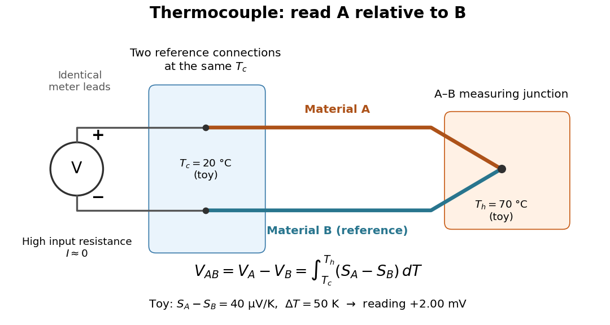
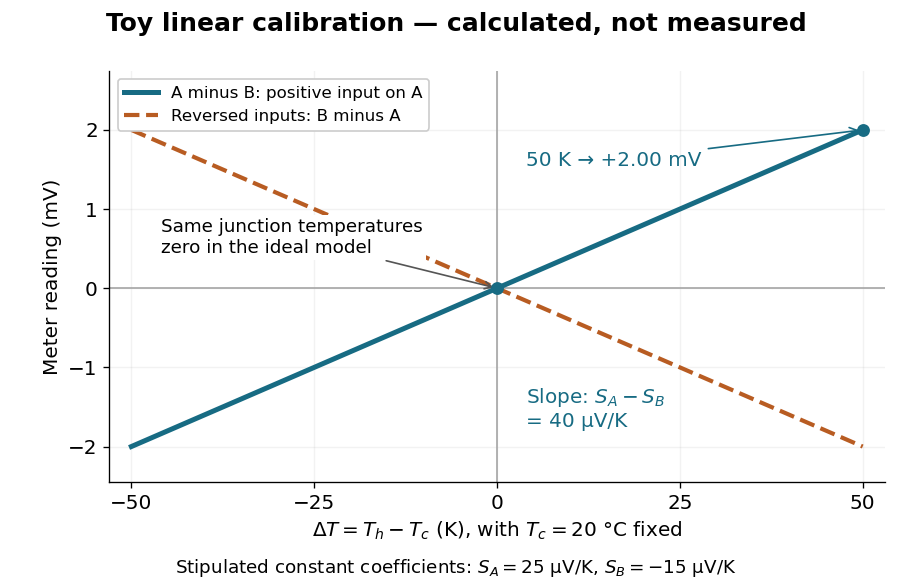

# Seebeck effect

↑ **Parent:** [Thermoelectric effect](thermoelectric-effect.md)

The [Seebeck effect](seebeck-effect.md) is the generation of a thermoelectric [electromotive force](electromotive-force.md) by a [temperature](temperature.md) difference. In a [thermocouple](thermocouple.md), two different homogeneous [electrical conductors](electrical-conductor.md) A and B connect a measuring junction at $T_h$ to two reference connections at a common $T_c$. With negligible [electric current](electric-current.md), the measured terminal voltage is determined by the difference of their [Seebeck coefficients](seebeck-coefficient.md). A hot junction alone does not specify the reading: the reference [temperature](temperature.md), the second material, and the terminal order matter.

**[Figure 1](#image-two-material-thermocouple-junction-temperatures-and-the-voltage-sign). Two-material thermocouple: junction temperatures and the voltage sign**. An idealized open-circuit [Seebeck effect](seebeck-effect.md) experiment. The A and B wires meet at the measuring junction; each reference connection meets an identical meter lead at the same $T_c$. The positive meter input connects to A. The shown $20\,{}^\circ\mathrm C$, $70\,{}^\circ\mathrm C$, and $+2\,\mathrm{mV}$ belong to the explicitly toy constant-[Seebeck coefficient](seebeck-coefficient.md) example below, not measured data.

For a motivating experiment, join one end of A to one end of B, insulating the wires elsewhere. Connect their free ends to identical meter leads at reference [temperature](temperature.md) $T_c$, for example in an ice-water [heat bath](heat-bath.md). A meter with input [electrical resistance](electrical-resistance.md) much larger than the [thermocouple](thermocouple.md)'s [electrical resistance](electrical-resistance.md) approximates an open circuit, meaning $I\approx0$. Keep the measuring junction in a separately controlled [heat bath](heat-bath.md) at $T_h$ and wait for stable junction [temperatures](temperature.md). Both reference connections must share $T_c$; identical leads with identical endpoint [temperatures](temperature.md) have cancelling thermoelectric contributions, allowing the meter to be elsewhere. [Marx, Link and Scott, Economic Assessment of the NIST Thermocouple Calibration Program (1997), §2.1](https://www.nist.gov/system/files/documents/director/planning/report97-1.pdf).

Define the reading as $V_{AB}=V_A-V_B$, with the positive input on the A reference terminal and the negative input on B. Use the [Seebeck coefficient](seebeck-coefficient.md) convention in which the voltage change along a homogeneous wire at zero [electric current](electric-current.md) is $dV=-S(T)\,dT$. Following the path from A at $T_c$ to the common junction at $T_h$, then back along B to $T_c$, gives

$$
V_{AB}(T_h,T_c)=\int_{T_c}^{T_h}\bigl[S_A(T)-S_B(T)\bigr]\,dT.
$$

This formula assumes homogeneous materials whose [Seebeck coefficients](seebeck-coefficient.md) depend only on the local [temperature](temperature.md), and no additional uncompensated lead contributions. Here voltage is the electrical transport voltage associated with [electrochemical potential](electrochemical-potential.md), rather than a direct measurement of an isolated equilibrium contact [electric potential](electric-potential.md).

Start with $T_h=T_c$, then increase $T_h$ while holding $T_c$ fixed and record $V_{AB}$ at each stable setting. In the ideal model the equal-[temperature](temperature.md) reading is zero. If $S_A-S_B>0$ throughout the interval, A reads positive when $T_h>T_c$. Exchanging meter inputs reverses the reading; exchanging the two junction [temperatures](temperature.md) reverses the oriented [integral](integral.md). Repeating the run with identical homogeneous materials gives zero because $S_A=S_B$. These controls test the stated model; a nonzero experimental baseline should be measured rather than silently removed by assuming it is zero.

For an explicitly toy linear example, stipulate constant [Seebeck coefficients](seebeck-coefficient.md) $S_A=25\,\mu\mathrm{V/K}$ and $S_B=-15\,\mu\mathrm{V/K}$. Choose reference [temperature](temperature.md) $T_c=20\,{}^\circ\mathrm C$ and measuring-junction [temperature](temperature.md) $T_h=70\,{}^\circ\mathrm C$. A [temperature](temperature.md) difference has the same numerical size in [kelvins](kelvin.md) and on the [degree Celsius](degree-celsius.md) scale, so

$$
S_A-S_B=40\,\mu\mathrm{V/K},\qquad \Delta T=50\,\mathrm K,
\qquad V_{AB}=(40\,\mu\mathrm{V/K})(50\,\mathrm K)=+2.00\,\mathrm{mV}.
$$

Swapping the inputs gives $-2.00\,\mathrm{mV}$. Bringing both junction regions to the same [temperature](temperature.md) gives zero. With [temperature](temperature.md)-dependent [Seebeck coefficients](seebeck-coefficient.md), shifting both junction [temperatures](temperature.md) equally while keeping their difference fixed can change the reading. No actual material pair is claimed to have the stipulated coefficients over this interval.

**[Figure 2](#image-toy-seebeck-effect-calibration-voltage-slope-and-reversed-inputs). Toy Seebeck effect calibration: voltage slope and reversed inputs**. Calculated lines, not measured data. The solid line is $V_{AB}=(40\,\mu\mathrm{V/K})\Delta T$; the dashed line shows the same device with reversed meter inputs. The [slope](slope.md) is the difference of the two [Seebeck coefficients](seebeck-coefficient.md), not either coefficient separately. The reference [temperature](temperature.md) is fixed at $20\,{}^\circ\mathrm C$; negative $\Delta T$ means the measuring junction is colder than the reference connections.

Real [thermocouples](thermocouple.md) need a calibrated voltage-versus-[temperature](temperature.md) relation: the constant-[Seebeck coefficient](seebeck-coefficient.md) approximation is useful only where the coefficient difference changes little. Wire inhomogeneity can make the result depend on where the [temperature gradient](temperature-gradient.md) lies, and reference connections at unequal or unknown [temperatures](temperature.md) introduce errors. An electronic reference correction uses a measured reference [temperature](temperature.md) in place of an ice bath. [Marx, Link and Scott (1997), §2.1: reference correction and wire homogeneity](https://www.nist.gov/system/files/documents/director/planning/report97-1.pdf). Burns and colleagues provide the standardized reference functions for common letter-designated [thermocouple](thermocouple.md) types; the toy line above is not a replacement for them. [Burns et al., Temperature-electromotive force reference functions and tables (1993), NIST Monograph 175](https://www.nist.gov/publications/temperature-electromotive-force-reference-functions-and-tables-letter-designated).

The historical experiment used a different detector. In his 1821–1823 investigations, Seebeck found that a closed [electrical circuit](electrical-circuit.md) of two dissimilar materials with junctions at different [temperatures](temperature.md) deflected a compass needle. The modern explanation is that thermoelectric [electromotive force](electromotive-force.md) drives an [electric current](electric-current.md), whose [magnetic field](magnetic-field.md) deflects the needle. The open-circuit experiment above detects voltage while drawing negligible [electric current](electric-current.md). The striking connection is that a thermal imbalance can become an electrical signal and then a magnetic response. [Northwestern thermoelectrics research group: Seebeck's compass experiment](https://thermoelectrics.matsci.northwestern.edu/thermoelectrics/history.html).

**Table of contents**

- [Seebeck coefficient](seebeck-coefficient.md)
- [Thermocouple](thermocouple.md)

## ↑ Ancestors (5)

1. [Thermoelectric effect](thermoelectric-effect.md)
2. [Electromagnetism](electromagnetism-split.md)
3. [Branches of physics](branches-of-physics.md)
4. [Physics](physics-split.md)
5. [Codex Wiki](split.md)

## ← Incoming links (4)

- [Solution](past-exam-of-the-mathematics-course-of-the-university-of-cambridge/2005/ii/paper-4/33b/solution.md)
- [Seebeck coefficient](seebeck-coefficient.md)
- [Seebeck effect](seebeck-effect.md)
- [Thermocouple](thermocouple.md)
