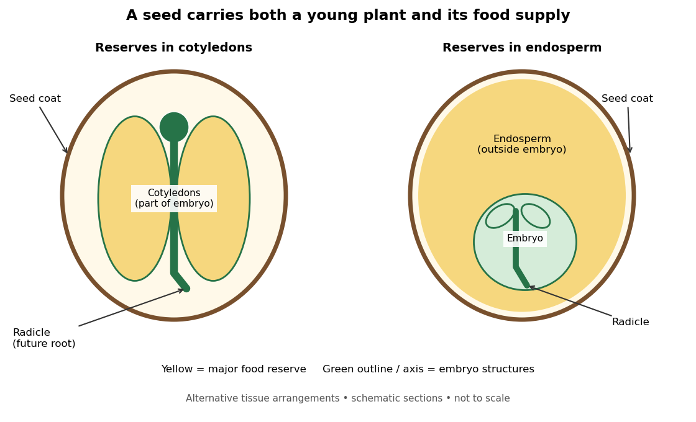

# Seed

↑ **Parent:** [Plant](plant.md)

A [seed](seed.md) packages a [plant embryo](plant-embryo.md), a [seed food reserve](seed-food-reserve.md) and a protective [seed coat](seed-coat.md). It is a living starting point for a new [plant](plant.md), not merely stored food. In a mature [pea](pea.md) [seed](seed.md), the large [cotyledons](cotyledon.md) hold reserves; other [seeds](seed.md) retain substantial [endosperm](endosperm.md). These are alternative arrangements, not successive [germination](germination.md) stages.[Biology 2e, §32.2 Development of the Seed, Figure 32.20 and the paragraph on pea cotyledons](biology-2e-by-mary-ann-clark-and-others.md)

**[Figure 10](#image-two-arrangements-of-plant-embryo-and-seed-food-reserve). Two arrangements of plant embryo and seed food reserve**. Original schematic sections, not microscope images or scale drawings. [Cotyledons](cotyledon.md) belong to the [plant embryo](plant-embryo.md); [endosperm](endosperm.md) is a distinct [plant tissue](plant-tissue.md).

A useful reading exercise is to identify both the future [plant](plant.md) and its initial food supply in each drawing. The large yellow area has the same role in both pictures, but it belongs to different [plant tissues](plant-tissue.md). Thus location and function alone do not establish tissue identity.

**Table of contents**

- [Seed vigor](seed-vigor.md)
- [Plant embryo](plant-embryo.md)
  - [Cotyledon](cotyledon.md)
  - [Radicle](radicle.md)
- [Seed coat](seed-coat.md)
- [Seed food reserve](seed-food-reserve.md)
- [Endosperm](endosperm.md)
- [Seedling](seedling.md)
- [Germination](germination.md)
  - [Seed imbibition](seed-imbibition.md)
  - [Seed dormancy](seed-dormancy.md)
  - [Seed viability](seed-viability.md)
  - [Lettuce red and far-red germination experiment](lettuce-red-and-far-red-germination-experiment.md)
  - [Germination assay](germination-assay.md)

## ↑ Ancestors (5)

1. [Plant](plant.md)
2. [Eukaryote](eukaryote.md)
3. [Organism](organism-split.md)
4. [Biology](biology-split.md)
5. [Codex Wiki](split.md)

## ← Incoming links (25)

- [Cellular respiration](cellular-respiration.md)
- [Double fertilization](double-fertilization.md)
- [Endosperm](endosperm.md)
- [Fern](fern.md)
- [Flower](flower.md)
- [Germination](germination.md)
- [Germination assay](germination-assay.md)
- [Independent assortment](independent-assortment.md)
- [Lettuce red and far-red germination experiment](lettuce-red-and-far-red-germination-experiment.md)
- [Ovule](ovule.md)
- [Solution](past-exam-of-the-genetics-course-of-the-university-of-cambridge/2024/paper-2/7/solution.md)
- [Solution](past-exam-of-the-plant-sciences-course-of-the-university-of-cambridge/2025/paper-plm3/4/solution.md)
- [Solution](past-exam-of-the-plant-sciences-course-of-the-university-of-cambridge/2025/paper-plm3/5/solution.md)
- [Pea seed respirometry](pea-seed-respirometry.md)
- [Plant embryo](plant-embryo.md)
- [Plant tissue](plant-tissue.md)
- [Pollen](pollen.md)
- [Pollen tube germination assay](pollen-tube-germination-assay.md)
- [Pollination](pollination.md)
- [Seed](seed.md)
- [Seed coat](seed-coat.md)
- [Seed dormancy](seed-dormancy.md)
- [Seed imbibition](seed-imbibition.md)
- [Seed plant](seed-plant.md)
- [Seed viability](seed-viability.md)
