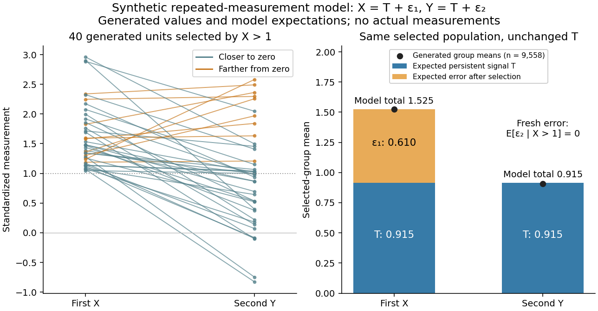

# Selection on an extreme first measurement

↑ **Parent:** [Gaussian regression toward the mean](gaussian-regression-toward-the-mean.md)

Select units with first reading $X>1$, keep that membership fixed, and measure the same units again. The first reading now has a [truncated normal distribution](truncated-normal-distribution.md). For a general finite threshold $a$, write $\phi$ for the [standard normal density](standard-normal-density.md) and $\Phi$ for the [standard normal distribution function](standard-normal-distribution-function.md). Since $\phi'(x)=-x\phi(x)$,

$$
\mathbb E[X\mid X>a]
=\frac{\int_a^\infty x\phi(x)\,dx}{1-\Phi(a)}
=\frac{\phi(a)}{1-\Phi(a)}.
$$

The [tower property](law-of-total-expectation.md) of [conditional expectation](conditional-expectation.md) lets us average the line $\mathbb E[Y\mid X]=0.6X$ over the selected group.[Theorem 4.1.13(ii), printed p. 212: nested conditioning](probability-theory-and-examples-fifth-edition-by-rick-durrett/4-1-conditional-expectation.md) At $a=1$ this gives

$$
\begin{aligned}
\mathbb P(X>1)&\approx0.158655,\\
\mathbb E[X\mid X>1]&\approx1.525135,\\
\mathbb E[Y\mid X>1]&=0.6\mathbb E[X\mid X>1]\approx0.915081,\\
\mathbb E[Y-X\mid X>1]&\approx-0.610054.
\end{aligned}
$$

The average second reading is below the selection threshold even though every selected first reading exceeded it. This is a group [expectation](expected-value-split.md); any finite generated group's [sample mean](sample-mean.md) fluctuates around it. Selecting again on $Y>1$ would define a different group and answer a different question.

The [latent variable](latent-variable-split.md) decomposition makes the apparent drop especially clear. Gaussian conditioning gives $\mathbb E[T\mid X=x]=0.6x$ and $\mathbb E[\varepsilon_1\mid X=x]=0.4x$. Thus

$$
\mathbb E[T\mid X>1]\approx0.915081,\qquad
\mathbb E[\varepsilon_1\mid X>1]\approx0.610054,\qquad
\mathbb E[\varepsilon_2\mid X>1]=0.
$$

The first [measurement error](measurement-error.md) has zero unconditional [mean](expected-value-split.md), but positive selected [mean](expected-value-split.md). The second [measurement error](measurement-error.md) stays centered because it is independent of selection on $X$. The persistent signal $T$ never changed.

**[Figure 8](#image-selection-captures-an-extreme-first-error-while-the-persistent-signal-stays-fixed). Selection captures an extreme first error while the persistent signal stays fixed**. Original synthetic repeated measurements, not actual measurements. Left: 40 generated units selected by $X>1$; orange trajectories move farther from zero. Right: analytic selected-group [expectations](expected-value-split.md) decompose the first and second readings into persistent [latent variable](latent-variable-split.md) $T$ and [measurement error](measurement-error.md). Black dots give generated group [sample means](sample-mean.md) after selecting from 60,000 synthetic units; their small departures from the bar totals reflect sampling variation. All selections use the first reading only.

## ↑ Ancestors (7)

1. [Gaussian regression toward the mean](gaussian-regression-toward-the-mean.md)
2. [Repeated-measurement latent signal model](repeated-measurement-latent-signal-model.md)
3. [Regression toward the mean](regression-toward-the-mean.md)
4. [Probability and statistics](probability-and-statistics-split.md)
5. [Area of mathematics](area-of-mathematics.md)
6. [Mathematics](mathematics-split.md)
7. [Codex Wiki](split.md)
