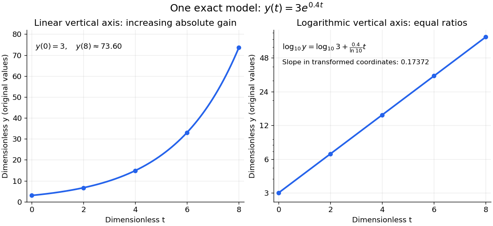

# Semi-log plot

↑ **Parent:** [Logarithmic scale](logarithmic-scale.md)  
ⓦ [Wiki](https://en.wikipedia.org/wiki/Semi-log_plot)

A [semi-log plot](semi-log-plot.md) uses a [logarithmic scale](logarithmic-scale.md) on one axis and a [linear scale](linear-scale.md) on the other. Which axis is logarithmic matters. Plotting $x$ against $\log y$ makes positive [exponential functions](exponential-function.md) appear as [straight lines](straight-line.md); plotting $\log x$ against $y$ instead makes an affine function of a [logarithm](logarithm.md) appear straight. The plotting operations change positions while retaining the original tick values.[Matplotlib 3.10.7 documentation; Matplotlib 3.10.7, Log scale: Convenience functions semilogx, semilogy, and loglog; distinction between horizontal and vertical logarithmic axes](matplotlib-3-10-7-documentation/log-scale.md)

Take the original dimensionless [mathematical model](mathematical-model.md) $y(t)=3e^{0.4t}$ for $0\leq t\leq8$. It has [exponential growth](exponential-growth.md), with $y(0)=3$, $y(4)\approx14.8591$, and $y(8)\approx73.5976$. Taking a base-ten [logarithm](logarithm.md) gives

$$
\log_{10}y=\log_{10}3+\frac{0.4}{\ln10}t.
$$

The [slope](slope.md) in these transformed positions is $0.4/\ln10\approx0.173718$, although the original relative growth rate $y'/y$ is $0.4$. Equal steps of two in $t$ multiply $y$ by $e^{0.8}\approx2.22554$. The corresponding ordinary gains increase, so the left plot bends while the right plot is straight.

**[Figure 10](#image-the-same-exponential-growth-model-bends-on-a-linear-scale-and-is-straight-on-a-semi-log-plot-with-a-logarithmic-vertical-axis). The same exponential growth model bends on a linear scale and is straight on a semi-log plot with a logarithmic vertical axis**. Original exact [mathematical model](mathematical-model.md) $y(t)=3e^{0.4t}$, not measurements. Both panels show identical values at the same $t$. Right-hand tick labels retain the original $y$ values, with equal gaps for each doubling. The stated [slope](slope.md) is for $(t,\log_{10}y)$, not the original [derivative](derivative.md) $y'$.

One practical use is checking a proposed [exponential distribution](exponential-distribution.md) for failure times. For rate $\lambda>0$ and $t\geq0$, its [cumulative distribution function](cumulative-distribution-function.md) is $F(t)=1-e^{-\lambda t}$, so the reciprocal [survival function](survival-function.md) $y=1/[1-F(t)]$ satisfies $\log_{10}y=\lambda t/\ln10$. Estimated [probabilities](probability.md) can therefore be placed on a logarithmic vertical axis and compared with a [straight line](straight-line.md). Agreement supports compatibility with the chosen [statistical model](statistical-model-split.md); a roughly straight finite sample does not establish a unique physical mechanism.[NIST and SEMATECH e-Handbook of Statistical Methods, §8.2.2.1 Probability plotting: Exponential Model, logarithmic vertical-axis transformation and interpretation of approximate straightness](nist-and-sematech-e-handbook-of-statistical-methods/8-2-2-1-probability-plotting.md)

## ↑ Ancestors (9)

1. [Logarithmic scale](logarithmic-scale.md)
2. [Logarithm](logarithm.md)
3. [Exponential function](exponential-function.md)
4. [Calculus](calculus-split.md)
5. [Real analysis](real-analysis-split.md)
6. [Analysis](analysis-split.md)
7. [Area of mathematics](area-of-mathematics.md)
8. [Mathematics](mathematics-split.md)
9. [Codex Wiki](split.md)

## ← Incoming links (2)

- [Log-log plot](log-log-plot.md)
- [Semi-log plot](semi-log-plot.md)
