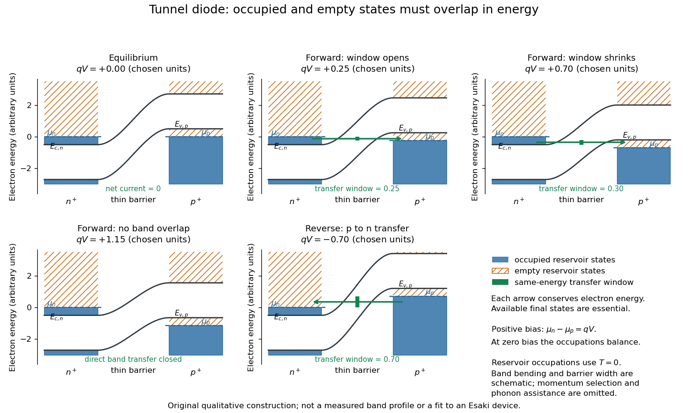
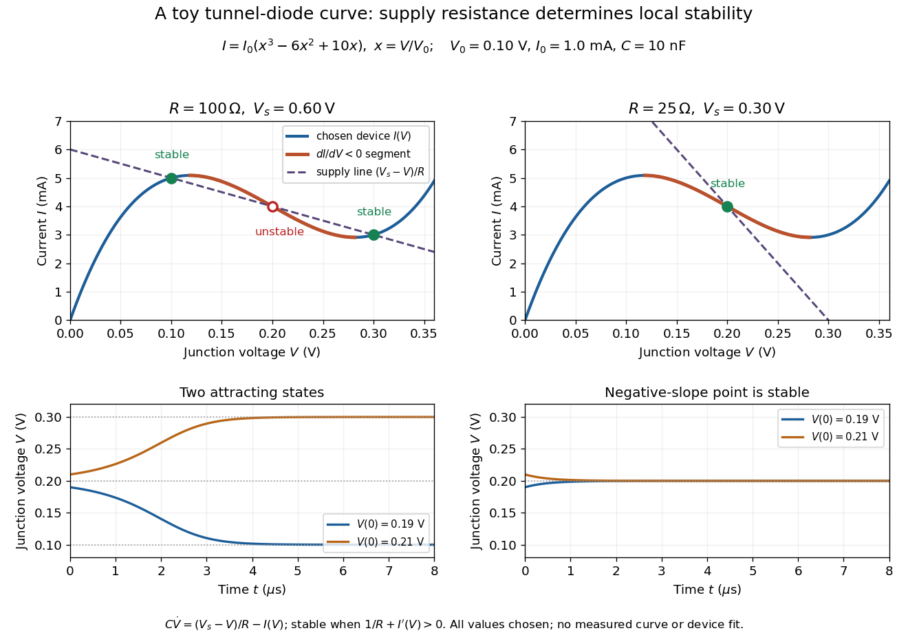
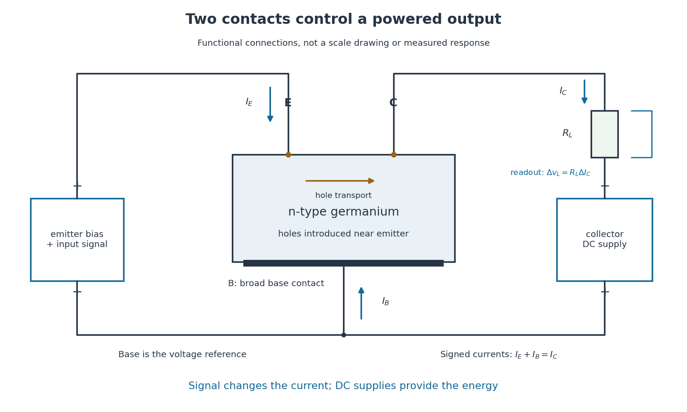
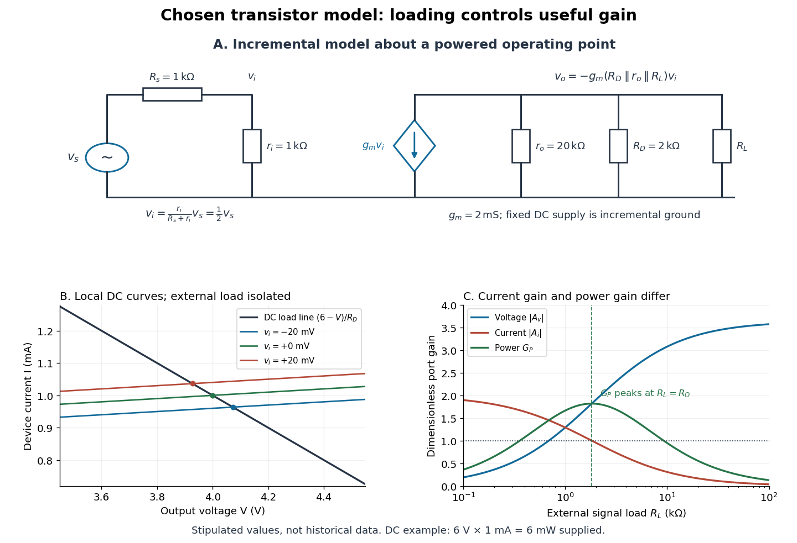
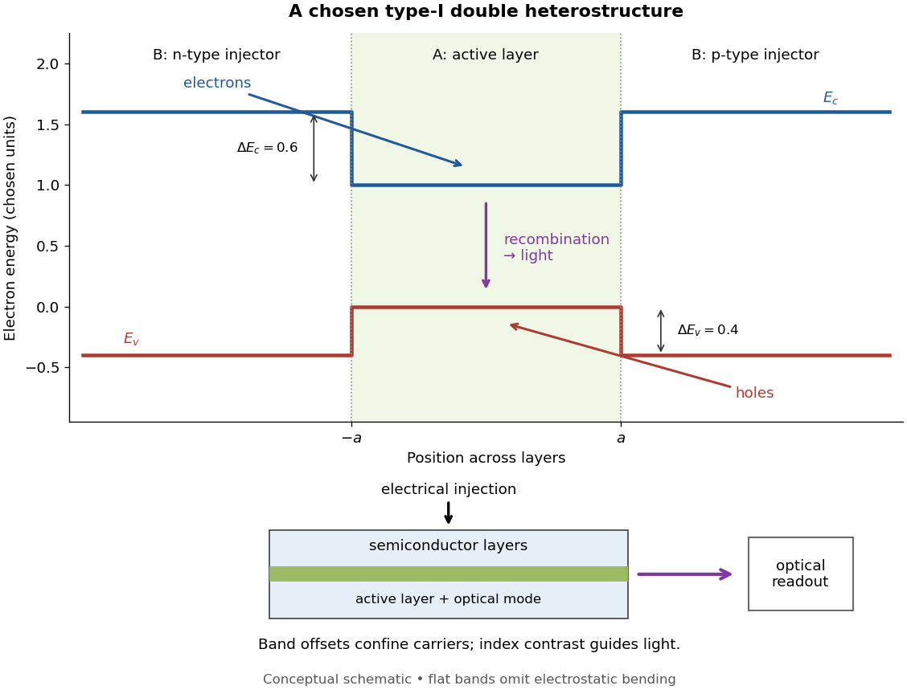
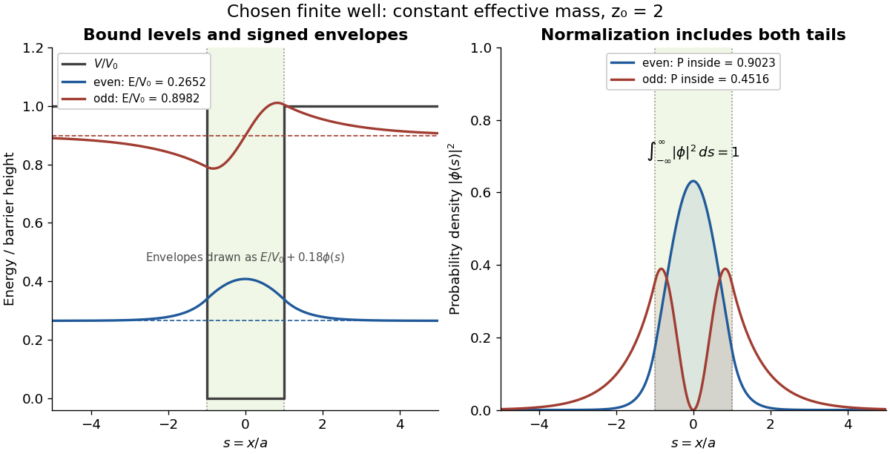

# Semiconductor

↑ **Parent:** [Physics](physics.md)  
ⓦ [Wiki](https://en.wikipedia.org/wiki/Semiconductor)

A semiconductor has an electronic [band gap](bloch-s-theorem.md#band-gap) and a conductivity strongly affected by temperature, impurities and carrier injection. Optical absorption can create mobile electrons and holes, enabling a [photodiode](optical-instrument.md#photodiode).

The useful feature of a [semiconductor](semiconductor.md) is that its [charge carrier](electric-charge.md#charge-carrier) population can be controlled. [Semiconductor doping](#semiconductor-doping) changes the supply of mobile [electrons](physics.md#electron) or [electron holes](quantum-mechanics.md#electron-hole); [carrier injection](#carrier-injection) changes their population away from [thermal equilibrium](thermal-equilibrium.md). A [transistor](#transistor) turns that control into an [electronic amplifier](electrical-circuit.md#electronic-amplifier): a small input [signal](electrical-engineering.md#signal) controls a larger flow of supplied [energy](energy.md).

For a uniform [semiconductor](semiconductor.md) in a weak [electric field](electric-field.md), a simple drift model writes its [electrical conductivity](electric-charge.md#electrical-conductivity) as

$$
\sigma=q(n\mu_n+p\mu_p).
$$

Here $q>0$ is the [elementary charge](electric-charge.md#elementary-charge), $n,p$ are the [number densities](statistical-physics.md#number-density) of mobile [electrons](physics.md#electron) and [electron holes](quantum-mechanics.md#electron-hole), and $\mu_n,\mu_p$ their positive [charge carrier mobilities](electric-charge.md#charge-carrier-mobility). The two contributions add because opposite [electric charges](electric-charge.md) drift in opposite directions and therefore carry [electric current](electric-charge.md#electric-current) in the same direction. This model assumes fixed [temperature](temperature.md) and mobilities and omits [diffusion](thermodynamics.md#diffusion) from density gradients.

An original dimensionless example isolates the effect of [carrier injection](#carrier-injection). Suppose initially $p\ll n=n_0$ and $\mu_n=2\mu_p$. Adding equal excess populations $\Delta n=\Delta p=0.1n_0$ gives $\Delta\sigma/\sigma_0=0.15$, even though the added [electron holes](quantum-mechanics.md#electron-hole) remain a [minority carrier](#minority-carrier) population. A [semiconductor](semiconductor.md) can respond strongly to a small injected population without changing its underlying [band gap](bloch-s-theorem.md#band-gap).

**Table of contents**

- [III-V semiconductor](#iii-v-semiconductor)
  - [Zone-centre bands of a zinc-blende III-V semiconductor](#zone-centre-bands-of-a-zinc-blende-iii-v-semiconductor)
- [Organic semiconductor](#organic-semiconductor)
  - [Optical absorption in organic semiconductors](#optical-absorption-in-organic-semiconductors)
  - [PCBM](#pcbm)
  - [Poly(3-hexylthiophene)](#poly-3-hexylthiophene)
- [Surface recombination](#surface-recombination)
- [Surface passivation](#surface-passivation)
- [Ohmic contact](#ohmic-contact)
  - [Transmission line contact measurement](#transmission-line-contact-measurement)
  - [Specific contact resistivity](#specific-contact-resistivity)
- [Schottky barrier](#schottky-barrier)
- [Nondegenerate semiconductor](#nondegenerate-semiconductor)
- [Photoconductivity](#photoconductivity)
- [Gallium phosphide](#gallium-phosphide)
- [Indium antimonide](#indium-antimonide)
- [Indium arsenide](#indium-arsenide)
- [Quantum dot](#quantum-dot)
  - [Electrostatically defined quantum dot](#electrostatically-defined-quantum-dot)
    - [Spin qubit in a gated quantum dot](#spin-qubit-in-a-gated-quantum-dot)
    - [Double quantum dot](#double-quantum-dot)
      - [Charge qubit in a double dot](#charge-qubit-in-a-double-dot)
      - [Exchange interaction in a double quantum dot](#exchange-interaction-in-a-double-quantum-dot)
    - [Spin-to-charge conversion](#spin-to-charge-conversion)
      - [Tunnel-rate-selective spin readout](#tunnel-rate-selective-spin-readout)
        - [Optimal tunnel-rate readout time](#optimal-tunnel-rate-readout-time)
      - [Pauli spin blockade](#pauli-spin-blockade)
        - [Magnetically driven spin-blockade lifting](#magnetically-driven-spin-blockade-lifting)
      - [Energy-selective spin readout](#energy-selective-spin-readout)
    - [Quantum-dot charge sensing](#quantum-dot-charge-sensing)
  - [Fock-Darwin spectrum](#fock-darwin-spectrum)
  - [Core-shell semiconductor nanocrystal](#core-shell-semiconductor-nanocrystal)
  - [Addition energy](#addition-energy)
  - [Quantum dot shell closure](#quantum-dot-shell-closure)
  - [Self-assembled InAs quantum-dot single-photon source](#self-assembled-inas-quantum-dot-single-photon-source)
- [Effective density of states](#effective-density-of-states)
- [Intrinsic semiconductor](#intrinsic-semiconductor)
  - [Constant-density-of-states intrinsic semiconductor](#constant-density-of-states-intrinsic-semiconductor)
  - [Intrinsic Fermi level](#intrinsic-fermi-level)
  - [Intrinsic-semiconductor chemical potential](#intrinsic-semiconductor-chemical-potential)
  - [Intrinsic carrier concentration](#intrinsic-carrier-concentration)
    - [Intrinsic carrier extrapolation across a crossover](#intrinsic-carrier-extrapolation-across-a-crossover)
    - [Band-gap extraction from intrinsic carrier activation](#band-gap-extraction-from-intrinsic-carrier-activation)
    - [Semiconductor mass-action law](#semiconductor-mass-action-law)
      - [Pauli reduction of the pinned-edge mass-action product](#pauli-reduction-of-the-pinned-edge-mass-action-product)
      - [Spin and valley factors in the semiconductor mass-action constant](#spin-and-valley-factors-in-the-semiconductor-mass-action-constant)
- [Homojunction](#homojunction)
- [Wide-bandgap semiconductor](#wide-bandgap-semiconductor)
- [Nonradiative recombination](#nonradiative-recombination)
  - [Shockley-Read-Hall recombination](#shockley-read-hall-recombination)
  - [Trap-assisted electron-hole recombination](#trap-assisted-electron-hole-recombination)
- [Acceptor impurity](#acceptor-impurity)
  - [Hydrogenic acceptor state](#hydrogenic-acceptor-state)
  - [Hydrogen passivation of magnesium acceptors in gallium nitride](#hydrogen-passivation-of-magnesium-acceptors-in-gallium-nitride)
- [Donor impurity](#donor-impurity)
  - [Two-level donor occupancy](#two-level-donor-occupancy)
  - [Effective Bohr radius of a hydrogenic donor](#effective-bohr-radius-of-a-hydrogenic-donor)
  - [Donor-state overlap estimate](#donor-state-overlap-estimate)
  - [Hydrogenic donor state](#hydrogenic-donor-state)
- [Mercury cadmium telluride](#mercury-cadmium-telluride)
- [P-n junction](#p-n-junction)
  - [Linearly graded p-n junction](#linearly-graded-p-n-junction)
    - [Linearly graded junction capacitance](#linearly-graded-junction-capacitance)
    - [Linearly graded junction depletion width](#linearly-graded-junction-depletion-width)
  - [Built-in potential](#built-in-potential)
  - [Tunnel diode](#tunnel-diode)
    - [Esaki tunnel-diode experiment](#esaki-tunnel-diode-experiment)
    - [Tunnel-diode load-line stability](#tunnel-diode-load-line-stability)
  - [Depletion region](#depletion-region)
    - [Depletion-region generation current](#depletion-region-generation-current)
    - [Depletion approximation](#depletion-approximation)
      - [Abrupt-junction depletion width and capacitance](#abrupt-junction-depletion-width-and-capacitance)
      - [Charge and carrier density of an abrupt p-n junction](#charge-and-carrier-density-of-an-abrupt-p-n-junction)
    - [Junction capacitance](#junction-capacitance)
      - [Full-depletion capacitance of a symmetric junction slab](#full-depletion-capacitance-of-a-symmetric-junction-slab)
- [Semiconductor doping](#semiconductor-doping)
  - [Degeneracy test for a fully ionized light-mass donor gas](#degeneracy-test-for-a-fully-ionized-light-mass-donor-gas)
  - [Semiconductor carrier freeze-out](#semiconductor-carrier-freeze-out)
  - [Ion implantation](#ion-implantation)
  - [Modulation doping](#modulation-doping)
    - [Modulation-doped GaAs-AlGaAs electron gas](#modulation-doped-gaas-algaas-electron-gas)
  - [Compensated semiconductor](#compensated-semiconductor)
  - [Amphoteric dopant](#amphoteric-dopant)
  - [Charge neutrality with partial donor ionization](#charge-neutrality-with-partial-donor-ionization)
    - [Full ionization versus isolated donor occupation](#full-ionization-versus-isolated-donor-occupation)
  - [Substitutional semiconductor doping](#substitutional-semiconductor-doping)
  - [Conductivity ratio of doped and intrinsic semiconductors](#conductivity-ratio-of-doped-and-intrinsic-semiconductors)
  - [Dopant freeze-out](#dopant-freeze-out)
  - [Impurity level](#impurity-level)
    - [Hydrogenic impurity absorption](#hydrogenic-impurity-absorption)
  - [N-type semiconductor](#n-type-semiconductor)
  - [P-type semiconductor](#p-type-semiconductor)
  - [Degenerate semiconductor](#degenerate-semiconductor)
- [Minority carrier](#minority-carrier)
  - [Carrier injection](#carrier-injection)
- [Surface state](#surface-state)
  - [Image-potential state](#image-potential-state)
  - [Shockley surface state](#shockley-surface-state)
  - [Band bending](#band-bending)
    - [Semiconductor inversion layer](#semiconductor-inversion-layer)
      - [MOS inversion threshold](#mos-inversion-threshold)
- [Transistor](#transistor)
  - [Single-electron transistor](#single-electron-transistor)
  - [Field-effect transistor](#field-effect-transistor)
    - [Thin-film transistor](#thin-film-transistor)
    - [Junction field-effect transistor](#junction-field-effect-transistor)
      - [Pinch-off in a junction field-effect transistor](#pinch-off-in-a-junction-field-effect-transistor)
    - [MOSFET](#mosfet)
      - [Long-channel MOSFET current law](#long-channel-mosfet-current-law)
      - [Gate-to-substrate Fermi-level difference](#gate-to-substrate-fermi-level-difference)
      - [CMOS](#cmos)
        - [CMOS inverter](#cmos-inverter)
  - [Point-contact transistor](#point-contact-transistor)
    - [Bardeen-Brattain point-contact transistor experiment](#bardeen-brattain-point-contact-transistor-experiment)
  - [Bipolar junction transistor](#bipolar-junction-transistor)
    - [Shockley junction transistor proposal](#shockley-junction-transistor-proposal)
  - [Transistor small-signal amplifier](#transistor-small-signal-amplifier)
- [Semiconductor device](#semiconductor-device)
  - [High-electron-mobility transistor](#high-electron-mobility-transistor)
- [Semiconductor heterostructure](#semiconductor-heterostructure)
  - [Lattice mismatch](#lattice-mismatch)
  - [Epitaxial buffer layer](#epitaxial-buffer-layer)
  - [Heterojunction](#heterojunction)
    - [Type-II band alignment](#type-ii-band-alignment)
    - [Band offset](#band-offset)
    - [Type-I band alignment](#type-i-band-alignment)
  - [Double heterostructure](#double-heterostructure)
    - [Double heterostructure laser](#double-heterostructure-laser)
      - [Continuous double heterostructure laser experiment](#continuous-double-heterostructure-laser-experiment)
  - [Quantum well](#quantum-well)
    - [Thermal occupation of a quantum well](#thermal-occupation-of-a-quantum-well)
    - [Quantum-confined Stark effect](#quantum-confined-stark-effect)
    - [Quantum-well interband threshold](#quantum-well-interband-threshold)
    - [Infinite-well interband selection rule](#infinite-well-interband-selection-rule)
    - [Envelope function approximation](#envelope-function-approximation)
    - [Finite-well confinement in a semiconductor heterostructure](#finite-well-confinement-in-a-semiconductor-heterostructure)

## III-V semiconductor

↑ **Parent:** [Semiconductor](semiconductor.md)

A compound semiconductor built from group-III and group-V elements, such as [gallium arsenide](chemical-substance.md#gallium-arsenide). Many common members have a [zinc blende structure](physical-chemistry.md#zinc-blende-structure), while other materials or growth conditions give a [wurtzite structure](physical-chemistry.md#wurtzite). The chemical family alone does not fix a direct rather than indirect gap or a particular band ordering.

### Zone-centre bands of a zinc-blende III-V semiconductor

↑ **Parent:** [III-V semiconductor](#iii-v-semiconductor)

A common unstrained cubic III-V band ordering consists of an s-like $\Gamma_{6c}$ conduction doublet, a p-like $\Gamma_{8v}$ quartet and a lower spin-orbit split-off $\Gamma_{7v}$ doublet. In the cubic limit the quartet gives [heavy-hole and light-hole bands](quantum-mechanics.md#heavy-hole-and-light-hole-bands) that meet at the [Gamma point](bloch-s-theorem.md#gamma-point); different curvatures and direction-dependent mixing distinguish them away from it. The [split-off valence band](quantum-mechanics.md#split-off-valence-band) is separated by $\Delta_{\rm so}$. This common ordering is a model to check against the actual material, not a consequence of chemical stoichiometry alone.

## Organic semiconductor

↑ **Parent:** [Semiconductor](semiconductor.md)

An organic solid supporting electronic charge transport; conjugation, intermolecular packing and disorder influence its properties.

### Optical absorption in organic semiconductors

↑ **Parent:** [Organic semiconductor](#organic-semiconductor)

Molecular excitations in [organic semiconductors](#organic-semiconductor) often retain strong local character. Weak screening supports [Frenkel excitons](quantum-mechanics.md#frenkel-exciton) or intermolecular charge-transfer admixtures, so a photon can create a bound neutral excitation rather than free carriers. Transition dipoles, [spin selection rules](atomic-physics.md#spin-selection-rule), molecular packing and [Franck-Condon factors](atomic-physics.md#franck-condon-factor) set the bright spectral features. Disorder and thermal vibrations broaden them. Electronic overlap can also produce more delocalized excitons; the molecular limit is a useful model, not a definition covering every organic solid.

### PCBM

↑ **Parent:** [Organic semiconductor](#organic-semiconductor)

A soluble fullerene derivative, commonly the C60-based phenyl-C61-butyric acid methyl ester, used as an electron acceptor in organic photovoltaic blends. Different fullerene cage sizes give related derivatives.

<h3 id="poly-3-hexylthiophene">Poly(3-hexylthiophene)</h3>

↑ **Parent:** [Organic semiconductor](#organic-semiconductor)

A conjugated polymer with hexyl-substituted thiophene repeat units, often used as a model electron-donor [semiconductor](semiconductor.md). Regioregularity and packing influence its optical and transport response.

## Surface recombination

↑ **Parent:** [Semiconductor](semiconductor.md)

Recombination of charge carriers through surface or interface states. Surface passivation and suitable wider-band-gap window or field layers can reduce minority-carrier losses in a photovoltaic device.

## Surface passivation

↑ **Parent:** [Semiconductor](semiconductor.md)

Reduction of electronically active surface states or of minority-carrier access to them. Chemical bond termination and electrostatic field effects can both suppress surface recombination.

## Ohmic contact

↑ **Parent:** [Semiconductor](semiconductor.md)

A contact with approximately linear, nonrectifying current–voltage behavior and suitably low contact resistance in its operating range.

### Transmission line contact measurement

↑ **Parent:** [Ohmic contact](#ohmic-contact)

A pad-spacing method separating contact and sheet resistance. For uniform ohmic contacts, $R(d)=2R_c+R_\square d/W$; the transfer length is $L_T=\sqrt{\rho_c/R_\square}$. A rectifying Schottky junction requires bias-dependent analysis.

### Specific contact resistivity

↑ **Parent:** [Ohmic contact](#ohmic-contact)

An area-normalized interface resistance, $\rho_c$ in resistance times area. For nonlinear contacts specify the bias-dependent differential quantity.

## Schottky barrier

↑ **Parent:** [Semiconductor](semiconductor.md)

An energy barrier at a metal–semiconductor contact. Depletion width and tunneling depend on doping; interface states can limit simple work-function predictions.

## Nondegenerate semiconductor

↑ **Parent:** [Semiconductor](semiconductor.md)

A carrier regime in which conduction electrons and valence holes are dilute enough to use Boltzmann approximations to Fermi-Dirac occupations. Typically $E_c-\mu\gg k_BT$ and $\mu-E_v\gg k_BT$ are required for both species.

## Photoconductivity

↑ **Parent:** [Semiconductor](semiconductor.md)

An increase of electrical conductivity due to light-generated mobile carriers. Generation, recombination, trapping and mobility determine the observable response.

## Gallium phosphide

↑ **Parent:** [Semiconductor](semiconductor.md)  
ⓦ [Wiki](https://en.wikipedia.org/wiki/Gallium_phosphide)

## Indium antimonide

↑ **Parent:** [Semiconductor](semiconductor.md)  
ⓦ [Wiki](https://en.wikipedia.org/wiki/Indium_antimonide)

[Indium antimonide](#indium-antimonide) is a narrow-gap [semiconductor](semiconductor.md) formed from [indium](chemical-substance.md#indium) and [antimony](chemical-substance.md#antimony).

## Indium arsenide

↑ **Parent:** [Semiconductor](semiconductor.md)

Indium arsenide, InAs, is a III-V [semiconductor](semiconductor.md). An InAs island in a larger-gap host can provide [quantum confinement](quantum-mechanics.md#quantum-confinement) for [electrons](physics.md#electron) and [electron holes](quantum-mechanics.md#electron-hole). The optical transition energy of a strained, confined island is not simply the bulk material's [band gap](bloch-s-theorem.md#band-gap).

## Quantum dot

↑ **Parent:** [Semiconductor](semiconductor.md)

A [quantum dot](#quantum-dot) confines [electrons](physics.md#electron) and [electron holes](quantum-mechanics.md#electron-hole) in all three spatial directions, producing discrete [energy levels](quantum-mechanics.md#energy-level). A [semiconductor](semiconductor.md) island surrounded by a larger-[band gap](bloch-s-theorem.md#band-gap) material is one realization. Its optical excitation and [electron-hole recombination](quantum-mechanics.md#electron-hole-recombination) depend on confinement, [Coulomb interactions](electrostatics.md#coulomb-interaction) and [electric-dipole selection rules](quantum-mechanics.md#electric-dipole-selection-rule).

### Electrostatically defined quantum dot

↑ **Parent:** [Quantum dot](#quantum-dot)

A small electron island confined laterally by depletion gates in an already vertically confined [two-dimensional electron gas](quantum-ideal-gas-statistics.md#two-dimensional-electron-gas). Tunnel barriers couple it to reservoirs, and a plunger gate tunes charge occupation. [Coulomb blockade](quantum-mechanics.md#coulomb-blockade) and orbital confinement resolve individual electron additions.

#### Spin qubit in a gated quantum dot

↑ **Parent:** [Electrostatically defined quantum dot](#electrostatically-defined-quantum-dot)

A single confined [electron](physics.md#electron)'s two [spin](angular-momentum-operator.md#spin) states form a [qubit](quantum-system.md#qubit) when initialization, coherent rotations and measurement are controlled. Local driving rotates one [spin](angular-momentum-operator.md#spin); gate-controlled exchange can entangle neighboring dot [spins](angular-momentum-operator.md#spin). [Spin-to-charge conversion](#spin-to-charge-conversion) permits electrical readout. Observing charge blockade alone does not demonstrate coherent [qubit](quantum-system.md#qubit) operation.

#### Double quantum dot

↑ **Parent:** [Electrostatically defined quantum dot](#electrostatically-defined-quantum-dot)

Two capacitively and tunnel-coupled electron islands with separately tunable occupations. Detuning controls which dot holds an electron and whether two-electron charge states such as $(1,1)$ and $(0,2)$ are accessible.

##### Charge qubit in a double dot

↑ **Parent:** [Double quantum dot](#double-quantum-dot)

A single [electron](physics.md#electron) shared by two dots has a left/right charge basis. In that basis, a two-level model is $H=(\varepsilon\sigma_z+2t_c\sigma_x)/2$, where detuning sets the energy imbalance and tunnelling mixes the states. Electrical control and charge sensing are direct, but electric-potential fluctuations also couple strongly to the encoded information.

##### Exchange interaction in a double quantum dot

↑ **Parent:** [Double quantum dot](#double-quantum-dot)

An effective coupling that separates the two-electron [singlet state](angular-momentum-operator.md#singlet-state) and [triplet states](angular-momentum-operator.md#spin-one-half-triplet-state) by energy $J$. For a symmetric two-site Hubbard model with weak tunnelling $t_c$ and charging cost $U$, $J\simeq4t_c^2/U$. Gate-controlled detuning and tunnelling change the interaction; the simple expression does not hold at arbitrary detuning or strong charge hybridization.

#### Spin-to-charge conversion

↑ **Parent:** [Electrostatically defined quantum dot](#electrostatically-defined-quantum-dot)

A measurement method in which spin-dependent tunnelling or allowed charge transfer maps a spin outcome onto a distinguishable dot charge state. [Quantum-dot charge sensing](#quantum-dot-charge-sensing) then records that charge. The measurement axis or singlet/triplet observable must be specified.

##### Tunnel-rate-selective spin readout

↑ **Parent:** [Spin-to-charge conversion](#spin-to-charge-conversion)

Map states with unequal escape rates $\Gamma_f\gg\Gamma_s$ onto distinct charge outcomes after an interval between their characteristic escape times. Both removal energies can lie above the reservoir [chemical potential](chemical-potential.md), so their splitting need not be thermally resolved. A useful rate difference must have a physical origin: a demonstrated single-dot example uses a two-electron [singlet state](angular-momentum-operator.md#singlet-state) and [triplet state](angular-momentum-operator.md#spin-one-half-triplet-state) with different occupied orbitals. A bare single-electron Zeeman pair in the same orbital does not automatically provide the required rate contrast.[pp. 1–2, Figs. 1–2](physics-bibliography.md#single-shot-readout-of-electron-spin-states-in-a-quantum-dot-using-spin-dependent-tunnel-rates-by-r-hanson-and-others)

###### Optimal tunnel-rate readout time

↑ **Parent:** [Tunnel-rate-selective spin readout](#tunnel-rate-selective-spin-readout)

For independent exponential escape, equal prior [probabilities](probability-theory.md#probability) and no state relaxation, the mean classification error is $P_e(\tau)=[e^{-\Gamma_f\tau}+1-e^{-\Gamma_s\tau}]/2$. Setting its derivative to zero gives the displayed interval. The error increases both when the fast state is not given enough time to escape and when the slow state is given too much. Detector bandwidth, relaxation and reloading require an expanded measurement model.

##### Pauli spin blockade

↑ **Parent:** [Spin-to-charge conversion](#spin-to-charge-conversion)

Suppression of charge transfer by spin symmetry and the [Pauli exclusion principle](tensor-product-of-quantum-systems.md#pauli-exclusion-principle). For a [double quantum dot](#double-quantum-dot), a $(1,1)$ [singlet state](angular-momentum-operator.md#singlet-state) can enter the lowest $(0,2)$ singlet, whereas a $(1,1)$ [triplet state](angular-momentum-operator.md#spin-one-half-triplet-state) is blocked if the required $(0,2)$ triplet lies above the accessible energy window. Spin mixing or relaxation can lift blockade.

###### Magnetically driven spin-blockade lifting

↑ **Parent:** [Pauli spin blockade](#pauli-spin-blockade)

A resonantly driven local electron-spin rotation can give a blocked two-dot triplet a singlet component, allowing spin-conserving charge transfer to a lowest-orbital doubly occupied dot. A common rotation of two perfectly identical [spins](angular-momentum-operator.md#spin) does not mix singlet and triplet sectors, so relative [spin](angular-momentum-operator.md#spin) rotation or an additional mixing mechanism is essential. Leakage-current spectroscopy tests resonant lifting; pulse-duration oscillations add evidence for coherent control.

##### Energy-selective spin readout

↑ **Parent:** [Spin-to-charge conversion](#spin-to-charge-conversion)

Place the reservoir chemical potential between the lower and higher Zeeman-split one-electron dot levels. The excited state can leave while the ground state remains trapped; a time-resolved charge sensor detects the temporary empty state. Thermal errors, missed fast tunnelling and relaxation before escape limit fidelity.

#### Quantum-dot charge sensing

↑ **Parent:** [Electrostatically defined quantum dot](#electrostatically-defined-quantum-dot)

Detection of a dot's charge through its capacitive influence on a nearby [quantum point contact](quantum-ideal-gas-statistics.md#quantum-point-contact) or [single-electron transistor](#single-electron-transistor). Discrete charge changes shift the sensor response, allowing individual tunnel events to be resolved even when direct current through the dot is too small to measure.

### Fock-Darwin spectrum

↑ **Parent:** [Quantum dot](#quantum-dot)

For a circular two-dimensional parabolic dot in perpendicular [magnetic field](magnetic-field.md), orbital levels are $\hbar\Omega(2n+|\ell|+1)\pm\ell\hbar\omega_c/2$, with $\Omega^2=\omega_0^2+\omega_c^2/4$. The sign depends on the angular-momentum and signed-charge convention. At zero field the shell degeneracy is $q+1$ before [spin](angular-momentum-operator.md#spin); Zeeman and interaction terms require separate treatment.

### Core-shell semiconductor nanocrystal

↑ **Parent:** [Quantum dot](#quantum-dot)

A [nanocrystal](engineering.md#nanocrystal) with one semiconducting composition surrounded by another. [band offsets](#band-offset), interface quality and shell thickness govern carrier confinement and coupling to external traps. [type-I band alignment](#type-i-band-alignment) favors electron and hole localization together; [type-II band alignment](#type-ii-band-alignment) can separate them. A larger shell [band gap](bloch-s-theorem.md#band-gap) does not by itself determine those offsets.

### Addition energy

↑ **Parent:** [Quantum dot](#quantum-dot)

The difference between successive electron-addition chemical potentials. In a [constant interaction model](quantum-mechanics.md#constant-interaction-model) it is $E_{\rm add}=e^2/C_\Sigma+\epsilon_{N+1}-\epsilon_N$, separating electrostatic charging from orbital level spacing. Spin, exchange and correlation can change the orbital contribution.

### Quantum dot shell closure

↑ **Parent:** [Quantum dot](#quantum-dot)

Filling a degenerate orbital shell produces a larger [addition energy](#addition-energy) for the next [electron](physics.md#electron). In a circular two-dimensional harmonic potential, shell $q=n_x+n_y$ has $q+1$ orbitals and capacity $2(q+1)$ including spin. Cumulative closed-shell occupancies are $(q+1)(q+2)=2,6,12,20,\ldots$. Charging and orbital contributions must be separated, and anisotropy or exchange can split the ideal shells.

### Self-assembled InAs quantum-dot single-photon source

↑ **Parent:** [Quantum dot](#quantum-dot)

A [quantum dot](#quantum-dot) of InAs embedded in [gallium arsenide](chemical-substance.md#gallium-arsenide) confines injected [electrons](physics.md#electron) and [electron holes](quantum-mechanics.md#electron-hole). Strain-driven island formation supplies dots with lateral dimensions of order tens of nanometres and heights of a few nanometres. In an electrically driven implementation, a dot lies in a junction's intrinsic region. Selecting one dot spatially and one radiative line spectrally turns discrete [exciton](quantum-mechanics.md#exciton) recombination into a [single-photon source](quantum-mechanics.md#single-photon-source). Pulsed injection must avoid re-excitation during the same collection window.

The pioneering electrically driven device used an areal dot density around $5\times10^8\,\mathrm{cm^{-2}}$, a GaAs p-i-n structure and an aperture selecting individual-dot light.[Device description and figure 1, printed p.103](https://doi.org/10.1126/science.1066790)

## Effective density of states

↑ **Parent:** [Semiconductor](semiconductor.md)

The [effective density of states](#effective-density-of-states) of a parabolic semiconductor band is its [density of states](quantum-ideal-gas-statistics.md#density-of-states) integrated against a thermal Boltzmann factor measured from its edge. For one spin-degenerate valley,

$$
N_c=2\left(\frac{m_e^*k_BT}{2\pi\hbar^2}\right)^{3/2},\qquad
N_v=2\left(\frac{m_h^*k_BT}{2\pi\hbar^2}\right)^{3/2}.
$$

These quantities have units of number per volume, unlike the energy-resolved [density of states](quantum-ideal-gas-statistics.md#density-of-states). In a nondegenerate [semiconductor](semiconductor.md), $n=N_c e^{-(E_c-\mu)/(k_BT)}$ and $p=N_v e^{-(\mu-E_v)/(k_BT)}$; multiple equivalent valleys add their contributions.

## Intrinsic semiconductor

↑ **Parent:** [Semiconductor](semiconductor.md)

An [intrinsic semiconductor](#intrinsic-semiconductor) has equilibrium mobile [electron](physics.md#electron) and [electron hole](quantum-mechanics.md#electron-hole) densities set predominantly by thermal excitation across its [band gap](bloch-s-theorem.md#band-gap), rather than by [semiconductor doping](#semiconductor-doping). In the nondegenerate regime, charge neutrality gives $n=p=n_i$.

### Constant-density-of-states intrinsic semiconductor

↑ **Parent:** [Intrinsic semiconductor](#intrinsic-semiconductor)

In a symmetric model with constant [density of states](quantum-ideal-gas-statistics.md#density-of-states) $D$ per volume and energy in two broad bands, [charge neutrality](electric-charge.md#charge-neutrality) gives $\mu=(E_c+E_v)/2$ and $n=p=Dk_BT\ln[1+e^{-E_g/(2k_BT)}]$. In the nondegenerate limit, $n\simeq Dk_BT e^{-E_g/(2k_BT)}$. Thus the leading exponential activation law can coexist with an algebraic temperature prefactor.

### Intrinsic Fermi level

↑ **Parent:** [Intrinsic semiconductor](#intrinsic-semiconductor)

The chemical potential fixed by equal conduction-electron and valence-hole densities in an intrinsic semiconductor. In the nondegenerate parabolic-band model, $E_i=(E_c+E_v)/2+(k_{\mathrm B}T/2)\ln(N_v/N_c)$.

### Intrinsic-semiconductor chemical potential

↑ **Parent:** [Intrinsic semiconductor](#intrinsic-semiconductor)

For nondegenerate [conduction bands](quantum-mechanics.md#conduction-band) and [valence bands](quantum-mechanics.md#valence-band), [charge neutrality](electric-charge.md#charge-neutrality) gives $N_c e^{-(E_c-\mu_i)/(k_BT)}=N_v e^{-(\mu_i-E_v)/(k_BT)}$. Taking logarithms yields

$$
\mu_i=\frac{E_c+E_v}{2}+\frac{k_BT}{2}\ln\frac{N_v}{N_c}.
$$

For single spin-degenerate parabolic extrema this becomes $(E_c+E_v)/2+(3k_BT/4)\ln(m_h^*/m_e^*)$. Valley multiplicities or additional hole bands belong in $N_c,N_v$ and change the logarithm. The intrinsic [chemical potential](chemical-potential.md) lies exactly at midgap only when the two [effective density of states](#effective-density-of-states) values agree.

### Intrinsic carrier concentration

↑ **Parent:** [Intrinsic semiconductor](#intrinsic-semiconductor)

For nondegenerate bands separated by $E_g$, the [intrinsic carrier concentration](#intrinsic-carrier-concentration) is $n_i=\sqrt{N_cN_v}\,e^{-E_g/(2k_BT)}$, using the [effective density of states](#effective-density-of-states) $N_c,N_v$. For fixed parabolic [band effective masses](bloch-s-theorem.md#band-effective-mass) and fixed gap, $n_i\propto T^{3/2}e^{-E_g/(2k_BT)}$.

#### Intrinsic carrier extrapolation across a crossover

↑ **Parent:** [Intrinsic carrier concentration](#intrinsic-carrier-concentration)

In a nondegenerate parabolic-band [semiconductor](semiconductor.md) with fixed density-of-states mass, $n(T)=C T^{3/2}e^{-\Delta(T)/(k_BT)}$, where $\Delta(T)=E_c(T)-\mu(T)$. Thus

$$
\frac{n(T_2)}{n(T_1)}=\left(\frac{T_2}{T_1}\right)^{3/2}\exp\left[-\frac{\Delta(T_2)}{k_BT_2}+\frac{\Delta(T_1)}{k_BT_1}\right].
$$

A single measured value of $\Delta$ does not determine its temperature dependence. A fixed-gap intrinsic model instead has $n_i=C_iT^{3/2}e^{-E_g/(2k_BT)}$, with the two [effective density of states](#effective-density-of-states) factors in $C_i$. Identifying a crossover by $n_i(T_c)\simeq n_{\rm ext}$ gives an order-of-magnitude dopant-density estimate once that activation law is specified. At exact charge neutrality with $n_i=n_{\rm ext}$, the total mobile-electron density is $(1+\sqrt5)n_{\rm ext}/2$, so a crossover is not a sharp equality of every density definition.

#### Band-gap extraction from intrinsic carrier activation

↑ **Parent:** [Intrinsic carrier concentration](#intrinsic-carrier-concentration)

For fixed [band effective masses](bloch-s-theorem.md#band-effective-mass) and [band gap](bloch-s-theorem.md#band-gap) $E_g$, the [intrinsic carrier concentration](#intrinsic-carrier-concentration) obeys $n_i=C T^{3/2}e^{-E_g/(2k_BT)}$. Thus

$$
\frac{d\ln(n_i/T^{3/2})}{d(1/T)}=-\frac{E_g}{2k_B}.
$$

A base-ten plot against $x=1000\,\mathrm K/T$ instead has slope $-E_g/(2000\,k_B\mathrm K\ln10)$ after the prefactor correction. The intrinsic branch must be used, rather than the extrinsic plateau or [dopant freeze-out](#dopant-freeze-out) branch. A changing gap or effective mass makes this an activation-energy estimate, and a small gap uncertainty can produce a much larger multiplicative uncertainty in a room-[temperature](temperature.md) minority density.

#### Semiconductor mass-action law

↑ **Parent:** [Intrinsic carrier concentration](#intrinsic-carrier-concentration)

In thermal equilibrium, nondegenerate conduction [electrons](physics.md#electron) and valence [electron holes](quantum-mechanics.md#electron-hole) share one [chemical potential](chemical-potential.md). Multiplying $n=N_c e^{-(E_c-\mu)/(k_BT)}$ by $p=N_v e^{-(\mu-E_v)/(k_BT)}$ cancels that [chemical potential](chemical-potential.md):

$$
np=N_cN_v e^{-E_g/(k_BT)}=n_i^2.
$$

This relation remains valid with [semiconductor doping](#semiconductor-doping) under the stated assumptions. Equality of the two individual densities, $n=p=n_i$, additionally requires the intrinsic neutral case. Separate electron and hole quasi-Fermi levels in nonequilibrium need not obey this equilibrium product.

With one parabolic valley and two spin states at each band edge, the prefactor multiplying $(k_BT)^3$ in the product is $4(m_cm_h)^{3/2}/(2\pi\hbar^2)^3$. Both populations must be nondegenerate; the [Pauli reduction of the pinned-edge mass-action product](#pauli-reduction-of-the-pinned-edge-mass-action-product) quantifies a failure of the classical approximation.

##### Pauli reduction of the pinned-edge mass-action product

↑ **Parent:** [Semiconductor mass-action law](#semiconductor-mass-action-law)

For [chemical potential](chemical-potential.md) at the conduction edge, divide the exact product by the classical prediction. The ratio is $F_{1/2}(0)e^xF_{1/2}(-x)$, where $x=E_g/(k_BT)$. It is less than one, approaches $F_{1/2}(0)$ as $T\to0$, and approaches its square in the formal high-[temperature](temperature.md) parabolic model.

##### Spin and valley factors in the semiconductor mass-action constant

↑ **Parent:** [Semiconductor mass-action law](#semiconductor-mass-action-law)

## Homojunction

↑ **Parent:** [Semiconductor](semiconductor.md)  
ⓦ [Wiki](https://en.wikipedia.org/wiki/Homojunction)

A [homojunction](#homojunction) joins regions of the same [semiconductor](semiconductor.md) material with different [semiconductor doping](#semiconductor-doping). Its bulk [band gap](bloch-s-theorem.md#band-gap) is the same on both sides. This distinguishes the electrostatic [band bending](#band-bending) of a simple equilibrium [p-n junction](#p-n-junction) from the material-dependent [band offsets](#band-offset) possible in a [heterojunction](#heterojunction).

## Wide-bandgap semiconductor

↑ **Parent:** [Semiconductor](semiconductor.md)  
ⓦ [Wiki](https://en.wikipedia.org/wiki/Wide-bandgap_semiconductor)

A [semiconductor](semiconductor.md) with a comparatively large [band gap](bloch-s-theorem.md#band-gap); short-wavelength [light-emitting diodes](electrical-circuit.md#light-emitting-diode) require sufficiently energetic optical transitions.

## Nonradiative recombination

↑ **Parent:** [Semiconductor](semiconductor.md)

[Electron-hole recombination](quantum-mechanics.md#electron-hole-recombination) that does not emit a [photon](quantum-mechanics.md#photon); it competes with the radiative channel in a [light-emitting diode](electrical-circuit.md#light-emitting-diode).

### Shockley-Read-Hall recombination

↑ **Parent:** [Nonradiative recombination](#nonradiative-recombination)

Trap-assisted recombination through defect states that capture electrons and holes sequentially. It can occur in the bulk or near interfaces.

### Trap-assisted electron-hole recombination

↑ **Parent:** [Nonradiative recombination](#nonradiative-recombination)

A localized electronic defect can capture a conduction [electron](physics.md#electron) and subsequently an [electron hole](quantum-mechanics.md#electron-hole), or the reverse sequence, returning to its original charge state. Energy is transferred to the lattice rather than an emitted [photon](quantum-mechanics.md#photon). The two-step process can remove an [electron-hole pair](quantum-mechanics.md#electron-hole-pair) even when direct band-to-band photon emission is inefficient. Its rate depends on trap density, occupation and both capture rates; a single trapping event is not necessarily completed recombination.

## Acceptor impurity

↑ **Parent:** [Semiconductor](semiconductor.md)

An impurity that can accept an electron from the valence band, leaving a mobile hole. A shallow acceptor creates an [impurity level in a crystal](bloch-s-theorem.md#impurity-level-in-a-crystal) near and above the valence-band edge. Donor and acceptor levels are descriptions of appropriate dopants, not universal features of every impurity species.

### Hydrogenic acceptor state

↑ **Parent:** [Acceptor impurity](#acceptor-impurity)

A shallow acceptor can bind an [electron hole](quantum-mechanics.md#electron-hole) through the screened [Coulomb potential](electrostatics.md#coulomb-potential-energy) of a negatively charged impurity. A scalar [band effective mass](bloch-s-theorem.md#band-effective-mass) approximation gives a hydrogen-like bound-state ladder. Actual valence-band degeneracy and anisotropy can split levels and limit that approximation.

### Hydrogen passivation of magnesium acceptors in gallium nitride

↑ **Parent:** [Acceptor impurity](#acceptor-impurity)

In [gallium nitride](chemical-substance.md#gallium-nitride), incorporated [hydrogen](chemical-substance.md#hydrogen) can neutralize [magnesium](chemical-substance.md#magnesium) [acceptor impurities](#acceptor-impurity). Activation treatments restore electrical activity; adding [magnesium](chemical-substance.md#magnesium) alone does not establish a mobile [electron hole](quantum-mechanics.md#electron-hole) population.

## Donor impurity

↑ **Parent:** [Semiconductor](semiconductor.md)

An impurity that can supply an electron to the conduction band. A shallow donor has a localized occupied [impurity level in a crystal](bloch-s-theorem.md#impurity-level-in-a-crystal) near and below the conduction-band edge; thermal or other ionization releases its electron. The binding energy depends on the host dielectric response and effective mass.

### Two-level donor occupancy

↑ **Parent:** [Donor impurity](#donor-impurity)

A nondegenerate donor-bound state of [energy](energy.md) zero and an excited representative conduction level of [energy](energy.md) $\Delta>0$ and degeneracy $g$ have the displayed bound [probability](probability-theory.md#probability) by canonical state counting. The inferred degeneracy from one measurement is $g=(P_b^{-1}-1)e^{\Delta/(k_BT)}$. At finite fixed $g$, the [probability](probability-theory.md#probability) decreases from1 toward $1/(1+g)$ as [temperature](temperature.md) grows. A temperature-independent effective degeneracy is an assumed two-level approximation; a full conduction-band [density of states](quantum-ideal-gas-statistics.md#density-of-states) can behave differently.

### Effective Bohr radius of a hydrogenic donor

↑ **Parent:** [Donor impurity](#donor-impurity)

In a scalar effective-mass dielectric model, the donor radius is $a_B^*=\epsilon_r(m_e/m^*)a_0$. The [effective mass](bloch-s-theorem.md#band-effective-mass) reduces the kinetic-energy scale and dielectric screening weakens attraction. The corresponding binding energy scales as $(m^*/m_e)\epsilon_r^{-2}$ times the vacuum hydrogen binding energy.

### Donor-state overlap estimate

↑ **Parent:** [Donor impurity](#donor-impurity)

For shallow [hydrogenic donor states](#hydrogenic-donor-state) of radius $a_B^*$ and random donor [number density](statistical-physics.md#number-density) $N_D$, the mean spacing is of order $N_D^{-1/3}$. Taking this spacing comparable to $a_B^*$ gives $N_D\sim(a_B^*)^{-3}$; a geometric diameter criterion instead gives $N_D\sim(2a_B^*)^{-3}$. The orbitals have exponentially decaying tails rather than hard boundaries, so there is no exact geometric onset. Appreciable overlap also limits the independent-donor ionisation model; a genuine transport transition needs additional electronic physics.

### Hydrogenic donor state

↑ **Parent:** [Donor impurity](#donor-impurity)

A shallow [donor impurity](#donor-impurity) in an isotropic [semiconductor](semiconductor.md) can be approximated by an electron of [effective mass](bloch-s-theorem.md#band-effective-mass) $m^*$ in a Coulomb potential screened by relative [permittivity](permittivity.md) $\epsilon_r$. Its ground-state binding energy and radius are

$$
E_B=13.6057\,\mathrm{eV}\,\frac{m^*/m_e}{\epsilon_r^2},\qquad
a_B^*=a_0\frac{\epsilon_r}{m^*/m_e}.
$$

The donor level lies $E_B$ below the [conduction band](quantum-mechanics.md#conduction-band). These are magnitudes: the bound electron's energy relative to the band edge is negative. Band anisotropy, short-distance impurity structure and screening by mobile carriers can invalidate the simple [Bohr model](mathematical-physics.md#bohr-model) rescaling.

## Mercury cadmium telluride

↑ **Parent:** [Semiconductor](semiconductor.md)  
ⓦ [Wiki](https://en.wikipedia.org/wiki/Mercury_cadmium_telluride)

Mercury cadmium telluride is a semiconductor whose composition tunes its [band gap](bloch-s-theorem.md#band-gap) and hence its long-wavelength absorption cutoff. It is widely used as the absorbing material in infrared detector arrays.

## P-n junction

↑ **Parent:** [Semiconductor](semiconductor.md)

A [p-n junction](#p-n-junction) joins regions of a [semiconductor](semiconductor.md) with opposite majority [charge carriers](electric-charge.md#charge-carrier): [electrons](physics.md#electron) on one side and [electron holes](quantum-mechanics.md#electron-hole) on the other. It provides the junction modeled by the [Shockley diode equation](electrical-circuit.md#shockley-diode-equation).

Near an unbiased [p-n junction](#p-n-junction), [diffusion](thermodynamics.md#diffusion) leaves exposed ionized [donor impurities](#donor-impurity) and [acceptor impurities](#acceptor-impurity). Their [electric field](electric-field.md) opposes further majority-carrier transfer. At [thermal equilibrium](thermal-equilibrium.md), drift and [diffusion](thermodynamics.md#diffusion) balance; there is no net [electric current](electric-charge.md#electric-current). [Forward bias](electrical-circuit.md#forward-bias) reduces the barrier to [carrier injection](#carrier-injection); [reverse bias](electrical-circuit.md#reverse-bias) enlarges it. A heavily doped [tunnel diode](#tunnel-diode) adds a different transport route, [quantum tunnelling](quantum-mechanics.md#quantum-tunnelling), that the ordinary [Shockley diode equation](electrical-circuit.md#shockley-diode-equation) omits.

### Linearly graded p-n junction

↑ **Parent:** [P-n junction](#p-n-junction)

A [linearly graded p-n junction](#linearly-graded-p-n-junction) has net ionized doping $N_D-N_A=\alpha x$ near the metallurgical junction. In the [depletion approximation](#depletion-approximation), $\rho=e\alpha x$. With vanishing external field, neutrality places the depletion edges at $\pm w/2$ and integration of [Poisson equation](partial-differential-equation.md#poisson-s-equation) gives

$$
E_x(x)=\frac{e\alpha}{2\varepsilon_s}\left(x^2-\frac{w^2}{4}\right).
$$

The field points from n to p and has largest magnitude $e\alpha w^2/(8\varepsilon_s)$ at $x=0$. The potential is cubic inside the layer.

#### Linearly graded junction capacitance

↑ **Parent:** [Linearly graded p-n junction](#linearly-graded-p-n-junction)

For a [linearly graded p-n junction](#linearly-graded-p-n-junction), the signed p-side depletion charge per area is $Q_p=-e\alpha w^2/8$. Differentiating with respect to positive p-side voltage $V$, using the [linearly graded junction depletion width](#linearly-graded-junction-depletion-width), gives the positive differential [junction capacitance](#junction-capacitance) per area

$$
C_A=\frac{dQ_p}{dV}=\frac{\varepsilon_s}{w}
=\left[\frac{e\alpha\varepsilon_s^2}{12(V_b-V)}\right]^{1/3}.
$$

Thus $C_A^{-3}$ is linear in $V$. If stored charge denotes the positive n-side magnitude $Q_n=-Q_p$, its derivative with respect to $V$ is negative; the positive capacitance is instead $-dQ_n/dV=dQ_n/dV_R$ for reverse-voltage magnitude $V_R=-V$. Neither definition uses the zero net charge of the whole depletion layer.

#### Linearly graded junction depletion width

↑ **Parent:** [Linearly graded p-n junction](#linearly-graded-p-n-junction)

Integrating the [electric field](electric-field.md) across a [linearly graded p-n junction](#linearly-graded-p-n-junction) gives $V_b-V=e\alpha w^3/(12\varepsilon_s)$, where positive $V$ means [forward bias](electrical-circuit.md#forward-bias). Thus the [depletion region](#depletion-region) width depends on the cube root of the remaining barrier voltage. Both the space-charge density and integration range grow with width; this differs from the square-root width law of an abrupt uniformly doped junction.

### Built-in potential

↑ **Parent:** [P-n junction](#p-n-junction)

The [built-in potential](#built-in-potential) of a [p-n junction](#p-n-junction) is the electrostatic potential difference established when carrier diffusion exposes ionized dopants until the opposing drift and diffusion currents balance. The equilibrium [electrochemical potential](chemical-potential.md#electrochemical-potential) is constant even though the [electric potential](electric-field.md#electric-potential) and band edges vary. In a nondegenerate homojunction with neutral-edge majority densities $p_p,n_n$, $eV_b=k_BT\log(p_p n_n/n_i^2)$. This is [band bending](#band-bending) within the same material, not necessarily a discontinuous offset of different materials' band edges.

### Tunnel diode

↑ **Parent:** [P-n junction](#p-n-junction)  
ⓦ [Wiki](https://en.wikipedia.org/wiki/Tunnel_diode)

A [tunnel diode](#tunnel-diode) is a [p-n junction](#p-n-junction) with sufficiently heavy [semiconductor doping](#semiconductor-doping) on both sides to make a thin [depletion region](#depletion-region) and permit substantial [interband tunnelling](quantum-mechanics.md#interband-tunnelling). The neutral regions are [degenerate semiconductors](#degenerate-semiconductor). Its distinctive forward [current-voltage characteristic](electrical-circuit.md#current-voltage-characteristic) contains a peak followed by a valley: over part of the curve, increasing the applied [electric potential difference](electric-field.md#electric-potential-difference) decreases the [electric current](electric-charge.md#electric-current). The [Esaki tunnel-diode experiment](#esaki-tunnel-diode-experiment) made this behavior experimentally concrete.

The useful quantity is the local slope, not the ratio of total voltage to total [electric current](electric-charge.md#electric-current). With conventional [electric current](electric-charge.md#electric-current) $I$ entering the positive-voltage terminal, define

$$
g_d=\frac{dI}{dV},\qquad r_d=\frac{dV}{dI}=\frac1{g_d}\quad(g_d\ne0).
$$

[Negative differential resistance](electric-charge.md#negative-differential-resistance) means $g_d<0$, hence $r_d<0$ where defined. A forward [operating point](electrical-circuit.md#operating-point) can still have $V>0$, $I>0$ and absorbed [power](energy.md#power) $VI>0$. A small voltage increase then gives a negative current increment; this does not make the total [electric current](electric-charge.md#electric-current) negative or turn the device into an unlimited source of [energy](energy.md). The external supply sets the [operating point](electrical-circuit.md#operating-point) and supplies the [energy](energy.md) available for an [electronic amplifier](electrical-circuit.md#electronic-amplifier).

An original idealized construction explains the shape. Put the [n-type semiconductor](#n-type-semiconductor) on the left and the [p-type semiconductor](#p-type-semiconductor) on the right. Take $q>0$ as the [elementary charge](electric-charge.md#elementary-charge) and $V=V_p-V_n$. Increasing [forward bias](electrical-circuit.md#forward-bias) lowers the right-hand [electron](physics.md#electron) [energy](energy.md) levels relative to the left. Denote the two reservoir [electrochemical potentials](chemical-potential.md#electrochemical-potential) by $\mu_n,\mu_p$, so that $\mu_n-\mu_p=qV$. At zero [temperature](temperature.md), occupied left-hand [conduction band](quantum-mechanics.md#conduction-band) states extend up to $\mu_n$; empty right-hand [valence band](quantum-mechanics.md#valence-band) states start at $\mu_p$. For transfer conserving [electron](physics.md#electron) [energy](energy.md), the available interval is

$$
\max(E_{c,n},\mu_p)<E<\min(\mu_n,E_{v,p}).
$$

It is nonempty only when its upper endpoint exceeds its lower endpoint. Both an occupied initial [quantum state](quantum-system.md#quantum-state) and an empty final [quantum state](quantum-system.md#quantum-state) must exist at the same [energy](energy.md). The [Pauli exclusion principle](tensor-product-of-quantum-systems.md#pauli-exclusion-principle) prevents transfer into an already occupied final [quantum state](quantum-system.md#quantum-state).

For the original diagram, choose arbitrary [energy](energy.md) units with $E_{c,n}=-0.5$, $\mu_n=0$, $\mu_p=-u$ and $E_{v,p}=0.5-u$, where $u$ is $qV$ in those units. The available interval has width

$$
L(u)=\max\!\left(0,\min(0,0.5-u)-\max(-0.5,-u)\right),\qquad u\ge0.
$$

Thus $L(0.25)=0.25$, $L(0.50)=0.50$, $L(0.70)=0.30$, and $L(1.15)=0$. Initially [forward bias](electrical-circuit.md#forward-bias) opens a transfer window; further [forward bias](electrical-circuit.md#forward-bias) closes it by moving the right-hand [valence band](quantum-mechanics.md#valence-band) edge below the left-hand [conduction band](quantum-mechanics.md#conduction-band) edge. This is a state-counting illustration, not a formula for a measured [electric current](electric-charge.md#electric-current).

**[Figure 1](#image-tunnel-diode-energy-band-alignment-and-occupied-to-empty-state-overlap). Tunnel diode: energy band alignment and occupied-to-empty state overlap**. [Source](tunnel-diode-band-state-overlap.py). Original chosen [energy band](bloch-s-theorem.md#energy-band) construction, with [n-type semiconductor](#n-type-semiconductor) on the left and [p-type semiconductor](#p-type-semiconductor) on the right. Blue shading denotes occupied reservoir states; orange hatching denotes empty reservoir states. Green arrows mark equal-[energy](energy.md) transfer. The central barrier and [band bending](#band-bending) are schematic; all [energies](energy.md) are arbitrary, and the drawing is not an experimental image or measured band profile.

For [reverse bias](electrical-circuit.md#reverse-bias), the transfer direction changes: occupied right-hand [valence band](quantum-mechanics.md#valence-band) states can feed empty left-hand [conduction band](quantum-mechanics.md#conduction-band) states. In the same construction, $u=-0.70$ opens the interval $0<E<0.70$ for this reverse transfer. A narrow [depletion region](#depletion-region) allows a large reverse [quantum tunnelling](quantum-mechanics.md#quantum-tunnelling) [electric current](electric-charge.md#electric-current) at small [electric potential difference](electric-field.md#electric-potential-difference), whereas the ordinary [Shockley diode equation](electrical-circuit.md#shockley-diode-equation) predicts only a small reverse saturation [electric current](electric-charge.md#electric-current) before [diode reverse breakdown](electrical-circuit.md#diode-reverse-breakdown). At zero [biasing](electrical-circuit.md#biasing), equal reservoir occupations give zero net [electric current](electric-charge.md#electric-current); [quantum tunnelling](quantum-mechanics.md#quantum-tunnelling) does not require a net equilibrium flow.

A finite-[temperature](temperature.md) refinement replaces sharp occupation cutoffs with the [Fermi-Dirac distribution](quantum-ideal-gas-statistics.md#fermi-dirac-distribution). An illustrative weak-transfer expression is

$$
I_{n\to p}(V)=K\int \mathcal W(E,V)\,[f_n(E)-f_p(E)]\,dE,\qquad K>0.
$$

Here $\mathcal W\ge0$ describes allowed initial/final [quantum states](quantum-system.md#quantum-state) and their coupling, and $f_n,f_p$ are [Fermi-Dirac distributions](quantum-ideal-gas-statistics.md#fermi-dirac-distribution) with the respective [electrochemical potentials](chemical-potential.md#electrochemical-potential). The occupation difference follows by subtracting the reverse transfer factor from the forward one: $f_n(1-f_p)-f_p(1-f_n)=f_n-f_p$. An overlap interval alone does not determine $\mathcal W$: [transmission probability](quantum-scattering.md#transmission-probability), [density of states](quantum-ideal-gas-statistics.md#density-of-states), [crystal momentum](bloch-s-theorem.md#crystal-momentum) selection and [phonons](quantum-ideal-gas-statistics.md#phonon) can matter. A complete [germanium](chemical-substance.md#germanium) calculation is more demanding than multiplying two constant [density of states](quantum-ideal-gas-statistics.md#density-of-states) factors. At larger [forward bias](electrical-circuit.md#forward-bias), ordinary [carrier injection](#carrier-injection) and [diffusion](thermodynamics.md#diffusion) supply a rising current branch even after direct band overlap is lost.

#### Esaki tunnel-diode experiment

↑ **Parent:** [Tunnel diode](#tunnel-diode)

[Leo Esaki](physicist.md#leo-esaki)'s 1958 report describes alloy-fabricated [germanium](chemical-substance.md#germanium) [p-n junctions](#p-n-junction), with [acceptor impurity](#acceptor-impurity) concentration $1.6\times10^{19}\,\mathrm{cm}^{-3}$ and [donor impurity](#donor-impurity) concentration approximately $10^{19}\,\mathrm{cm}^{-3}$. Its readout was the [current-voltage characteristic](electrical-circuit.md#current-voltage-characteristic): a forward peak occurred at $0.035\pm0.005\,\mathrm V$. The report says specimens could be reproduced; above $0.3\,\mathrm V$ the forward branch approximately followed the ordinary [Shockley diode equation](electrical-circuit.md#shockley-diode-equation).[New Phenomenon in Narrow Germanium p-n Junctions, p. 603, opening paragraph and Fig. 1; opening reproduced on slide 2 of the Trinity College Dublin lecture PDF](physics-bibliography.md#new-phenomenon-in-narrow-germanium-p-n-junctions-by-leo-esaki)

In his 1973 lecture, [Leo Esaki](physicist.md#leo-esaki) recalls an earlier junction whose strong room-temperature reverse conduction preceded a negative-slope forward segment revealed by cooling. Its estimated zero-bias width was about $200$ [ångströms](physics.md#angstrom) ($20\,\mathrm{nm}$), supported by [capacitance](electromagnetism.md#capacitance) measurements. Increasing [semiconductor doping](#semiconductor-doping) further made the negative slope visible across the measured [temperatures](temperature.md), including room temperature. Thus preparation and [temperature](temperature.md) variation were experimental controls, not merely changes to a theoretical diagram. The low onset voltage argued against avalanche production of [electrons](physics.md#electron) and [electron holes](quantum-mechanics.md#electron-hole); the [energy band](bloch-s-theorem.md#energy-band) explanation connected the forward decline to loss of available final states.[Long Journey into Tunneling, section II, printed pp. 120–122, Figs. 3–5; inspected institutional mirror at kapitza.ras.ru](physics-bibliography.md#long-journey-into-tunneling-by-leo-esaki)

The historical readouts were junction [electric current](electric-charge.md#electric-current) versus applied [electric potential difference](electric-field.md#electric-potential-difference) and a separate [capacitance](electromagnetism.md#capacitance) check; preparation and [temperature](temperature.md) were varied. The cited descriptions do not identify a meter model or give a complete wiring diagram.

For a modern repetition, measure junction voltage directly while stepping the supply and recording [electric current](electric-charge.md#electric-current), repeat both sweep directions, and compare temperatures and differently doped specimens. These are proposed controls, not a reconstruction of the historical apparatus. Lead [electrical resistance](electric-charge.md#electrical-resistance), [Joule heating](electric-charge.md#joule-heating), contact quality and voltage resolution can obscure the result. The [tunnel-diode load-line stability](#tunnel-diode-load-line-stability) calculation also predicts that an external [resistor](electric-charge.md#resistor) can make a negative-slope [operating point](electrical-circuit.md#operating-point) inaccessible in a slow sweep. A jump in terminal readings then need not mean the underlying [current-voltage characteristic](electrical-circuit.md#current-voltage-characteristic) is discontinuous.

#### Tunnel-diode load-line stability

↑ **Parent:** [Tunnel diode](#tunnel-diode)

A [current-voltage characteristic](electrical-circuit.md#current-voltage-characteristic) determines possible steady [operating points](electrical-circuit.md#operating-point); it does not alone determine their [linear stability](dynamical-systems.md#linear-stability). Consider an ideal [voltage source](electrical-engineering.md#voltage-source) $V_s$ feeding a [tunnel diode](#tunnel-diode) through a [resistor](electric-charge.md#resistor) $R>0$, with a positive constant [capacitance](electromagnetism.md#capacitance) $C$ across the junction. Assume a quasistatic device relation $I(V)$ and neglect [inductance](electromagnetism.md#inductance), transit delays, [noise](electrical-engineering.md#noise-signal-processing) and heating. [Kirchhoff's current law](random-walk.md#kirchhoff-node-law) gives the original one-state model

$$
C\dot V=\frac{V_s-V}{R}-I(V).
$$

A steady [operating point](electrical-circuit.md#operating-point) $V_*$ satisfies $I(V_*)=(V_s-V_*)/R$: the device curve intersects the descending supply line. This is the source-side counterpart of a [resistive load line](electrical-engineering.md#resistive-load-line). A small perturbation $V=V_*+\delta V$ obeys

$$
C\,\delta\dot V=-\left(\frac1R+I'(V_*)\right)\delta V,\qquad
\lambda=-\frac{1/R+I'(V_*)}{C}.
$$

Thus the [equilibrium point](dynamical-systems.md#equilibrium-point-of-a-dynamical-system) is locally attracting if $1/R+I'(V_*)>0$ and unstable if the inequality reverses. Equality requires higher-order analysis. Even on a [negative differential resistance](electric-charge.md#negative-differential-resistance) segment, a sufficiently small supply [electrical resistance](electric-charge.md#electrical-resistance) can stabilize this model. The assumption about the [electrical circuit](electrical-circuit.md) matters: an inductive or delayed circuit has additional state variables and may behave differently.

Choose an original toy forward characteristic, with no fitted device parameters:

$$
x=\frac{V}{V_0},\qquad
I(V)=I_0\,i(x),\qquad
i(x)=x^3-6x^2+10x=x\bigl((x-3)^2+1\bigr),
$$

where $V_0=0.10\,\mathrm V$, $I_0=1.0\,\mathrm{mA}$ and $0\le x\le3.6$. For every $x>0$, $i(x)>0$, so this entire forward curve absorbs positive total [power](energy.md#power). Nevertheless

$$
I'(V)=\frac{I_0}{V_0}(3x^2-12x+10)<0
\quad\Longleftrightarrow\quad
2-\frac{\sqrt6}{3}<x<2+\frac{\sqrt6}{3}.
$$

The model therefore separates [negative differential resistance](electric-charge.md#negative-differential-resistance) from negative total $V/I$. The corresponding peak and valley are at approximately $0.1184\,\mathrm V$ and $0.2816\,\mathrm V$; these voltages deliberately differ from the historical peak.

With $R=100\,\Omega$ and $V_s=0.60\,\mathrm V$, the supply line is $I/I_0=6-x$. The intersection equation factors exactly:

$$
i(x)+x-6=(x-1)(x-2)(x-3)=0.
$$

The three [operating points](electrical-circuit.md#operating-point) are $(0.10\,\mathrm V,5\,\mathrm{mA})$, $(0.20\,\mathrm V,4\,\mathrm{mA})$ and $(0.30\,\mathrm V,3\,\mathrm{mA})$. Their values of $1/R+I'(V_*)$ are respectively $20$, $-10$ and $20\,\mathrm{mS}$. The outer two attract nearby trajectories; the middle one repels them. This is [bistability](dynamical-systems.md#bistability) in the specified one-state [electrical circuit](electrical-circuit.md).

**[Figure 2](#image-chosen-tunnel-diode-curve-and-supply-line-linear-stability). Chosen tunnel diode curve and supply-line linear stability**. [Source](tunnel-diode-toy-load-line-stability.py). Original calculated [current-voltage characteristics](electrical-circuit.md#current-voltage-characteristic) and trajectories of the stated quasistatic model. Filled green points attract nearby trajectories; the open red point repels them. The same negative-slope point becomes attracting when the supply [electrical resistance](electric-charge.md#electrical-resistance) is reduced and the source voltage adjusted. All values are chosen, not measured data or a fit to a historical device. Both panels use $C=10\,\mathrm{nF}$ and the same toy device curve.

For the second panel, choose $R=25\,\Omega$ and $V_s=0.30\,\mathrm V$. Now $I/I_0=12-4x$ and

$$
i(x)+4x-12=(x-2)\bigl((x-2)^2+2\bigr)=0.
$$

There is exactly one real [operating point](electrical-circuit.md#operating-point), again $(0.20\,\mathrm V,4\,\mathrm{mA})$. Here $1/R+I'(V_*)=20\,\mathrm{mS}>0$, despite the device's own slope $I'(V_*)=-20\,\mathrm{mS}$. With $C=10\,\mathrm{nF}$, the perturbation decays with time constant $C/(20\,\mathrm{mS})=0.50\,\mathrm{\mu s}$; the unstable middle point of the first panel has growth time $1.0\,\mathrm{\mu s}$.

The one-state autonomous model supports switching between attracting [operating points](electrical-circuit.md#operating-point) after a perturbation or parameter change; it cannot produce a nonconstant periodic orbit. A proposed [oscillator](wave.md#oscillator) needs additional dynamics. This limitation is useful: a load-line intersection establishes a possible steady reading, the slope test establishes local attraction in a specified model, and neither calculation alone predicts an oscillation frequency for a real [tunnel diode](#tunnel-diode).

### Depletion region

↑ **Parent:** [P-n junction](#p-n-junction)

The region around a [p-n junction](#p-n-junction) with reduced mobile [charge carrier](electric-charge.md#charge-carrier) density.

An illustrative abrupt-junction depletion approximation assumes uniform, fully ionized [donor impurities](#donor-impurity) and [acceptor impurities](#acceptor-impurity), negligible mobile space charge in the depleted layer, and [permittivity](permittivity.md) $\varepsilon_s$. For area $A$, doping [number densities](statistical-physics.md#number-density) $N_A,N_D$ and built-in [electric potential difference](electric-field.md#electric-potential-difference) $V_{\mathrm{bi}}$, it gives

$$
W\simeq\sqrt{\frac{2\varepsilon_s}{q}\left(\frac1{N_A}+\frac1{N_D}\right)(V_{\mathrm{bi}}-V)},\qquad C_j\simeq\frac{\varepsilon_s A}{W}.
$$

Here $q>0$ is the [elementary charge](electric-charge.md#elementary-charge) and $V$ is positive for [forward bias](electrical-circuit.md#forward-bias). Increasing both doping densities reduces $W$ in this estimate. That explains the preparation strategy for a [tunnel diode](#tunnel-diode); it does not make this sharp-depletion approximation a precise microscopic model of a [degenerate semiconductor](#degenerate-semiconductor).

#### Depletion-region generation current

↑ **Parent:** [Depletion region](#depletion-region)

Thermal generation of [electron-hole pairs](quantum-mechanics.md#electron-hole-pair) within a reverse-biased [depletion region](#depletion-region) can supply a leakage [electric current](electric-charge.md#electric-current) in addition to neutral-region diffusion. For a simple midgap trap with equal electron and hole lifetime parameters, its scale is $e\mathcal A Wn_i/(2\tau_g)$, where $W$ is depletion width and $\tau_g$ the lifetime parameter. The [electric field](electric-field.md) separates generated carriers. Unlike ideal [diode minority-carrier diffusion current](electrical-circuit.md#diode-minority-carrier-diffusion-current), this contribution scales approximately with $n_i$ rather than $n_i^2$ and can vary with reverse voltage through $W$. Consequently a measured activation energy need not equal the full [band gap](bloch-s-theorem.md#band-gap).

#### Depletion approximation

↑ **Parent:** [Depletion region](#depletion-region)

The [depletion approximation](#depletion-approximation) replaces the junction's transition region by a region without mobile carriers, leaving only fixed ionized dopants. For a uniformly doped abrupt [p-n junction](#p-n-junction), $\rho=-eN_A$ on the p side, $\rho=+eN_D$ on the n side and $\rho\simeq0$ outside. [Charge neutrality](electric-charge.md#charge-neutrality) gives $N_Ax_p=N_Dx_n$. Integrating [Poisson equation](partial-differential-equation.md#poisson-s-equation) gives the [electric field](electric-field.md) and the electrostatic [band bending](#band-bending).

##### Abrupt-junction depletion width and capacitance

↑ **Parent:** [Depletion approximation](#depletion-approximation)

For a planar abrupt [p-n junction](#p-n-junction) with ionized densities $N_A,N_D$, p-side width $w_p$ and n-side width $w_n$, zero external field requires $N_Aw_p=N_Dw_n$. Integrating [Poisson equation](partial-differential-equation.md#poisson-s-equation) gives $V_{\rm bi}-V=e(N_Aw_p^2+N_Dw_n^2)/(2\varepsilon_s)$, with positive $V$ denoting forward bias. Therefore $W=w_n+w_p$ has the displayed value, $w_n=N_AW/(N_A+N_D)$ and $w_p=N_DW/(N_A+N_D)$. The positive depletion capacitance per area is $C_A=\varepsilon_s/W$. It equals $dQ_p/dV=-dQ_n/dV$ when $Q_p=-eN_Aw_p$ and $Q_n=eN_Dw_n$ are signed space charges per area. Differentiating a positive charge magnitude with respect to forward voltage instead gives a negative derivative. The square-root law assumes partially depleted regions, negligible mobile charge and no substantial injected-carrier storage.

##### Charge and carrier density of an abrupt p-n junction

↑ **Parent:** [Depletion approximation](#depletion-approximation)

For a zero-bias abrupt [p-n junction](#p-n-junction), choose the p side at $x<0$ and the n side at $x>0$. Ionized acceptors and donors remain fixed while mobile [electrons](physics.md#electron) and [electron holes](quantum-mechanics.md#electron-hole) diffuse and establish a built-in [electric field](electric-field.md). In the [depletion approximation](#depletion-approximation), mobile carriers are neglected on $-x_p<x<x_n$ and the net [charge density](electric-charge.md#charge-density) is

$$
\rho(x)=\begin{cases}-eN_A,&-x_p<x<0,\\+eN_D,&0<x<x_n,\\0,&\text{outside the depletion region}.
\end{cases}
$$

Charge neutrality gives $N_Ax_p=N_Dx_n$. The quasi-neutral bulk can have a large mobile carrier density while its net [charge density](electric-charge.md#charge-density) is nearly zero, because fixed dopant charge compensates it. With complete ionization and nondegenerate carriers, equilibrium also gives $np=n_i^2$; real carrier profiles vary smoothly rather than forming exact step functions at depletion edges.

#### Junction capacitance

↑ **Parent:** [Depletion region](#depletion-region)

The incremental [capacitance](electromagnetism.md#capacitance) associated with changes of [electric charge](electric-charge.md) around a [p-n junction](#p-n-junction). Its depletion contribution is often estimated by $C_j\simeq\varepsilon_s A/W$, so an independent [junction capacitance](#junction-capacitance) measurement can constrain the width $W$ of the [depletion region](#depletion-region) under the model assumptions. Other stored [electric charge](electric-charge.md), including injected [minority carriers](#minority-carrier), can also contribute to a measured terminal [capacitance](electromagnetism.md#capacitance).

##### Full-depletion capacitance of a symmetric junction slab

↑ **Parent:** [Junction capacitance](#junction-capacitance)

Let each side of a symmetric abrupt [p-n junction](#p-n-junction) have thickness $d$, area $\mathcal A$ and doping density $N$. Partial depletion gives $w^2=\varepsilon_s(V_{\rm bi}-V)/(eN)$. Both sides become fully depleted at $V_{\rm fd}=V_{\rm bi}-eNd^2/\varepsilon_s$. Beyond that point, the ionized dopant charges are fixed, but an incremental terminal voltage changes the electric field uniformly across the full thickness $2d$. [Gauss's law](maxwell-equations.md#gauss-s-law) then gives $dQ_{\rm terminal}=\varepsilon_s\mathcal A\,dV/(2d)$, up to terminal orientation. The measured positive capacitance approaches $C_{\rm fd}$ rather than vanishing. This geometrical result assumes ideal contacts, negligible mobile carriers, no breakdown and no other series capacitances.

## Semiconductor doping

↑ **Parent:** [Semiconductor](semiconductor.md)  
ⓦ [Wiki](https://en.wikipedia.org/wiki/Doping_(semiconductor))

The controlled introduction of impurities to change a [semiconductor](semiconductor.md)'s [charge carrier](electric-charge.md#charge-carrier) populations. [Donor impurities](#donor-impurity) and [acceptor impurities](#acceptor-impurity) can produce an [n-type semiconductor](#n-type-semiconductor) or a [p-type semiconductor](#p-type-semiconductor), respectively; compensation and [temperature](temperature.md) also matter.

### Degeneracy test for a fully ionized light-mass donor gas

↑ **Parent:** [Semiconductor doping](#semiconductor-doping)

Before using a Maxwell–Boltzmann chemical-potential formula in a doped [semiconductor](semiconductor.md), compare the carrier density to its conduction-band effective density of states. When n is much larger than $N_c$, a nondegenerate logarithmic estimate is inconsistent. Use Fermi–Dirac statistics or a controlled degenerate expansion instead. A small effective mass strongly reduces $N_c$ and raises the Fermi energy at fixed density, so even an otherwise familiar donor concentration can put the chemical potential inside the conduction band.

### Semiconductor carrier freeze-out

↑ **Parent:** [Semiconductor doping](#semiconductor-doping)

At sufficiently low [temperature](temperature.md), thermal ionization of shallow dopants becomes inefficient, reducing the mobile [carrier density](electric-charge.md#carrier-density). An acceptor-doped sample may then have many neutral acceptors and few mobile [electron holes](quantum-mechanics.md#electron-hole). Extracting an activation [energy](energy.md) requires a model of dopant ionization and compensation; the mobile density need not have the same simple activation exponent in every compensation regime.

### Ion implantation

↑ **Parent:** [Semiconductor doping](#semiconductor-doping)

Introduction of dopants by accelerating ions into a solid. Their depth distribution, lattice damage and electrical activation depend on implantation and subsequent annealing.

### Modulation doping

↑ **Parent:** [Semiconductor doping](#semiconductor-doping)

Placing dopants away from the carrier channel to reduce ionized-impurity scattering while supplying carriers.

#### Modulation-doped GaAs-AlGaAs electron gas

↑ **Parent:** [Modulation doping](#modulation-doping)

A [two-dimensional electron gas](quantum-ideal-gas-statistics.md#two-dimensional-electron-gas) supplied by remote donors in [aluminium gallium arsenide](chemical-substance.md#aluminium-gallium-arsenide) and confined on the [gallium arsenide](chemical-substance.md#gallium-arsenide) side of a [heterojunction](#heterojunction). An undoped spacer separates ionized donors from mobile carriers, reducing impurity scattering. A conduction-band [band offset](#band-offset) and self-consistent [band bending](#band-bending) create the confinement well.

### Compensated semiconductor

↑ **Parent:** [Semiconductor doping](#semiconductor-doping)

A compensated [semiconductor](semiconductor.md) contains both [donor impurities](#donor-impurity) and [acceptor impurities](#acceptor-impurity). In a nondegenerate equilibrium model with both species fully ionized, [charge neutrality](electric-charge.md#charge-neutrality) gives $n-p=\Delta=N_D-N_A$, while the semiconductor [semiconductor mass-action law](#semiconductor-mass-action-law) gives $np=n_i^2$. Solving yields

$$
n=\frac{\Delta+\sqrt{\Delta^2+4n_i^2}}2,\qquad p=\frac{-\Delta+\sqrt{\Delta^2+4n_i^2}}2.
$$

For $\Delta>0$ and $n_i\ll\Delta$, $n\simeq\Delta$ and $p\simeq n_i^2/\Delta$. Numerically the minority concentration is better obtained as $n_i^2/n$ than by subtracting nearly equal numbers. If dopants are only partly ionized, replace $N_D,N_A$ in charge neutrality by their ionized concentrations and determine the [chemical potential](chemical-potential.md) self-consistently.

### Amphoteric dopant

↑ **Parent:** [Semiconductor doping](#semiconductor-doping)

An amphoteric dopant can act as a [donor impurity](#donor-impurity) or an [acceptor impurity](#acceptor-impurity) according to its incorporated lattice site or defect configuration. [Silicon](chemical-substance.md#silicon) in [gallium arsenide](chemical-substance.md#gallium-arsenide) is the standard example: substitution on the [gallium](chemical-substance.md#gallium) sublattice gives a shallow donor, while substitution on the [arsenic](chemical-substance.md#arsenic) sublattice gives a shallow acceptor. Its electrical effect therefore depends on growth conditions as well as total silicon concentration.[Abstract: neutral and ionized donor species occupy Ga sites; neutral and ionized acceptor species occupy As sites](physics-bibliography.md#thermal-equilibrium-concentrations-of-the-amphoteric-dopant-si-and-the-associated-carrier-concentrations-in-gaas-by-chang-ho-chen-and-others)

### Charge neutrality with partial donor ionization

↑ **Parent:** [Semiconductor doping](#semiconductor-doping)

For a nondegenerate [semiconductor](semiconductor.md) with donor density $N_D$, no acceptors, and donor energy $E_D=E_c-E_b$, an occupied donor has two electron spin states while an empty donor has one. Its ionized fraction is therefore $N_D^+/N_D=[1+2e^{(E_F-E_D)/(k_BT)}]^{-1}$. The conduction-band relation $n=N_ce^{(E_F-E_c)/(k_BT)}$ gives $N_D^+=N_D/[1+(2n/N_c)e^{E_b/(k_BT)}]$. Combining [charge neutrality](electric-charge.md#charge-neutrality), $n-p=N_D^+$, with the [semiconductor mass-action law](#semiconductor-mass-action-law), $np=n_i^2$, proves the displayed equation.

Its left side increases strictly for $n>0$ and its right side decreases, so there is one physical solution, with $n\geq n_i$. In the freeze-out regime, holes are negligible and solving the quadratic gives $n=2N_D/[1+\sqrt{1+(8N_D/N_c)e^{E_b/(k_BT)}}]$. Strong [dopant freeze-out](#dopant-freeze-out) reduces this to $n\simeq\sqrt{N_DN_c/2}\,e^{-E_b/(2k_BT)}$. An extrinsic plateau requires $(2N_D/N_c)e^{E_b/(k_BT)}\ll1$ and $n_i\ll N_D$, not simply $k_BT\gg E_b$.

#### Full ionization versus isolated donor occupation

↑ **Parent:** [Charge neutrality with partial donor ionization](#charge-neutrality-with-partial-donor-ionization)

The comparison $E_B\ll k_BT$ alone does not establish full ionization for arbitrary donor concentration. Localized-level occupation depends on the chemical potential through charge neutrality. If donor orbit radii greatly exceed their separation, an independent isolated-hydrogenic-level model itself fails and overlapping impurity states or band reconstruction are needed. A stipulated extended-carrier density can still define a conductivity calculation, but it must not simultaneously be interpreted as an independently verified dilute-donor equilibrium result.

### Substitutional semiconductor doping

↑ **Parent:** [Semiconductor doping](#semiconductor-doping)

[Substitutional semiconductor doping](#substitutional-semiconductor-doping) replaces selected host atoms with impurity atoms on ordinary lattice sites. A shallow [donor impurity](#donor-impurity) can supply a mobile conduction electron and remain positively charged; a shallow [acceptor impurity](#acceptor-impurity) can capture an electron and leave a mobile valence hole, remaining negatively charged. In nondegenerate, substantially ionized material, donor-dominated doping raises the [chemical potential](chemical-potential.md) toward the conduction edge and acceptor-dominated doping lowers it toward the valence edge. Dopants do not create net bulk charge in a neutral sample: fixed impurity charge compensates the mobile carrier charge. Freeze-out, compensation and degeneracy qualify the simplest relation between dopant and carrier densities.

### Conductivity ratio of doped and intrinsic semiconductors

↑ **Parent:** [Semiconductor doping](#semiconductor-doping)

An [intrinsic semiconductor](#intrinsic-semiconductor) has electron and hole densities $n=p=n_i$, so $\sigma_i=en_i(\mu_e+\mu_h)$. In a fully ionised, uncompensated n-type sample with $N_D\gg n_i$, $n\simeq N_D$, $p\simeq n_i^2/N_D$, and

$$
\frac{\sigma_d}{\sigma_i}\simeq\frac{N_D\mu_{e,d}}{n_i(\mu_{e,i}+\mu_{h,i})}.
$$

Thus a carrier-density ratio alone is not generally the [electrical conductivity](electric-charge.md#electrical-conductivity) ratio. If [electron mobility](electric-charge.md#electron-mobility) is unchanged and electron transport dominates the intrinsic conductivity, it reduces to $N_D/n_i$; equal electron and hole mobilities instead give $N_D/(2n_i)$. Ionised-impurity scattering can change the doped mobility.

### Dopant freeze-out

↑ **Parent:** [Semiconductor doping](#semiconductor-doping)

At sufficiently low [temperature](temperature.md), donor or acceptor ionization becomes energetically unfavourable. Carriers remain bound to dopants rather than contributing to conduction, reducing the mobile [carrier density](electric-charge.md#carrier-density). This [dopant freeze-out](#dopant-freeze-out) is distinct from the high-temperature intrinsic regime, where thermal excitation across the [band gap](bloch-s-theorem.md#band-gap) overwhelms the net dopant contribution.

### Impurity level

↑ **Parent:** [Semiconductor doping](#semiconductor-doping)

An [impurity level](#impurity-level) is an electronic [energy level](quantum-mechanics.md#energy-level) associated with a dopant or defect in a [semiconductor](semiconductor.md). A shallow [donor impurity](#donor-impurity) introduces a level just below the [conduction band](quantum-mechanics.md#conduction-band), and a shallow [acceptor impurity](#acceptor-impurity) introduces one just above the [valence band](quantum-mechanics.md#valence-band). Under electrostatic [band bending](#band-bending), these levels shift with the local band edges in the same material; their occupation is determined relative to the equilibrium [chemical potential](chemical-potential.md).

#### Hydrogenic impurity absorption

↑ **Parent:** [Impurity level](#impurity-level)

A sequence of bound-to-bound optical transitions of a [hydrogenic donor state](#hydrogenic-donor-state) or [hydrogenic acceptor state](#hydrogenic-acceptor-state), converging on a photoionization threshold $R^*$. For an initially occupied $1s$ state, ordinary [electric dipole transitions](quantum-mechanics.md#electric-dipole-transition) reach $np$ states; above the threshold, the final carrier can enter a band continuum.

### N-type semiconductor

↑ **Parent:** [Semiconductor doping](#semiconductor-doping)

An [n-type semiconductor](#n-type-semiconductor) has more mobile [electrons](physics.md#electron) than [electron holes](quantum-mechanics.md#electron-hole). The letter describes the predominant mobile [charge carriers](electric-charge.md#charge-carrier), not a net negative [electric charge](electric-charge.md) of the whole material.

### P-type semiconductor

↑ **Parent:** [Semiconductor doping](#semiconductor-doping)

A [p-type semiconductor](#p-type-semiconductor) has more mobile [electron holes](quantum-mechanics.md#electron-hole) than [electrons](physics.md#electron); it can nevertheless be electrically neutral overall.

### Degenerate semiconductor

↑ **Parent:** [Semiconductor doping](#semiconductor-doping)  
ⓦ [Wiki](https://en.wikipedia.org/wiki/Degenerate_semiconductor)

A [semiconductor](semiconductor.md) whose mobile [charge carrier](electric-charge.md#charge-carrier) population requires [Fermi-Dirac statistics](tensor-product-of-quantum-systems.md#fermi-dirac-statistics) rather than a dilute [Maxwell-Boltzmann distribution](quantum-ideal-gas-statistics.md#maxwell-boltzmann-distribution). In a strongly degenerate [n-type semiconductor](#n-type-semiconductor), the [Fermi level](quantum-ideal-gas-statistics.md#fermi-level) lies inside the [conduction band](quantum-mechanics.md#conduction-band); in a strongly degenerate [p-type semiconductor](#p-type-semiconductor), it lies inside the [valence band](quantum-mechanics.md#valence-band). The occupied and empty [quantum states](quantum-system.md#quantum-state) on opposite sides of a [tunnel diode](#tunnel-diode) can then overlap in [energy](energy.md). Heavy [semiconductor doping](#semiconductor-doping) both changes these occupations and narrows the [depletion region](#depletion-region); a narrow barrier and accessible final [quantum states](quantum-system.md#quantum-state) serve different roles.

## Minority carrier

↑ **Parent:** [Semiconductor](semiconductor.md)

The less abundant mobile [charge carrier](electric-charge.md#charge-carrier) species: [electron holes](quantum-mechanics.md#electron-hole) in an [n-type semiconductor](#n-type-semiconductor), or [electrons](physics.md#electron) in a [p-type semiconductor](#p-type-semiconductor). A small equilibrium population does not imply an unimportant role in an operating [transistor](#transistor).

### Carrier injection

↑ **Parent:** [Minority carrier](#minority-carrier)

Introducing excess mobile [charge carriers](electric-charge.md#charge-carrier) into a [semiconductor](semiconductor.md), for example through a contact under [biasing](electrical-circuit.md#biasing). Their subsequent motion and [electron-hole recombination](quantum-mechanics.md#electron-hole-recombination) can change the [electrical conductivity](electric-charge.md#electrical-conductivity) and an output [electric current](electric-charge.md#electric-current).

## Surface state

↑ **Parent:** [Semiconductor](semiconductor.md)  
ⓦ [Wiki](https://en.wikipedia.org/wiki/Surface_state)

A [surface state](#surface-state) is an electronic state localized near a material boundary. Its occupation can store [electric charge](electric-charge.md) and change the near-surface [electric potential](electric-field.md#electric-potential), producing [band bending](#band-bending).

[Walter Houser Brattain](physicist.md#walter-houser-brattain)'s surface studies combined changes of contact potential under [light](optics.md#light), [electrical conductivity](electric-charge.md#electrical-conductivity), and transient response to distinguish surface effects from bulk properties. His Nobel lecture distinguishes fast and slow charge responses and warns that slow behavior can involve the surrounding gas rather than a simple electronic state.[Printed pp. 381–383](physics-bibliography.md#surface-properties-of-semiconductors-by-walter-houser-brattain)

### Image-potential state

↑ **Parent:** [Surface state](#surface-state)

An [electron](physics.md#electron) state bound outside a conducting surface by image-charge attraction and the surface barrier. Its in-plane [effective mass](bloch-s-theorem.md#band-effective-mass) is often close to the free-electron mass and its energy lies below the vacuum level.

### Shockley surface state

↑ **Parent:** [Surface state](#surface-state)

A state localized near a crystal surface associated with the termination of bulk bands in a projected gap. A thin film on another metal need not retain the projected gap and localization of its bulk-terminated surface.

### Band bending

↑ **Parent:** [Surface state](#surface-state)

Spatial variation of the [valence band](quantum-mechanics.md#valence-band) and [conduction band](quantum-mechanics.md#conduction-band) edges associated with a varying [electric potential](electric-field.md#electric-potential). Near a [semiconductor](semiconductor.md) boundary it can deplete mobile [charge carriers](electric-charge.md#charge-carrier) or create a [semiconductor inversion layer](#semiconductor-inversion-layer).

#### Semiconductor inversion layer

↑ **Parent:** [Band bending](#band-bending)

A near-surface region whose predominant mobile [charge carrier](electric-charge.md#charge-carrier) species is opposite to that in the interior: for example a layer rich in [electron holes](quantum-mechanics.md#electron-hole) on an [n-type semiconductor](#n-type-semiconductor).

##### MOS inversion threshold

↑ **Parent:** [Semiconductor inversion layer](#semiconductor-inversion-layer)

For an ideal [MOSFET](#mosfet) with a nondegenerate [p-type semiconductor](#p-type-semiconductor) of acceptor density $N_A$, define $\phi_F=(k_BT/e)\ln(N_A/n_i)>0$, where $n_i$ is the [intrinsic carrier concentration](#intrinsic-carrier-concentration). A positive surface [electric potential](electric-field.md#electric-potential) $\psi_s$ lowers the local [conduction band](quantum-mechanics.md#conduction-band) and [valence band](quantum-mechanics.md#valence-band) by $e\psi_s$. The surface [electron](physics.md#electron) density is $n_s=(n_i^2/N_A)\exp(e\psi_s/k_BT)$. Equality $n_s=N_A$ gives the conventional onset of strong inversion at $\psi_s=2\phi_F$. The earlier crossover $n_s=p_s=n_i$ occurs at $\psi_s=\phi_F$. Neither condition requires the [Fermi level](quantum-ideal-gas-statistics.md#fermi-level) to enter the conduction band.

## Transistor

↑ **Parent:** [Semiconductor](semiconductor.md)  
ⓦ [Wiki](https://en.wikipedia.org/wiki/Transistor)

A [transistor](#transistor) is a [semiconductor](semiconductor.md) device in which an input controls an output [electric current](electric-charge.md#electric-current). Used with [biasing](electrical-circuit.md#biasing) and an [electrical load](electrical-engineering.md#electrical-load), it can form an [electronic amplifier](electrical-circuit.md#electronic-amplifier) or a switch. Its [power gain](electrical-circuit.md#power-gain) comes from an external supply: the input [signal](electrical-engineering.md#signal) controls the conversion of supplied [energy](energy.md) into output [signal](electrical-engineering.md#signal) [power](energy.md#power).

The [point-contact transistor](#point-contact-transistor) makes the idea tangible: two nearby contacts interact through one piece of [semiconductor](semiconductor.md). A [bipolar junction transistor](#bipolar-junction-transistor) instead uses two [p-n junctions](#p-n-junction) and a thin intervening region. The distinction matters both for the history and for choosing a physical model.

### Single-electron transistor

↑ **Parent:** [Transistor](#transistor)  
ⓦ [Wiki](https://en.wikipedia.org/wiki/Single-electron_transistor)

A small charge island coupled to source and drain through [tunnel junctions](quantum-mechanics.md#tunnel-junction) and capacitively to a gate. Resolved island charging makes sequential tunnelling depend on discrete charge states.

### Field-effect transistor

↑ **Parent:** [Transistor](#transistor)  
ⓦ [Wiki](https://en.wikipedia.org/wiki/Field-effect_transistor)

A [transistor](#transistor) whose gate controls an [electric field](electric-field.md) that changes conduction through a channel between source and drain. Changing the gate's [electric potential difference](electric-field.md#electric-potential-difference) controls the channel [electric current](electric-charge.md#electric-current).

#### Thin-film transistor

↑ **Parent:** [Field-effect transistor](#field-effect-transistor)

A transistor whose active semiconductor channel is a thin film on a supporting substrate. Semiconductor purity, channel continuity, gate [dielectric](permittivity.md#dielectric) and contacts jointly determine switching; a high intrinsic [charge carrier mobility](electric-charge.md#charge-carrier-mobility) alone does not guarantee a uniform transistor array.

#### Junction field-effect transistor

↑ **Parent:** [Field-effect transistor](#field-effect-transistor)

A [junction field-effect transistor](#junction-field-effect-transistor) controls a conducting [semiconductor](semiconductor.md) channel using reverse-biased [p-n junctions](#p-n-junction) at its gate. Changing gate voltage changes the [depletion region](#depletion-region) and therefore the cross-section available to mobile [charge carriers](electric-charge.md#charge-carrier). A depletion-mode n-channel device normally conducts at zero gate-source voltage and is depleted by a more negative gate. The small reverse gate [electric current](electric-charge.md#electric-current) gives high input resistance, while a source-drain supply provides output power.

##### Pinch-off in a junction field-effect transistor

↑ **Parent:** [Junction field-effect transistor](#junction-field-effect-transistor)

In an n-channel [junction field-effect transistor](#junction-field-effect-transistor), increasing drain voltage increases the local gate-channel reverse bias near the drain. The [depletion region](#depletion-region) can meet there, ending the quasi-neutral channel before the drain. Carriers already in the channel are swept across the remaining high-field region, so drain-end pinch-off produces current saturation rather than zero current. A sufficiently negative gate voltage can instead deplete the whole channel and cut the device off. In the one-sided [depletion approximation](#depletion-approximation), a channel half-width $a$ and donor density $N_D$ give a depletion threshold voltage $U_P=eN_Da^2/(2\varepsilon_s)$; with built-in junction voltage $V_{\rm bi}$, drain-end pinch-off occurs approximately at $V_{DS}=U_P-V_{\rm bi}+V_{GS}$.

#### MOSFET

↑ **Parent:** [Field-effect transistor](#field-effect-transistor)  
ⓦ [Wiki](https://en.wikipedia.org/wiki/MOSFET)

A metal-oxide-semiconductor [field-effect transistor](#field-effect-transistor), with an insulating layer separating the gate from the [semiconductor](semiconductor.md). Its gate [electric field](electric-field.md) controls the channel's mobile [charge carriers](electric-charge.md#charge-carrier); a [semiconductor inversion layer](#semiconductor-inversion-layer) can form a [two-dimensional electron gas](quantum-ideal-gas-statistics.md#two-dimensional-electron-gas).

##### Long-channel MOSFET current law

↑ **Parent:** [MOSFET](#mosfet)

For an n-channel [MOSFET](#mosfet), assume a gradual channel, constant [charge carrier mobility](electric-charge.md#charge-carrier-mobility) $\mu$, gate capacitance per area $C_{\rm ox}$, width $W$ and length $L$. With overdrive $V_{\rm ov}=V_{GS}-V_T>0$, the inversion-sheet charge magnitude is $C_{\rm ox}(V_{\rm ov}-V(x))$. The drift-current relation $I_D=\mu WC_{\rm ox}(V_{\rm ov}-V)V'$ is constant along the channel. Integrating from $V=0$ to $V_{DS}$ over length $L$ proves the displayed expression for $0\leq V_{DS}\leq V_{\rm ov}$. At the drain pinch-off condition $V_{DS}=V_{\rm ov}$, it yields $I_{D,\rm sat}=\mu C_{\rm ox}WV_{\rm ov}^2/(2L)$. This ideal saturation neglects channel-length modulation and short-channel velocity saturation.

##### Gate-to-substrate Fermi-level difference

↑ **Parent:** [MOSFET](#mosfet)

An ideal insulating gate blocks particle exchange between the gate and substrate of a [MOSFET](#mosfet). Their [electrochemical potentials](chemical-potential.md#electrochemical-potential), represented by their band-diagram [Fermi levels](quantum-ideal-gas-statistics.md#fermi-level), therefore need not coincide. An applied gate voltage fixes their difference; with $e>0$ and voltage defined by an electron reservoir, $\widetilde\mu_g-\widetilde\mu_s=-eV_g$. Contact work-function differences also affect [band bending](#band-bending), so equal Fermi levels do not imply flat bands. Each conducting region can separately have a spatially constant equilibrium electrochemical potential.

##### CMOS

↑ **Parent:** [MOSFET](#mosfet)

An [integrated circuit](electrical-circuit.md#integrated-circuit) technology using complementary [MOSFETs](#mosfet). [CMOS](#cmos) names a circuit technology; [active-pixel sensor](optical-instrument.md#active-pixel-sensor) names a detector architecture.

###### CMOS inverter

↑ **Parent:** [CMOS](#cmos)

A complementary p-channel/n-channel transistor pair with joined gates as input and joined drains as output. The p-channel device pulls toward the positive supply and the n-channel device toward ground, producing logic inversion with ideally zero settled-state through-current.

### Point-contact transistor

↑ **Parent:** [Transistor](#transistor)  
ⓦ [Wiki](https://en.wikipedia.org/wiki/Point-contact_transistor)

A [point-contact transistor](#point-contact-transistor) has two closely spaced rectifying contacts, the emitter and collector, and a third low-[electrical resistance](electric-charge.md#electrical-resistance) base contact to the [semiconductor](semiconductor.md). The [Bardeen-Brattain point-contact transistor experiment](#bardeen-brattain-point-contact-transistor-experiment) established amplification using this arrangement. It does not require two fabricated bulk [p-n junctions](#p-n-junction).

#### Bardeen-Brattain point-contact transistor experiment

↑ **Parent:** [Point-contact transistor](#point-contact-transistor)

In December 1947, [John Bardeen](physicist.md#john-bardeen) and [Walter Houser Brattain](physicist.md#walter-houser-brattain) obtained transistor action at Bell Telephone Laboratories. [William Shockley](physicist.md#william-shockley) proposed the distinct [bipolar junction transistor](#bipolar-junction-transistor) within the following month.[Printed pp. 78–79](physics-bibliography.md#walter-houser-brattain-by-john-bardeen)

Their 1948 paper describes ground, etched [germanium](chemical-substance.md#germanium), initially also anodized and rinsed. Surface contacts separated by $50$–$250\,\mathrm{\mu m}$ share a broad base contact. Positive emitter [biasing](electrical-circuit.md#biasing) injects [electron holes](quantum-mechanics.md#electron-hole); negative collector [biasing](electrical-circuit.md#biasing) draws them toward the collector. An input [signal](electrical-engineering.md#signal) changes emitter [electric current](electric-charge.md#electric-current), and a collector [electrical load](electrical-engineering.md#electrical-load) converts the resulting change into voltage.[pp. 230–231, Fig. 1](physics-bibliography.md#the-transistor-a-semi-conductor-triode-by-john-bardeen-and-walter-houser-brattain)

**[Figure 3](#image-functional-point-contact-transistor-experiment). Functional point-contact transistor experiment**. [Source](point-contact-transistor-bias-and-readout.py). Original functional schematic; geometry and current arrows are explanatory, not measured data.[Printed pp. 78–80](physics-bibliography.md#walter-houser-brattain-by-john-bardeen)

Early [electric field](electric-field.md) control experiments gave unexpectedly weak responses. [John Bardeen](physicist.md#john-bardeen) proposed that [surface states](#surface-state) screened the interior. Surface charge could create a barrier and a hole-rich [semiconductor inversion layer](#semiconductor-inversion-layer). Replacing an [electrolyte](electrochemistry.md#electrolyte) control with a [gold](chemical-substance.md#gold) contact reversed the response sign, suggesting [electron hole](quantum-mechanics.md#electron-hole) [carrier injection](#carrier-injection). Closely spaced contacts made from a [gold](chemical-substance.md#gold)-coated wedge split with a razor then enabled [power gain](electrical-circuit.md#power-gain). The relative importance of surface and bulk transport depended on preparation and collector forming.[Printed pp. 333–340, Figs. 6–12](physics-bibliography.md#semiconductor-research-leading-to-the-point-contact-transistor-by-john-bardeen)

The 1948 authors found that collector-current increments could exceed emitter-current increments; their [current gain](electrical-circuit.md#current-gain) depended on [biasing](electrical-circuit.md#biasing).[p. 231, amplification-factor definition](physics-bibliography.md#the-transistor-a-semi-conductor-triode-by-john-bardeen-and-walter-houser-brattain) A terminal-current ratio alone cannot identify the microscopic path. [Surface states](#surface-state), the local barrier, [carrier injection](#carrier-injection) and contact preparation prevent a single ideal modern [bipolar junction transistor](#bipolar-junction-transistor) model from explaining every [point-contact transistor](#point-contact-transistor).

For the conventional [electric current](electric-charge.md#electric-current) directions drawn in the figure, $I_E$ enters the emitter, $I_C$ leaves the collector and signed $I_B$ enters the base. [Kirchhoff's current law](random-walk.md#kirchhoff-node-law) requires

$$
I_E+I_B=I_C,\qquad
\alpha=\left(\frac{\partial I_C}{\partial I_E}\right)_{V_C},\qquad
\delta I_B=(\alpha-1)\delta I_E\quad\text{at fixed }V_C.
$$

Thus a local [current gain](electrical-circuit.md#current-gain) $\alpha>1$ requires an accompanying base-current change. The collector increment is not simply a count of injected [electron holes](quantum-mechanics.md#electron-hole), and it does not violate [electric charge](electric-charge.md) conservation.

For an experiment following the functional arrangement, first establish each contact's separate [current-voltage characteristic](electrical-circuit.md#current-voltage-characteristic) relative to the base. Then hold collector [biasing](electrical-circuit.md#biasing) fixed, vary a small emitter [signal](electrical-engineering.md#signal), and compare the collector [electrical load](electrical-engineering.md#electrical-load) voltage with the input. A decisive [power gain](electrical-circuit.md#power-gain) check measures both input [electric current](electric-charge.md#electric-current) and voltage and the output [power](energy.md#power) in a known [electrical load](electrical-engineering.md#electrical-load); voltage enlargement alone is insufficient. These are proposed measurement controls, not additional claims about the 1947 laboratory record.

Repeating a setting tests drift; reversing or removing emitter [biasing](electrical-circuit.md#biasing) tests whether the response requires [carrier injection](#carrier-injection). Contact motion, surface contamination, [temperature](temperature.md), direct electrical coupling and [noise](electrical-engineering.md#noise-signal-processing) can all affect the inference. A [small-signal model](electrical-circuit.md#small-signal-model) describes measured local terminal response without deciding every microscopic mechanism.

### Bipolar junction transistor

↑ **Parent:** [Transistor](#transistor)  
ⓦ [Wiki](https://en.wikipedia.org/wiki/Bipolar_junction_transistor)

A [bipolar junction transistor](#bipolar-junction-transistor) has two [p-n junctions](#p-n-junction) sharing a thin base region, arranged n-p-n or p-n-p. In its forward amplification regime, the emitter junction injects [minority carriers](#minority-carrier); many cross the base before [electron-hole recombination](quantum-mechanics.md#electron-hole-recombination) and reach the reverse-biased collector junction.[Printed pp. 368–370, Figs. 11–12](physics-bibliography.md#transistor-technology-evokes-new-physics-by-william-shockley)

#### Shockley junction transistor proposal

↑ **Parent:** [Bipolar junction transistor](#bipolar-junction-transistor)

[William Shockley](physicist.md#william-shockley)'s proposal used transport through the bulk of a [semiconductor](semiconductor.md), rather than coupling between two surface points. The base must be thin enough for injected [minority carriers](#minority-carrier) to reach the collector. Two separately wired [diodes](electrical-circuit.md#diode) do not supply that shared transport region. The proposal was a design principle; producing a working device required further control of material properties.[Printed pp. 368–370](physics-bibliography.md#transistor-technology-evokes-new-physics-by-william-shockley)

### Transistor small-signal amplifier

↑ **Parent:** [Transistor](#transistor)

An original teaching model exposes the roles of input loading, output loading and the supply. Choose a [small-signal model](electrical-circuit.md#small-signal-model) with positive input [electrical resistance](electric-charge.md#electrical-resistance) $r_i$, [transconductance](electrical-circuit.md#transconductance) $g_m>0$, and output [electrical resistance](electric-charge.md#electrical-resistance) $r_o>0$. Its controlled output [current source](electrical-engineering.md#current-source) draws $g_mv_i$ from the output node toward the reference node. This chosen sign gives an inverting [voltage gain](electrical-circuit.md#voltage-gain); it is not the historical contact circuit's sign convention.

Assume a fixed [operating point](electrical-circuit.md#operating-point), negligible reverse coupling, a [frequency](wave.md#frequency) range where coupling [capacitors](electromagnetism.md#capacitor) pass the [signal](electrical-engineering.md#signal), and negligible other [capacitances](electromagnetism.md#capacitance) and transit delays. A collector [resistor](electric-charge.md#resistor) $R_D$ connects the output to a steady ideal supply $V_{DD}$; an external [electrical load](electrical-engineering.md#electrical-load) $R_L$ is coupled through a [capacitor](electromagnetism.md#capacitor), so it draws no [direct current](electric-charge.md#direct-current). The input source has series [electrical resistance](electric-charge.md#electrical-resistance) $R_s$. All voltages below are small departures from the [operating point](electrical-circuit.md#operating-point). An ideal fixed supply has zero incremental voltage and therefore becomes the reference node in the [small-signal model](electrical-circuit.md#small-signal-model).

Define $R_O=R_D\parallel r_o$ and $R_P=R_O\parallel R_L$, where $a\parallel b=ab/(a+b)$. Input voltage division and output [Kirchhoff's current law](random-walk.md#kirchhoff-node-law) give

$$
v_i=\frac{r_i}{R_s+r_i}v_s,\qquad
\frac{v_o}{R_D}+\frac{v_o}{r_o}+\frac{v_o}{R_L}+g_mv_i=0.
$$

Consequently the port [voltage gain](electrical-circuit.md#voltage-gain), overall source-to-output [voltage gain](electrical-circuit.md#voltage-gain), and load [current gain](electrical-circuit.md#current-gain) magnitudes are

$$
A_v=\frac{v_o}{v_i}=-g_mR_P,\qquad
\frac{v_o}{v_s}=-g_mR_P\frac{r_i}{R_s+r_i},\qquad
|A_i|=\frac{|v_o|/R_L}{|v_i|/r_i}=g_mr_i\frac{R_O}{R_O+R_L}.
$$

This [current gain](electrical-circuit.md#current-gain) uses load [electric current](electric-charge.md#electric-current), not all the controlled-source [electric current](electric-charge.md#electric-current). It is also a different port definition from the historical emitter-to-collector [current gain](electrical-circuit.md#current-gain). Larger $R_s$ attenuates the input; smaller $R_L$ attenuates the output.

For a [sinusoid](geometry-and-topology.md#sinusoid) input [signal](electrical-engineering.md#signal), use [root mean square](analysis.md#root-mean-square) voltages. The [power gain](electrical-circuit.md#power-gain) from accepted input [signal](electrical-engineering.md#signal) [power](energy.md#power) $P_i=v_i^2/r_i$ to useful load [power](energy.md#power) $P_L=v_o^2/R_L$ is

$$
G_P=\frac{P_L}{P_i}
=g_m^2r_i\frac{R_O^2R_L}{(R_O+R_L)^2}.
$$

Unlike $|A_i|$, this tends to zero as either $R_L\to0$ or $R_L\to\infty$. Differentiation gives

$$
\frac{dG_P}{dR_L}=g_m^2r_iR_O^2\frac{R_O-R_L}{(R_O+R_L)^3},\qquad
G_{P,\max}=\frac{g_m^2r_iR_O}{4}\quad\text{at }R_L=R_O.
$$

Thus matching the output [electrical load](electrical-engineering.md#electrical-load) maximizes delivered [power](energy.md#power) in this unilateral resistive model. For fixed source voltage, input loading multiplies $P_L$ by $[r_i/(R_s+r_i)]^2$; the accepted-input [power gain](electrical-circuit.md#power-gain) above excludes the loss in $R_s$.

Choose $r_i=R_s=1\,\mathrm{k\Omega}$, $g_m=2\,\mathrm{mS}$, $r_o=20\,\mathrm{k\Omega}$, and $R_D=2\,\mathrm{k\Omega}$. Then $R_O=20/11\,\mathrm{k\Omega}$. With $R_L=2\,\mathrm{k\Omega}$ and $v_s=20\,\mathrm{mV}$ [root mean square](analysis.md#root-mean-square), the input is $10\,\mathrm{mV}$ and the inverted output has magnitude $19.0476\,\mathrm{mV}$ [root mean square](analysis.md#root-mean-square). Hence $P_i=0.100\,\mathrm{\mu W}$ and $P_L=0.181406\,\mathrm{\mu W}$: $G_P=1.81406$. These are calculated values of the chosen model, not historical measurements.

With the same parameters but $R_L=100\,\Omega$, $|A_i|=1.89573$ while $G_P=0.359381<1$. At $R_L=10\,\mathrm{k\Omega}$, $|A_v|=3.07692$ while $G_P=0.946746<1$. Neither [current gain](electrical-circuit.md#current-gain) nor [voltage gain](electrical-circuit.md#voltage-gain) alone establishes [power gain](electrical-circuit.md#power-gain).

**[Figure 4](#image-chosen-transistor-model-transconductance-load-and-supply). Chosen transistor model: transconductance, load and supply**. [Source](transistor-controlled-source-load-and-gain.py). Original calculated illustration. Top: incremental [electrical circuit](electrical-circuit.md). Lower left: the no-external-load [direct current](electric-charge.md#direct-current) load line intersects three chosen local device curves. Lower right: port [voltage gain](electrical-circuit.md#voltage-gain), load [current gain](electrical-circuit.md#current-gain) and [power gain](electrical-circuit.md#power-gain) as $R_L$ changes. All parameters are stipulated teaching values.

For the [direct current](electric-charge.md#direct-current) load line in the figure, choose $V_{DD}=6\,\mathrm V$, $I_Q=1\,\mathrm{mA}$ and $V_Q=4\,\mathrm V$, consistent with $V_Q=V_{DD}-R_DI_Q$. Locally extend the model as $I=I_Q+g_mv_i+(V-V_Q)/r_o$. With the external [electrical load](electrical-engineering.md#electrical-load) isolated at [direct current](electric-charge.md#direct-current), its intersection with $I=(V_{DD}-V)/R_D$ is $V=V_Q-g_mR_Ov_i$. Keeping $|v_o|$ small compared with the available voltage headroom is essential; extrapolation to arbitrarily large [signals](electrical-engineering.md#signal) would be unphysical.

At the chosen [operating point](electrical-circuit.md#operating-point) the collector supply delivers $V_{DD}I_Q=6\,\mathrm{mW}$: $2\,\mathrm{mW}$ is dissipated in $R_D$ and $4\,\mathrm{mW}$ in the output device. Under a small [signal](electrical-engineering.md#signal), that [energy](energy.md) flow is redistributed to provide load [power](energy.md#power). The incremental controlled [current source](electrical-engineering.md#current-source) hides the supply's steady [energy](energy.md) flow; it does not create [energy](energy.md). A real complete [amplifier](electrical-circuit.md#amplifier) also needs its input [biasing](electrical-circuit.md#biasing) network and has further losses. This calculation establishes neither its total efficiency nor a universal law for [point-contact transistors](#point-contact-transistor).

## Semiconductor device

↑ **Parent:** [Semiconductor](semiconductor.md)  
🏷️ **Tags:** [Electrical circuit](electrical-circuit.md)

### High-electron-mobility transistor

↑ **Parent:** [Semiconductor device](#semiconductor-device)

A heterostructure transistor with a high-mobility channel spatially separated from ionized dopants; the gate modulates channel population.

## Semiconductor heterostructure

↑ **Parent:** [Semiconductor](semiconductor.md)

A [semiconductor heterostructure](#semiconductor-heterostructure) combines different [semiconductors](semiconductor.md), using their interfaces and spatially varying [band gaps](bloch-s-theorem.md#band-gap) to control device behavior.[§I, p. 783](physics-bibliography.md#nobel-lecture-quasielectric-fields-and-band-offsets-teaching-electrons-new-tricks-by-herbert-kroemer)

### Lattice mismatch

↑ **Parent:** [Semiconductor heterostructure](#semiconductor-heterostructure)

A difference between the in-plane lattice spacings of joined [crystals](thermodynamics.md#crystal), which can cause strain and [crystal defects](physical-chemistry.md#crystallographic-defect) during [epitaxy](engineering.md#epitaxy).

### Epitaxial buffer layer

↑ **Parent:** [Semiconductor heterostructure](#semiconductor-heterostructure)

An intermediate layer used to prepare the growth of a later layer by [epitaxy](engineering.md#epitaxy); it need not eliminate the [lattice mismatch](#lattice-mismatch).

### Heterojunction

↑ **Parent:** [Semiconductor heterostructure](#semiconductor-heterostructure)  
ⓦ [Wiki](https://en.wikipedia.org/wiki/Heterojunction)

A [heterojunction](#heterojunction) joins different [semiconductors](semiconductor.md); its two sides need not have opposite [semiconductor doping](#semiconductor-doping).[§§I–II, pp. 783–784](physics-bibliography.md#nobel-lecture-quasielectric-fields-and-band-offsets-teaching-electrons-new-tricks-by-herbert-kroemer)

#### Type-II band alignment

↑ **Parent:** [Heterojunction](#heterojunction)

A staggered alignment in which the lowest electron states and most favorable hole states occur in different materials. Unlike [type-I band alignment](#type-i-band-alignment), it can reduce electron–hole spatial overlap. Comparing the two [band gaps](bloch-s-theorem.md#band-gap) alone does not determine whether this alignment occurs.

#### Band offset

↑ **Parent:** [Heterojunction](#heterojunction)

A [band offset](#band-offset) is an interface discontinuity in a [conduction band](quantum-mechanics.md#conduction-band) or [valence band](quantum-mechanics.md#valence-band) edge.[§VIII, Fig. 12, pp. 790–791](physics-bibliography.md#nobel-lecture-quasielectric-fields-and-band-offsets-teaching-electrons-new-tricks-by-herbert-kroemer)

For a chosen two-material example, let the central material A have $E_{c,A}=1$ and $E_{v,A}=0$, and the surrounding material B have $E_{c,B}=1.6$ and $E_{v,B}=-0.4$, in stipulated [energy](energy.md) units. Define positive confinement barriers by $\Delta E_c=E_{c,B}-E_{c,A}$ and $\Delta E_v=E_{v,A}-E_{v,B}$. Then $\Delta E_c=0.6$, $\Delta E_v=0.4$, and the [band gaps](bloch-s-theorem.md#band-gap) obey

$$
E_{g,B}-E_{g,A}=\Delta E_c+\Delta E_v=1.
$$

This identity determines the sum of the [band offsets](#band-offset); a [band gap](bloch-s-theorem.md#band-gap) difference alone cannot determine their partition. The chosen numbers illustrate the definition and do not specify a measured material pair.

#### Type-I band alignment

↑ **Parent:** [Heterojunction](#heterojunction)

A [type-I band alignment](#type-i-band-alignment) confines [electrons](physics.md#electron) and [electron holes](quantum-mechanics.md#electron-hole) together: its inner [conduction band](quantum-mechanics.md#conduction-band) edge is lower, its [valence band](quantum-mechanics.md#valence-band) edge higher.[§IV, Figs. 6–8, pp. 786–787](physics-bibliography.md#nobel-lecture-quasielectric-fields-and-band-offsets-teaching-electrons-new-tricks-by-herbert-kroemer)

In the chosen [band offset](#band-offset) example, the [electron](physics.md#electron) barrier is $0.6$, while the [electron hole](quantum-mechanics.md#electron-hole) barrier is $0.4$. A hole's excitation [energy](energy.md) is measured downward from a [valence band](quantum-mechanics.md#valence-band) maximum: reversing that convention would incorrectly make the two barriers appear to repel opposite carriers. An electrostatic shift $-q\phi$ moves both electron [energy band](bloch-s-theorem.md#energy-band) edges together; changing the [band gap](bloch-s-theorem.md#band-gap) also changes their separation. Thus material composition supplies a control beyond the [electric potential](electric-field.md#electric-potential) $\phi$ alone.

### Double heterostructure

↑ **Parent:** [Semiconductor heterostructure](#semiconductor-heterostructure)

A [double heterostructure](#double-heterostructure) sandwiches one [semiconductor](semiconductor.md) between two layers of another, for example [gallium arsenide](chemical-substance.md#gallium-arsenide) between [aluminium gallium arsenide](chemical-substance.md#aluminium-gallium-arsenide) layers. Suitable [band offsets](#band-offset) confine injected [charge carriers](electric-charge.md#charge-carrier) centrally.[§II, Fig. 1, pp. 768–769](physics-bibliography.md#nobel-lecture-the-double-heterostructure-concept-and-its-applications-in-physics-electronics-and-technology-by-zhores-ivanovich-alferov)

#### Double heterostructure laser

↑ **Parent:** [Double heterostructure](#double-heterostructure)

A [double heterostructure laser](#double-heterostructure-laser) electrically pumps its central layer for [stimulated emission](laser.md#stimulated-emission). [Band offsets](#band-offset) confine [charge carriers](electric-charge.md#charge-carrier); [refractive index](electromagnetic-wave.md#refractive-index) contrast confines the optical [normal mode](wave-equation.md#normal-mode).[§II, Fig. 1, p. 768](physics-bibliography.md#nobel-lecture-the-double-heterostructure-concept-and-its-applications-in-physics-electronics-and-technology-by-zhores-ivanovich-alferov)

**[Figure 5](#image-chosen-type-i-band-alignment-carrier-injection-and-optical-readout). Chosen type-I band alignment: carrier injection and optical readout**. [Source](semiconductor-heterostructure-band-injection.py). Original schematic using stipulated [energy](energy.md) units. The upper panel plots electron [energy band](bloch-s-theorem.md#energy-band) edges across the layers; the lower panel separates electrical pumping from the emerging [light](optics.md#light). Flat segments omit [band bending](#band-bending). The curves do not reproduce a historical device.

For an original bookkeeping model, let $R$ be the injected pair rate per unit area, $d$ the active-layer thickness, $N$ its excess pair [number density](statistical-physics.md#number-density), $\tau$ a recombination lifetime, and $\tau_e$ an escape time. Before appreciable [stimulated emission](laser.md#stimulated-emission), suppose

$$
\frac{dN}{dt}=\frac{R}{d}-\frac{N}{\tau}-\frac{N}{\tau_e},\qquad
N_{\rm ss}=\frac{R\tau}{d}\frac{1}{1+\tau/\tau_e}.
$$

Choose two otherwise identical devices with $\tau_e=\tau$ and $\tau_e=9\tau$. The resulting [steady state](dynamical-systems.md#steady-state) populations are $R\tau/(2d)$ and $9R\tau/(10d)$: improved confinement raises the population by a factor $1.8$ at fixed injection. This linear model assumes equal excess [electron](physics.md#electron) and [electron hole](quantum-mechanics.md#electron-hole) densities, fixed lifetimes, and no [laser gain clamping](laser.md#laser-gain-clamping).

Optical confinement enters separately. For a chosen optical [normal mode](wave-equation.md#normal-mode), define $0<\Gamma\leq1$ as its gain-overlap factor with the active layer. With material [optical gain](laser.md#optical-gain) $g$, internal loss $\alpha_i$, and mirror loss $\alpha_m$, a simple [laser threshold](laser.md#laser-threshold) condition is

$$
\Gamma g=\alpha_i+\alpha_m.
$$

For stipulated losses $\alpha_i+\alpha_m=3$ in inverse-length units, $\Gamma=1/2$ requires $g=6$, whereas $\Gamma=3/4$ requires $g=4$. This calculation varies optical overlap only; the preceding population calculation varies carrier escape only. Their combination explains the usefulness of controlling both the [energy band](bloch-s-theorem.md#energy-band) profile and the optical [normal mode](wave-equation.md#normal-mode).

[Herbert Kroemer](physicist.md#herbert-kroemer) proposed the [double heterostructure laser](#double-heterostructure-laser) in 1963; he did not participate in its 1970 experimental realization.[§IV, p. 787](physics-bibliography.md#nobel-lecture-quasielectric-fields-and-band-offsets-teaching-electrons-new-tricks-by-herbert-kroemer) [Zhores I. Alferov](physicist.md#zhores-ivanovich-alferov) describes his group's independent 1963 proposal and later experimental program.[§II, pp. 768–770](physics-bibliography.md#nobel-lecture-the-double-heterostructure-concept-and-its-applications-in-physics-electronics-and-technology-by-zhores-ivanovich-alferov)

##### Continuous double heterostructure laser experiment

↑ **Parent:** [Double heterostructure laser](#double-heterostructure-laser)

The experimental distinction is concrete. A 1962 [gallium arsenide](chemical-substance.md#gallium-arsenide) [p-n junction](#p-n-junction) [laser](laser.md) used top and bottom contacts, parallel polished faces, and current pulses with the device in liquid nitrogen. An infrared image converter recorded the radiation pattern; a spectrometer measured narrowing above [laser threshold](laser.md#laser-threshold). Comparing the same device below and above [laser threshold](laser.md#laser-threshold) supplied a control. Pulsed, cooled operation did not demonstrate continuous operation at room [temperature](temperature.md).[pp. 366–367, Figs. 1–2](physics-bibliography.md#coherent-light-emission-from-gaas-junctions-by-r-n-hall-and-others)

[Zhores I. Alferov](physicist.md#zhores-ivanovich-alferov)'s 1970 team photolithographically patterned stripe [double heterostructure lasers](#double-heterostructure-laser) on silver-covered copper plates. He reports sustained [laser](laser.md) emission at room [temperature](temperature.md); Fig. 4 shows the device structure. Independently, [Izuo Hayashi](physicist.md#izuo-hayashi), [Morton B. Panish](chemistry.md#morton-b-panish) and collaborators demonstrated continuous [double heterostructure laser](#double-heterostructure-laser) operation with diamond heat sinks.[§II, p. 770, Fig. 4](physics-bibliography.md#nobel-lecture-the-double-heterostructure-concept-and-its-applications-in-physics-electronics-and-technology-by-zhores-ivanovich-alferov)

The below-threshold comparison tests the onset of [stimulated emission](laser.md#stimulated-emission); continuous operation additionally requires sustained removal of waste [heat](heat.md). Neither observation alone measures the separate [band offsets](#band-offset), optical overlap, or every loss mechanism. The schematic above therefore explains a design principle rather than reconstructing the historical apparatus.

### Quantum well

↑ **Parent:** [Semiconductor heterostructure](#semiconductor-heterostructure)  
ⓦ [Wiki](https://en.wikipedia.org/wiki/Quantum_well)

A [quantum well](#quantum-well) confines a [particle](physics.md#particle-physics) in one spatial direction while allowing motion along the layer. In a [semiconductor heterostructure](#semiconductor-heterostructure), [band offsets](#band-offset) can create that confinement. The following [finite square well](quantum-mechanics.md#finite-square-well) model makes the resulting discrete transverse [energy levels](quantum-mechanics.md#energy-level) explicit.

#### Thermal occupation of a quantum well

↑ **Parent:** [Quantum well](#quantum-well)

For one nondegenerate thermalized particle, excited-state occupation relative to the [ground state](quantum-mechanics.md#ground-state) is set by the excitation gap, not by the absolute [energy](energy.md) origin. In an [infinite square well](quantum-mechanics.md#infinite-square-well) of width $L$, the first gap is $3\pi^2\hbar^2/(2mL^2)$. Predominant ground-state occupation requires this gap to be much larger than $k_BT$; an explicit tolerated occupation gives a quantitative [temperature](temperature.md) criterion. State [quantum degeneracy](quantum-mechanics.md#degenerate-energy-levels) adds its statistical weight.

#### Quantum-confined Stark effect

↑ **Parent:** [Quantum well](#quantum-well)

An electric field normal to a [semiconductor](semiconductor.md) [quantum well](#quantum-well) shifts the [electron](physics.md#electron) and [hole](quantum-mechanics.md#electron-hole) confinement energies and displaces their envelopes in opposite directions. The [exciton](quantum-mechanics.md#exciton) optical transition usually redshifts and its oscillator strength falls as their overlap decreases. In a symmetric unbiased well the permanent dipole $p_0$ vanishes, so the leading weak-field shift is quadratic. This optical shift includes confinement and binding changes; it is not solely a change in [exciton](quantum-mechanics.md#exciton) binding [energy](energy.md).

#### Quantum-well interband threshold

↑ **Parent:** [Quantum well](#quantum-well)

For parabolic bands confined by an infinite well of width $L$, a same-index transition has edge $E_{g,j}+\pi^2\hbar^2n^2(1/m_e^*+1/m_{h,j}^*)/(2L^2)$. Above it the in-plane pair kinetic [energy](energy.md) is $\hbar^2k_\parallel^2/(2\mu_j)$ with [reduced mass](classical-mechanics.md#reduced-mass) $\mu_j^{-1}=(m_e^*)^{-1}+(m_{h,j}^*)^{-1}$.

#### Infinite-well interband selection rule

↑ **Parent:** [Quantum well](#quantum-well)

In an [infinite square well](quantum-mechanics.md#infinite-square-well), [electron](physics.md#electron) and hole envelopes are the same normalized [sine](geometry-and-topology.md#sine) functions even when their [effective masses](bloch-s-theorem.md#band-effective-mass) differ. In the electric dipole and envelope approximations, their overlap is $\int F_{n^{\prime}}^*(z)F_n(z)\,dz=\delta_{n^{\prime}n}$. The same-index rule is an ideal-envelope rule, separate from Bloch-state [polarization](wave.md#polarization-waves) selection rules.

#### Envelope function approximation

↑ **Parent:** [Quantum well](#quantum-well)

A [semiconductor](semiconductor.md) state is approximated by a slowly varying envelope multiplying a cell-periodic Bloch function from a selected band. [effective masses](bloch-s-theorem.md#band-effective-mass) govern the envelope equation. Interband optical [matrix elements](vector-space.md#matrix-element) then factor approximately into a cell-scale [momentum](momentum.md) [matrix element](vector-space.md#matrix-element) and an envelope overlap; abrupt interfaces, band mixing and nonparabolicity limit the separation.

#### Finite-well confinement in a semiconductor heterostructure

↑ **Parent:** [Quantum well](#quantum-well)

Consider an original one-dimensional [effective mass](bloch-s-theorem.md#band-effective-mass) model with $V(x)=0$ for $|x|<a$ and $V(x)=V_0>0$ outside. Take the same positive [effective mass](bloch-s-theorem.md#band-effective-mass) $m^*$ everywhere, an abrupt interface, and no interactions. The [wavefunction](wave-function.md) represents a transverse envelope; free motion parallel to the layer is outside this calculation. A [double heterostructure laser](#double-heterostructure-laser) need not be thin enough for this quantization to dominate its operation.

Set $s=x/a$, $\epsilon=\hbar^2/(2m^*a^2)$, $z_0^2=V_0/\epsilon$, $z^2=E/\epsilon$ and $w=\sqrt{z_0^2-z^2}$. The time-independent [Schrödinger equation](mathematical-physics.md#schrodinger-equation) becomes

$$
-\frac{d^2\phi}{ds^2}+u(s)\phi=z^2\phi,\qquad
u(s)=\begin{cases}0&|s|<1,\\z_0^2&|s|>1.\end{cases}
$$

Here $u(s)$ denotes the dimensionless potential; a [bound state](quantum-system.md#bound-state) has $0<z<z_0$. Matching the [wavefunction](wave-function.md) and its [derivative](calculus.md#derivative) at $s=1$ gives

$$
z\tan z=w\quad\text{(even)},\qquad
-z\cot z=w\quad\text{(odd)}.
$$

For the even [bound state](quantum-system.md#bound-state), the interior solution is $A\cos(zs)$ and the exterior solution is $A\cos z\,e^{-w(|s|-1)}$. For the odd [bound state](quantum-system.md#bound-state), replace $\cos(zs)$ by $\sin(zs)$ and $\cos z$ by $\operatorname{sgn}(s)\sin z$. The physical [wavefunction](wave-function.md) is $\psi(x)=\phi(x/a)/\sqrt a$.

[Wavefunction normalization](wave-function.md#wavefunction-normalization) includes both exterior tails, not just the active layer. Direct integration gives

$$
A_{\rm even}^{-2}=1+\frac{\sin(2z)}{2z}+\frac{\cos^2 z}{w},\qquad
A_{\rm odd}^{-2}=1-\frac{\sin(2z)}{2z}+\frac{\sin^2 z}{w}.
$$

The first two terms are the interior integral; the last is the total exterior integral. Thus the interior [probability](probability-theory.md#probability) is $P_{\rm in}=A^2[1\pm\sin(2z)/(2z)]$, with the upper sign for even [parity](quantum-mechanics.md#parity).

Choose $z_0=2$. There is one even root in $(0,\pi/2)$ and one odd root in $(\pi/2,2)$; higher branches start beyond $z_0$. Each left-hand side increases on its stated interval while $\sqrt{4-z^2}$ decreases, proving uniqueness there. Numerically,

$$
\begin{array}{c|ccc}
\text{parity}&z&E/V_0&P_{\rm in}\\\hline
\text{even}&1.029867&0.265156&0.902317\\
\text{odd}&1.895494&0.898225&0.451648
\end{array}
$$

These are calculated values of the chosen [finite square well](quantum-mechanics.md#finite-square-well). The excited [bound state](quantum-system.md#bound-state) lies closer to the barrier and has a longer exterior tail: being bound does not mean having unit [probability](probability-theory.md#probability) inside the well.

**[Figure 6](#image-two-normalized-bound-states-in-a-chosen-semiconductor-quantum-well). Two normalized bound states in a chosen semiconductor quantum well**. [Source](semiconductor-quantum-well-bound-state-confinement.py). Original dimensionless calculation at $z_0=2$. Left: [energy levels](quantum-mechanics.md#energy-level) and signed normalized envelope [wavefunctions](wave-function.md), vertically offset for display. Right: [probability densities](wave-function.md#probability-density) and integrated interior [probabilities](probability-theory.md#probability). Shading marks $|x|<a$; exterior tails remain part of the [wavefunction normalization](wave-function.md#wavefunction-normalization).

This model demonstrates electronic confinement, not optical [refractive index](electromagnetic-wave.md#refractive-index) confinement or a complete [laser](laser.md). Unequal [effective masses](bloch-s-theorem.md#band-effective-mass), [band bending](#band-bending), interface disorder and interactions require a more detailed model. In particular, continuity of the ordinary [derivative](calculus.md#derivative) above uses the chosen constant [effective mass](bloch-s-theorem.md#band-effective-mass) assumption.

## 🏷️ Tagged (2)

- [Aluminium gallium arsenide](chemical-substance.md#aluminium-gallium-arsenide)
- [Gallium arsenide](chemical-substance.md#gallium-arsenide)

## ↑ Ancestors (2)

1. [Physics](physics.md)
2. [Codex Wiki](README.md)

## ← Incoming links (109)

- [Aluminium gallium arsenide](chemical-substance.md#aluminium-gallium-arsenide)
- [Arthur Gossard](engineering.md#arthur-gossard)
- [Band bending](#band-bending)
- [Boltzmann approximation](quantum-ideal-gas-statistics.md#boltzmann-approximation)
- [Carrier injection](#carrier-injection)
- [Charge-coupled device](optical-instrument.md#charge-coupled-device)
- [Charge neutrality with partial donor ionization](#charge-neutrality-with-partial-donor-ionization)
- [Compensated semiconductor](#compensated-semiconductor)
- [Conduction band](quantum-mechanics.md#conduction-band)
- [Copper(I) oxide](quantum-mechanics.md#copper-i-oxide)
- [Degeneracy test for a fully ionized light-mass donor gas](#degeneracy-test-for-a-fully-ionized-light-mass-donor-gas)
- [Degenerate semiconductor](#degenerate-semiconductor)
- [Double heterostructure](#double-heterostructure)
- [Drude-Lorentz reflectivity minimum](electric-charge.md#drude-lorentz-reflectivity-minimum)
- [Effective density of states](#effective-density-of-states)
- [Electrical conductor](electric-charge.md#electrical-conductor)
- [Electron-hole pair](quantum-mechanics.md#electron-hole-pair)
- [Envelope function approximation](#envelope-function-approximation)
- [Exciton](quantum-mechanics.md#exciton)
- [Gallium arsenide](chemical-substance.md#gallium-arsenide)
- [Heavy-hole and light-hole bands](quantum-mechanics.md#heavy-hole-and-light-hole-bands)
- [Heterojunction](#heterojunction)
- [Homojunction](#homojunction)
- [Hybrid infrared detector](optical-instrument.md#hybrid-infrared-detector)
- [Hydrogenic donor state](#hydrogenic-donor-state)
- [Impurity level](#impurity-level)
- [Indium antimonide](#indium-antimonide)
- [Indium arsenide](#indium-arsenide)
- [Integrated circuit](electrical-circuit.md#integrated-circuit)
- [Integrated circuit interconnect](electrical-circuit.md#integrated-circuit-interconnect)
- [Intrinsic carrier extrapolation across a crossover](#intrinsic-carrier-extrapolation-across-a-crossover)
- [Junction field-effect transistor](#junction-field-effect-transistor)
- [Kazumasa Hiramatsu](electrical-engineering.md#kazumasa-hiramatsu)
- [Kilby integrated circuit demonstration](electrical-circuit.md#kilby-integrated-circuit-demonstration)
- [Leo Esaki](physicist.md#leo-esaki)
- [Light-emitting diode](electrical-circuit.md#light-emitting-diode)
- [MOS capacitor](electromagnetism.md#mos-capacitor)
- [MOSFET](#mosfet)
- [Nobel Prize in Physics in 1956](nobel-prize-in-physics.md#nobel-prize-in-physics-in-1956)
- [Nobel Prize in Physics in 1973](nobel-prize-in-physics.md#nobel-prize-in-physics-in-1973)
- [Organic solar cell](quantum-mechanics.md#organic-solar-cell)
- [P-n junction](#p-n-junction)
- [Solution](past-exam-of-the-advanced-quantum-condensed-matter-physics-course-of-the-university-of-cambridge/2015/paper-1.md#2/b/solution)
- [Solution](past-exam-of-the-advanced-quantum-condensed-matter-physics-course-of-the-university-of-cambridge/2016/paper-1.md#2/solution)
- [Solution](past-exam-of-the-advanced-quantum-condensed-matter-physics-course-of-the-university-of-cambridge/2016/paper-1.md#3/b/solution)
- [Solution](past-exam-of-the-chemistry-a-course-of-the-university-of-cambridge/2021/paper-2.md#a10/a/iii/solution)
- [Solution](past-exam-of-the-chemistry-a-course-of-the-university-of-cambridge/2025/paper-2.md#a10/a/i/solution)
- [Solution](past-exam-of-the-chemistry-course-of-the-year-1-of-the-natural-sciences-course-of-the-university-of-cambridge/2025.md#6/b/ii/solution)
- [Solution](past-exam-of-the-mathematics-course-of-the-university-of-cambridge/2005/ii/paper-4.md#33b/solution)
- [Solution](past-exam-of-the-mathematics-course-of-the-university-of-cambridge/2010/ii/paper-3.md#34b/solution)
- [Solution](past-exam-of-the-mphil-in-micro-and-nanotechnology-enterprise-course-of-the-university-of-cambridge/2017/paper-2.md#section-a-ii/15/ii/solution)
- [Solution](past-exam-of-the-mphil-in-micro-and-nanotechnology-enterprise-course-of-the-university-of-cambridge/2017/paper-2.md#section-a-iii/19/iv/solution)
- [Solution](past-exam-of-the-mphil-in-micro-and-nanotechnology-enterprise-course-of-the-university-of-cambridge/2018/paper-1.md#section-b/7/vi/b/solution)
- [Solution](past-exam-of-the-mphil-in-micro-and-nanotechnology-enterprise-course-of-the-university-of-cambridge/2018/paper-1.md#section-b/7/vi/c/solution)
- [Solution](past-exam-of-the-mphil-in-micro-and-nanotechnology-enterprise-course-of-the-university-of-cambridge/2018/paper-1.md#section-b/8/ii/solution)
- [Solution](past-exam-of-the-mphil-in-micro-and-nanotechnology-enterprise-course-of-the-university-of-cambridge/2019/paper-1.md#section-a-i/1/iii/d/solution)
- [Solution](past-exam-of-the-mphil-in-micro-and-nanotechnology-enterprise-course-of-the-university-of-cambridge/2019/paper-1.md#section-b/9/ii/a/solution)
- [Solution](past-exam-of-the-mphil-in-micro-and-nanotechnology-enterprise-course-of-the-university-of-cambridge/2019/paper-1.md#section-b/9/ii/c/solution)
- [Solution](past-exam-of-the-mphil-in-micro-and-nanotechnology-enterprise-course-of-the-university-of-cambridge/2019/paper-2.md#section-b/21/ii/solution)
- [Solution](past-exam-of-the-mphil-in-micro-and-nanotechnology-enterprise-course-of-the-university-of-cambridge/2019/paper-2.md#section-b/21/iv/a/solution)
- [Solution](past-exam-of-the-mphil-in-micro-and-nanotechnology-enterprise-course-of-the-university-of-cambridge/2020/paper-1.md#section-a-iii/7/ii/solution)
- [Solution](past-exam-of-the-mphil-in-micro-and-nanotechnology-enterprise-course-of-the-university-of-cambridge/2021/paper-1.md#9/i/a/solution)
- [Solution](past-exam-of-the-mphil-in-micro-and-nanotechnology-enterprise-course-of-the-university-of-cambridge/2021/paper-1.md#9/i/b/solution)
- [Solution](past-exam-of-the-mphil-in-micro-and-nanotechnology-enterprise-course-of-the-university-of-cambridge/2022/paper-1.md#section-b/12/i/solution)
- [Solution](past-exam-of-the-physics-a-course-of-the-university-of-cambridge/2012/paper-2.md#section-c/c10/solution)
- [Solution](past-exam-of-the-physics-a-course-of-the-university-of-cambridge/2016/paper-2.md#section-d/d13/c/solution)
- [Semiconductor bands and efficient light emission](past-exam-of-the-physics-a-course-of-the-university-of-cambridge/2017/paper-2.md#section-c/c11/semiconductor-bands-and-efficient-light-emission)
- [Solution](past-exam-of-the-physics-a-course-of-the-university-of-cambridge/2018/paper-2.md#section-d/d12/solution)
- [Solution](past-exam-of-the-physics-a-course-of-the-university-of-cambridge/2019/paper-2.md#section-c/c11/a/solution)
- [Solution](past-exam-of-the-physics-a-course-of-the-university-of-cambridge/2022/paper-2.md#section-a/4/solution)
- [Solution](past-exam-of-the-quantum-condensed-matter-course-of-the-university-of-cambridge/2008.md#section-b/b2/b/solution)
- [Solution](past-exam-of-the-quantum-condensed-matter-course-of-the-university-of-cambridge/2008.md#section-b/b3/a/solution)
- [Solution](past-exam-of-the-quantum-condensed-matter-course-of-the-university-of-cambridge/2012.md#1/a/solution)
- [Solution](past-exam-of-the-quantum-condensed-matter-course-of-the-university-of-cambridge/2012.md#2/a/solution)
- [Solution](past-exam-of-the-quantum-condensed-matter-course-of-the-university-of-cambridge/2012.md#4/solution)
- [Solution](past-exam-of-the-quantum-condensed-matter-course-of-the-university-of-cambridge/2013.md#3/solution)
- [Solution](past-exam-of-the-quantum-condensed-matter-course-of-the-university-of-cambridge/2014.md#4/solution)
- [Solution](past-exam-of-the-quantum-condensed-matter-course-of-the-university-of-cambridge/2015/paper-1.md#2/c/solution)
- [Solution](past-exam-of-the-quantum-condensed-matter-course-of-the-university-of-cambridge/2015/paper-1.md#4/solution)
- [Solution](past-exam-of-the-quantum-condensed-matter-course-of-the-university-of-cambridge/2016.md#1/c/solution)
- [Solution](past-exam-of-the-quantum-condensed-matter-course-of-the-university-of-cambridge/2017.md#3/solution)
- [Solution](past-exam-of-the-quantum-condensed-matter-course-of-the-university-of-cambridge/2022.md#section-b/6/b/solution)
- [Photodiode](optical-instrument.md#photodiode)
- [Photodiode responsivity measurement](optical-instrument.md#photodiode-responsivity-measurement)
- [Photovoltaic effect](quantum-mechanics.md#photovoltaic-effect)
- [Planar process](electrical-circuit.md#planar-process)
- [Point-contact transistor](#point-contact-transistor)
- [Poly(3-hexylthiophene)](#poly-3-hexylthiophene)
- [Quantum-confined Stark effect](#quantum-confined-stark-effect)
- [Quantum dot](#quantum-dot)
- [Radiative electron-hole recombination](quantum-mechanics.md#radiative-electron-hole-recombination)
- [Scanning capacitance microscopy](engineering.md#scanning-capacitance-microscopy)
- [Seebeck coefficient](thermoelectric-effect.md#seebeck-coefficient)
- [Semiconductor](semiconductor.md)
- [Semiconductor die](electrical-circuit.md#semiconductor-die)
- [Semiconductor doping](#semiconductor-doping)
- [Semiconductor heterostructure](#semiconductor-heterostructure)
- [Semiconductor wafer](electrical-circuit.md#semiconductor-wafer)
- [Shockley junction transistor proposal](#shockley-junction-transistor-proposal)
- [Solar cell](quantum-mechanics.md#solar-cell)
- [Split-off valence band](quantum-mechanics.md#split-off-valence-band)
- [Takashi Mukai](electrical-engineering.md#takashi-mukai)
- [Thermoelectric cooling](thermoelectric-effect.md#thermoelectric-cooling)
- [Transistor](#transistor)
- [Ulrich Gösele](physicist.md#ulrich-gosele)
- [Valence band](quantum-mechanics.md#valence-band)
- [Vertical-cavity surface-emitting laser](laser.md#vertical-cavity-surface-emitting-laser)
- [Wide-bandgap semiconductor](#wide-bandgap-semiconductor)
- [Zinc oxide](chemical-substance.md#zinc-oxide)
